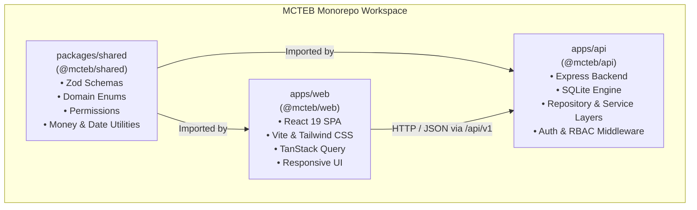
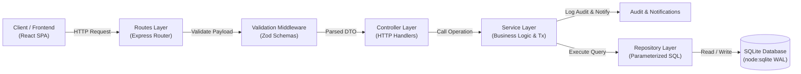

# System Architecture

## Municipal Community Tool and Equipment Bank (MCTEB)

**Municipality of Basco, Batanes**

---

## 1. System Mission & Context

The Municipal Community Tool and Equipment Bank (MCTEB) is a civic inventory, equipment rental, and asset preservation platform developed for the local government of Basco, Batanes. It facilitates the managed sharing of agricultural machinery, fishing implements, carpentry and construction equipment, electrical repair tools, and emergency storm-response gear across the six barangays of Basco.

The system is designed with specific operational priorities:

- **Offline / Local Resilience**: Operates reliably in an island environment with intermittent internet connectivity.
- **Relational Integrity**: Enforces strict foreign keys, atomic inventory adjustments, and status state machines.
- **Financial Precision**: Eliminates floating-point rounding errors by representing all monetary values as integer centavos.
- **Civic Governance**: Provides granular role-based access control, account lockout protection, and immutable audit logs.

---

## 2. Monorepo Organization

MCTEB is structured as a TypeScript monorepo orchestrated via `pnpm workspaces`:

### Workspace Packages

| Package         | Path              | Purpose                                                                                                                                                                                      |
| --------------- | ----------------- | -------------------------------------------------------------------------------------------------------------------------------------------------------------------------------------------- |
| `@mcteb/shared` | `packages/shared` | Authoritative domain contracts, Zod schemas, role-permission matrices, integer centavos currency utilities, and localized date formatters. Zero runtime dependencies other than `zod`.       |
| `@mcteb/api`    | `apps/api`        | Layered RESTful backend service built on Express.js and native Node.js SQLite (`node:sqlite`). Implements domain modules, authentication, rate limiting, and transactions.                   |
| `@mcteb/web`    | `apps/web`        | Single-page application built on React 19, TypeScript, Vite, Tailwind CSS, Lucide icons, and TanStack Query. Features dark/light mode, mobile responsive drawer, and role-scoped navigation. |

---

## 3. Layered Architectural Design

The backend application (`apps/api`) follows a strict separation of concerns:

### Layer Responsibilities

1. **Presentation Layer (`apps/web`)**:

   - Renders responsive screens, accessible modals, and status badges.
   - Manages client-side session state and theme context.
   - Queries backend endpoints via TanStack Query and centralized API client (`apps/web/src/lib/api.ts`).
   - Presentation-level input validation using React Hook Form and Zod.

2. **Routing & Middleware Layer (`apps/api/src/middleware`)**:

   - Enforces security headers via `helmet`.
   - Restricts cross-origin requests to configured origins via `cors`.
   - Throttles brute force attempts via `express-rate-limit`.
   - Authenticates sessions and verifies RBAC permissions via `auth.ts`.
   - Validates request payloads against shared Zod schemas before reaching controllers.
   - Centralizes error handling and sanitizes error responses.

3. **Controller Layer (`apps/api/src/modules/*/*.controller.ts`)**:

   - Parses HTTP requests and route parameters.
   - Delegates operations to domain services.
   - Translates domain responses into HTTP status codes and JSON payloads.
   - Contains no database queries or business transaction logic.

4. **Service Layer (`apps/api/src/modules/*/*.service.ts`)**:

   - Enforces municipal business rules (e.g., minimum 18-year-old borrower age, stock availability checks).
   - Coordinates atomic database transactions using `db.transaction()`.
   - Dispatches user notifications and writes immutable system audit records.
   - Completely decoupled from HTTP request/response objects.

5. **Repository Layer (`apps/api/src/modules/*/*.repository.ts`)**:

   - Executes parameterized SQLite statements.
   - Prevents SQL injection vulnerabilities.
   - Maps raw database rows to typed domain records.

6. **Database Engine (`apps/api/src/db/client.ts`)**:
   - Utilizes native Node.js SQLite (`node:sqlite DatabaseSync`).
   - Runs with Write-Ahead Logging (`WAL`), foreign keys enforced (`PRAGMA foreign_keys = ON`), and immediate busy timeout (`5000ms`).

---

## 4. Key Architectural Patterns

### 1. Integer Centavos Currency

To prevent IEEE 754 floating-point inaccuracies, all financial values (rental fees, deposit bonds, damage assessments, overdue penalties) are stored and computed as integers representing centavos (1 PHP = 100 centavos). Conversion to pesos and localized formatting occurs strictly at the presentation boundary via `@mcteb/shared/src/money.ts`.

### 2. Idempotent Data Management

Database migrations (`db/schema.sql`) and seed fixtures (`apps/api/src/db/seed/`) are fully idempotent. Re-running `db:migrate` or `db:seed` will not duplicate records, drop user tables, or corrupt existing relationships.

### 3. Explicit Demo Data Isolation

Demo records utilize deterministic identifier prefixes (`a0000000-...` for users, `b0000000-...` for equipment). The dedicated command `pnpm run db:reset-demo` cleans up only these designated demo records in exact reverse foreign-key order while preserving custom user data.
