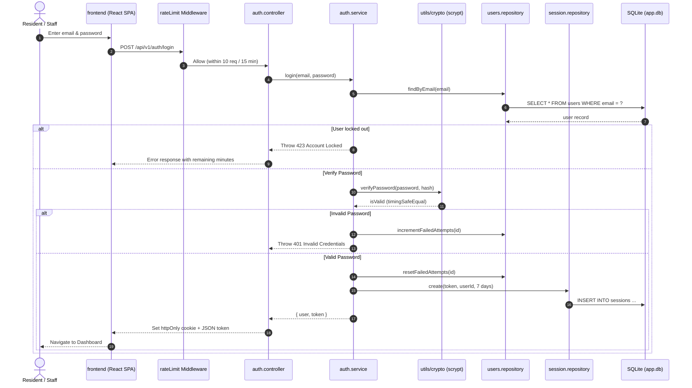
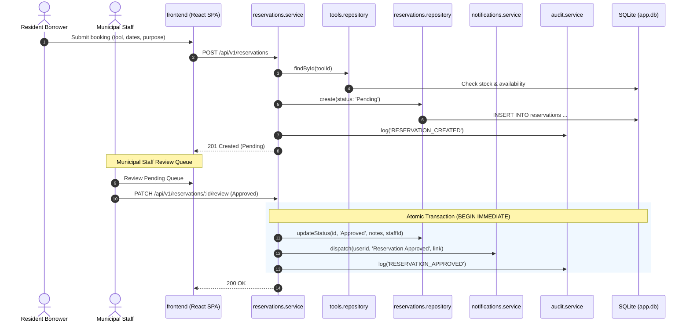
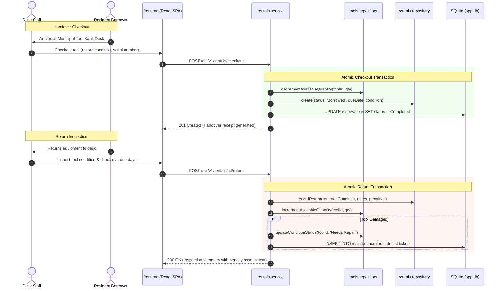
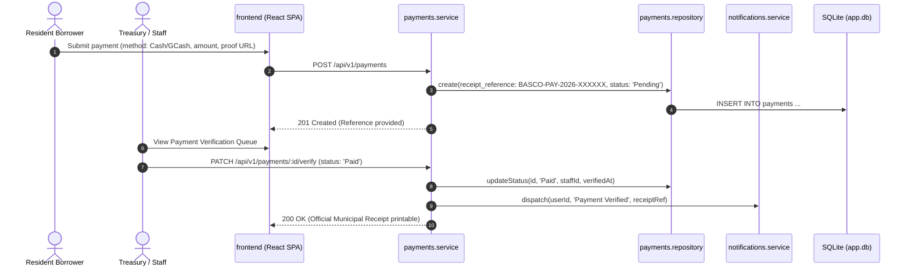

# Data Flow Documentation

This document diagrams the primary operational workflows and data transitions in the Municipal Community Tool and Equipment Bank (MCTEB).

---

## 1. Authentication & Session Flow

---

## 2. Reservation Lifecycle Flow

---

## 3. Physical Handover Checkout & Return Inspection Flow

---

## 4. Payment Submission & Treasury Verification Flow

