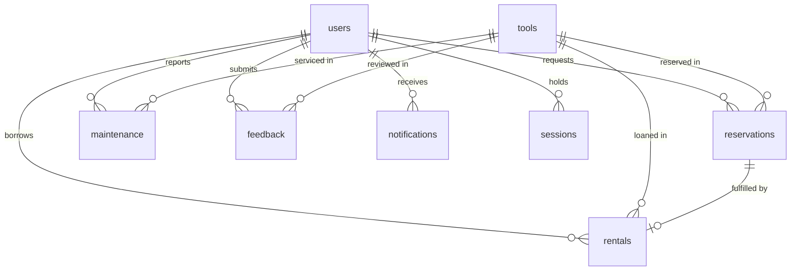

# Database Architecture & Technical Reference

## Municipal Community Tool and Equipment Bank (MCTEB)

**Database Engine**: SQLite 3 via Node.js Native Engine (`node:sqlite DatabaseSync`)  
**File Location**: `Database/app.db`  
**Authoritative DDL**: `backend/db/schema.sql`

---

## 1. Engine Configuration & Pragmas

The application establishes its database connection in `backend/db/client.ts` with the following performance and integrity pragmas:

```sql
PRAGMA journal_mode = WAL;
PRAGMA foreign_keys = ON;
PRAGMA busy_timeout = 5000;
PRAGMA synchronous = NORMAL;
```

### Purpose of Pragmas

- **`journal_mode = WAL`**: Write-Ahead Logging allows readers to execute concurrently without blocking writers, and writers do not block readers.
- **`foreign_keys = ON`**: SQLite disables foreign key validation by default; this pragma strictly prevents orphaned child records.
- **`busy_timeout = 5000`**: If an atomic write temporarily locks the database, subsequent queries wait up to 5,000 milliseconds before throwing a busy error.
- **`synchronous = NORMAL`**: Maximizes performance while maintaining crash resilience in WAL mode.

---

## 2. Entity-Relationship Overview



---

## 3. Core Relational Schema

### 1. `users`

Stores registered residents, equipment desk staff, and municipal administrators.

| Column                  | Type    | Constraints                | Description                                          |
| ----------------------- | ------- | -------------------------- | ---------------------------------------------------- |
| `id`                    | TEXT    | PRIMARY KEY                | UUID v4 identifier                                   |
| `full_name`             | TEXT    | NOT NULL                   | Resident full name                                   |
| `email`                 | TEXT    | NOT NULL, UNIQUE           | Login email address                                  |
| `password_hash`         | TEXT    | NOT NULL                   | Salted scrypt key hash                               |
| `phone`                 | TEXT    | NOT NULL                   | Contact telephone number                             |
| `birth_date`            | TEXT    | NOT NULL                   | ISO date (YYYY-MM-DD); enforced 18+                  |
| `barangay`              | TEXT    | NOT NULL                   | Basco barangay jurisdiction                          |
| `address`               | TEXT    | NOT NULL                   | Detailed residential street address                  |
| `role`                  | TEXT    | NOT NULL, CHECK            | `'Administrator'`, `'Municipal Staff'`, `'Borrower'` |
| `status`                | TEXT    | NOT NULL, DEFAULT 'Active' | `'Active'`, `'Pending Verification'`, `'Suspended'`  |
| `failed_login_attempts` | INTEGER | NOT NULL, DEFAULT 0        | Failed counter for account lockout                   |
| `lockout_until`         | TEXT    | NULLABLE                   | ISO timestamp blocking login attempts                |
| `created_at`            | TEXT    | NOT NULL                   | Record creation timestamp                            |
| `updated_at`            | TEXT    | NOT NULL                   | Record last modification timestamp                   |

### 2. `tools`

Municipal equipment catalog items and shelf stock.

| Column                | Type    | Constraints                   | Description                                                                                         |
| --------------------- | ------- | ----------------------------- | --------------------------------------------------------------------------------------------------- |
| `id`                  | TEXT    | PRIMARY KEY                   | UUID v4 identifier                                                                                  |
| `name`                | TEXT    | NOT NULL                      | Equipment title                                                                                     |
| `category`            | TEXT    | NOT NULL                      | Category (e.g. Agriculture, Carpentry, Electrical)                                                  |
| `description`         | TEXT    | NOT NULL                      | Equipment manual and operating description                                                          |
| `specifications`      | TEXT    | NULLABLE                      | JSON string with technical specifications                                                           |
| `availability_status` | TEXT    | NOT NULL, DEFAULT 'Available' | `'Available'`, `'Reserved'`, `'Borrowed'`, `'Returned'`, `'Maintenance'`, `'Damaged'`, `'Archived'` |
| `condition_status`    | TEXT    | NOT NULL, DEFAULT 'Good'      | `'Excellent'`, `'Good'`, `'Fair'`, `'Needs Repair'`, `'Under Maintenance'`                          |
| `total_quantity`      | INTEGER | NOT NULL, DEFAULT 1           | Total inventory units acquired                                                                      |
| `available_quantity`  | INTEGER | NOT NULL, DEFAULT 1           | Units currently unreserved on shelf                                                                 |
| `serial_number`       | TEXT    | NULLABLE                      | Manufacturer serial number                                                                          |
| `image_url`           | TEXT    | NULLABLE                      | Equipment photo URL or illustration key                                                             |
| `images_json`         | TEXT    | NULLABLE                      | JSON array of up to 5 uploaded equipment images                                                     |
| `owner_id`            | TEXT    | NULLABLE, REFERENCES users(id)| Community uploader ID (null for municipal inventory)                                                |

### 3. `reservations`

Advance booking requests submitted by residents.

| Column        | Type    | Constraints                    | Description                                                           |
| ------------- | ------- | ------------------------------ | --------------------------------------------------------------------- |
| `id`          | TEXT    | PRIMARY KEY                    | UUID v4 identifier                                                    |
| `user_id`     | TEXT    | NOT NULL, REFERENCES users(id) | Borrower making the reservation                                       |
| `tool_id`     | TEXT    | NOT NULL, REFERENCES tools(id) | Equipment being booked                                                |
| `quantity`    | INTEGER | NOT NULL, DEFAULT 1            | Units requested                                                       |
| `pickup_date` | TEXT    | NOT NULL                       | Requested start date (YYYY-MM-DD)                                     |
| `return_date` | TEXT    | NOT NULL                       | Requested return date (YYYY-MM-DD)                                    |
| `purpose`     | TEXT    | NULLABLE                       | Civic or personal project purpose                                     |
| `status`      | TEXT    | NOT NULL, DEFAULT 'Pending'    | `'Pending'`, `'Approved'`, `'Rejected'`, `'Cancelled'`, `'Completed'` |
| `staff_notes` | TEXT    | NULLABLE                       | Review comments or rejection reason                                   |
| `reviewed_by` | TEXT    | NULLABLE, REFERENCES users(id) | Staff member reviewing request                                        |
| `reviewed_at` | TEXT    | NULLABLE                       | Decision timestamp                                                    |

### 4. `rentals`

Active and historic equipment loans executed at the physical municipal desk.

| Column               | Type    | Constraints                           | Description                                                          |
| -------------------- | ------- | ------------------------------------- | -------------------------------------------------------------------- |
| `id`                 | TEXT    | PRIMARY KEY                           | UUID v4 identifier                                                   |
| `reservation_id`     | TEXT    | NULLABLE, REFERENCES reservations(id) | Originating reservation                                              |
| `user_id`            | TEXT    | NOT NULL, REFERENCES users(id)        | Borrower taking physical possession                                  |
| `tool_id`            | TEXT    | NOT NULL, REFERENCES tools(id)        | Equipment released                                                   |
| `quantity`           | INTEGER | NOT NULL, DEFAULT 1                   | Quantity released                                                    |
| `due_date`           | TEXT    | NOT NULL                              | Handover deadline date (YYYY-MM-DD)                                  |
| `returned_at`        | TEXT    | NULLABLE                              | Actual check-in timestamp                                            |
| `status`             | TEXT    | NOT NULL, DEFAULT 'Borrowed'          | `'Pending'`, `'Reserved'`, `'Borrowed'`, `'Returned'`, `'Completed'` |
| `initial_condition`  | TEXT    | NOT NULL                              | Condition checked during release                                     |
| `returned_condition` | TEXT    | NULLABLE                              | Condition checked during return                                      |
| `inspection_notes`   | TEXT    | NULLABLE                              | Defects or scratches observed                                        |
| `released_by`        | TEXT    | NULLABLE, REFERENCES users(id)        | Desk staff releasing equipment                                       |
| `received_by`        | TEXT    | NULLABLE, REFERENCES users(id)        | Desk staff receiving equipment                                       |

### 5. `maintenance`

Equipment repair tickets and maintenance board.

| Column              | Type | Constraints                      | Description                                                                     |
| ------------------- | ---- | -------------------------------- | ------------------------------------------------------------------------------- |
| `id`                | TEXT | PRIMARY KEY                      | UUID v4 identifier                                                              |
| `tool_id`           | TEXT | NOT NULL, REFERENCES tools(id)   | Equipment requiring repair                                                      |
| `rental_id`         | TEXT | NULLABLE, REFERENCES rentals(id) | Related rental where damage occurred                                            |
| `reported_by`       | TEXT | NOT NULL, REFERENCES users(id)   | Staff or borrower reporting defect                                              |
| `issue_description` | TEXT | NOT NULL                         | Description of malfunction or defect                                            |
| `severity`          | TEXT | NOT NULL                         | `'Minor'`, `'Moderate'`, `'Severe'`, `'Critical'`                               |
| `status`            | TEXT | NOT NULL, DEFAULT 'Reported'     | `'Reported'`, `'Scheduled'`, `'In Progress'`, `'Completed'`, `'Decommissioned'` |
| `technician_name`   | TEXT | NULLABLE                         | Municipal technician or contractor                                              |
| `resolution_notes`  | TEXT | NULLABLE                         | Summary of repairs performed                                                    |

### 6. `feedback`

Post-loan ratings and community reviews.

| Column                  | Type    | Constraints                      | Description                    |
| ----------------------- | ------- | -------------------------------- | ------------------------------ |
| `id`                    | TEXT    | PRIMARY KEY                      | UUID v4 identifier             |
| `user_id`               | TEXT    | NOT NULL, REFERENCES users(id)   | Reviewer resident              |
| `tool_id`               | TEXT    | NOT NULL, REFERENCES tools(id)   | Reviewed equipment             |
| `rental_id`             | TEXT    | NULLABLE, REFERENCES rentals(id) | Loan reference                 |
| `overall_rating`        | INTEGER | CHECK (BETWEEN 1 AND 5)          | General experience star rating |
| `tool_condition_rating` | INTEGER | CHECK (BETWEEN 1 AND 5)          | Physical condition rating      |
| `service_rating`        | INTEGER | CHECK (BETWEEN 1 AND 5)          | Municipal staff service rating |
| `comments`              | TEXT    | NOT NULL                         | Narrative review               |
| `is_public`             | INTEGER | CHECK IN (0, 1)                  | Moderation visibility flag     |

### 7. `notifications`

Direct alerts and reminders for residents.

| Column     | Type    | Constraints                    | Description                                    |
| ---------- | ------- | ------------------------------ | ---------------------------------------------- |
| `id`       | TEXT    | PRIMARY KEY                    | UUID v4 identifier                             |
| `user_id`  | TEXT    | NOT NULL, REFERENCES users(id) | Recipient resident                             |
| `title`    | TEXT    | NOT NULL                       | Alert subject                                  |
| `message`  | TEXT    | NOT NULL                       | Detailed notification body                     |
| `type`     | TEXT    | NOT NULL                       | `'info'`, `'success'`, `'warning'`, `'danger'` |
| `link_url` | TEXT    | NULLABLE                       | Deep link to reservation, loan, or catalog item|
| `is_read`  | INTEGER | CHECK IN (0, 1)                | Read / Unread status flag                      |

### 8. `audit_logs`

Immutable record of all state transitions and security events.

| Column        | Type | Constraints                    | Description                                     |
| ------------- | ---- | ------------------------------ | ----------------------------------------------- |
| `id`          | TEXT | PRIMARY KEY                    | UUID v4 identifier                              |
| `actor_id`    | TEXT | NULLABLE, REFERENCES users(id) | User initiating action                          |
| `actor_name`  | TEXT | NOT NULL                       | Actor display name                              |
| `action`      | TEXT | NOT NULL                       | Event code (e.g. `USER_LOGIN`, `TOOL_ARCHIVED`) |
| `target_type` | TEXT | NOT NULL                       | Target entity type (e.g. `tool`, `rental`)      |
| `target_id`   | TEXT | NOT NULL                       | Target record identifier                        |
| `details`     | TEXT | NULLABLE                       | Contextual details or state changes             |
| `ip_address`  | TEXT | NULLABLE                       | Client IP address                               |

### 9. `sessions`

Server-side active authentication sessions.

| Column       | Type | Constraints                    | Description                                   |
| ------------ | ---- | ------------------------------ | --------------------------------------------- |
| `token`      | TEXT | PRIMARY KEY                    | Cryptographically secure random session token |
| `user_id`    | TEXT | NOT NULL, REFERENCES users(id) | Authenticated user                            |
| `expires_at` | TEXT | NOT NULL                       | Expiration timestamp (default: 7 days)        |

---

## 4. Backup & Restoration Procedures

### Online Hot Backups

MCTEB supports online hot database backups without terminating the server process using SQLite's native `VACUUM INTO` command:

```bash
pnpm run db:backup
```

This writes an atomic, defragmented snapshot into `Database/backups/mcteb-backup-<timestamp>.db`.

### Database Restoration

To restore from a backup:

1. Stop the application server (`Development/scripts/stop.bat` or `Ctrl+C`).
2. Copy the desired backup snapshot over `Database/app.db`:
   ```powershell
   Copy-Item Database/backups/mcteb-backup-YYYY-MM-DD.db Database/app.db -Force
   ```
3. Restart the application:
   ```bash
   pnpm run dev
   ```
