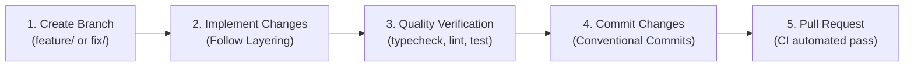

# Development Guidelines & Engineering Workflow

This document establishes the daily engineering workflow, git conventions, commit message standards, and code review criteria for contributors to MCTEB.

---

## 1. Daily Developer Workflow



### Typical Daily Commands

```bash
# Check code formatting
pnpm run format:check

# Auto-format files
pnpm run format

# Run TypeScript static type checking
pnpm run typecheck

# Run ESLint analysis
pnpm run lint

# Run all test suites
pnpm run test
```

---

## 2. Git Branching Strategy

- **`main`**: Protected branch representing stable, production-ready code. Direct pushes are restricted.
- **Feature Branches**: Branch off `main` using standard naming:
  - `feature/<module-name>-<short-description>` (e.g., `feature/reservations-date-picker`)
  - `fix/<issue-description>` (e.g., `fix/currency-rounding-centavos`)
  - `docs/<doc-name>` (e.g., `docs/api-specification-update`)
  - `refactor/<target>` (e.g., `refactor/ts-controller-types`)

---

## 3. Conventional Commit Standards

MCTEB enforces Conventional Commits via Husky and Commitlint (`commitlint.config.cjs`). Commits that violate this structure are rejected by pre-commit hooks.

### Structure

```text
<type>(<scope>): <short imperative summary>

[optional body explaining context and rationale]

[optional footer referencing issue or breaking changes]
```

### Allowed Types

- **`feat`**: A new user-facing feature or API capability.
- **`fix`**: A bug fix.
- **`docs`**: Documentation updates or additions.
- **`refactor`**: Code restructuring without changing behavior or adding features.
- **`test`**: Adding or updating unit/integration test suites.
- **`chore`**: Maintenance tasks, dependency updates, build tooling.
- **`perf`**: Performance optimizations.

### Example Commit Messages

```bash
git commit -m "feat(backend): add minimum 18-year age validation for borrower registration"
git commit -m "fix(frontend): prevent duplicate reservation modal submission"
git commit -m "docs(architecture): add database schema and indexing reference"
git commit -m "test(backend): add RBAC forbidden access integration test"
```

---

## 4. Pull Request Checklist

Before submitting a Pull Request for review, verify all four quality gates:

- [ ] **Typecheck**: `pnpm run typecheck` passes with zero errors.
- [ ] **Lint**: `pnpm run lint` completes with zero errors.
- [ ] **Formatting**: `pnpm run format:check` reports all files matching Prettier styling.
- [ ] **Tests**: `pnpm run test` executes successfully across all workspace packages.
- [ ] **Documentation**: If architecture, APIs, or database schemas changed, corresponding docs in `Development/Documentation/` are updated.
- [ ] **No Generated Artifacts**: No compiled `.js`, `.d.ts`, or `.map` files are committed inside `src/` directories.
