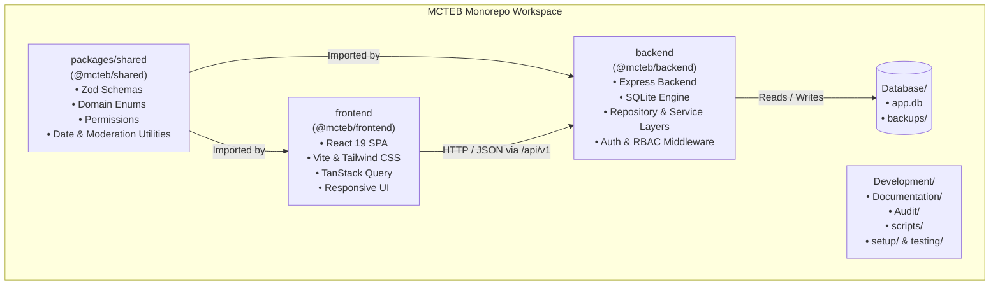

# System Overview

## Municipal Community Tool and Equipment Bank (MCTEB)

**Municipality of Basco, Province of Batanes**

---

## 1. Executive Summary & Purpose

The Municipal Community Tool and Equipment Bank (MCTEB) is a standardized, TypeScript-driven civic resource platform developed for the local government of Basco, Batanes. It enables residents across the six barangays of Basco (Chanarian, Ihubok I, Ihubok II, Kayhuvokan, San Antonio, and San Joaquin) to discover, reserve, and borrow shared agricultural machinery, fishing gear, carpentry and construction equipment, electrical repair tools, and emergency storm-response implements.

### Core Priorities:

- **Island Environment Resilience**: Operates reliably in an isolated island province prone to typhoon disruptions and intermittent connectivity, leveraging local-first Node.js SQLite with Write-Ahead Logging (`WAL`).
- **Relational Integrity**: Enforces strict foreign keys, atomic inventory adjustments, and status transition state machines across the entire loan lifecycle.
- **Civic Governance**: Granular role-based access control (RBAC), self-lockout safeguards, immutable audit logging, and transparent equipment custody tracking.

---

## 2. Monorepo Organization

MCTEB is structured as a TypeScript monorepo orchestrated via `pnpm workspaces`:

### Workspace Directory Structure

| Package / Directory | Path              | Responsibility                                                                                                                                                                               |
| ------------------- | ----------------- | -------------------------------------------------------------------------------------------------------------------------------------------------------------------------------------------- |
| `@mcteb/shared`     | `packages/shared` | Authoritative domain contracts, Zod schemas, role-permission matrices, image moderation utilities, and localized date formatters. Zero runtime dependencies other than `zod`.                |
| `@mcteb/backend`    | `backend`         | Layered RESTful backend service built on Express.js and native Node.js SQLite (`node:sqlite`). Implements domain modules, authentication, rate limiting, and atomic database operations.    |
| `@mcteb/frontend`   | `frontend`        | Single-page application built on React 19, TypeScript, Vite, Tailwind CSS, Lucide icons, and TanStack Query. Features dark/light mode, mobile responsive drawer, and role-scoped navigation. |
| `Database/`         | `Database`        | Dedicated data directory housing the live SQLite database (`Database/app.db`) and hot backup snapshots (`Database/backups/`).                                                                |
| `Development/`      | `Development`     | Centralized developer ecosystem housing technical documentation, audit reports, cross-platform scripts (`.bat`, `.ps1`, `.sh`), setup guides, and coding standards.                          |

---

## 3. Core Functional Domains

The platform encapsulates nine primary domain modules:

1. **Authentication & Identity (`backend/src/controllers/auth.controller.ts`, `services/auth.service.ts`)**:

   - Municipal borrower registration enforcing minimum 18-year-old eligibility and Basco barangay residence.
   - Cryptographic password hashing with `node:crypto` scrypt and cryptographic salt.
   - HTTP-only cookie and bearer token session management.
   - Brute-force protection: 15-minute account lockout upon 5 consecutive failed attempts.

2. **Equipment Catalog & Inventory (`backend/src/controllers/tools.controller.ts`, `services/tools.service.ts`)**:

   - Searchable, category-filtered municipal equipment registry (Agriculture, Construction, Fishing, Electrical, Mechanical, Emergency Response).
   - Real-time tracking of total versus available quantities.
   - Community-shared equipment support enabling borrowers to contribute and manage their own tools.

3. **Reservations Queue (`backend/src/controllers/reservations.controller.ts`, `services/reservations.service.ts`)**:

   - Resident advance booking requests with pickup/return scheduling.
   - Date conflict detection and concurrent availability checks.
   - Staff review queue: approval, rejection with municipal rationale, borrower cancellation.

4. **Rental Desk Handover & Return (`backend/src/controllers/rentals.controller.ts`, `services/rentals.service.ts`)**:

   - Physical equipment release by municipal desk staff upon identity verification.
   - Return intake inspection: condition assessment (Excellent, Good, Fair, Needs Repair, Under Maintenance).
   - Atomic inventory incrementation upon return.

5. **Equipment Maintenance Board (`backend/src/controllers/maintenance.controller.ts`, `services/maintenance.service.ts`)**:

   - Defect ticketing by staff or upon damaged tool return.
   - Severity tracking: Minor, Moderate, Severe, Critical.
   - Automatic removal of maintenance-flagged equipment from public borrowable inventory.
   - Repair logging with technician assignments and return-to-service certification.

6. **Community Feedback & Moderation (`backend/src/controllers/feedback.controller.ts`, `services/feedback.service.ts`)**:

   - 3-axis post-rental resident feedback (Equipment Condition, Staff Service, Overall Experience).
   - Public review feed with resident name privacy protection.
   - Staff moderation controls.

7. **Notification Dispatch (`backend/src/controllers/notifications.controller.ts`, `services/notifications.service.ts`)**:

   - In-app alerts for reservation approvals/rejections, upcoming return deadlines, and overdue reminders.
   - Read/unread indicators and direct resource deep-linking.

8. **Security Audit Log (`backend/src/controllers/audit.controller.ts`, `services/audit.service.ts`)**:

   - Immutable security trail recording every administrative action, handover, return, and user update with actor ID, IP address, and metadata.

9. **Administrative Perimeter (`backend/src/admin/`)**:
   - Dedicated, isolated route perimeter (`/api/v1/admin`) strictly gated to the `Administrator` role.
   - System health overview, user role modifications, and system-wide activity monitoring.

---

## 4. Architectural Principles

- **Separation of Concerns**: Request parsing, business rules, database operations, and SQL statements are isolated into controllers, services, repositories, and models.
- **Atomic State Transitions**: Multi-row operations (e.g. tool return + rental status update + stock adjustment + audit log) execute inside atomic SQLite blocks (`db.atomic()`).
- **Zero External Database Drivers**: Runs on Node.js 20+ built-in `node:sqlite` (`DatabaseSync`), eliminating node-gyp and native build toolchain dependencies on developer machines.
- **Local Hot Backups**: Automated online snapshots using SQLite's native `VACUUM INTO` command via `pnpm run db:backup`.
