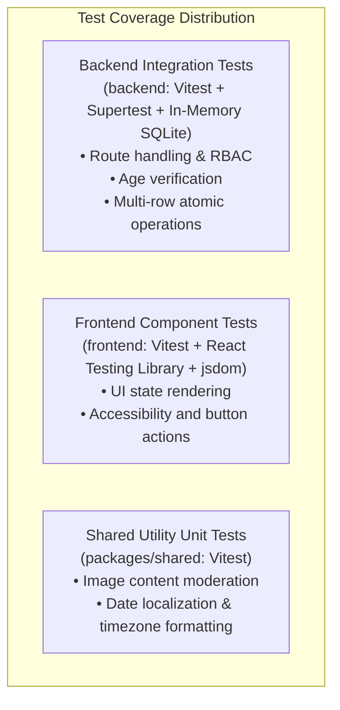

# Testing Guidelines & Test Suite Reference

This document outlines the testing strategy, test runner configuration, and conventions for authoring automated tests in MCTEB.

---

## 1. Testing Strategy

MCTEB implements a multi-tier automated test suite covering all three monorepo packages:



---

## 2. Running Test Suites

### Run All Tests Across Monorepo

```bash
pnpm run test
```

### Run Tests for Specific Packages

```bash
# Shared package tests
pnpm --filter @mcteb/shared test

# Backend API integration tests
pnpm --filter @mcteb/backend test

# Frontend React component tests
pnpm --filter @mcteb/frontend test
```

---

## 3. Backend Integration Testing (`backend/src/app.test.ts`)

Backend integration tests execute against the full Express middleware stack, using an initialized SQLite database with migrations and demo fixtures.

### Key Test Scenarios Covered

1. **Health Verification**: `GET /health` returns `200 OK` with status and timestamp.
2. **Public Catalog Access**: `GET /api/v1/tools` returns public catalog equipment items without authentication.
3. **Municipal Policy Guard**: `POST /api/v1/auth/register` rejects applicants under 18 years of age with `400 Bad Request`.
4. **Credential Verification**: `POST /api/v1/auth/login` verifies scrypt password hashing for seeded demo accounts.
5. **RBAC Isolation (IDOR / Privilege Boundary)**: Verifies that Borrowers cannot access the administrative user list (`/api/v1/users`), returning `403 Forbidden`.
6. **Administrator Access**: Verifies that Administrators can successfully query the user registry.
7. **Not Found Handling**: Verifies unmapped routes return standardized `404 Not Found` JSON errors.

---

## 4. Frontend Component Testing (`frontend/src/**/*.test.tsx`)

Frontend tests utilize Vitest configured with the `jsdom` environment and `@testing-library/react`.

### Component Test Example (`Button.test.tsx`)

```tsx
import { describe, it, expect } from 'vitest';
import { render, screen } from '@testing-library/react';
import React from 'react';
import { Button } from './Button.js';

describe('Button component', () => {
  it('renders children correctly', () => {
    render(<Button>Click me</Button>);
    expect(screen.getByRole('button', { name: /click me/i })).toBeDefined();
  });

  it('renders disabled state when isLoading is true', () => {
    render(<Button isLoading>Submitting</Button>);
    const button = screen.getByRole('button', { name: /submitting/i });
    expect(button.hasAttribute('disabled')).toBe(true);
  });
});
```

---

## 5. Shared Utility Unit Testing (`packages/shared/src/**/*.test.ts`)

Validates pure functional rules, image moderation, and date parsing (`packages/shared/src/image-moderation.test.ts`).
