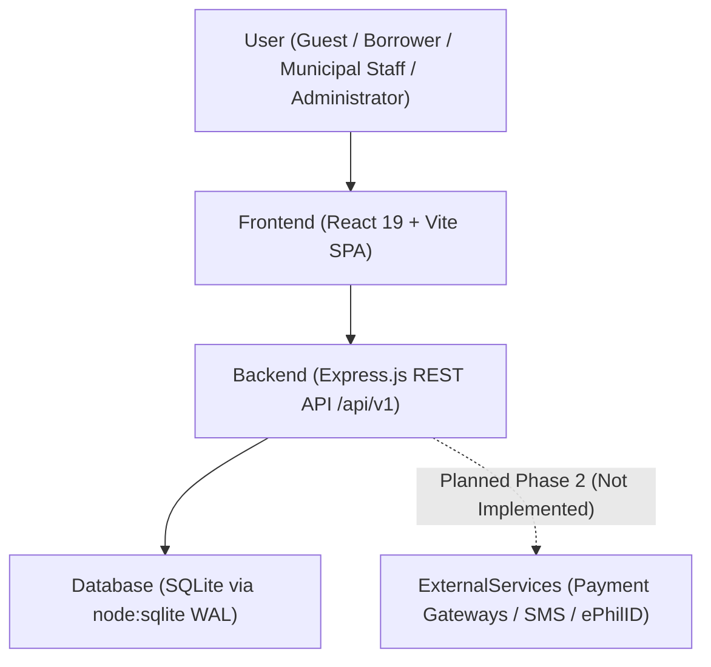
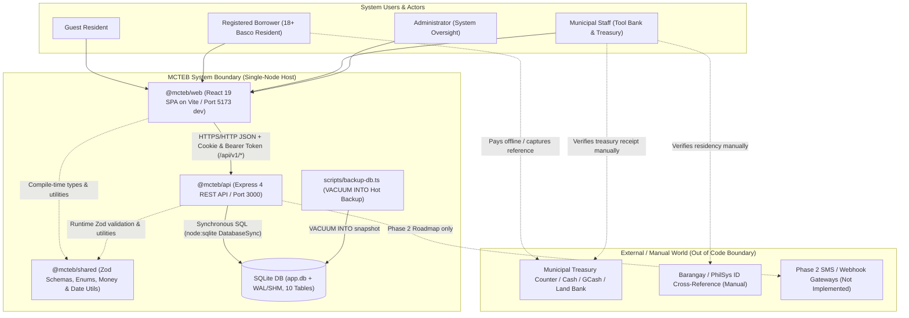

# 01 — System Overview

> **Epistemic Classification Legend**
> - `[Verified from source code]` — Directly observed in repository files, schemas, configurations, or tool outputs.
> - `[Inferred from architecture]` — Logically deduced from codebase structure, middleware order, or runtime behavior.
> - `[Assumption requiring validation]` — Organizational, municipal policy, or operational assumption not codified in source code.

---

## Table of Contents

- [1. Executive Summary](#1-executive-summary)
- [2. Purpose](#2-purpose)
- [3. Scope](#3-scope)
- [4. Key Components](#4-key-components)
- [5. Architecture Diagrams](#5-architecture-diagrams)
  - [5.1 Required High-Level Context Diagram](#51-required-high-level-context-diagram)
  - [5.2 Expanded MCTEB System Context & Boundary Diagram](#52-expanded-mcteb-system-context--boundary-diagram)
- [6. Technical Details & Detailed Analysis](#6-technical-details--detailed-analysis)
  - [6.1 Business Purpose & Problem Solved](#61-business-purpose--problem-solved)
  - [6.2 Major Users & Actor Profiles](#62-major-users--actor-profiles)
  - [6.3 Primary Features & Domain Capabilities](#63-primary-features--domain-capabilities)
  - [6.4 Technology Stack Summary](#64-technology-stack-summary)
  - [6.5 Major Integrations & Current Boundaries](#65-major-integrations--current-integrations)
  - [6.6 Source Code Evidence & Discrepancies](#66-source-code-evidence--discrepancies)
- [7. Findings](#7-findings)
- [8. Risks](#8-risks)
- [9. Recommendations](#9-recommendations)
- [10. Future Enhancements](#10-future-enhancements)
- [11. References to Source Files & Cross-References](#11-references-to-source-files--cross-references)

---

## 1. Executive Summary

The **Municipal Community Tool and Equipment Bank (MCTEB)** — hosted in repository `MCTED` — is a full-stack TypeScript civic web platform built for the **Municipality of Basco, Province of Batanes, Philippines** (`[Verified from source code]`, `README.md`, `package.json`). It enables verified adult residents (18+ years old) across Basco's six barangays to browse shared municipal equipment, request advance reservations, pay rental fees and refundable security deposits, check out and return equipment under staff inspection, submit multi-axis reviews, and track transaction alerts (`[Verified from source code]`).

The system is architected as a **pnpm workspace monorepo** (`pnpm@12.15.0`) containing three workspace packages:
1. `@mcteb/web` (`apps/web`): A React 19 Single-Page Application (SPA) compiled with Vite 6 and styled with Tailwind CSS (`[Verified from source code]`).
2. `@mcteb/api` (`apps/api`): A layered Express 4 REST API server written in TypeScript, using Node.js's built-in `node:sqlite` (`DatabaseSync`) embedded database engine in Write-Ahead Logging (`WAL`) mode (`[Verified from source code]`, `apps/api/src/db/client.ts`).
3. `@mcteb/shared` (`packages/shared`): A shared contracts library providing Zod validation schemas, domain enums, an RBAC permissions matrix, integer-centavo Philippine Peso (`PHP`) formatting utilities, and `Asia/Manila` date formatting utilities (`[Verified from source code]`).

Currently, the system operates as a self-contained single-node modular monolith with **zero external runtime service integrations** (no live payment gateway webhooks, no SMS/email providers, and no external OAuth identity providers) (`[Verified from source code]`).

---

## 2. Purpose

This document establishes the top-level architectural baseline for MCTEB (`MCTED`), defining its civic business purpose, problem domain, user personas, functional scope, technology stack, external integration posture, and system boundaries for engineering onboarding, municipal stakeholder review, audits, and system modernization.

---

## 3. Scope

This overview covers:
- The complete `MCTED` repository at `c:/Users/USER/Documents/GitHub/MCTED` (`[Verified from source code]`).
- All three monorepo workspaces (`apps/web`, `apps/api`, `packages/shared`) plus authoritative schema (`db/schema.sql`), scripts (`scripts/backup-db.ts`), and project documentation (`docs/`, `README.md`, `PROJECT_PLAN.md`, `report.md`) (`[Verified from source code]`).
- Both verified implemented capabilities and documented discrepancies between existing docs (`README.md`, `docs/adr/0001-sqlite-storage-engine.md`) and runtime source code (`[Verified from source code]`).

---

## 4. Key Components

| Component | Location | Responsibility | Verification Status |
|---|---|---|---|
| **Frontend SPA (`@mcteb/web`)** | `apps/web/src/` | Role-aware UI shell, public equipment catalog, borrower portals, staff operational consoles, admin oversight screens | `[Verified from source code]` |
| **Backend REST API (`@mcteb/api`)** | `apps/api/src/` | HTTP routing (`/api/v1/*`, `/health`), rate limiting, session authentication, RBAC/IDOR checks, transactional business services, parameterized SQLite repositories | `[Verified from source code]` |
| **Shared Contracts (`@mcteb/shared`)** | `packages/shared/src/` | Canonical Zod schemas, enums, role permissions table, centavo money helpers, `Asia/Manila` date helpers | `[Verified from source code]` |
| **SQLite Embedded Database** | `db/schema.sql`, `apps/api/src/db/client.ts` | 9 authoritative tables + 1 runtime `sessions` table, 17 indexes, `WAL` journaling, `foreign_keys = ON`, `BEGIN IMMEDIATE` atomic transactions | `[Verified from source code]` |
| **Operations & Backup Script** | `scripts/backup-db.ts` | Hot SQLite backup via `VACUUM INTO` using `node:sqlite` | `[Verified from source code]` |

---

## 5. Architecture Diagrams

### 5.1 Required High-Level Context Diagram



*(Note: `[Verified from source code]` — The link from `Backend` to `ExternalServices` is shown as dashed because no external network integrations exist in the current implementation; payment verification, identity verification, and notifications are currently internal/manual.)*

### 5.2 Expanded MCTEB System Context & Boundary Diagram



---

## 6. Technical Details & Detailed Analysis

### 6.1 Business Purpose & Problem Solved

- **Civic Problem Addressed**: Residents of Basco, Batanes (an island municipality) require intermittent access to specialized agricultural, fishery, carpentry, construction, electrical, and emergency-response equipment (such as hand tillers, water pumps, concrete mixers, circular saws, backpack sprayers, marine GPS units, and portable generators) without bearing full ownership and maintenance costs (`[Verified from source code]`, `README.md`, `apps/api/src/db/seed/fixtures/index.ts`, `DashboardPage.tsx` line 281).
- **Operational Solution**: MCTEB centralizes catalog discovery, conflict-checked advance reservations, municipal staff review queues, physical handover/return condition inspections, penalty assessment, payment submission and municipal treasury verification with printable official receipts, defect/maintenance tracking, resident feedback moderation, and immutable audit logging (`[Verified from source code]`, `PROJECT_PLAN.md`, `report.md`).
- **Financial Precision Policy**: All fees, refundable deposits, overdue penalties, damage penalties, and repair costs are stored and computed in integer centavos (`1 PHP = 100 centavos`) to eliminate IEEE-754 floating-point rounding anomalies (`[Verified from source code]`, `packages/shared/src/money.ts`, `docs/adr/0002-integer-centavos-currency.md`).

### 6.2 Major Users & Actor Profiles

Defined in `packages/shared/src/enums.ts` (`UserRoleSchema`) and `packages/shared/src/permissions.ts` (`[Verified from source code]`):

1. **Guest (Unauthenticated)**: Can browse the public equipment catalog (`GET /api/v1/tools`, `GET /api/v1/tools/:id`), view public borrower reviews with masked reviewer surnames (`GET /api/v1/feedback/public`), and register/sign in (`[Verified from source code]`).
2. **Borrower (`Borrower`)**: Self-registered verified resident (must be >= 18 years old per `AuthService.register`). Can submit/cancel reservations, view own rentals, submit payment records, view official receipts, post 3-axis tool feedback, manage profile contact details, and manage personal notifications (`[Verified from source code]`).
3. **Municipal Staff (`Municipal Staff`)**: Operational personnel provisioned by an Administrator. Reviews pending reservations (`Approve`/`Reject`), processes physical handovers (`checkout`) and return inspections (`return`), verifies or declines payments (`Paid`/`Failed`/`Refunded`), manages catalog tool inventory (`POST`/`PATCH`/`archive`), manages maintenance tickets, and moderates feedback visibility (`[Verified from source code]`).
4. **Administrator (`Administrator`)**: Inherits all `Municipal Staff` operational capabilities plus full user account oversight (`GET /api/v1/users`, `PATCH /api/v1/users/:id/status`, `PATCH /api/v1/users/:id/role`) and read access to the immutable system audit log (`GET /api/v1/audit`) (`[Verified from source code]`).

### 6.3 Primary Features & Domain Capabilities

Mapped directly from `apps/api/src/app.ts` (lines 93–102) and `apps/web/src/app/routes.tsx` (`[Verified from source code]`):

| Domain Module | Backend Route Prefix | Frontend Feature Pages / Modals | Core Capabilities |
|---|---|---|---|
| **Authentication & Sessions** | `/api/v1/auth` | `LoginPage.tsx`, `RegisterPage.tsx` | Registration with 18+ age check, scrypt password hashing, 5-attempt / 15-min lockout, 7-day stateful DB sessions |
| **User Oversight & Profiles** | `/api/v1/users` | `ProfilePage.tsx`, `UsersPage.tsx` | Profile updates with IDOR checks, admin status/role management, self-suspension & last-admin safeguards |
| **Equipment Catalog & Inventory** | `/api/v1/tools` | `CatalogPage.tsx`, `ToolDetailPage.tsx`, `InventoryPage.tsx`, `ToolFormModal.tsx` | Search/category filtering, pagination, stock & condition tracking, safe archival (`available_quantity < total_quantity` guard) |
| **Reservations** | `/api/v1/reservations` | `MyReservationsPage.tsx`, `ReservationFormModal.tsx`, `ReservationQueuePage.tsx` | Date overlap & stock conflict checking, pending/approved/rejected/cancelled/completed lifecycle |
| **Rentals & Inspections** | `/api/v1/rentals` | `MyRentalsPage.tsx`, `RentalDeskPage.tsx`, `ReturnInspectionModal.tsx` | Atomic checkout (`available_quantity` decrement), return condition inspection, overdue/damage penalty capture |
| **Payments & Official Receipts** | `/api/v1/payments` | `MyPaymentsPage.tsx`, `PaymentVerificationPage.tsx`, `OfficialReceiptModal.tsx` | `BASCO-PAY-YYYY-XXXXXX` receipt reference generation, manual treasury verification, printable receipt |
| **Maintenance Board** | `/api/v1/maintenance` | `MaintenancePage.tsx`, `MaintenanceReportModal.tsx` | Defect tickets (`Minor`/`Moderate`/`Severe`/`Critical`), auto-offline for Severe/Critical, return-to-service restoration |
| **Community Feedback** | `/api/v1/feedback` | `FeedbackPage.tsx`, `SubmitFeedbackModal.tsx` | 3-axis 1–5 ratings, dynamic surname privacy masking (`FirstName L.`), staff moderation (`is_public`) |
| **Notifications** | `/api/v1/notifications` | `NotificationsPage.tsx` | Chronological in-app alerts, mark read, mark all read |
| **Audit Trail** | `/api/v1/audit` | `AuditLogPage.tsx` | Immutable audit rows (`actor_id`, `action`, `target_type`, `target_id`, `details`, `ip_address`) |

### 6.4 Technology Stack Summary

Directly extracted from `package.json`, `apps/api/package.json`, `apps/web/package.json`, and `packages/shared/package.json` (`[Verified from source code]`):

- **Runtime & Package Manager**: Node.js (`engines.node: ">=20"` in `package.json`, `.nvmrc: 20`; however `node:sqlite` requires **Node.js >= 22.5.0** `[Verified from source code]`), `pnpm@12.15.0` workspaces, TypeScript `5.8.3`.
- **Backend**: `express@^4.21.2`, `node:sqlite` (`DatabaseSync`), `zod@^3.23.8`, `helmet@^8.0.0`, `cors@^2.8.5`, `cookie-parser@^1.4.7`, `express-rate-limit@^7.5.0`, `pino@^9.6.0`, `pino-http@^10.4.0`, `dotenv@^16.4.7`.
- **Frontend**: `react@^19.0.0`, `react-dom@^19.0.0`, `react-router-dom@^7.1.5`, `vite@^6.1.0`, `tailwindcss@^3.4.17`, `lucide-react@^0.475.0`, `clsx@^2.1.1`, `tailwind-merge@^3.0.1`, `@tanstack/react-query@^5.66.0` (provider mounted, hooks unused), `react-hook-form@^7.54.2` (unused).
- **Quality & Testing**: `vitest@^3.0.5`, `supertest@^7.0.0`, `@testing-library/react@^16.2.0` (no web tests written), `eslint@9.27.0`, `prettier@3.5.3`, `husky@9.1.7`, `lint-staged@15.5.2`, `@commitlint/cli@19.8.1`.

### 6.5 Major Integrations

- **Current State (`[Verified from source code]`)**: There are **zero live third-party API integrations**.
  - Payment methods (`Cash`, `GCash`, `Bank Transfer`, `Municipal Treasury`) are recorded as metadata and manually verified by Municipal Staff (`PaymentsService.verifyPayment` in `apps/api/src/modules/payments/payments.service.ts`).
  - Notifications are stored exclusively in the local SQLite `notifications` table (`NotificationsRepository.create`).
  - Residency and identity checks rely on user-declared Basco barangay selection and manual staff verification (`[Inferred from architecture]`, `report.md` lines 101–103).
- **Vite Development Proxy (`apps/web/vite.config.ts`, lines 15–20)**:
```ts
    proxy: {
      '/api': {
        target: 'http://localhost:3000',
        changeOrigin: true,
      },
    },
```
  The Vite dev server proxies `/api` requests from port `5173` to the Express backend on port `3000` (`[Verified from source code]`).

### 6.6 Source Code Evidence & Discrepancies

- **Repository Name vs Brand Name**: The Git repository workspace is named `MCTED`, while all product titles, packages (`@mcteb/shared`, `@mcteb/api`, `@mcteb/web`), and documentation use `MCTEB` (Municipal Community Tool and Equipment Bank) (`[Verified from source code]`).
- **SQLite Driver Discrepancy**: `README.md` (line 11), `PROJECT_PLAN.md` (line 344), and `docs/adr/0001-sqlite-storage-engine.md` state `better-sqlite3` is used, whereas `apps/api/src/db/client.ts` (line 1) and `scripts/backup-db.ts` (line 3) use Node.js's built-in `import { DatabaseSync } from 'node:sqlite'` (`[Verified from source code]`).

---

## 7. Findings

### Verified from Source Code
1. All 10 backend domain modules (`auth`, `users`, `tools`, `reservations`, `rentals`, `payments`, `maintenance`, `feedback`, `notifications`, `audit`) and all 11 frontend feature folders are implemented in source code (`apps/api/src/modules/`, `apps/web/src/features/`).
2. `apps/api/src/db/client.ts` uses `node:sqlite` (`DatabaseSync`), not `better-sqlite3`.
3. No external payment webhooks, SMS gateways, email services, or OAuth providers exist in the codebase.

### Inferred from Architecture
1. The system is designed for single-municipality, single-host deployment (e.g., Basco Municipal Hall server or cloud VM) with low-to-moderate concurrent write volume suitable for SQLite `WAL` mode.
2. Client-server communication relies on relative `/api/v1` URLs (`apps/web/src/lib/api.ts` line 38), assuming either Vite proxy in development or same-origin reverse-proxy routing in production.

### Assumptions Requiring Validation
1. `[Assumption requiring validation]` Basco Municipal Council ordinance / policy governs exact daily rental rates, security deposit amounts, penalty calculations, and the 18-year minimum age rule.
2. `[Assumption requiring validation]` Production hosting will run on Node.js >= 22.5.0 despite `.nvmrc` specifying `20`.

---

## 8. Risks

| ID | Risk | Severity | Evidence |
|---|---|---|---|
| **R-01** | Node.js runtime version incompatibility (`node:sqlite` fails on Node 20 specified in `.nvmrc` and `package.json`) | **High** | `.nvmrc` (`20`), `package.json` (`>=20`), `apps/api/src/db/client.ts` (`node:sqlite`) |
| **R-02** | Stale `@mcteb/shared/dist` declarations cause `pnpm typecheck` failure in `apps/web` (`RegisterPage.tsx`) | **High** | `pnpm.cmd -r typecheck` output (`TS2345`), `packages/shared/dist/schemas/user.d.ts` |
| **R-03** | Seed fixture drift (demo credentials, barangays, categories) causes confusion and zero-match category filters | **Medium** | `README.md`, `LoginPage.tsx`, `CatalogPage.tsx`, `apps/api/src/db/seed/fixtures/index.ts` |

---

## 9. Recommendations

1. **Align Node.js Version Pinning**: Update `.nvmrc` and `package.json` `engines.node` to `>=22.5.0` (or `22`/`24` LTS) to match `node:sqlite` usage, and update `README.md` and `docs/adr/0001-sqlite-storage-engine.md` (`[Verified from source code]`).
2. **Build `@mcteb/shared` Before Downstream Checks**: Ensure `pnpm --filter @mcteb/shared build` runs prior to `typecheck`, `lint`, and `test` in local workflows and `.github/workflows/ci.yml` (`[Verified from source code]`).
3. **Reconcile Fixture & Documentation Drift**: Align `SEED_USERS` emails/barangays and `SEED_TOOLS` categories with `BarangaySchema`, `CatalogPage.tsx`, `LoginPage.tsx`, and `README.md` (`[Verified from source code]`).

---

## 10. Future Enhancements

Documented in `report.md` (lines 96–106) and `PROJECT_PLAN.md` (`[Verified from source code]`):
1. **Digital Payment Gateway Webhooks**: Automated verification callbacks from GCash Enterprise / Maya APIs.
2. **Automated Identity Verification**: Integration with PhilSys / ePhilID or Barangay Residency Certificate verification.
3. **SMS Notification Gateway**: Outbound SMS alerts (e.g., Semaphore/Infobip) for Basco farmers and fisherfolk operating with intermittent mobile data.

---

## 11. References to Source Files & Cross-References

| File / Symbol | Role in System |
|---|---|
| `package.json`, `pnpm-workspace.yaml` | Root monorepo configuration and scripts |
| `README.md`, `report.md`, `PROJECT_PLAN.md` | Project overview, implementation verification, product specification |
| `apps/api/src/app.ts`, `apps/api/src/server.ts` | Express application wiring and HTTP server startup |
| `apps/api/src/db/client.ts`, `db/schema.sql` | SQLite connection (`node:sqlite`) and authoritative schema |
| `apps/web/src/app/App.tsx`, `apps/web/src/app/routes.tsx` | React 19 application root and route table |
| `packages/shared/src/index.ts` | Shared Zod schemas, enums, permissions, money and date helpers |

**Cross-References**: See [02-Architecture.md](./02-Architecture.md), [03-Repository-Structure.md](./03-Repository-Structure.md), [04-Database-and-ERD.md](./04-Database-and-ERD.md), [05-API-Architecture.md](./05-API-Architecture.md), and [SYSTEM_INVENTORY.md](./SYSTEM_INVENTORY.md).
