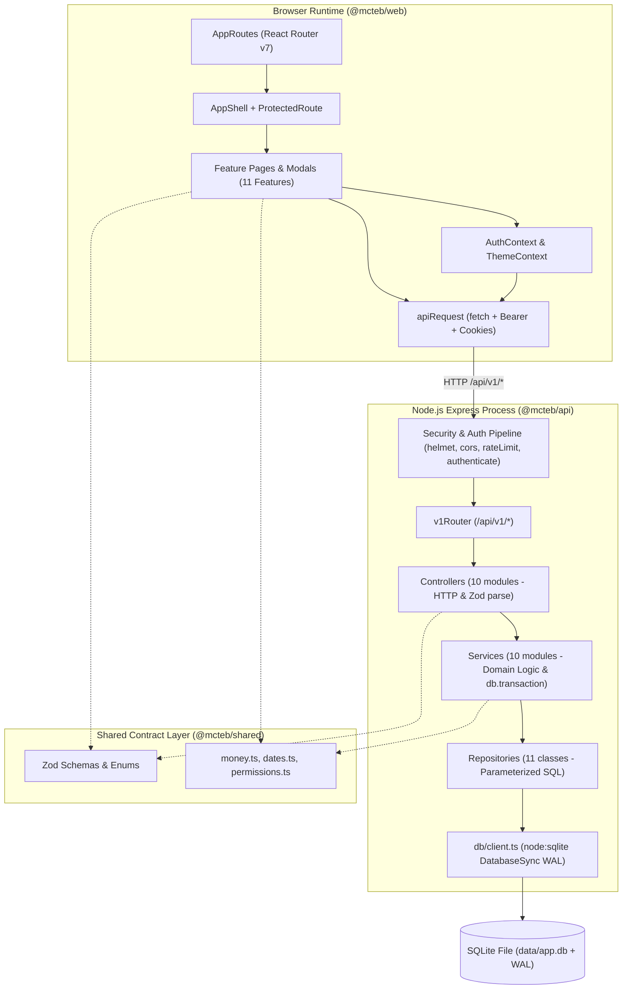
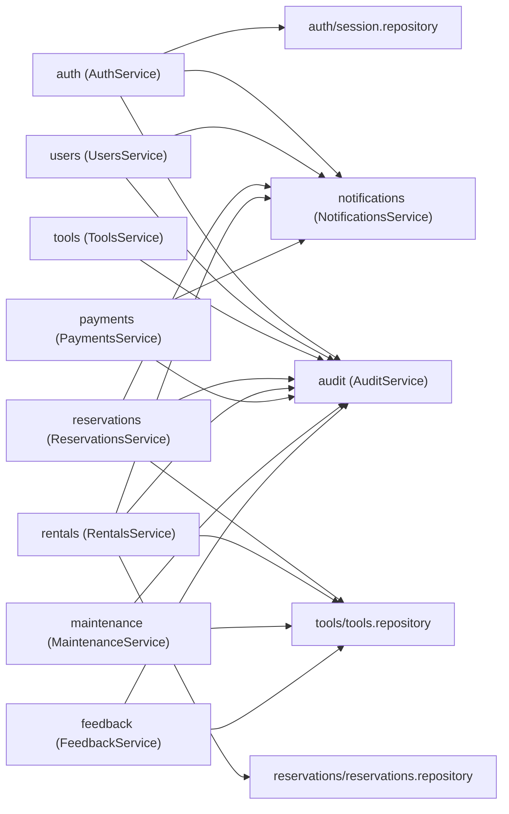
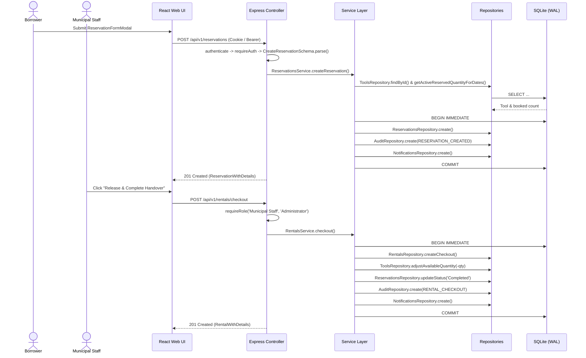

# 02 — System Architecture

> **Epistemic Classification Legend**
>
> - `[Verified from source code]` — Directly observed in repository files, schemas, configurations, or tool outputs.
> - `[Inferred from architecture]` — Logically deduced from codebase structure, middleware order, or runtime behavior.
> - `[Assumption requiring validation]` — Organizational, municipal policy, or operational assumption not codified in source code.

---

## Table of Contents

- [1. Executive Summary](#1-executive-summary)
- [2. Purpose](#2-purpose)
- [3. Scope](#3-scope)
- [4. Key Components](#4-key-components)
- [5. Architecture Diagrams](#5-architecture-diagrams)
  - [5.1 Layered Modular Monolith Component Diagram](#51-layered-modular-monolith-component-diagram)
  - [5.2 Cross-Module Dependency Diagram (Backend)](#52-cross-module-dependency-diagram-backend)
  - [5.3 Sequence Diagram: End-to-End Reservation & Checkout Flow](#53-sequence-diagram-end-to-end-reservation--checkout-flow)
- [6. Technical Details & Detailed Analysis](#6-technical-details--detailed-analysis)
  - [6.1 Architectural Style: Monolith vs Microservices](#61-architectural-style-monolith-vs-microservices)
  - [6.2 Layered Backend Architecture](#62-layered-backend-architecture)
  - [6.3 Feature-Sliced Frontend Architecture](#63-feature-sliced-frontend-architecture)
  - [6.4 Service Boundaries & Cross-Module Coupling](#64-service-boundaries--cross-module-coupling)
  - [6.5 Data Flow & Synchronous Transaction Model](#65-data-flow--synchronous-transaction-model)
  - [6.6 Event Flow Analysis](#66-event-flow-analysis)
- [7. Findings](#7-findings)
- [8. Risks](#8-risks)
- [9. Recommendations](#9-recommendations)
- [10. Future Enhancements](#10-future-enhancements)
- [11. References to Source Files & Cross-References](#11-references-to-source-files--cross-references)

---

## 1. Executive Summary

MCTEB is implemented as a **three-package pnpm monorepo containing a modular monolith backend and a Single-Page Application (SPA) frontend** (`[Verified from source code]`). Rather than decomposing domain entities into separate networked microservices, all 10 backend domain modules (`auth`, `users`, `tools`, `reservations`, `rentals`, `payments`, `maintenance`, `feedback`, `notifications`, `audit`) execute within a single Node.js Express process backed by a single embedded SQLite file (`[Verified from source code]`, `apps/api/src/app.ts`, `apps/api/src/db/client.ts`).

Each backend domain strictly enforces a four-tier separation of concerns (`Routes -> Controller -> Service -> Repository -> DB Client`), while cross-module mutations execute synchronously inside SQLite `BEGIN IMMEDIATE` write transactions (`[Verified from source code]`).

---

## 2. Purpose

This document describes MCTEB's architectural topology, style trade-offs, internal layering, module boundaries, runtime dependencies, data flow, and event propagation characteristics.

---

## 3. Scope

Covers architectural composition across:

- `apps/api/src/` (Express app, middleware pipeline, 10 domain modules, SQLite client) (`[Verified from source code]`).
- `apps/web/src/` (React 19 app shell, contexts, HTTP client, 11 feature slices) (`[Verified from source code]`).
- `packages/shared/src/` (Shared contract layer coupling frontend and backend at compile time and runtime) (`[Verified from source code]`).

---

## 4. Key Components

| Layer / Boundary                  | Implementation                                          | Key Mechanism                                                                                            |
| --------------------------------- | ------------------------------------------------------- | -------------------------------------------------------------------------------------------------------- |
| **Presentation SPA**              | `apps/web/src/app/`, `features/`, `components/`         | React 19, React Router v7, `AuthContext`, `ThemeContext`, `apiRequest` wrapper                           |
| **API Gateway / Edge Middleware** | `apps/api/src/app.ts`, `middleware/`                    | `helmet`, `cors`, `express.json(100kb)`, `cookieParser`, `pinoHttp`, `globalRateLimiter`, `authenticate` |
| **Domain Routes & Controllers**   | `apps/api/src/modules/*/*.routes.ts`, `*.controller.ts` | Express `Router`, `requireAuth`/`requireRole`, Zod `.parse()`, IDOR checks                               |
| **Business Services**             | `apps/api/src/modules/*/*.service.ts`                   | Domain rules, `db.transaction()` orchestration, calls to `AuditService` & `NotificationsService`         |
| **Data Access Repositories**      | `apps/api/src/modules/*/*.repository.ts`                | Parameterized `db.prepare()` SQL statements via `node:sqlite` `DatabaseSync`                             |
| **Shared Contract Package**       | `packages/shared/src/`                                  | Zod schemas, TypeScript types, enums, permissions matrix, formatting utilities                           |

---

## 5. Architecture Diagrams

### 5.1 Layered Modular Monolith Component Diagram



### 5.2 Cross-Module Dependency Diagram (Backend)



### 5.3 Sequence Diagram: End-to-End Reservation & Checkout Flow



---

## 6. Technical Details & Detailed Analysis

### 6.1 Architectural Style: Monolith vs Microservices

- **Observed Style**: MCTEB is a **Modular Monolith** (`[Verified from source code]`). All 10 domain modules run in a single Express process (`apps/api/src/server.ts`) and read/write the same SQLite database file (`apps/api/src/db/client.ts`).
- **Architectural Rationale**: As documented in `docs/adr/0001-sqlite-storage-engine.md` and `PROJECT_PLAN.md` Section B4, Basco's municipal hardware and intermittent island connectivity benefit from zero-configuration local deployment, in-process `BEGIN IMMEDIATE` ACID transactions across multiple tables (reservations + tools + rentals + audit + notifications), and minimal operational footprint (`[Verified from source code]`, `[Inferred from architecture]`).
- **Migration Seam**: Because SQL queries are encapsulated inside `*.repository.ts` modules and `AppDatabase` (`apps/api/src/db/client.ts`), transitioning to a client-server database (e.g., PostgreSQL) or extracting services later is isolated primarily to the repository and database client layers (`[Inferred from architecture]`).

### 6.2 Layered Backend Architecture

Every module under `apps/api/src/modules/<module>/` follows an identical four-file pattern (`[Verified from source code]`):

1. **`*.routes.ts`**: Mounts Express route paths, applies `requireAuth`, `requireRole(...)`, and `authRateLimiter`.
2. **`*.controller.ts`**: Extracts `req.params`, `req.query`, `req.body`, `req.user`, validates payloads with `@mcteb/shared` Zod schemas (`Schema.parse(...)`), enforces controller-level IDOR ownership rules (e.g., `if (req.user.role === 'Borrower' && record.user_id !== req.user.id)`), and serializes HTTP JSON responses (`[Verified from source code]`).
3. **`*.service.ts`**: Executes domain rules (age calculation, stock checks, admin safeguards), wraps multi-table mutations inside `db.transaction(() => { ... })`, and invokes `AuditService.record()` and `NotificationsService.create()` (`[Verified from source code]`).
4. **`*.repository.ts`**: Prepares and executes parameterized SQL statements (`db.prepare(...)`), maps database rows into TypeScript DTOs (`*WithDetails`), and has zero dependency on Express HTTP primitives (`[Verified from source code]`).

Code excerpt from `apps/api/src/db/client.ts` (lines 58–70) demonstrating atomic transaction control (`[Verified from source code]`):

```ts
  transaction<Args extends unknown[], R>(fn: (...args: Args) => R): (...args: Args) => R {
    return (...args: Args): R => {
      rawDb.exec('BEGIN IMMEDIATE');
      try {
        const result = fn(...args);
        rawDb.exec('COMMIT');
        return result;
      } catch (err) {
        rawDb.exec('ROLLBACK');
        throw err;
      }
    };
  },
```

### 6.3 Feature-Sliced Frontend Architecture

The frontend (`apps/web/src/`) uses a **feature-sliced UI organization** (`[Verified from source code]`):

- **Global Providers (`apps/web/src/app/App.tsx`)**: Wraps the app in `QueryClientProvider` -> `ThemeProvider` -> `AuthProvider` -> `BrowserRouter` -> `AppShell` -> `AppRoutes`.
- **Feature Modules (`apps/web/src/features/`)**: 11 domain-aligned folders (`admin`, `auth`, `catalog`, `dashboard`, `feedback`, `inventory`, `maintenance`, `notifications`, `payments`, `profile`, `rentals`, `reservations` — note 12 folders exist when counting `admin`, `auth`, `profile`, `dashboard`, `notifications` alongside core resource slices) (`[Verified from source code]`).
- **Shared Design System (`apps/web/src/components/ui/`)**: 8 reusable primitives (`Alert`, `Badge`, `Button`, `Card`, `EmptyState`, `Input`/`Select`, `Modal`, `Skeleton`).

### 6.4 Service Boundaries & Cross-Module Coupling

- **Horizontal Infrastructure Services**: `AuditService` (`apps/api/src/modules/audit/audit.service.ts`) and `NotificationsService` (`apps/api/src/modules/notifications/notifications.service.ts`) act as cross-cutting sinks imported directly by `AuthService`, `UsersService`, `ToolsService`, `ReservationsService`, `RentalsService`, `PaymentsService`, `MaintenanceService`, and `FeedbackService` (`[Verified from source code]`).
- **Direct Repository Coupling**: Domain services directly import `ToolsRepository` (`ReservationsService`, `RentalsService`, `MaintenanceService`, `FeedbackService`) and `ReservationsRepository` (`RentalsService`) rather than going through `ToolsService` or `ReservationsService` (`[Verified from source code]`).
- **Middleware Database Coupling**: `apps/api/src/middleware/auth.ts` (lines 50–54) bypasses `UsersRepository` / `AuthRepository` and executes raw `db.prepare('SELECT ... FROM users WHERE id = ?')` directly inside `authenticate()` (`[Verified from source code]`).

### 6.5 Data Flow & Synchronous Transaction Model

- **Synchronous Database Execution**: Because `node:sqlite` (`DatabaseSync`) executes queries synchronously on the Node.js main thread, all service methods except `AuthService.register` and `AuthService.login` (which await `crypto.scrypt` promises) execute synchronously (`[Verified from source code]`, `[Inferred from architecture]`).
- **Nested Transaction Risk**: `db.transaction()` executes raw `BEGIN IMMEDIATE` / `COMMIT` / `ROLLBACK` without checking if a transaction is already active or using SQLite `SAVEPOINT`s (`[Verified from source code]`, `apps/api/src/db/client.ts` lines 58–70). Currently, no service inside a `db.transaction()` calls another service that opens a second `db.transaction()` (`[Verified from source code]`), avoiding nested transaction crashes, though this creates an implicit fragility if cross-service calls expand.

### 6.6 Event Flow Analysis

- **No Asynchronous Event Bus**: `[Verified from source code]` — There is **no `EventEmitter`, message queue, pub/sub broker, WebSocket server, or webhook dispatcher** in the system.
- **In-Transaction Synchronous Side Effects**: State-change "events" (e.g., reservation approved, equipment checked out, payment verified) are modeled as synchronous function calls to `AuditService.record()` and `NotificationsService.create()` inside the owning service's `db.transaction()` block (`[Verified from source code]`). Because they run inside the same SQLite transaction, audit logs and notifications are strictly atomic with the domain mutation (`[Inferred from architecture]`).

---

## 7. Findings

### Verified from Source Code

1. Backend enforces a clean `routes -> controller -> service -> repository -> db` pattern across all 10 domain modules.
2. `AuditService.record()` and `NotificationsService.create()` execute synchronously inside the same `BEGIN IMMEDIATE` transaction as domain writes (`ReservationsService`, `RentalsService`, `PaymentsService`).
3. `db.transaction()` does not use `SAVEPOINT`s and would fail with `cannot start a transaction within a transaction` if a transactional service called another transactional service method.
4. `authenticate` middleware queries `users` table directly via `db.prepare()` instead of delegating to `AuthRepository` or `UsersRepository`.
5. On the frontend, `QueryClientProvider` is initialized in `App.tsx`, yet individual pages manage server state manually using `useState` and `useEffect` (`[Verified from source code]`).

### Inferred from Architecture

1. Single-process synchronous SQLite transactions guarantee strong consistency for inventory stock updates without distributed locks, at the cost of serializing concurrent write operations and preventing horizontal multi-instance scaling of `apps/api`.
2. Direct repository-to-repository imports across modules (`RentalsService` -> `ToolsRepository`) bypass service-layer invariants in `ToolsService` (e.g., `ToolsRepository.adjustAvailableQuantity` overwrites `availability_status` unconditionally).

### Assumptions Requiring Validation

1. `[Assumption requiring validation]` Expected peak concurrent traffic in Basco Municipal Hall is low enough that synchronous SQLite queries and `BEGIN IMMEDIATE` locks will not stall the Node.js event loop.

---

## 8. Risks

| ID       | Risk                                                    | Severity       | Impact                                                                                                                                                       |
| -------- | ------------------------------------------------------- | -------------- | ------------------------------------------------------------------------------------------------------------------------------------------------------------ |
| **A-01** | Non-reentrant `db.transaction()` (`BEGIN IMMEDIATE`)    | **Medium**     | Calling one transactional service from another would throw a SQLite nested-transaction error (`[Inferred from architecture]`).                               |
| **A-02** | Cross-module repository calls bypass service invariants | **Medium**     | `ToolsRepository.adjustAvailableQuantity` can change a `'Maintenance'` tool's status back to `'Available'` on rental return (`[Verified from source code]`). |
| **A-03** | Single-node SQLite lock-in                              | **Low/Medium** | Horizontal scaling beyond one API instance is impossible without migrating from `node:sqlite` to PostgreSQL (`[Inferred from architecture]`).                |
| **A-04** | Unused `@tanstack/react-query` client cache             | **Low**        | Repeated page transitions re-fetch identical endpoints (`DashboardPage.tsx`, `CatalogPage.tsx`) without cache deduplication (`[Verified from source code]`). |

---

## 9. Recommendations

1. **Support `SAVEPOINT` Nesting in `db.transaction()`**: Track transaction depth in `apps/api/src/db/client.ts` and issue `SAVEPOINT` / `RELEASE` / `ROLLBACK TO` for nested transactions (`[Inferred from architecture]`).
2. **Route Cross-Module Inventory Updates Through `ToolsService`**: Consolidate stock and status transitions in `ToolsService` so `Maintenance` and `Damaged` states are never clobbered by `adjustAvailableQuantity` (`[Verified from source code]`).
3. **Move `authenticate` User Lookup into `AuthRepository`**: Eliminate direct SQL in `apps/api/src/middleware/auth.ts` (`[Verified from source code]`).
4. **Adopt `@tanstack/react-query` Hooks Consistently**: Replace ad-hoc `useState`/`useEffect` fetching in feature pages with `useQuery` and `useMutation` + query invalidation (`[Verified from source code]`).

---

## 10. Future Enhancements

1. **Internal Domain Event Bus**: Introduce a typed in-process event dispatcher (post-commit) for future asynchronous side effects such as SMS/email dispatch without extending SQLite transaction lock duration (`[Inferred from architecture]`).
2. **PostgreSQL Repository Adapter**: Implement a `pg` / Drizzle repository adapter behind the existing service boundaries if municipal deployment scales to multi-municipality provincial hosting across Batanes (`docs/adr/0001-sqlite-storage-engine.md`).

---

## 11. References to Source Files & Cross-References

| File / Symbol                                                    | Purpose                                                                               |
| ---------------------------------------------------------------- | ------------------------------------------------------------------------------------- |
| `apps/api/src/app.ts`                                            | Global Express middleware pipeline and `/api/v1` router mounting                      |
| `apps/api/src/server.ts`                                         | Startup migration runner (`runMigrations()`) and `SIGTERM`/`SIGINT` graceful shutdown |
| `apps/api/src/db/client.ts`                                      | `node:sqlite` initialization, pragmas, and `db.transaction()` wrapper                 |
| `apps/api/src/middleware/auth.ts`                                | Token extraction, session validation, and RBAC middleware                             |
| `apps/api/src/modules/rentals/rentals.service.ts`                | Cross-module `checkout` and `processReturn` atomic transactions                       |
| `apps/web/src/app/App.tsx`                                       | Root provider hierarchy (`QueryClientProvider`, `ThemeProvider`, `AuthProvider`)      |
| `docs/architecture.md`, `docs/adr/0001-sqlite-storage-engine.md` | Original architecture documentation and SQLite ADR                                    |

**Cross-References**: See [03-Repository-Structure.md](./03-Repository-Structure.md), [21-Developer-Architecture-Guide.md](./21-Developer-Architecture-Guide.md), and [22-Backend-Architecture.md](./22-Backend-Architecture.md).
