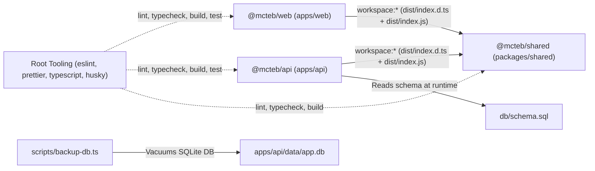
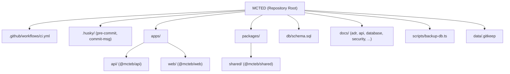

# 03 — Repository Structure

> **Epistemic Classification Legend**
> - `[Verified from source code]` — Directly observed in repository files, schemas, configurations, or tool outputs.
> - `[Inferred from architecture]` — Logically deduced from codebase structure, middleware order, or runtime behavior.
> - `[Assumption requiring validation]` — Organizational, municipal policy, or operational assumption not codified in source code.

---

## Table of Contents

- [1. Executive Summary](#1-executive-summary)
- [2. Purpose](#2-purpose)
- [3. Scope](#3-scope)
- [4. Key Components](#4-key-components)
- [5. Architecture Diagrams](#5-architecture-diagrams)
  - [5.1 Workspace Package Dependency Graph](#51-workspace-package-dependency-graph)
  - [5.2 Monorepo Layout Overview](#52-monorepo-layout-overview)
- [6. Technical Details & Detailed Analysis](#6-technical-details--detailed-analysis)
  - [6.1 Complete Repository Tree Structure](#61-complete-repository-tree-structure)
  - [6.2 Purpose of Every Major Folder & Module](#62-purpose-of-every-major-folder--module)
  - [6.3 Build Configuration & TypeScript Project Graph](#63-build-configuration--typescript-project-graph)
  - [6.4 Code Quality, Git Hooks & CI Configuration](#64-code-quality-git-hooks--ci-configuration)
  - [6.5 Tracked Build Artifacts & Git Hygiene Findings](#65-tracked-build-artifacts--git-hygiene-findings)
- [7. Findings](#7-findings)
- [8. Risks](#8-risks)
- [9. Recommendations](#9-recommendations)
- [10. Future Enhancements](#10-future-enhancements)
- [11. References to Source Files & Cross-References](#11-references-to-source-files--cross-references)

---

## 1. Executive Summary

The `MCTED` repository is structured as a **pnpm workspace monorepo** (`pnpm-workspace.yaml`) comprising two deployable applications (`apps/api`, `apps/web`), one shared internal library (`packages/shared`), a root SQLite schema (`db/schema.sql`), operational scripts (`scripts/backup-db.ts`), project documentation (`docs/`), and Git/CI automation (`.github/`, `.husky/`) (`[Verified from source code]`).

Inspection of `git ls-files` reveals two major repository hygiene anomalies (`[Verified from source code]`):
1. **112 compiled TypeScript output files** (`.js`, `.js.map`, `.d.ts`, `.d.ts.map` for 28 source modules) are currently committed inside `apps/web/src/`.
2. **3 live SQLite database files** (`apps/api/data/app.db`, `app.db-shm`, `app.db-wal`) are committed under `apps/api/data/`, bypassing `.gitignore`'s root `data/*.db` pattern.
3. Additionally, `packages/shared/dist/` currently holds stale `.d.ts` files that cause `pnpm -r typecheck` to fail in `apps/web` until `@mcteb/shared` is rebuilt (`[Verified from source code]`).

---

## 2. Purpose

This document provides a complete structural map of the `MCTED` repository, detailing folder responsibilities, workspace package boundaries, TypeScript/Vite/ESLint build configurations, and workspace dependency relationships.

---

## 3. Scope

Covers all files and directories tracked in `c:/Users/USER/Documents/GitHub/MCTED` as observed via `git ls-files`, `Get-ChildItem`, and configuration file inspection (`[Verified from source code]`).

---

## 4. Key Components

- **Workspace Root** (`package.json`, `pnpm-workspace.yaml`, `tsconfig.base.json`, `tsconfig.json`, `eslint.config.mjs`) (`[Verified from source code]`).
- **`packages/shared`** (`@mcteb/shared`): Shared Zod schemas, enums, RBAC matrix, money/date helpers (`[Verified from source code]`).
- **`apps/api`** (`@mcteb/api`): Express REST API server, database migration/seed pipeline, and Vitest integration test suite (`[Verified from source code]`).
- **`apps/web`** (`@mcteb/web`): React 19 + Vite + Tailwind CSS SPA with custom SVG equipment artwork (`[Verified from source code]`).
- **`db/`**, **`data/`**, **`docs/`**, **`scripts/`**: Authoritative SQL schema, local SQLite storage, architectural docs, and hot backup script (`[Verified from source code]`).

---

## 5. Architecture Diagrams

### 5.1 Workspace Package Dependency Graph



### 5.2 Monorepo Layout Overview



---

## 6. Technical Details & Detailed Analysis

### 6.1 Complete Repository Tree Structure

Verified from `git ls-files` and directory listings (`[Verified from source code]`):

```text
MCTED/
├── .editorconfig
├── .env                          # Local runtime env (gitignored, present on disk)
├── .env.example                  # Documented environment variable template
├── .gitignore
├── .husky/
│   └── husky.json                # Configures pre-commit (lint-staged) and commit-msg (commitlint)
├── .lintstagedrc.json            # ESLint + Prettier on staged files
├── .npmrc                        # engine-strict=true, auto-install-peers=true, save-exact=true
├── .nvmrc                        # Pins Node 20 (conflicts with node:sqlite >=22.5.0)
├── .prettierrc.json              # Single quotes, semi, trailingComma: all, printWidth: 100
├── .github/
│   └── workflows/
│       └── ci.yml                # GitHub Actions CI workflow
├── CHANGELOG.md
├── PROJECT_PLAN.md               # Comprehensive Part A (Product) & Part B (Tech Arch) plan
├── README.md
├── SECURITY.md
├── commitlint.config.cjs         # Conventional Commits enforcement
├── eslint.config.mjs             # ESLint 9 flat config with typescript-eslint type-checked rules
├── package.json                  # Root workspace scripts & devDependencies
├── pnpm-lock.yaml                # Locked dependency graph
├── pnpm-workspace.yaml           # Workspaces: apps/*, packages/*
├── report.md                     # Implementation & verification report
├── tsconfig.base.json            # Shared strict TS compiler options
├── tsconfig.json                 # Project references root
├── data/
│   └── .gitkeep                  # Placeholder for root data directory
├── db/
│   └── schema.sql                # Authoritative 9-table SQLite schema + 16 indexes
├── docs/
│   ├── adr/
│   │   ├── 0001-sqlite-storage-engine.md
│   │   └── 0002-integer-centavos-currency.md
│   ├── api.md
│   ├── architecture.md
│   ├── data-dictionary.md
│   ├── database.md
│   ├── role-matrix.md
│   ├── security.md
│   └── status-transitions.md
├── scripts/
│   └── backup-db.ts              # Hot SQLite backup via VACUUM INTO
├── packages/
│   └── shared/
│       ├── package.json          # @mcteb/shared (dependency: zod)
│       ├── tsconfig.json
│       └── src/
│           ├── dates.ts          # MANILA_TIMEZONE, formatDate, formatDateTime, isValidDateRange
│           ├── enums.ts          # 12 Zod enum definitions
│           ├── index.ts          # Barrel export
│           ├── money.ts          # centavosToPesos, pesosToCentavos, formatPHP
│           ├── permissions.ts    # Permissions map & hasPermission()
│           └── schemas/          # 9 entity schema modules
│               ├── audit.ts
│               ├── feedback.ts
│               ├── maintenance.ts
│               ├── notification.ts
│               ├── payment.ts
│               ├── rental.ts
│               ├── reservation.ts
│               ├── tool.ts
│               └── user.ts
└── apps/
    ├── api/
    │   ├── package.json          # @mcteb/api
    │   ├── tsconfig.json
    │   ├── vitest.config.ts
    │   ├── data/                 # Tracked SQLite runtime files (app.db, -shm, -wal)
    │   └── src/
    │       ├── app.ts            # Express app definition (middleware + /api/v1 mount)
    │       ├── app.test.ts       # 7 Supertest integration tests
    │       ├── server.ts         # HTTP server entry point + migrations + shutdown
    │       ├── config/env.ts     # Zod-validated environment configuration
    │       ├── db/
    │       │   ├── client.ts     # node:sqlite DatabaseSync connection & tx wrapper
    │       │   ├── migrate.ts    # Schema execution from db/schema.sql
    │       │   └── seed/
    │       │       ├── seed.ts
    │       │       ├── validate-fixtures.ts
    │       │       └── fixtures/index.ts
    │       ├── middleware/
    │       │   ├── auth.ts
    │       │   ├── errorHandler.ts
    │       │   ├── rateLimit.ts
    │       │   └── validate.ts
    │       ├── utils/
    │       │   ├── crypto.ts
    │       │   ├── errors.ts
    │       │   └── logger.ts
    │       └── modules/          # 10 domain modules (routes/controller/service/repository)
    │           ├── audit/
    │           ├── auth/         # Also contains session.repository.ts
    │           ├── feedback/
    │           ├── maintenance/
    │           ├── notifications/
    │           ├── payments/
    │           ├── rentals/
    │           ├── reservations/
    │           ├── tools/
    │           └── users/
    └── web/
        ├── index.html
        ├── package.json          # @mcteb/web
        ├── postcss.config.js
        ├── tailwind.config.ts
        ├── tsconfig.json
        ├── vite.config.ts
        ├── vitest.config.ts
        ├── public/
        │   ├── favicon.svg
        │   └── equipment/        # 8 SVG equipment illustrations + fallback.svg
        └── src/
            ├── main.tsx
            ├── styles/index.css
            ├── app/              # App.tsx, routes.tsx
            ├── lib/              # api.ts, auth-context.tsx, theme-context.tsx
            ├── components/
            │   ├── layout/       # AppShell.tsx, ProtectedRoute.tsx
            │   └── ui/           # Alert, Badge, Button, Card, EmptyState, Input, Modal, Skeleton
            └── features/         # admin, auth, catalog, dashboard, feedback, inventory,
                                  # maintenance, notifications, payments, profile, rentals, reservations
            (+ 112 tracked *.js, *.js.map, *.d.ts, *.d.ts.map build artifacts alongside .ts/.tsx files)
```

### 6.2 Purpose of Every Major Folder & Module

| Path | Purpose |
|---|---|
| `.github/workflows/` | Automated CI checks (`lint`, `typecheck`, `test`, `audit`, `build`) on `main` and `develop` branches (`[Verified from source code]`). |
| `.husky/` | Git hook configuration invoking `lint-staged` on commit and `commitlint` on commit messages (`[Verified from source code]`). |
| `packages/shared/src/` | Single source of truth for Zod schemas, domain status enums, role permissions, currency (`PHP` centavos), and timezone (`Asia/Manila`) formatters (`[Verified from source code]`). |
| `apps/api/src/config/` | Validates `process.env` at startup via Zod (`env.ts`) and resolves `DATABASE_PATH_RESOLVED` (`[Verified from source code]`). |
| `apps/api/src/db/` | Initializes `node:sqlite`, executes `db/schema.sql`, validates fixtures, and seeds demo records (`[Verified from source code]`). |
| `apps/api/src/middleware/` | Cross-cutting Express handlers for session auth/RBAC, rate limiting, error formatting, and unused generic body validation (`[Verified from source code]`). |
| `apps/api/src/modules/*` | Isolated domain slices, each containing `.routes.ts`, `.controller.ts`, `.service.ts`, and `.repository.ts` (`[Verified from source code]`). |
| `apps/web/public/equipment/` | Static SVG vector illustrations for equipment cards (`backpack-sprayer.svg`, `circular-saw.svg`, `concrete-mixer.svg`, `fallback.svg`, `generator.svg`, `marine-gps.svg`, `tiller.svg`, `water-pump.svg`) (`[Verified from source code]`). |
| `apps/web/src/components/` | Layout wrappers (`AppShell`, `ProtectedRoute`) and headless/Tailwind UI primitives (`[Verified from source code]`). |
| `apps/web/src/features/` | Domain-organized React page views and modal workflows (`[Verified from source code]`). |
| `scripts/` | Operational maintenance utilities; currently contains `backup-db.ts` (`[Verified from source code]`). |

### 6.3 Build Configuration & TypeScript Project Graph

- **`tsconfig.base.json`** (`[Verified from source code]`): Sets strict compiler rules (`"strict": true`, `"noUncheckedIndexedAccess": true`, `"noImplicitOverride": true`, `"target": "ES2022"`, `"module": "ESNext"`, `"moduleResolution": "bundler"`, `"declaration": true`, `"declarationMap": true`, `"sourceMap": true`).
- **`tsconfig.json`** (`[Verified from source code]`): Declares TypeScript Project References to `./packages/shared`, `./apps/api`, and `./apps/web`.
- **`packages/shared/package.json`** (`[Verified from source code]`): Exports `./dist/index.js` and `./dist/index.d.ts`:
```json
  "exports": {
    ".": {
      "types": "./dist/index.d.ts",
      "import": "./dist/index.js",
      "default": "./dist/index.js"
    }
  },
```
  Because downstream packages (`@mcteb/api`, `@mcteb/web`) resolve `@mcteb/shared` via `dist/`, any edit to `packages/shared/src/` requires rebuilding `@mcteb/shared` before `typecheck` or `build` sees updated types (`[Verified from source code]`).
- **`apps/web/tsconfig.json`** (`[Verified from source code]`): Extends `tsconfig.base.json` and sets `"noEmit": true` and `"jsx": "react-jsx"`, with path alias `"@/*": ["src/*"]`.
- **`apps/web/vite.config.ts`** (`[Verified from source code]`): Configures `@vitejs/plugin-react`, `@` alias, dev port `5173`, and `/api` proxy to `http://localhost:3000`.

### 6.4 Code Quality, Git Hooks & CI Configuration

- **`.npmrc`**: Enforces `"engine-strict=true"`, `"auto-install-peers=true"`, `"save-exact=true"` (`[Verified from source code]`).
- **`eslint.config.mjs`**: Uses `tseslint.config(eslint.configs.recommended, ...tseslint.configs.recommendedTypeChecked)` with `projectService: true`, enforcing `@typescript-eslint/no-explicit-any: 'error'` and `@typescript-eslint/consistent-type-imports: 'error'` (`[Verified from source code]`).
- **Note on `eslint.config.mjs` vs `apps/api/src/db/client.ts`**: `apps/api/src/db/client.ts` contains `(params as any[])` on lines 45, 48, 51, which conflicts with `@typescript-eslint/no-explicit-any: 'error'`; additionally, `eslint.config.mjs` ignores `'*.js'` at root level rather than `'**/*.js'`, meaning the 112 tracked `.js` files inside `apps/web/src/` may be affected depending on ESLint glob behavior (`[Verified from source code]`, `[Inferred from architecture]`).

### 6.5 Tracked Build Artifacts & Git Hygiene Findings

- **112 Compiled Files in `apps/web/src/`**: Even though `apps/web/tsconfig.json` specifies `"noEmit": true` and `vite build` outputs to `apps/web/dist/`, an earlier `tsc` run without `--noEmit` (likely using `tsconfig.base.json`'s `"declaration": true`, `"sourceMap": true`) emitted `.js`, `.js.map`, `.d.ts`, and `.d.ts.map` files directly beside all 28 `.ts`/`.tsx` files in `apps/web/src/` and they were committed to Git (`[Verified from source code]`, `[Inferred from architecture]`).
- **Tracked SQLite Files (`apps/api/data/app.db*`)**: `.gitignore` specifies `data/*.db`, `data/*.db-wal`, `data/*.db-shm` (which only matches `<repo-root>/data/` or `**/data/` depending on path, wait: in `.gitignore` lines 16–18, `data/*.db` without leading slash matches any `data/*.db` ONLY if not previously force-added or gitignored after tracking; `git ls-files` confirms `apps/api/data/app.db`, `app.db-shm`, and `app.db-wal` are tracked in Git, and `git status --short` shows `M apps/api/data/app.db-shm` is modified on disk!) (`[Verified from source code]`).

---

## 7. Findings

### Verified from Source Code
1. `packages/shared/dist/schemas/user.d.ts` on disk is out of sync with `packages/shared/src/schemas/user.ts`, causing `pnpm.cmd -r typecheck` to fail with `TS2345` at `apps/web/src/features/auth/RegisterPage.tsx(43,22)`.
2. 112 compiled build artifacts (`.js`, `.js.map`, `.d.ts`, `.d.ts.map`) are tracked under `apps/web/src/`.
3. 3 SQLite runtime files (`apps/api/data/app.db`, `app.db-shm`, `app.db-wal`) are tracked in Git.
4. `packages/config` (referenced in `PROJECT_PLAN.md` Section B2) does not exist; configurations live at the repository root.
5. `apps/api/src/db/schema.ts` and `apps/api/src/db/migrations/` (mentioned in `PROJECT_PLAN.md` Section B2 for Drizzle) do not exist; migrations use raw `db/schema.sql`.

### Inferred from Architecture
1. In `.github/workflows/ci.yml`, running `pnpm lint`, `pnpm typecheck`, and `pnpm test` before `pnpm build` will fail on a clean CI runner because `packages/shared/dist/` is excluded by `.gitignore` (`dist/`) and does not exist until `@mcteb/shared` is compiled.
2. Root `tsconfig.json` project references require `composite: true` on referenced tsconfigs if `tsc --build` were used, whereas currently `pnpm -r build` runs `tsc` sequentially/topologically across workspaces.

### Assumptions Requiring Validation
1. `[Assumption requiring validation]` Whether the tracked `apps/api/data/app.db` contains only seeded demo fixtures or any real test data before removing it from Git history.

---

## 8. Risks

| ID | Risk | Severity | Details |
|---|---|---|---|
| **RS-01** | Broken CI & `typecheck` from unbuilt/stale `@mcteb/shared/dist` | **High** | Fresh clones fail `typecheck`/`test`; existing clone fails `typecheck` due to stale `dist/schemas/user.d.ts`. |
| **RS-02** | Runtime database file tracked in Git (`apps/api/data/app.db*`) | **High** | Risk of leaking user accounts, password hashes, and active session tokens in commits/PRs, plus frequent binary merge conflicts (`M apps/api/data/app.db-shm`). |
| **RS-03** | 112 stale `.js`/`.d.ts` files inside `apps/web/src/` | **Medium** | Vite or TypeScript can resolve stale `.js`/`.d.ts` files instead of edited `.tsx`/`.ts` files! |

---

## 9. Recommendations

1. **Remove Tracked Build Artifacts from `apps/web/src/`**: Delete all `*.js`, `*.js.map`, `*.d.ts`, and `*.d.ts.map` files inside `apps/web/src/` via `git rm`.
2. **Untrack `apps/api/data/app.db*`**: Run `git rm --cached apps/api/data/app.db*` and ensure `.gitignore` includes `**/data/*.db*`.
3. **Add `build:shared` Pre-Step**: Add `"pretypecheck": "pnpm --filter @mcteb/shared build"` (or update CI to run `pnpm --filter @mcteb/shared build` right after `pnpm install --frozen-lockfile`) so `@mcteb/shared/dist` is always current.

---

## 10. Future Enhancements

1. **Composite TypeScript Project References / Direct TS Exports**: Configure `"customConditions"` or `tsconfig` paths / `composite: true` so IDE and `typecheck` resolve `@mcteb/shared` source directly without stale `dist/` artifacts.
2. **Dedicated `packages/config` Workspace**: Extract `tsconfig.base.json`, `eslint.config.mjs`, and `.prettierrc.json` into `@mcteb/config` if additional apps (e.g., an offline kiosk or mobile companion app) are added.

---

## 11. References to Source Files & Cross-References

| File | Purpose |
|---|---|
| `pnpm-workspace.yaml`, `package.json` | Workspace definitions and root scripts |
| `tsconfig.base.json`, `tsconfig.json`, `packages/shared/tsconfig.json`, `apps/api/tsconfig.json`, `apps/web/tsconfig.json` | TypeScript compilation settings |
| `.github/workflows/ci.yml` | CI pipeline definition |
| `.gitignore`, `.npmrc`, `.nvmrc`, `eslint.config.mjs`, `.prettierrc.json`, `commitlint.config.cjs`, `.husky/husky.json`, `.lintstagedrc.json` | Repository tooling and hygiene configuration |

**Cross-References**: See [SYSTEM_INVENTORY.md](./SYSTEM_INVENTORY.md), [TECH_STACK_AUDIT.md](./TECH_STACK_AUDIT.md), [UNUSED_CODE_ANALYSIS.md](./UNUSED_CODE_ANALYSIS.md), and [TECHNICAL_DEBT_REPORT.md](./TECHNICAL_DEBT_REPORT.md).
