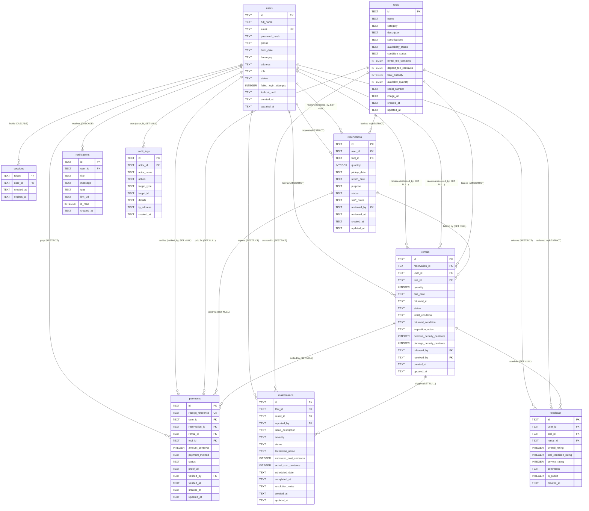

# 04 — Database Architecture & Entity-Relationship Model

> **Epistemic Classification Legend**
>
> - `[Verified from source code]` — Directly observed in repository files, schemas, configurations, or tool outputs.
> - `[Inferred from architecture]` — Logically deduced from codebase structure, middleware order, or runtime behavior.
> - `[Assumption requiring validation]` — Organizational, municipal policy, or operational assumption not codified in source code.

---

## Table of Contents

- [1. Executive Summary](#1-executive-summary)
- [2. Purpose](#2-purpose)
- [3. Scope](#3-scope)
- [4. Key Components](#4-key-components)
- [5. Architecture Diagrams](#5-architecture-diagrams)
  - [5.1 Complete Entity-Relationship Diagram (All 10 Tables)](#51-complete-entity-relationship-diagram-all-10-tables)
- [6. Technical Details & Detailed Analysis](#6-technical-details--detailed-analysis)
  - [6.1 Storage Engine & SQLite Pragmas](#61-storage-engine--sqlite-pragmas)
  - [6.2 Data Dictionary (All 10 Tables)](#62-data-dictionary-all-10-tables)
  - [6.3 Constraints & Foreign Key Integrity Rules](#63-constraints--foreign-key-integrity-rules)
  - [6.4 Index Inventory (All 17 Indexes)](#64-index-inventory-all-17-indexes)
  - [6.5 Views, Stored Procedures & Triggers](#65-views-stored-procedures--triggers)
  - [6.6 Migration & Seeding Architecture](#66-migration--seeding-architecture)
- [7. Findings](#7-findings)
- [8. Risks](#8-risks)
- [9. Recommendations](#9-recommendations)
- [10. Future Enhancements](#10-future-enhancements)
- [11. References to Source Files & Cross-References](#11-references-to-source-files--cross-references)

---

## 1. Executive Summary

MCTEB persists all application state in a single embedded **SQLite** database using Node.js's built-in `node:sqlite` (`DatabaseSync`) module (`[Verified from source code]`, `apps/api/src/db/client.ts` line 1). While `db/schema.sql` and `docs/database.md` describe **9 core tables** (`users`, `tools`, `reservations`, `rentals`, `payments`, `maintenance`, `feedback`, `notifications`, `audit_logs`) and **16 indexes**, inspection of the codebase reveals a **10th table (`sessions`) and 17th index (`idx_sessions_user`)** dynamically initialized at module load time inside `apps/api/src/modules/auth/session.repository.ts` (`[Verified from source code]`, lines 11–19).

The database enforces `PRAGMA foreign_keys = ON`, `PRAGMA journal_mode = WAL`, `PRAGMA busy_timeout = 5000`, and `PRAGMA synchronous = NORMAL` (`[Verified from source code]`). There are **zero database views, zero stored procedures, and zero triggers** (`[Verified from source code]`). All monetary columns store exact integer centavos (`*_centavos`) and all timestamps/dates use ISO-8601 `TEXT` (`DATETIME('now')` or `YYYY-MM-DD`) (`[Verified from source code]`).

---

## 2. Purpose

This document serves as the authoritative Data Dictionary and Entity-Relationship Reference for MCTEB, documenting every table, column, data type, constraint, foreign key cascade behavior, index, pragma, and schema discrepancy verified in the repository.

---

## 3. Scope

Covers:

- `db/schema.sql` (lines 1–175) (`[Verified from source code]`).
- `apps/api/src/modules/auth/session.repository.ts` (lines 10–19) (`[Verified from source code]`).
- `apps/api/src/db/client.ts`, `migrate.ts`, `seed/seed.ts`, `seed/validate-fixtures.ts`, and `scripts/backup-db.ts` (`[Verified from source code]`).

---

## 4. Key Components

- **SQLite Client (`apps/api/src/db/client.ts`)**: Single-process synchronous wrapper over `DatabaseSync` providing `prepare()`, `exec()`, `transaction()` (`BEGIN IMMEDIATE`), `pragma()`, and `close()` (`[Verified from source code]`).
- **Migration Runner (`apps/api/src/db/migrate.ts`)**: Reads and executes `db/schema.sql` idempotently (`CREATE TABLE IF NOT EXISTS`, `CREATE INDEX IF NOT EXISTS`) on API startup and via `pnpm db:migrate` (`[Verified from source code]`).
- **Schema Entities**: 10 tables total (9 domain tables in `db/schema.sql` + 1 auth session table in `session.repository.ts`) (`[Verified from source code]`).

---

## 5. Architecture Diagrams

### 5.1 Complete Entity-Relationship Diagram (All 10 Tables)



---

## 6. Technical Details & Detailed Analysis

### 6.1 Storage Engine & SQLite Pragmas

From `apps/api/src/db/client.ts` (lines 1–19) (`[Verified from source code]`):

```ts
import { DatabaseSync } from 'node:sqlite';
// ...
const rawDb = new DatabaseSync(env.DATABASE_PATH_RESOLVED);

// Apply recommended SQLite pragmas
rawDb.exec('PRAGMA journal_mode = WAL;');
rawDb.exec('PRAGMA foreign_keys = ON;');
rawDb.exec('PRAGMA busy_timeout = 5000;');
rawDb.exec('PRAGMA synchronous = NORMAL;');
```

- **`journal_mode = WAL`**: Allows concurrent readers while a write transaction is executing (`[Inferred from architecture]`).
- **`foreign_keys = ON`**: Enforces declared `REFERENCES` constraints at runtime (`node:sqlite` / SQLite defaults foreign keys to OFF per connection unless explicitly enabled) (`[Verified from source code]`).
- **`busy_timeout = 5000`**: Waits up to 5000 ms on `SQLITE_BUSY` lock contention before throwing (`[Verified from source code]`).
- **`synchronous = NORMAL`**: Reduces `fsync` overhead in `WAL` mode while preserving database corruption safety on OS crashes (`[Inferred from architecture]`).

### 6.2 Data Dictionary (All 10 Tables)

#### Table 1: `users` (`db/schema.sql` lines 8–23) `[Verified from source code]`

| Column                  | Type    | Required                        | Description                                                                                                        |
| ----------------------- | ------- | ------------------------------- | ------------------------------------------------------------------------------------------------------------------ |
| `id`                    | TEXT    | Yes (PK)                        | UUID v4 primary identifier (`generateUUID()`).                                                                     |
| `full_name`             | TEXT    | Yes                             | Resident or municipal staff full legal name.                                                                       |
| `email`                 | TEXT    | Yes (UNIQUE)                    | Login identifier; queried with `COLLATE NOCASE` in `AuthRepository.findByEmail`, stored lowercase on registration. |
| `password_hash`         | TEXT    | Yes                             | Salted scrypt key string formatted as `scrypt$<salt_hex>$<hash_hex>`.                                              |
| `phone`                 | TEXT    | Yes                             | Contact phone number.                                                                                              |
| `birth_date`            | TEXT    | Yes                             | Date of birth (`YYYY-MM-DD`); enforced >= 18 years old at registration (`AuthService.register`).                   |
| `barangay`              | TEXT    | Yes                             | Basco barangay name (no SQL `CHECK` constraint; validated via Zod `BarangaySchema` on API input).                  |
| `address`               | TEXT    | Yes                             | Street / sitio residential address.                                                                                |
| `role`                  | TEXT    | Yes                             | System role: `CHECK(role IN ('Administrator', 'Municipal Staff', 'Borrower'))`.                                    |
| `status`                | TEXT    | Yes (DEFAULT `'Active'`)        | Account status: `CHECK(status IN ('Active', 'Pending Verification', 'Suspended'))`.                                |
| `failed_login_attempts` | INTEGER | Yes (DEFAULT `0`)               | Consecutive failed password counter used for brute-force lockout.                                                  |
| `lockout_until`         | TEXT    | No                              | ISO-8601 UTC timestamp until which login is blocked (15 mins after >= 5 failures).                                 |
| `created_at`            | TEXT    | Yes (DEFAULT `DATETIME('now')`) | UTC creation timestamp.                                                                                            |
| `updated_at`            | TEXT    | Yes (DEFAULT `DATETIME('now')`) | UTC last-modification timestamp (updated manually in repository SQL).                                              |

#### Table 2: `sessions` (`apps/api/src/modules/auth/session.repository.ts` lines 11–19) `[Verified from source code]`

_(Note: Defined in TypeScript runtime DDL, NOT in `db/schema.sql`)_

| Column       | Type | Required                        | Description                                                                          |
| ------------ | ---- | ------------------------------- | ------------------------------------------------------------------------------------ |
| `token`      | TEXT | Yes (PK)                        | 64-char hex random session token (`crypto.randomBytes(32).toString('hex')`).         |
| `user_id`    | TEXT | Yes (FK -> `users.id`)          | Owning user UUID; `ON DELETE CASCADE`.                                               |
| `created_at` | TEXT | Yes (DEFAULT `DATETIME('now')`) | Session creation UTC timestamp.                                                      |
| `expires_at` | TEXT | Yes                             | ISO-8601 expiration timestamp (`ttlDays = 7` default in `SessionRepository.create`). |

#### Table 3: `tools` (`db/schema.sql` lines 26–42) `[Verified from source code]`

| Column                 | Type    | Required                        | Description                                                                                                              |
| ---------------------- | ------- | ------------------------------- | ------------------------------------------------------------------------------------------------------------------------ |
| `id`                   | TEXT    | Yes (PK)                        | UUID v4 tool identifier.                                                                                                 |
| `name`                 | TEXT    | Yes                             | Equipment title (e.g., `Agricultural Hand Tiller`).                                                                      |
| `category`             | TEXT    | Yes                             | Equipment category string (no SQL `CHECK` constraint).                                                                   |
| `description`          | TEXT    | Yes                             | Practical usage description and guidelines.                                                                              |
| `specifications`       | TEXT    | No                              | Technical specs (stored as JSON string in fixtures, displayed as `whitespace-pre-line` text in UI).                      |
| `availability_status`  | TEXT    | Yes (DEFAULT `'Available'`)     | `CHECK(availability_status IN ('Available', 'Reserved', 'Borrowed', 'Returned', 'Maintenance', 'Damaged', 'Archived'))`. |
| `condition_status`     | TEXT    | Yes (DEFAULT `'Good'`)          | `CHECK(condition_status IN ('Excellent', 'Good', 'Fair', 'Needs Repair', 'Under Maintenance'))`.                         |
| `rental_fee_centavos`  | INTEGER | Yes (DEFAULT `0`)               | Daily rental rate in integer centavos (`100` = ₱1.00).                                                                   |
| `deposit_fee_centavos` | INTEGER | Yes (DEFAULT `0`)               | Refundable security deposit in integer centavos.                                                                         |
| `total_quantity`       | INTEGER | Yes (DEFAULT `1`)               | Total municipal inventory units owned.                                                                                   |
| `available_quantity`   | INTEGER | Yes (DEFAULT `1`)               | Units currently available on shelf for checkout.                                                                         |
| `serial_number`        | TEXT    | No                              | Municipal asset tag or manufacturer serial number.                                                                       |
| `image_url`            | TEXT    | No                              | Path/URL to illustration (e.g., `/equipment/tiller.svg`).                                                                |
| `created_at`           | TEXT    | Yes (DEFAULT `DATETIME('now')`) | UTC creation timestamp.                                                                                                  |
| `updated_at`           | TEXT    | Yes (DEFAULT `DATETIME('now')`) | UTC last-modification timestamp.                                                                                         |

#### Table 4: `reservations` (`db/schema.sql` lines 45–59) `[Verified from source code]`

| Column        | Type    | Required                        | Description                                                                       |
| ------------- | ------- | ------------------------------- | --------------------------------------------------------------------------------- |
| `id`          | TEXT    | Yes (PK)                        | UUID v4 reservation identifier.                                                   |
| `user_id`     | TEXT    | Yes (FK -> `users.id`)          | Borrowing resident UUID; `ON DELETE RESTRICT`.                                    |
| `tool_id`     | TEXT    | Yes (FK -> `tools.id`)          | Requested tool UUID; `ON DELETE RESTRICT`.                                        |
| `quantity`    | INTEGER | Yes (DEFAULT `1`)               | Number of tool units requested.                                                   |
| `pickup_date` | TEXT    | Yes                             | Intended pickup date (`YYYY-MM-DD`).                                              |
| `return_date` | TEXT    | Yes                             | Intended return date (`YYYY-MM-DD`).                                              |
| `purpose`     | TEXT    | No                              | Borrower's stated civic/project purpose.                                          |
| `status`      | TEXT    | Yes (DEFAULT `'Pending'`)       | `CHECK(status IN ('Pending', 'Approved', 'Rejected', 'Cancelled', 'Completed'))`. |
| `staff_notes` | TEXT    | No                              | Reviewer approval/rejection remarks.                                              |
| `reviewed_by` | TEXT    | No (FK -> `users.id`)           | Reviewing staff/admin UUID; `ON DELETE SET NULL`.                                 |
| `reviewed_at` | TEXT    | No                              | Timestamp of staff decision (`DATETIME('now')`).                                  |
| `created_at`  | TEXT    | Yes (DEFAULT `DATETIME('now')`) | UTC creation timestamp.                                                           |
| `updated_at`  | TEXT    | Yes (DEFAULT `DATETIME('now')`) | UTC last-modification timestamp.                                                  |

#### Table 5: `rentals` (`db/schema.sql` lines 62–80) `[Verified from source code]`

| Column                     | Type    | Required                        | Description                                                                                                              |
| -------------------------- | ------- | ------------------------------- | ------------------------------------------------------------------------------------------------------------------------ |
| `id`                       | TEXT    | Yes (PK)                        | UUID v4 rental record identifier.                                                                                        |
| `reservation_id`           | TEXT    | No (FK -> `reservations.id`)    | Optional originating reservation UUID (supports walk-in checkouts); `ON DELETE SET NULL`.                                |
| `user_id`                  | TEXT    | Yes (FK -> `users.id`)          | Borrower UUID; `ON DELETE RESTRICT`.                                                                                     |
| `tool_id`                  | TEXT    | Yes (FK -> `tools.id`)          | Loaned tool UUID; `ON DELETE RESTRICT`.                                                                                  |
| `quantity`                 | INTEGER | Yes (DEFAULT `1`)               | Number of units handed over.                                                                                             |
| `due_date`                 | TEXT    | Yes                             | Expected return date (`YYYY-MM-DD`).                                                                                     |
| `returned_at`              | TEXT    | No                              | Actual return timestamp (`DATETIME('now')` set on return).                                                               |
| `status`                   | TEXT    | Yes (DEFAULT `'Borrowed'`)      | `CHECK(status IN ('Pending', 'Reserved', 'Borrowed', 'Returned', 'Completed'))`.                                         |
| `initial_condition`        | TEXT    | Yes                             | Condition at handover: `CHECK(initial_condition IN ('Excellent', 'Good', 'Fair', 'Needs Repair', 'Under Maintenance'))`. |
| `returned_condition`       | TEXT    | No                              | Condition at return: same `CHECK` enum values or `NULL`.                                                                 |
| `inspection_notes`         | TEXT    | No                              | Handover and return inspection remarks.                                                                                  |
| `overdue_penalty_centavos` | INTEGER | Yes (DEFAULT `0`)               | Assessed late-return penalty in integer centavos.                                                                        |
| `damage_penalty_centavos`  | INTEGER | Yes (DEFAULT `0`)               | Assessed damage recovery penalty in integer centavos.                                                                    |
| `released_by`              | TEXT    | No (FK -> `users.id`)           | Staff UUID who released equipment; `ON DELETE SET NULL`.                                                                 |
| `received_by`              | TEXT    | No (FK -> `users.id`)           | Staff UUID who inspected return; `ON DELETE SET NULL`.                                                                   |
| `created_at`               | TEXT    | Yes (DEFAULT `DATETIME('now')`) | UTC creation timestamp.                                                                                                  |
| `updated_at`               | TEXT    | Yes (DEFAULT `DATETIME('now')`) | UTC last-modification timestamp.                                                                                         |

#### Table 6: `payments` (`db/schema.sql` lines 83–98) `[Verified from source code]`

| Column              | Type    | Required                        | Description                                                                                         |
| ------------------- | ------- | ------------------------------- | --------------------------------------------------------------------------------------------------- |
| `id`                | TEXT    | Yes (PK)                        | UUID v4 payment record identifier.                                                                  |
| `receipt_reference` | TEXT    | Yes (UNIQUE)                    | Traceable receipt number generated via `BASCO-PAY-<YEAR>-<6DIGITS>` (fixture uses `OR-2026-00001`). |
| `user_id`           | TEXT    | Yes (FK -> `users.id`)          | Paying user UUID; `ON DELETE RESTRICT`.                                                             |
| `reservation_id`    | TEXT    | No (FK -> `reservations.id`)    | Optional linked reservation; `ON DELETE SET NULL`.                                                  |
| `rental_id`         | TEXT    | No (FK -> `rentals.id`)         | Optional linked rental; `ON DELETE SET NULL`.                                                       |
| `tool_id`           | TEXT    | No (FK -> `tools.id`)           | Optional linked tool; `ON DELETE SET NULL`.                                                         |
| `amount_centavos`   | INTEGER | Yes                             | Payment amount in integer centavos.                                                                 |
| `payment_method`    | TEXT    | Yes                             | `CHECK(payment_method IN ('Cash', 'GCash', 'Bank Transfer', 'Municipal Treasury'))`.                |
| `status`            | TEXT    | Yes (DEFAULT `'Pending'`)       | `CHECK(status IN ('Pending', 'Paid', 'Failed', 'Refunded'))`.                                       |
| `proof_url`         | TEXT    | No                              | Optional payment proof URL/reference.                                                               |
| `verified_by`       | TEXT    | No (FK -> `users.id`)           | Verifying staff/admin UUID; `ON DELETE SET NULL`.                                                   |
| `verified_at`       | TEXT    | No                              | Verification timestamp (`DATETIME('now')`).                                                         |
| `created_at`        | TEXT    | Yes (DEFAULT `DATETIME('now')`) | UTC creation timestamp.                                                                             |
| `updated_at`        | TEXT    | Yes (DEFAULT `DATETIME('now')`) | UTC last-modification timestamp.                                                                    |

#### Table 7: `maintenance` (`db/schema.sql` lines 101–117) `[Verified from source code]`

| Column                    | Type    | Required                        | Description                                                                                 |
| ------------------------- | ------- | ------------------------------- | ------------------------------------------------------------------------------------------- |
| `id`                      | TEXT    | Yes (PK)                        | UUID v4 maintenance ticket identifier.                                                      |
| `tool_id`                 | TEXT    | Yes (FK -> `tools.id`)          | Tool under maintenance; `ON DELETE RESTRICT`.                                               |
| `rental_id`               | TEXT    | No (FK -> `rentals.id`)         | Optional rental where defect occurred; `ON DELETE SET NULL`.                                |
| `reported_by`             | TEXT    | Yes (FK -> `users.id`)          | Reporting staff/admin UUID; `ON DELETE RESTRICT`.                                           |
| `issue_description`       | TEXT    | Yes                             | Description of defect or wear.                                                              |
| `severity`                | TEXT    | Yes                             | `CHECK(severity IN ('Minor', 'Moderate', 'Severe', 'Critical'))`.                           |
| `status`                  | TEXT    | Yes (DEFAULT `'Reported'`)      | `CHECK(status IN ('Reported', 'Scheduled', 'In Progress', 'Completed', 'Decommissioned'))`. |
| `technician_name`         | TEXT    | No                              | Assigned repair technician or motorpool name.                                               |
| `estimated_cost_centavos` | INTEGER | Yes (DEFAULT `0`)               | Estimated repair cost in centavos.                                                          |
| `actual_cost_centavos`    | INTEGER | Yes (DEFAULT `0`)               | Final repair cost in centavos.                                                              |
| `scheduled_date`          | TEXT    | No                              | Scheduled repair date (`YYYY-MM-DD`).                                                       |
| `completed_at`            | TEXT    | No                              | Completion timestamp (`DATETIME('now')` when status becomes `'Completed'`).                 |
| `resolution_notes`        | TEXT    | No                              | Summary of parts/labor applied.                                                             |
| `created_at`              | TEXT    | Yes (DEFAULT `DATETIME('now')`) | UTC creation timestamp.                                                                     |
| `updated_at`              | TEXT    | Yes (DEFAULT `DATETIME('now')`) | UTC last-modification timestamp.                                                            |

#### Table 8: `feedback` (`db/schema.sql` lines 120–131) `[Verified from source code]`

| Column                  | Type    | Required                        | Description                                                              |
| ----------------------- | ------- | ------------------------------- | ------------------------------------------------------------------------ |
| `id`                    | TEXT    | Yes (PK)                        | UUID v4 feedback identifier.                                             |
| `user_id`               | TEXT    | Yes (FK -> `users.id`)          | Reviewer UUID; `ON DELETE RESTRICT`.                                     |
| `tool_id`               | TEXT    | Yes (FK -> `tools.id`)          | Reviewed tool UUID; `ON DELETE RESTRICT`.                                |
| `rental_id`             | TEXT    | No (FK -> `rentals.id`)         | Optional associated rental UUID; `ON DELETE SET NULL`.                   |
| `overall_rating`        | INTEGER | Yes                             | `CHECK(overall_rating BETWEEN 1 AND 5)`.                                 |
| `tool_condition_rating` | INTEGER | Yes                             | `CHECK(tool_condition_rating BETWEEN 1 AND 5)`.                          |
| `service_rating`        | INTEGER | Yes                             | `CHECK(service_rating BETWEEN 1 AND 5)`.                                 |
| `comments`              | TEXT    | Yes                             | Borrower review text.                                                    |
| `is_public`             | INTEGER | Yes (DEFAULT `1`)               | Boolean flag (`CHECK(is_public IN (0, 1))`) toggled by staff moderation. |
| `created_at`            | TEXT    | Yes (DEFAULT `DATETIME('now')`) | UTC creation timestamp.                                                  |

#### Table 9: `notifications` (`db/schema.sql` lines 134–143) `[Verified from source code]`

| Column       | Type    | Required                        | Description                                                        |
| ------------ | ------- | ------------------------------- | ------------------------------------------------------------------ |
| `id`         | TEXT    | Yes (PK)                        | UUID v4 notification identifier.                                   |
| `user_id`    | TEXT    | Yes (FK -> `users.id`)          | Recipient user UUID; `ON DELETE CASCADE`.                          |
| `title`      | TEXT    | Yes                             | Short alert heading.                                               |
| `message`    | TEXT    | Yes                             | Notification body text.                                            |
| `type`       | TEXT    | Yes                             | `CHECK(type IN ('info', 'success', 'warning', 'danger'))`.         |
| `link_url`   | TEXT    | No                              | Target SPA relative route (e.g., `/catalog`, `/reservations/:id`). |
| `is_read`    | INTEGER | Yes (DEFAULT `0`)               | Read status flag (`CHECK(is_read IN (0, 1))`).                     |
| `created_at` | TEXT    | Yes (DEFAULT `DATETIME('now')`) | UTC creation timestamp.                                            |

#### Table 10: `audit_logs` (`db/schema.sql` lines 146–156) `[Verified from source code]`

| Column        | Type | Required                        | Description                                                                                                       |
| ------------- | ---- | ------------------------------- | ----------------------------------------------------------------------------------------------------------------- |
| `id`          | TEXT | Yes (PK)                        | UUID v4 audit event identifier.                                                                                   |
| `actor_id`    | TEXT | No (FK -> `users.id`)           | User UUID who triggered event (nullable for system events); `ON DELETE SET NULL`.                                 |
| `actor_name`  | TEXT | Yes                             | Denormalized actor name preserved even if user record changes.                                                    |
| `action`      | TEXT | Yes                             | Action code (e.g., `USER_LOGIN`, `RESERVATION_APPROVED`, `RENTAL_CHECKOUT`).                                      |
| `target_type` | TEXT | Yes                             | Target entity category (`user`, `tool`, `reservation`, `rental`, `payment`, `maintenance`, `feedback`, `system`). |
| `target_id`   | TEXT | Yes                             | Target entity UUID or string identifier (`basco-batanes`).                                                        |
| `details`     | TEXT | No                              | Human-readable narrative of state change and reason.                                                              |
| `ip_address`  | TEXT | No                              | Client IP address (passed for auth events only).                                                                  |
| `created_at`  | TEXT | Yes (DEFAULT `DATETIME('now')`) | UTC event timestamp.                                                                                              |

### 6.3 Constraints & Foreign Key Integrity Rules

- **Delete Protection (`ON DELETE RESTRICT`)**: Prevents deleting `users` or `tools` that have historical `reservations`, `rentals`, `payments`, `maintenance`, or `feedback` rows (`[Verified from source code]`).
- **Attribution Preservation (`ON DELETE SET NULL`)**: Staff references (`reviewed_by`, `released_by`, `received_by`, `verified_by`, `actor_id`) and optional parent links (`reservation_id`, `rental_id`, `tool_id` on `payments`) use `ON DELETE SET NULL` (`[Verified from source code]`).
- **Ephemeral Cleanup (`ON DELETE CASCADE`)**: Deleting a user cascades to `sessions` and `notifications` (`[Verified from source code]`).
- **Notable Missing Constraints**:
  - `tools` lacks SQL `CHECK(available_quantity >= 0 AND available_quantity <= total_quantity)` and `CHECK(total_quantity > 0)` constraints (`[Verified from source code]`).
  - `reservations` lacks `CHECK(pickup_date <= return_date)` and `CHECK(quantity > 0)` constraints at the SQL level (`[Verified from source code]`).
  - `users.barangay` has no `CHECK` constraint, permitting `SEED_USERS` to insert `'Barangay I (Poblacion)'`–`'Barangay IV'` which violate `BarangaySchema` (`[Verified from source code]`).

### 6.4 Index Inventory (All 17 Indexes)

| Index Name                      | Table           | Column(s)               | Source Location            |
| ------------------------------- | --------------- | ----------------------- | -------------------------- |
| `idx_users_email`               | `users`         | `(email)`               | `db/schema.sql:159`        |
| `idx_tools_category`            | `tools`         | `(category)`            | `db/schema.sql:160`        |
| `idx_tools_availability`        | `tools`         | `(availability_status)` | `db/schema.sql:161`        |
| `idx_reservations_user`         | `reservations`  | `(user_id)`             | `db/schema.sql:162`        |
| `idx_reservations_tool`         | `reservations`  | `(tool_id)`             | `db/schema.sql:163`        |
| `idx_reservations_status`       | `reservations`  | `(status)`              | `db/schema.sql:164`        |
| `idx_rentals_user`              | `rentals`       | `(user_id)`             | `db/schema.sql:165`        |
| `idx_rentals_tool`              | `rentals`       | `(tool_id)`             | `db/schema.sql:166`        |
| `idx_rentals_status`            | `rentals`       | `(status)`              | `db/schema.sql:167`        |
| `idx_payments_user`             | `payments`      | `(user_id)`             | `db/schema.sql:168`        |
| `idx_payments_status`           | `payments`      | `(status)`              | `db/schema.sql:169`        |
| `idx_maintenance_tool`          | `maintenance`   | `(tool_id)`             | `db/schema.sql:170`        |
| `idx_maintenance_status`        | `maintenance`   | `(status)`              | `db/schema.sql:171`        |
| `idx_feedback_tool`             | `feedback`      | `(tool_id)`             | `db/schema.sql:172`        |
| `idx_notifications_user_unread` | `notifications` | `(user_id, is_read)`    | `db/schema.sql:173`        |
| `idx_audit_logs_created`        | `audit_logs`    | `(created_at)`          | `db/schema.sql:174`        |
| `idx_sessions_user`             | `sessions`      | `(user_id)`             | `session.repository.ts:18` |

### 6.5 Views, Stored Procedures & Triggers

- **Views**: **None** (`[Verified from source code]`). Multi-table projections (`ReservationWithDetails`, `RentalWithDetails`, `PaymentWithDetails`, `MaintenanceWithDetails`, `FeedbackWithDetails`) are assembled via SQL `JOIN` clauses inside each repository (`[Verified from source code]`).
- **Stored Procedures**: **None** (`[Verified from source code]`, and unsupported natively in SQLite).
- **Triggers**: **None** (`[Verified from source code]`). `updated_at` timestamps are explicitly set via `updated_at = DATETIME('now')` in repository `UPDATE` queries (`[Verified from source code]`).

### 6.6 Migration & Seeding Architecture

- **DDL Ordering Anomaly**: In `apps/api/src/app.ts`, importing `authenticate` causes `session.repository.ts` to execute `CREATE TABLE IF NOT EXISTS sessions (... REFERENCES users(id) ...)` at module load time, _before_ `server.ts` invokes `runMigrations()` to create `users` (`[Verified from source code]`). In SQLite, referencing a non-existent parent table in `CREATE TABLE` is allowed until a row is inserted, so it does not crash on an empty database, but the DDL lives outside `db/schema.sql` (`[Inferred from architecture]`).
- **Idempotent Seeding (`apps/api/src/db/seed/seed.ts`)**: Validates fixture IDs and dates via `validateFixtures()`, refuses execution when `NODE_ENV === 'production' && !ALLOW_DEMO_SEED`, and inserts fixtures using `INSERT OR IGNORE INTO ...` inside a single `db.transaction()` (`[Verified from source code]`).

---

## 7. Findings

### Verified from Source Code

1. There are **10 tables** and **17 indexes** in runtime SQLite, not 9 tables and 16 indexes as stated in `db/schema.sql` and `docs/database.md`.
2. Zero views, zero triggers, and zero stored procedures exist.
3. `idx_audit_logs_created` is indexed on `created_at`, yet `AuditRepository.findMany` sorts with `ORDER BY datetime(created_at) DESC`, wrapping the column in a function that defeats B-tree index sorting.
4. `users.email` is queried with `COLLATE NOCASE` in `AuthRepository.findByEmail`, whereas `idx_users_email` is a default binary-collation index (`[Verified from source code]`).
5. `PROJECT_PLAN.md` Section A11 notes `rentals.reservation_id` and `payments.*` lack foreign keys, which was subsequently **resolved** in the current `db/schema.sql` (`REFERENCES ... ON DELETE SET NULL`) (`[Verified from source code]`).

### Inferred from Architecture

1. Because `migrations` rely strictly on `CREATE TABLE IF NOT EXISTS` in `db/schema.sql` without a schema version tracking table (e.g., `_migrations`), future `ALTER TABLE` schema evolutions cannot be applied incrementally via `runMigrations()`.
2. `sessions` table grows monotonically without an automated cleanup job for expired tokens (`[Inferred from architecture]`).

### Assumptions Requiring Validation

1. `[Assumption requiring validation]` No external database encryption (SQLCipher) is currently required by Basco municipal IT policy, or OS-level filesystem permissions are expected to protect `app.db`.

---

## 8. Risks

| ID        | Risk                                                         | Severity       | Details                                                                                                                        |
| --------- | ------------------------------------------------------------ | -------------- | ------------------------------------------------------------------------------------------------------------------------------ |
| **DB-01** | No incremental migration version tracking                    | **High**       | Editing `db/schema.sql` will not alter existing tables in `app.db` (`CREATE TABLE IF NOT EXISTS` no-ops on existing tables).   |
| **DB-02** | `sessions` DDL hidden in `session.repository.ts`             | **Medium**     | External tools inspecting `db/schema.sql` miss the `sessions` table and its foreign key to `users`.                            |
| **DB-03** | Unbounded `sessions` table growth & `app.db*` tracked in Git | **Medium**     | Expired sessions accumulate; `apps/api/data/app.db*` is committed to Git.                                                      |
| **DB-04** | Missing SQL `CHECK` constraints on quantities & dates        | **Low/Medium** | Database relies solely on service/Zod validation to prevent `available_quantity > total_quantity` or `available_quantity < 0`. |

---

## 9. Recommendations

1. **Move `sessions` Table & `idx_sessions_user` into `db/schema.sql`**: Establish `db/schema.sql` as the true 10-table single source of truth and remove top-level `db.exec(...)` side effects from `session.repository.ts`.
2. **Introduce Numbered SQL Migrations**: Add a `schema_migrations` tracking table and `db/migrations/` folder for future `ALTER TABLE` changes.
3. **Add Missing SQL `CHECK` Constraints & Case-Insensitive Email Index**: Add `COLLATE NOCASE` to `idx_users_email` and `CHECK(available_quantity >= 0 AND available_quantity <= total_quantity)` on `tools`.
4. **Optimize `ORDER BY` Clauses**: Store uniform ISO-8601 UTC strings (`strftime('%Y-%m-%dT%H:%M:%fZ', 'now')` or uniform `YYYY-MM-DD HH:MM:SS`) so `ORDER BY created_at DESC` can utilize `idx_audit_logs_created` without `datetime(created_at)`.

---

## 10. Future Enhancements

1. **SQLite FTS5 Virtual Table**: Add a full-text search index on `tools(name, description, category, specifications)` to accelerate catalog queries (`[Inferred from architecture]`).
2. **PostgreSQL Migration Path**: Keep `db/schema.sql` portable or introduce Drizzle/Kysely migrations if transitioning to multi-node PostgreSQL (`docs/adr/0001-sqlite-storage-engine.md`).

---

## 11. References to Source Files & Cross-References

| File                                                   | Symbol / Lines                                                            |
| ------------------------------------------------------ | ------------------------------------------------------------------------- |
| `db/schema.sql`                                        | Tables 1–9 (`lines 8–156`), Indexes 1–16 (`lines 159–174`)                |
| `apps/api/src/modules/auth/session.repository.ts`      | `sessions` DDL (`lines 11–19`), `SessionRepository`                       |
| `apps/api/src/db/client.ts`                            | `DatabaseSync`, pragmas (`lines 16–19`), `db.transaction` (`lines 58–70`) |
| `apps/api/src/db/migrate.ts`                           | `runMigrations()`                                                         |
| `apps/api/src/db/seed/seed.ts`, `validate-fixtures.ts` | `runSeed()`, `validateFixtures()`                                         |
| `scripts/backup-db.ts`                                 | `VACUUM INTO` hot backup script                                           |

**Cross-References**: See [05-API-Architecture.md](./05-API-Architecture.md), [13-Geography-and-Reference-Data.md](./13-Geography-and-Reference-Data.md), [18-Architecture-Decisions.md](./18-Architecture-Decisions.md), and [PERFORMANCE_REVIEW.md](./PERFORMANCE_REVIEW.md).
