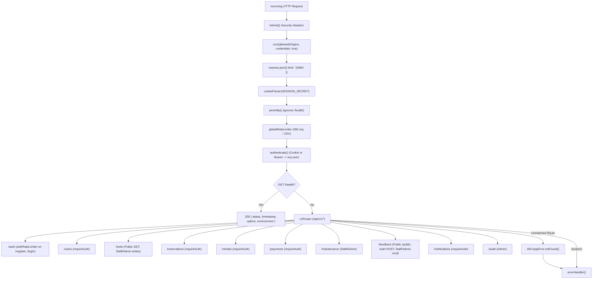

# 05 — API Architecture

> **Epistemic Classification Legend**
>
> - `[Verified from source code]` — Directly observed in repository files, schemas, configurations, or tool outputs.
> - `[Inferred from architecture]` — Logically deduced from codebase structure, middleware order, or runtime behavior.
> - `[Assumption requiring validation]` — Organizational, municipal policy, or operational assumption not codified in source code.

---

## Table of Contents

- [1. Executive Summary](#1-executive-summary)
- [2. Purpose](#2-purpose)
- [3. Scope](#3-scope)
- [4. Key Components](#4-key-components)
- [5. Architecture Diagrams](#5-architecture-diagrams)
  - [5.1 API Routing & Middleware Pipeline](#51-api-routing--middleware-pipeline)
- [6. Technical Details & Detailed Analysis](#6-technical-details--detailed-analysis)
  - [6.1 API Styles Absent from Codebase (GraphQL, Webhooks, Event Streams)](#61-api-styles-absent-from-codebase-graphql-webhooks-event-streams)
  - [6.2 Global Conventions, Versioning & Error Contract](#62-global-conventions-versioning--error-contract)
  - [6.3 Complete Endpoint Catalog (All 40 Endpoints)](#63-complete-endpoint-catalog-all-40-endpoints)
  - [6.4 OpenAPI 3.1 Specification Excerpt & Examples](#64-openapi-31-specification-excerpt--examples)
  - [6.5 Internal Services & Cross-Module APIs](#65-internal-services--cross-module-apis)
- [7. Findings](#7-findings)
- [8. Risks](#8-risks)
- [9. Recommendations](#9-recommendations)
- [10. Future Enhancements](#10-future-enhancements)
- [11. References to Source Files & Cross-References](#11-references-to-source-files--cross-references)

---

## 1. Executive Summary

MCTEB exposes a **versioned RESTful JSON API** mounted under `/api/v1` alongside a root `/health` check endpoint, totaling **40 HTTP routes** across 10 Express domain routers (`[Verified from source code]`, `apps/api/src/app.ts` lines 81–104).

**Explicit Negative Findings (`[Verified from source code]`):**

- **No GraphQL APIs** exist (no GraphQL server, SDL schemas, or resolvers).
- **No Webhooks** exist (no incoming webhook receivers and no outbound HTTP webhook dispatchers).
- **No Real-Time Event APIs** (no WebSockets, Server-Sent Events, or gRPC endpoints) exist.

Every state-changing endpoint parses incoming request bodies or query strings using `@mcteb/shared` Zod schemas inside controller methods (`[Verified from source code]`). Uniform errors return `{ error: { code, message, details? } }` via `errorHandler` (`apps/api/src/middleware/errorHandler.ts`) (`[Verified from source code]`).

---

## 2. Purpose

This document catalogs every HTTP endpoint, internal service contract, authentication guard, Zod validation schema, dependency chain, error envelope, and OpenAPI-compatible request/response specification across the MCTEB API surface.

---

## 3. Scope

Covers `apps/api/src/app.ts`, all 10 `*.routes.ts` and `*.controller.ts` files in `apps/api/src/modules/`, `apps/api/src/middleware/`, `apps/api/src/utils/errors.ts`, and `packages/shared/src/schemas/` (`[Verified from source code]`).

---

## 4. Key Components

- **Router Mount (`apps/api/src/app.ts`)**: `v1Router` mounted at `/api/v1` with 10 sub-routers (`auth`, `users`, `tools`, `reservations`, `rentals`, `payments`, `maintenance`, `feedback`, `notifications`, `audit`) (`[Verified from source code]`).
- **Validation Layer (`packages/shared/src/schemas/*`)**: Zod schemas invoked directly via `Schema.parse(...)` inside controllers (`[Verified from source code]`). _(Note: `apps/api/src/middleware/validate.ts` exists as unused middleware.)_
- **Auth & Rate-Limit Middleware (`apps/api/src/middleware/`)**: `globalRateLimiter`, `authRateLimiter`, `authenticate`, `requireAuth`, `requireRole` (`[Verified from source code]`).
- **Central Error Formatter (`apps/api/src/middleware/errorHandler.ts`)**: Converts `AppError`, `ZodError`, and unhandled exceptions into JSON responses (`[Verified from source code]`).

---

## 5. Architecture Diagrams

### 5.1 API Routing & Middleware Pipeline



---

## 6. Technical Details & Detailed Analysis

### 6.1 API Styles Absent from Codebase (GraphQL, Webhooks, Event Streams)

| Paradigm                          | Status          | Source Verification                                                                                                                                      |
| --------------------------------- | --------------- | -------------------------------------------------------------------------------------------------------------------------------------------------------- |
| **REST / JSON over HTTP**         | **Implemented** | 40 routes in `apps/api/src/app.ts` and `modules/*/*.routes.ts` `[Verified from source code]`                                                             |
| **GraphQL APIs**                  | **Absent**      | Zero `.graphql` files, Apollo/Yoga packages, or `/graphql` endpoints `[Verified from source code]`                                                       |
| **Webhooks (Inbound / Outbound)** | **Absent**      | Zero `fetch`/`axios`/webhook signature handlers in `apps/api/src/` (`report.md` lists payment webhooks as Phase 2 roadmap) `[Verified from source code]` |
| **Events / WebSockets / SSE**     | **Absent**      | No `ws`, `socket.io`, `EventSource`, or `EventEmitter` usage `[Verified from source code]`                                                               |

### 6.2 Global Conventions, Versioning & Error Contract

- **Versioning**: Path-based versioning under `/api/v1` (`app.use('/api/v1', v1Router)`) (`[Verified from source code]`).
- **Payload Limit**: `express.json({ limit: '100kb' })` (`[Verified from source code]`, `apps/api/src/app.ts` line 61).
- **Uniform Error Format** (`apps/api/src/middleware/errorHandler.ts` lines 12–43) (`[Verified from source code]`):
  - `AppError`: `{ error: { code, message, details } }` with HTTP `400`, `401`, `403`, `404`, `409`, or `500`.
  - `ZodError`: `400` `{ error: { code: 'VALIDATION_ERROR', message: 'Invalid request payload', details: err.flatten().fieldErrors } }`.
  - Unhandled error: `500` `{ error: { code: 'INTERNAL_SERVER_ERROR', message: 'An unexpected internal server error occurred' } }`.

### 6.3 Complete Endpoint Catalog (All 40 Endpoints)

#### A. System & Health (`apps/api/src/app.ts`)

| Route     | Method | Auth   | Input | Output                                             | Validation & Dependencies                      |
| --------- | ------ | ------ | ----- | -------------------------------------------------- | ---------------------------------------------- |
| `/health` | `GET`  | Public | None  | `200` `{ status, timestamp, uptime, environment }` | None; reads `env.NODE_ENV`, `process.uptime()` |

#### B. Authentication (`/api/v1/auth`, `auth.routes.ts`, `auth.controller.ts`)

| Route                   | Method | Auth                       | Input                     | Output                                                       | Validation & Dependencies                                                                                                                            |
| ----------------------- | ------ | -------------------------- | ------------------------- | ------------------------------------------------------------ | ---------------------------------------------------------------------------------------------------------------------------------------------------- |
| `/api/v1/auth/register` | `POST` | Public (`authRateLimiter`) | Body: `RegisterUserInput` | `201` `{ user, token }` + `Set-Cookie: mcteb_session`        | `RegisterUserSchema`; `AuthService.register` -> `AuthRepository`, `SessionRepository`, `AuditService`, `NotificationsService`, `crypto.hashPassword` |
| `/api/v1/auth/login`    | `POST` | Public (`authRateLimiter`) | Body: `LoginInput`        | `200` `{ user, token }` + `Set-Cookie: mcteb_session`        | `LoginSchema`; `AuthService.login` -> `AuthRepository`, `SessionRepository`, `AuditService`, `crypto.verifyPassword`                                 |
| `/api/v1/auth/logout`   | `POST` | Public (optional token)    | Cookie or Bearer token    | `200` `{ message: 'Signed out successfully' }` + clearCookie | `AuthService.logout` -> `SessionRepository.delete`                                                                                                   |
| `/api/v1/auth/me`       | `GET`  | `requireAuth`              | Session token             | `200` `User` (without `password_hash`)                       | `AuthService.getCurrentUser` -> `AuthRepository.findById`                                                                                            |

#### C. Users (`/api/v1/users`, `users.routes.ts`, `users.controller.ts`)

| Route                       | Method  | Auth                                          | Input                                      | Output         | Validation & Dependencies                                                                                              |
| --------------------------- | ------- | --------------------------------------------- | ------------------------------------------ | -------------- | ---------------------------------------------------------------------------------------------------------------------- |
| `/api/v1/users`             | `GET`   | `requireAuth`, `requireRole('Administrator')` | None                                       | `200` `User[]` | `UsersService.getAllUsers` -> `UsersRepository.findAll`                                                                |
| `/api/v1/users/:id`         | `GET`   | `requireAuth` + IDOR (`Borrower` self-only)   | Param: `id`                                | `200` `User`   | `UsersService.getUserById` -> `UsersRepository.findById`                                                               |
| `/api/v1/users/:id/profile` | `PATCH` | `requireAuth` + IDOR (non-Admin self-only)    | Param: `id`, Body: `UpdateProfileInput`    | `200` `User`   | `UpdateProfileSchema`; `UsersService.updateProfile` -> `UsersRepository`, `AuditService`                               |
| `/api/v1/users/:id/status`  | `PATCH` | `requireAuth`, `requireRole('Administrator')` | Param: `id`, Body: `UpdateUserStatusInput` | `200` `User`   | `UpdateUserStatusSchema`; `UsersService.updateUserStatus` -> `UsersRepository`, `AuditService`, `NotificationsService` |
| `/api/v1/users/:id/role`    | `PATCH` | `requireAuth`, `requireRole('Administrator')` | Param: `id`, Body: `UpdateUserRoleInput`   | `200` `User`   | `UpdateUserRoleSchema`; `UsersService.updateUserRole` -> `UsersRepository`, `AuditService`, `NotificationsService`     |

#### D. Tools (`/api/v1/tools`, `tools.routes.ts`, `tools.controller.ts`)

| Route                       | Method  | Auth                                                             | Input                                                                                         | Output                                   | Validation & Dependencies                                                          |
| --------------------------- | ------- | ---------------------------------------------------------------- | --------------------------------------------------------------------------------------------- | ---------------------------------------- | ---------------------------------------------------------------------------------- |
| `/api/v1/tools`             | `GET`   | Public                                                           | Query: `ToolFilterInput` (`search`, `category`, `availability`, `condition`, `page`, `limit`) | `200` `{ items: Tool[], total: number }` | `ToolFilterSchema`; `ToolsService.getTools` -> `ToolsRepository.findMany`          |
| `/api/v1/tools/:id`         | `GET`   | Public                                                           | Param: `id`                                                                                   | `200` `Tool`                             | `ToolsService.getToolById` -> `ToolsRepository.findById`                           |
| `/api/v1/tools`             | `POST`  | `requireAuth`, `requireRole('Municipal Staff', 'Administrator')` | Body: `CreateToolInput`                                                                       | `201` `Tool`                             | `CreateToolSchema`; `ToolsService.createTool` -> `ToolsRepository`, `AuditService` |
| `/api/v1/tools/:id`         | `PATCH` | `requireAuth`, `requireRole('Municipal Staff', 'Administrator')` | Param: `id`, Body: `UpdateToolInput`                                                          | `200` `Tool`                             | `UpdateToolSchema`; `ToolsService.updateTool` -> `ToolsRepository`, `AuditService` |
| `/api/v1/tools/:id/archive` | `POST`  | `requireAuth`, `requireRole('Municipal Staff', 'Administrator')` | Param: `id`                                                                                   | `200` `Tool`                             | `ToolsService.archiveTool` -> `ToolsRepository`, `AuditService`                    |

#### E. Reservations (`/api/v1/reservations`, `reservations.routes.ts`, `reservations.controller.ts`)

| Route                             | Method  | Auth                                                                 | Input                                       | Output                           | Validation & Dependencies                                                                                                                                 |
| --------------------------------- | ------- | -------------------------------------------------------------------- | ------------------------------------------- | -------------------------------- | --------------------------------------------------------------------------------------------------------------------------------------------------------- |
| `/api/v1/reservations`            | `GET`   | `requireAuth` (Borrower scoped to own; Staff/Admin all + `?status=`) | Query: optional `status`                    | `200` `ReservationWithDetails[]` | `ReservationStatusSchema`; `ReservationsService` -> `ReservationsRepository`                                                                              |
| `/api/v1/reservations`            | `POST`  | `requireAuth` _(No `requireRole('Borrower')`!)_                      | Body: `CreateReservationInput`              | `201` `ReservationWithDetails`   | `CreateReservationSchema`; `ReservationsService.createReservation` -> `ToolsRepository`, `ReservationsRepository`, `AuditService`, `NotificationsService` |
| `/api/v1/reservations/:id`        | `GET`   | `requireAuth` + IDOR (`Borrower` own only)                           | Param: `id`                                 | `200` `ReservationWithDetails`   | `ReservationsService.getById`                                                                                                                             |
| `/api/v1/reservations/:id/cancel` | `POST`  | `requireAuth` + IDOR (`Borrower` own only)                           | Param: `id`                                 | `200` `ReservationWithDetails`   | `ReservationsService.cancelReservation` -> `ReservationsRepository`, `AuditService`, `NotificationsService`                                               |
| `/api/v1/reservations/:id/review` | `PATCH` | `requireAuth`, `requireRole('Municipal Staff', 'Administrator')`     | Param: `id`, Body: `ReviewReservationInput` | `200` `ReservationWithDetails`   | `ReviewReservationSchema`; `ReservationsService.reviewReservation`                                                                                        |

#### F. Rentals (`/api/v1/rentals`, `rentals.routes.ts`, `rentals.controller.ts`)

| Route                        | Method | Auth                                                                 | Input                                  | Output                      | Validation & Dependencies                                                                                                                                     |
| ---------------------------- | ------ | -------------------------------------------------------------------- | -------------------------------------- | --------------------------- | ------------------------------------------------------------------------------------------------------------------------------------------------------------- |
| `/api/v1/rentals`            | `GET`  | `requireAuth` (Borrower scoped to own; Staff/Admin all + `?status=`) | Query: optional `status`               | `200` `RentalWithDetails[]` | `RentalStatusSchema`; `RentalsService` -> `RentalsRepository`                                                                                                 |
| `/api/v1/rentals/:id`        | `GET`  | `requireAuth` + IDOR (`Borrower` own only)                           | Param: `id`                            | `200` `RentalWithDetails`   | `RentalsService.getById`                                                                                                                                      |
| `/api/v1/rentals/checkout`   | `POST` | `requireAuth`, `requireRole('Municipal Staff', 'Administrator')`     | Body: `CheckoutRentalInput`            | `201` `RentalWithDetails`   | `CheckoutRentalSchema`; `RentalsService.checkout` -> `ToolsRepository`, `RentalsRepository`, `ReservationsRepository`, `AuditService`, `NotificationsService` |
| `/api/v1/rentals/:id/return` | `POST` | `requireAuth`, `requireRole('Municipal Staff', 'Administrator')`     | Param: `id`, Body: `ReturnRentalInput` | `200` `RentalWithDetails`   | `ReturnRentalSchema`; `RentalsService.processReturn` -> `RentalsRepository`, `ToolsRepository`, `AuditService`, `NotificationsService`                        |

#### G. Payments (`/api/v1/payments`, `payments.routes.ts`, `payments.controller.ts`)

| Route                         | Method  | Auth                                                             | Input                                   | Output                       | Validation & Dependencies                                                                                              |
| ----------------------------- | ------- | ---------------------------------------------------------------- | --------------------------------------- | ---------------------------- | ---------------------------------------------------------------------------------------------------------------------- |
| `/api/v1/payments`            | `GET`   | `requireAuth` (Borrower own; Staff/Admin all + `?status=`)       | Query: optional `status`                | `200` `PaymentWithDetails[]` | `PaymentStatusSchema`; `PaymentsService` -> `PaymentsRepository`                                                       |
| `/api/v1/payments`            | `POST`  | `requireAuth` _(No `requireRole('Borrower')`!)_                  | Body: `CreatePaymentInput`              | `201` `PaymentWithDetails`   | `CreatePaymentSchema`; `PaymentsService.recordPayment` -> `PaymentsRepository`, `AuditService`, `NotificationsService` |
| `/api/v1/payments/:id`        | `GET`   | `requireAuth` + IDOR (`Borrower` own only)                       | Param: `id`                             | `200` `PaymentWithDetails`   | `PaymentsService.getById`                                                                                              |
| `/api/v1/payments/:id/verify` | `PATCH` | `requireAuth`, `requireRole('Municipal Staff', 'Administrator')` | Param: `id`, Body: `VerifyPaymentInput` | `200` `PaymentWithDetails`   | `VerifyPaymentSchema`; `PaymentsService.verifyPayment`                                                                 |

#### H. Maintenance (`/api/v1/maintenance`, `maintenance.routes.ts`, `maintenance.controller.ts`)

| Route                     | Method  | Auth                                                             | Input                                       | Output                           | Validation & Dependencies                                                                                                  |
| ------------------------- | ------- | ---------------------------------------------------------------- | ------------------------------------------- | -------------------------------- | -------------------------------------------------------------------------------------------------------------------------- |
| `/api/v1/maintenance`     | `GET`   | `requireAuth`, `requireRole('Municipal Staff', 'Administrator')` | Query: optional `status`                    | `200` `MaintenanceWithDetails[]` | `MaintenanceStatusSchema`; `MaintenanceService.getAll`                                                                     |
| `/api/v1/maintenance/:id` | `GET`   | `requireAuth`, `requireRole('Municipal Staff', 'Administrator')` | Param: `id`                                 | `200` `MaintenanceWithDetails`   | `MaintenanceService.getById`                                                                                               |
| `/api/v1/maintenance`     | `POST`  | `requireAuth`, `requireRole('Municipal Staff', 'Administrator')` | Body: `CreateMaintenanceInput`              | `201` `MaintenanceWithDetails`   | `CreateMaintenanceSchema`; `MaintenanceService.createReport` -> `ToolsRepository`, `MaintenanceRepository`, `AuditService` |
| `/api/v1/maintenance/:id` | `PATCH` | `requireAuth`, `requireRole('Municipal Staff', 'Administrator')` | Param: `id`, Body: `UpdateMaintenanceInput` | `200` `MaintenanceWithDetails`   | `UpdateMaintenanceSchema`; `MaintenanceService.updateRecord` -> `ToolsRepository`, `MaintenanceRepository`, `AuditService` |

#### I. Feedback (`/api/v1/feedback`, `feedback.routes.ts`, `feedback.controller.ts`)

| Route                           | Method  | Auth                                                             | Input                                      | Output                                               | Validation & Dependencies                                                                                           |
| ------------------------------- | ------- | ---------------------------------------------------------------- | ------------------------------------------ | ---------------------------------------------------- | ------------------------------------------------------------------------------------------------------------------- |
| `/api/v1/feedback/public`       | `GET`   | Public                                                           | Query: optional `tool_id`                  | `200` `FeedbackWithDetails[]` (masked reviewer name) | `FeedbackService.getPublicReviews` -> `FeedbackRepository.findPublic`                                               |
| `/api/v1/feedback`              | `POST`  | `requireAuth` _(No `requireRole('Borrower')`!)_                  | Body: `CreateFeedbackInput`                | `201` `FeedbackWithDetails`                          | `CreateFeedbackSchema`; `FeedbackService.submitFeedback` -> `ToolsRepository`, `FeedbackRepository`, `AuditService` |
| `/api/v1/feedback/all`          | `GET`   | `requireAuth`, `requireRole('Municipal Staff', 'Administrator')` | None                                       | `200` `FeedbackWithDetails[]` (unmasked)             | `FeedbackService.getAllReviews`                                                                                     |
| `/api/v1/feedback/:id/moderate` | `PATCH` | `requireAuth`, `requireRole('Municipal Staff', 'Administrator')` | Param: `id`, Body: `ModerateFeedbackInput` | `200` `FeedbackWithDetails`                          | `ModerateFeedbackSchema`; `FeedbackService.moderateFeedback`                                                        |

#### J. Notifications (`/api/v1/notifications`, `notifications.routes.ts`, `notifications.controller.ts`)

| Route                                 | Method  | Auth          | Input       | Output                                           | Validation & Dependencies                        |
| ------------------------------------- | ------- | ------------- | ----------- | ------------------------------------------------ | ------------------------------------------------ |
| `/api/v1/notifications`               | `GET`   | `requireAuth` | None        | `200` `Notification[]` (scoped to `req.user.id`) | `NotificationsService.getForUser`                |
| `/api/v1/notifications/:id/read`      | `PATCH` | `requireAuth` | Param: `id` | `200` `{ success: true }`                        | `NotificationsService.markRead(id, req.user.id)` |
| `/api/v1/notifications/mark-all-read` | `POST`  | `requireAuth` | None        | `200` `{ success: true, count: number }`         | `NotificationsService.markAllRead(req.user.id)`  |

#### K. Audit (`/api/v1/audit`, `audit.routes.ts`, `audit.controller.ts`)

| Route           | Method | Auth                                          | Input                                                                                            | Output                                       | Validation & Dependencies                      |
| --------------- | ------ | --------------------------------------------- | ------------------------------------------------------------------------------------------------ | -------------------------------------------- | ---------------------------------------------- |
| `/api/v1/audit` | `GET`  | `requireAuth`, `requireRole('Administrator')` | Query: `AuditLogFilterInput` (`action`, `target_type`, `target_id`, `actor_id`, `page`, `limit`) | `200` `{ items: AuditLog[], total: number }` | `AuditLogFilterSchema`; `AuditService.getLogs` |

### 6.4 OpenAPI 3.1 Specification Excerpt & Examples

Below is an OpenAPI 3.1-style specification excerpt reflecting the verified request/response schemas (`[Verified from source code]`):

```yaml
openapi: 3.1.0
info:
  title: MCTEB Municipal Equipment Bank API
  version: 0.1.0
servers:
  - url: http://localhost:3000/api/v1
components:
  securitySchemes:
    bearerAuth:
      type: http
      scheme: bearer
    cookieAuth:
      type: apiKey
      in: cookie
      name: mcteb_session
paths:
  /reservations:
    post:
      summary: Submit advance equipment reservation request
      security:
        - cookieAuth: []
        - bearerAuth: []
      requestBody:
        required: true
        content:
          application/json:
            schema:
              type: object
              required: [tool_id, pickup_date, return_date]
              properties:
                tool_id: { type: string, format: uuid }
                quantity: { type: integer, minimum: 1, default: 1 }
                pickup_date: { type: string, pattern: "^\\d{4}-\\d{2}-\\d{2}$" }
                return_date: { type: string, pattern: "^\\d{4}-\\d{2}-\\d{2}$" }
                purpose: { type: string, maxLength: 255 }
            example:
              tool_id: 'b0000000-0000-4000-8000-000000000001'
              quantity: 1
              pickup_date: '2026-11-20'
              return_date: '2026-11-22'
              purpose: 'Root crop land preparation in San Antonio'
      responses:
        '201':
          description: Created ReservationWithDetails
        '400':
          description: Zod validation error or tool Archived/Damaged
        '409':
          description: Insufficient tool inventory for selected dates
```

### 6.5 Internal Services & Cross-Module APIs

Two backend services act exclusively as internal domain services called by sibling services rather than only HTTP endpoints (`[Verified from source code]`):

- `AuditService.record(input: CreateAuditLogInput)` (`apps/api/src/modules/audit/audit.service.ts` lines 5–7) — invoked synchronously by 8 modules (`auth`, `users`, `tools`, `reservations`, `rentals`, `payments`, `maintenance`, `feedback`).
- `NotificationsService.create(input: CreateNotificationInput)` (`apps/api/src/modules/notifications/notifications.service.ts` lines 5–7) — invoked synchronously by `auth`, `users`, `reservations`, `rentals`, `payments`.

---

## 7. Findings

### Verified from Source Code

1. All 40 endpoints are documented across `/health` and `/api/v1/*`; no GraphQL, WebSocket, or webhook endpoints exist.
2. `POST /api/v1/reservations`, `POST /api/v1/payments`, and `POST /api/v1/feedback` use `requireAuth` without `requireRole('Borrower')`, diverging from `packages/shared/src/permissions.ts`.
3. `apps/api/src/middleware/validate.ts` is unused; all controllers invoke `Schema.parse()` inside `try/catch` blocks.
4. `FeedbackController.listPublic` reads `req.query.tool_id as string | undefined` without UUID Zod validation (`apps/api/src/modules/feedback/feedback.controller.ts` line 9).
5. `ReservationsController.list`, `RentalsController.list`, `PaymentsController.list`, and `MaintenanceController.list` accept optional `status` query parameter parsed via Zod, whereas `AuditController.getLogs` and `ToolsController.list` are the only endpoints supporting pagination (`page` / `limit`).

### Inferred from Architecture

1. Inconsistent response envelopes exist across list endpoints: `/tools` and `/audit` return `{ items, total }`, whereas `/users`, `/reservations`, `/rentals`, `/payments`, `/maintenance`, `/feedback/*`, and `/notifications` return raw top-level JSON arrays (`[...]`) (`[Verified from source code]`).

### Assumptions Requiring Validation

1. `[Assumption requiring validation]` No external consumers depend on `/api/v1` yet, so standardizing response envelopes or adding pagination would only require coordinated updates in `apps/web`.

---

## 8. Risks

| ID         | Risk                                                    | Severity   | Details                                                                                                                                                |
| ---------- | ------------------------------------------------------- | ---------- | ------------------------------------------------------------------------------------------------------------------------------------------------------ |
| **API-01** | Missing role restriction on Borrower write endpoints    | **High**   | Staff or Admins can submit borrower reservations, payments, and feedback via API calls (`[Verified from source code]`).                                |
| **API-02** | Unpaginated list endpoints                              | **Medium** | `/users`, `/reservations`, `/rentals`, `/payments`, `/maintenance`, `/feedback/*`, and `/notifications` return entire tables without `LIMIT`/`OFFSET`. |
| **API-03** | Unvalidated `id` route params and `tool_id` query param | **Low**    | Passing malformed non-UUID `id` triggers unnecessary SQLite queries before returning 404 or empty array (`[Verified from source code]`).               |

---

## 9. Recommendations

1. **Enforce `requireRole('Borrower')` or `requirePermission(...)`**: Wire `requirePermission` from `apps/api/src/middleware/auth.ts` onto `reservations`, `payments`, and `feedback` creation routes (`[Verified from source code]`).
2. **Adopt `validate()` Middleware Consistently**: Validate `params`, `query`, and `body` uniformly using `apps/api/src/middleware/validate.ts` and enforce `.strict()` on schemas (`[Verified from source code]`).
3. **Standardize Pagination & Response Envelopes**: Migrate unpaginated array endpoints to `{ items, total, page, limit }` with bounded `max(100)` limits (`[Inferred from architecture]`).

---

## 10. Future Enhancements

1. **Generated OpenAPI / Swagger UI Endpoint**: Use `zod-to-openapi` against `@mcteb/shared` schemas to serve live interactive documentation at `/api/v1/docs` (`[Inferred from architecture]`).
2. **Payment Webhook Endpoint**: Add `/api/v1/webhooks/payments` with HMAC signature verification when Phase 2 digital payments launch (`report.md`).

---

## 11. References to Source Files & Cross-References

| File                                                         | Scope                                                      |
| ------------------------------------------------------------ | ---------------------------------------------------------- |
| `apps/api/src/app.ts`                                        | Global middleware, `/health`, `/api/v1` mount, 404 handler |
| `apps/api/src/modules/*/*.routes.ts`, `*.controller.ts`      | All 40 route definitions and request handlers              |
| `apps/api/src/middleware/errorHandler.ts`, `utils/errors.ts` | Error codes and HTTP status mappings                       |
| `packages/shared/src/schemas/*.ts`                           | Canonical Zod input/output contracts                       |

**Cross-References**: See [06-Authentication-and-Security.md](./06-Authentication-and-Security.md), [07-User-Roles-and-Permissions.md](./07-User-Roles-and-Permissions.md), [21-Developer-Architecture-Guide.md](./21-Developer-Architecture-Guide.md), and [22-Backend-Architecture.md](./22-Backend-Architecture.md).
