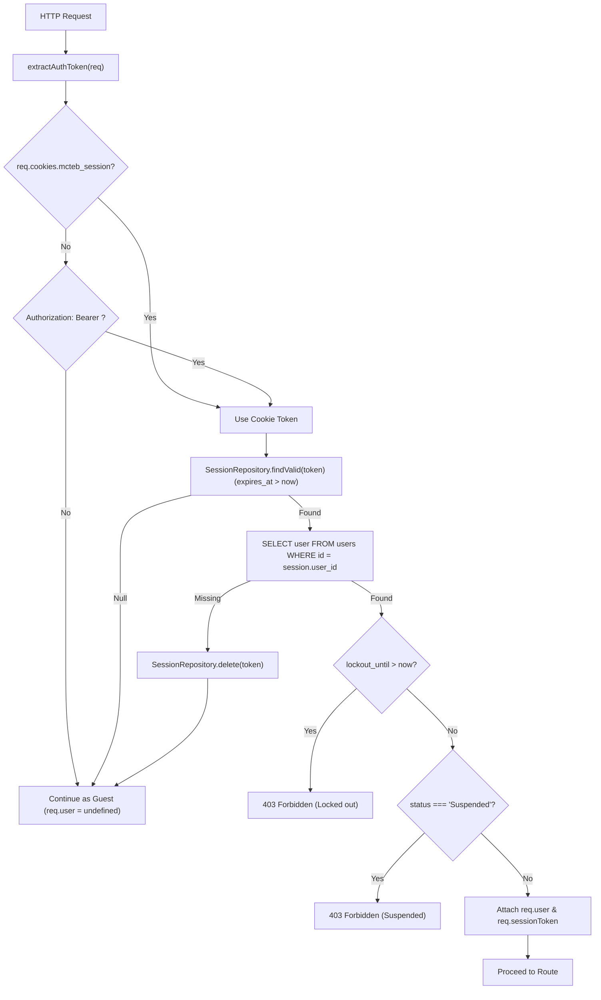

# 06 — Authentication & Security

> **Epistemic Classification Legend**
>
> - `[Verified from source code]` — Directly observed in repository files, schemas, configurations, or tool outputs.
> - `[Inferred from architecture]` — Logically deduced from codebase structure, middleware order, or runtime behavior.
> - `[Assumption requiring validation]` — Organizational, municipal policy, or operational assumption not codified in source code.

---

## Table of Contents

- [1. Executive Summary](#1-executive-summary)
- [2. Purpose](#2-purpose)
- [3. Scope](#3-scope)
- [4. Key Components](#4-key-components)
- [5. Architecture Diagrams](#5-architecture-diagrams)
  - [5.1 Authentication & Session Verification Pipeline](#51-authentication--session-verification-pipeline)
- [6. Technical Details & Detailed Analysis](#6-technical-details--detailed-analysis)
  - [6.1 Password Hashing & Timing-Safe Verification](#61-password-hashing--timing-safe-verification)
  - [6.2 Session Architecture vs JWT & OAuth](#62-session-architecture-vs-jwt--oauth)
  - [6.3 Brute-Force Lockout & Rate Limiting](#63-brute-force-lockout--rate-limiting)
  - [6.4 Authorization, RBAC, IDOR & Admin Safeguards](#64-authorization-rbac-idor--admin-safeguards)
  - [6.5 HTTP Security Headers, CORS & Privacy Masking](#65-http-security-headers-cors--privacy-masking)
  - [6.6 Secrets Management & Data Protection](#66-secrets-management--data-protection)
  - [6.7 OWASP Top 10 (2021) Assessment](#67-owasp-top-10-2021-assessment)
- [7. Findings](#7-findings)
- [8. Risks](#8-risks)
- [9. Recommendations](#9-recommendations)
- [10. Future Enhancements](#10-future-enhancements)
- [11. References to Source Files & Cross-References](#11-references-to-source-files--cross-references)

---

## 1. Executive Summary

MCTEB implements a **stateful opaque-token session authentication system** backed by SQLite (`sessions` table), `crypto.scrypt` password hashing, `crypto.timingSafeEqual` hash comparison, IP-based rate limiting (`express-rate-limit`), and a 5-attempt / 15-minute account lockout mechanism (`[Verified from source code]`). Neither **JWTs** nor **OAuth 2.0 / OIDC** are used (`[Verified from source code]`).

While strong foundational controls are present (parameterized SQL, Helmet CSP headers, generic login errors, IDOR checks on borrower queries, last-admin protection, surname masking in public reviews), code review identified notable security gaps: dual session token storage in browser `localStorage`, unused `SESSION_SECRET` cookie signing, missing `requireRole('Borrower')` enforcement on borrower write endpoints, non-revocation of active sessions upon user suspension, and live SQLite database files tracked in Git (`[Verified from source code]`).

---

## 2. Purpose

This document analyzes all authentication, session management, authorization, cryptographic, transport, privacy, and secret-management controls implemented in MCTEB, providing an OWASP-aligned risk evaluation and actionable hardening plan.

---

## 3. Scope

Covers `apps/api/src/utils/crypto.ts`, `apps/api/src/middleware/auth.ts`, `rateLimit.ts`, `apps/api/src/modules/auth/*`, `apps/api/src/modules/users/*`, `apps/api/src/app.ts`, `apps/api/src/config/env.ts`, `apps/web/src/lib/api.ts`, `auth-context.tsx`, `.env.example`, and `SECURITY.md` (`[Verified from source code]`).

---

## 4. Key Components

- **Cryptography Helper (`apps/api/src/utils/crypto.ts`)**: `hashPassword`, `verifyPassword`, `generateSessionToken`, `generateUUID` (`[Verified from source code]`).
- **Session Store (`apps/api/src/modules/auth/session.repository.ts`)**: Persistent SQLite `sessions` table with 7-day TTL (`[Verified from source code]`).
- **Auth Middleware (`apps/api/src/middleware/auth.ts`)**: `extractAuthToken`, `authenticate`, `requireAuth`, `requireRole`, `requirePermission` (unused) (`[Verified from source code]`).
- **Rate Limiters (`apps/api/src/middleware/rateLimit.ts`)**: `globalRateLimiter` (300/15m) and `authRateLimiter` (10/15m) (`[Verified from source code]`).

---

## 5. Architecture Diagrams

### 5.1 Authentication & Session Verification Pipeline



---

## 6. Technical Details & Detailed Analysis

### 6.1 Password Hashing & Timing-Safe Verification

From `apps/api/src/utils/crypto.ts` (lines 7–39) (`[Verified from source code]`):

```ts
export async function hashPassword(password: string): Promise<string> {
  return new Promise((resolve, reject) => {
    const salt = crypto.randomBytes(16).toString('hex');
    crypto.scrypt(password, salt, 64, (err, derivedKey) => {
      if (err) reject(err);
      resolve(`scrypt$${salt}$${derivedKey.toString('hex')}`);
    });
  });
}
```

- Uses Node.js `crypto.scrypt` with a 16-byte cryptographic salt (`32` hex characters) and 64-byte derived key (`[Verified from source code]`).
- `verifyPassword` verifies length equality before invoking `crypto.timingSafeEqual(originalBuffer, derivedKey)` to prevent timing side-channel leaks (`[Verified from source code]`).
- Note: `PROJECT_PLAN.md` Section B5 recommended `argon2id` and `docs/database.md` mentions `bcrypt/scrypt`, while the implementation chose zero-dependency Node `scrypt` (`[Verified from source code]`).

### 6.2 Session Architecture vs JWT & OAuth

- **Stateful Opaque Tokens**: `generateSessionToken()` produces 32 random bytes as a 64-character hex string (`crypto.randomBytes(32).toString('hex')`) stored in SQLite `sessions` with `expires_at = now + 7 days` (`[Verified from source code]`, `session.repository.ts`).
- **JWT**: **Not implemented** (`[Verified from source code]`). No JWT libraries (`jsonwebtoken`, `jose`) are installed (`[Verified from source code]`).
- **OAuth / SSO**: **Not implemented** (`[Verified from source code]`).
- **Dual Client Storage Issue**: `AuthController.login` and `register` set cookie `mcteb_session` (`httpOnly: true`, `secure: env.NODE_ENV === 'production'`, `sameSite: 'lax'`, `maxAge: 7 days`) **AND** return `{ user, token }` in JSON (`apps/api/src/modules/auth/auth.controller.ts` lines 14–21, 33–40). The frontend (`apps/web/src/lib/auth-context.tsx` lines 41, 50) writes `localStorage.setItem('mcteb_token', data.token)` and sends `Authorization: Bearer ${token}` on every `apiRequest()` (`apps/web/src/lib/api.ts` lines 27–36) (`[Verified from source code]`).

### 6.3 Brute-Force Lockout & Rate Limiting

- **HTTP Rate Limiting (`apps/api/src/middleware/rateLimit.ts`)**:
  - `globalRateLimiter`: Max 300 requests per 15-minute window per IP (`[Verified from source code]`).
  - `authRateLimiter`: Max 10 requests per 15-minute window per IP on `POST /api/v1/auth/register` and `POST /api/v1/auth/login` (`[Verified from source code]`).
- **Account Lockout (`apps/api/src/modules/auth/auth.repository.ts` lines 44–58)**:
  - Incorrect passwords increment `failed_login_attempts`. At `>= 5` failures, `lockout_until` is set to `now + 15 minutes` (`[Verified from source code]`).
  - Note: Unknown email lookups and invalid passwords both return `401 Invalid email or password` (preventing email enumeration on wrong credentials), _except_ when a valid account is currently locked or suspended, which returns `403` with remaining minutes or suspension message (`AuthService.login` lines 71–91) (`[Verified from source code]`).

### 6.4 Authorization, RBAC, IDOR & Admin Safeguards

- **Middleware RBAC (`apps/api/src/middleware/auth.ts`)**: `requireAuth` checks `req.user`; `requireRole(...roles)` checks `roles.includes(req.user.role)` (`[Verified from source code]`).
- **Dead Permission Layer**: `requirePermission(action)` (`auth.ts` lines 103–115) and `Permissions` (`packages/shared/src/permissions.ts`) are never attached to routes (`[Verified from source code]`). As a result, `POST /reservations`, `POST /payments`, and `POST /feedback` permit `Municipal Staff` and `Administrator` callers even though `Permissions` limits them to `['Borrower']` (`[Verified from source code]`).
- **IDOR Controls**: `UsersController`, `ReservationsController`, `RentalsController`, `PaymentsController`, and `NotificationsController` enforce ownership checks against `req.user.id` when `req.user.role === 'Borrower'` (`[Verified from source code]`).
- **Admin Self-Lockout Guards (`UsersService`)**: Blocks `actor.id === id && input.status === 'Suspended'` and blocks suspending or demoting the last active `Administrator` (`UsersRepository.countActiveAdmins() <= 1`) (`[Verified from source code]`).

### 6.5 HTTP Security Headers, CORS & Privacy Masking

- **Helmet (`apps/api/src/app.ts` lines 32–43)**: Sets CSP (`defaultSrc: ["'self'"]`, `imgSrc: ["'self'", 'data:', 'https:']`, `scriptSrc: ["'self'"]`, `styleSrc: ["'self'", "'unsafe-inline'"]`) and disables `x-powered-by` (`[Verified from source code]`).
- **CORS (`apps/api/src/app.ts` lines 46–58)**: Allows `allowedOrigins` from `env.CORS_ORIGINS`, `!origin` (curl/mobile), **or any origin when `env.NODE_ENV === 'development'`** (`[Verified from source code]`).
- **Privacy Masking (`FeedbackService.getPublicReviews`)**: Truncates reviewer surnames to first initial (`Ana Reyes` -> `Ana R.`) and omits phone/email/address (`[Verified from source code]`).

### 6.6 Secrets Management & Data Protection

- **Environment Secrets (`apps/api/src/config/env.ts` line 13)**: `SESSION_SECRET` defaults to `'mcteb-default-session-secret-batanes-32char'` if unset in `.env` (`[Verified from source code]`).
- **Unused Cookie Signing (`apps/api/src/app.ts` line 62)**: `app.use(cookieParser(env.SESSION_SECRET))` passes the secret, but `AuthController` creates unsigned cookies (`signed` option not set) and `extractAuthToken` reads `req.cookies.mcteb_session` rather than `req.signedCookies` (`[Verified from source code]`).
- **Log Redaction (`apps/api/src/utils/logger.ts` line 6)**: Pino redacts `req.headers.authorization`, `req.headers.cookie`, `password`, and `password_hash` (`[Verified from source code]`).

### 6.7 OWASP Top 10 (2021) Assessment

| OWASP Category                          | Posture                 | Verified Evidence                                                                                                                                            |
| --------------------------------------- | ----------------------- | ------------------------------------------------------------------------------------------------------------------------------------------------------------ |
| **A01: Broken Access Control**          | **Partial / Needs Fix** | Strong Borrower IDOR checks; **gap**: `POST /reservations`, `/payments`, `/feedback` lack `requireRole('Borrower')`; `Permissions` matrix unused.            |
| **A02: Cryptographic Failures**         | **Good / Minor Gap**    | Strong `scrypt` + `timingSafeEqual`; **gap**: token stored in `localStorage`; `app.db*` committed to Git; `SESSION_SECRET` has hardcoded default.            |
| **A03: Injection**                      | **Strong**              | Parameterized `db.prepare()` SQL across all repositories; React JSX escaping; no `dangerouslySetInnerHTML`.                                                  |
| **A04: Insecure Design**                | **Partial**             | Atomic `BEGIN IMMEDIATE` stock/rental updates; **gap**: `reviewReservation` does not re-check stock; `SessionRepository.deleteForUser` unused on suspension. |
| **A05: Security Misconfiguration**      | **Partial**             | Helmet CSP & `x-powered-by` disabled; **gap**: missing `trust proxy` setting despite reading `x-forwarded-for`; `apps/api/data/app.db*` tracked in Git.      |
| **A06: Vulnerable Components**          | **Good**                | CI runs `pnpm audit --prod` (`.github/workflows/ci.yml` line 41) `[Verified from source code]`.                                                              |
| **A07: Identification & Auth Failures** | **Good / Minor Gap**    | 5-attempt lockout + rate limiter; **gap**: `failed_login_attempts` is not reset upon lockout expiration, causing instant re-lock on 6th attempt.             |
| **A08: Software & Data Integrity**      | **Good**                | `pnpm-lock.yaml` frozen installs in CI; Zod payload validation.                                                                                              |
| **A09: Security Logging & Monitoring**  | **Strong**              | Pino structured logging + immutable `audit_logs` table recording actor, action, target, IP.                                                                  |
| **A10: SSRF**                           | **Low Risk**            | No server-side outbound HTTP requests (`fetch`/`http.request`) exist anywhere in `apps/api` (`[Verified from source code]`).                                 |

---

## 7. Findings

_(See detailed findings in Sections 6.2–6.7 above and [SECURITY_AUDIT.md](./SECURITY_AUDIT.md) for severity-rated remediation tickets.)_

---

## 8. Risks

1. **HIGH**: Missing `requireRole('Borrower')` on `POST /reservations`, `POST /payments`, `POST /feedback` (`[Verified from source code]`).
2. **MEDIUM**: `localStorage` storage of `mcteb_session` tokens exposes session credentials to any future XSS vector (`[Verified from source code]`).
3. **MEDIUM**: `apps/api/data/app.db*` tracked in Git risks exposing database records (`[Verified from source code]`).
4. **MEDIUM**: Suspended accounts retain valid rows in `sessions` until `authenticate` blocks them—if `SessionRepository.deleteForUser` is not called, session rows remain orphaned (`[Verified from source code]`).
5. **MEDIUM**: Hardcoded default `SESSION_SECRET` allows server startup in `production` without a real secret (`[Verified from source code]`).

---

## 9. Recommendations

1. **Eliminate `localStorage` Session Storage**: Stop returning `token` in `/auth/login` and `/auth/register` JSON bodies (or stop reading/writing `mcteb_token` in `apps/web/src/lib/api.ts` and `auth-context.tsx`), relying exclusively on `HttpOnly; Secure; SameSite=Lax` cookies (`[Verified from source code]`).
2. **Fail Fast on Default `SESSION_SECRET` in Production**: Validate in `apps/api/src/config/env.ts` that `NODE_ENV === 'production'` rejects the default secret (`[Verified from source code]`).
3. **Revoke Sessions on Suspension / Role Demotion**: Call `SessionRepository.deleteForUser(id)` inside `UsersService.updateUserStatus` and `updateUserRole` (`[Verified from source code]`).
4. **Configure `app.set('trust proxy', 1)`** when deploying behind Nginx/Caddy so `express-rate-limit` and `req.ip` identify real client IPs without trusting raw spoofable `x-forwarded-for` headers (`[Inferred from architecture]`).

---

## 10. Future Enhancements

1. **CSRF Protection (`Double-Submit Cookie` or `SameSite=Strict`)**: Add explicit CSRF token validation if moving strictly to cookie auth across subdomains (`[Inferred from architecture]`).
2. **Self-Service Password Change & Reset**: Add authenticated password change and email/OTP reset flows (currently absent from `auth.routes.ts`) (`[Verified from source code]`).

---

## 11. References to Source Files & Cross-References

| File                                                | Symbol / Lines                                                                        |
| --------------------------------------------------- | ------------------------------------------------------------------------------------- |
| `apps/api/src/utils/crypto.ts`                      | `hashPassword`, `verifyPassword`, `generateSessionToken`                              |
| `apps/api/src/middleware/auth.ts`                   | `extractAuthToken`, `authenticate`, `requireAuth`, `requireRole`, `requirePermission` |
| `apps/api/src/middleware/rateLimit.ts`              | `globalRateLimiter`, `authRateLimiter`                                                |
| `apps/api/src/modules/auth/*`                       | `AuthController`, `AuthService`, `AuthRepository`, `SessionRepository`                |
| `apps/api/src/config/env.ts`, `apps/api/src/app.ts` | `SESSION_SECRET`, `helmet`, `cors`, `cookieParser`                                    |

**Cross-References**: See [SECURITY_AUDIT.md](./SECURITY_AUDIT.md), [07-User-Roles-and-Permissions.md](./07-User-Roles-and-Permissions.md), and [05-API-Architecture.md](./05-API-Architecture.md).
