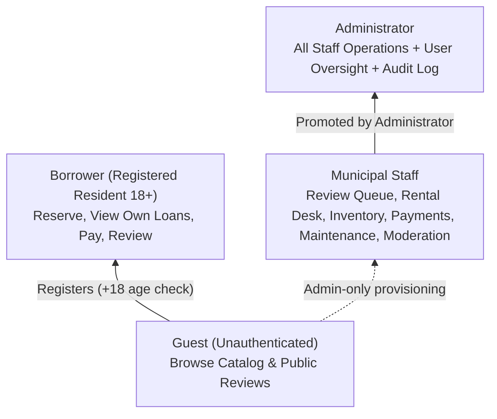
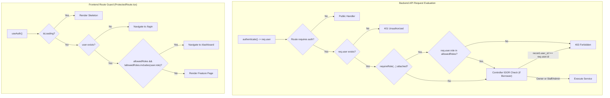

# 07 — User Roles & Permissions

> **Epistemic Classification Legend**
> - `[Verified from source code]` — Directly observed in repository files, schemas, configurations, or tool outputs.
> - `[Inferred from architecture]` — Logically deduced from codebase structure, middleware order, or runtime behavior.
> - `[Assumption requiring validation]` — Organizational, municipal policy, or operational assumption not codified in source code.

---

## Table of Contents

- [1. Executive Summary](#1-executive-summary)
- [2. Purpose](#2-purpose)
- [3. Scope](#3-scope)
- [4. Key Components](#4-key-components)
- [5. Architecture Diagrams](#5-architecture-diagrams)
  - [5.1 Role & Privilege Hierarchy Diagram](#51-role--privilege-hierarchy-diagram)
  - [5.2 Backend & Frontend Permission Evaluation Flow](#52-backend--frontend-permission-evaluation-flow)
- [6. Technical Details & Detailed Analysis](#6-technical-details--detailed-analysis)
  - [6.1 User Categories & Account Statuses](#61-user-categories--account-statuses)
  - [6.2 Role-to-Permissions Summary Table](#62-role-to-permissions-summary-table)
  - [6.3 Complete Feature Access Matrix (`packages/shared/src/permissions.ts`)](#63-complete-feature-access-matrix-packagessharedsrcpermissionsts)
  - [6.4 Declared Permissions vs Runtime Enforcement Drift](#64-declared-permissions-vs-runtime-enforcement-drift)
  - [6.5 Account Status & Administrative Safeguards](#65-account-status--administrative-safeguards)
- [7. Findings](#7-findings)
- [8. Risks](#8-risks)
- [9. Recommendations](#9-recommendations)
- [10. Future Enhancements](#10-future-enhancements)
- [11. References to Source Files & Cross-References](#11-references-to-source-files--cross-references)

---

## 1. Executive Summary

MCTEB defines four user categories across its permission model: **Guest** (unauthenticated visitor), **Borrower** (registered resident >= 18 years old), **Municipal Staff** (operational personnel), and **Administrator** (system & user oversight) (`[Verified from source code]`, `packages/shared/src/enums.ts`, `packages/shared/src/permissions.ts`).

The shared contracts package declares **25 granular `PermissionAction` constants** and a `hasPermission(role, action)` helper (`[Verified from source code]`). However, code analysis reveals an important divergence: neither the backend (`apps/api`) nor the frontend (`apps/web`) actually invokes `Permissions` or `hasPermission` (`[Verified from source code]`). Instead, backend routes rely on `requireAuth` and `requireRole(...roles)` plus controller-level IDOR checks, while the frontend uses `<ProtectedRoute allowedRoles={...}>` and role-branched navigation in `AppShell.tsx` (`[Verified from source code]`).

---

## 2. Purpose

This document catalogs every user role, account lifecycle status, privilege hierarchy, granular permission mapping, and enforcement boundary across database constraints, backend middleware, and React UI routes.

---

## 3. Scope

Covers `packages/shared/src/enums.ts`, `packages/shared/src/permissions.ts`, `apps/api/src/middleware/auth.ts`, `apps/api/src/modules/*/*.routes.ts` & `*.controller.ts`, `apps/api/src/modules/users/users.service.ts`, `apps/web/src/components/layout/AppShell.tsx`, `ProtectedRoute.tsx`, and `apps/web/src/app/routes.tsx` (`[Verified from source code]`).

---

## 4. Key Components

- **`UserRoleSchema` & `UserStatusSchema` (`packages/shared/src/enums.ts`)**: Canonical role (`Administrator`, `Municipal Staff`, `Borrower`) and status (`Active`, `Pending Verification`, `Suspended`) enums (`[Verified from source code]`).
- **`Permissions` & `hasPermission` (`packages/shared/src/permissions.ts`)**: Declarative 25-action permission matrix (`[Verified from source code]`).
- **`requireAuth`, `requireRole`, `requirePermission` (`apps/api/src/middleware/auth.ts`)**: Express route guards (`[Verified from source code]`).
- **`ProtectedRoute` & `AppShell` (`apps/web/src/components/layout/`)**: Client-side route protection and navigation menu filtering (`[Verified from source code]`).

---

## 5. Architecture Diagrams

### 5.1 Role & Privilege Hierarchy Diagram



### 5.2 Backend & Frontend Permission Evaluation Flow



---

## 6. Technical Details & Detailed Analysis

### 6.1 User Categories & Account Statuses

- **Roles (`db/schema.sql:17`, `enums.ts:3`)**: `'Administrator'`, `'Municipal Staff'`, `'Borrower'` (`[Verified from source code]`). Public self-registration via `POST /api/v1/auth/register` hardcodes `'Borrower'` and `'Active'` inside `AuthRepository.createBorrower` (`auth.repository.ts:28`) (`[Verified from source code]`).
- **Statuses (`db/schema.sql:18`, `enums.ts:6`)**: `'Active'`, `'Pending Verification'`, `'Suspended'` (`[Verified from source code]`).
  - `Suspended` users are blocked during login (`AuthService.login:89`) and on every subsequent API request (`authenticate:67`) (`[Verified from source code]`).
  - **Important finding**: `Pending Verification` users are **NOT** blocked by either `AuthService.login` or `authenticate()` (`[Verified from source code]`).

### 6.2 Role-to-Permissions Summary Table

Mapped directly from `packages/shared/src/permissions.ts` (`[Verified from source code]`):

| Role | Permissions |
|---|---|
| **Guest** | `CATALOG_VIEW`, `FEEDBACK_VIEW_PUBLIC` |
| **Borrower** | `CATALOG_VIEW`, `FEEDBACK_VIEW_PUBLIC`, `RESERVATION_CREATE`, `RESERVATION_VIEW_OWN`, `RESERVATION_CANCEL_OWN`, `RENTAL_VIEW_OWN`, `PAYMENT_SUBMIT_OWN`, `PAYMENT_VIEW_OWN`, `FEEDBACK_SUBMIT`, `PROFILE_VIEW_UPDATE_OWN`, `NOTIFICATIONS_VIEW_OWN` |
| **Municipal Staff** | `CATALOG_VIEW`, `FEEDBACK_VIEW_PUBLIC`, `PROFILE_VIEW_UPDATE_OWN`, `NOTIFICATIONS_VIEW_OWN`, `RESERVATION_VIEW_ALL`, `RESERVATION_REVIEW`, `RENTAL_CHECKOUT`, `RENTAL_RETURN`, `RENTAL_VIEW_ALL`, `TOOL_MANAGE`, `PAYMENT_VERIFY`, `PAYMENT_VIEW_ALL`, `MAINTENANCE_MANAGE`, `FEEDBACK_MODERATE` |
| **Administrator** | All `Municipal Staff` permissions (`CATALOG_VIEW`, `FEEDBACK_VIEW_PUBLIC`, `PROFILE_VIEW_UPDATE_OWN`, `NOTIFICATIONS_VIEW_OWN`, `RESERVATION_VIEW_ALL`, `RESERVATION_REVIEW`, `RENTAL_CHECKOUT`, `RENTAL_RETURN`, `RENTAL_VIEW_ALL`, `TOOL_MANAGE`, `PAYMENT_VERIFY`, `PAYMENT_VIEW_ALL`, `MAINTENANCE_MANAGE`, `FEEDBACK_MODERATE`) **plus** `USER_VIEW_ALL`, `USER_STATUS_UPDATE`, `USER_ROLE_UPDATE`, `AUDIT_LOG_VIEW` |

### 6.3 Complete Feature Access Matrix (`packages/shared/src/permissions.ts`)

| PermissionAction | Guest | Borrower | Municipal Staff | Administrator |
|---|---|---|---|---|
| `CATALOG_VIEW` | Yes | Yes | Yes | Yes |
| `FEEDBACK_VIEW_PUBLIC` | Yes | Yes | Yes | Yes |
| `RESERVATION_CREATE` | No | Yes | No | No |
| `RESERVATION_VIEW_OWN` | No | Yes | No *(see 6.4)* | No *(see 6.4)* |
| `RESERVATION_CANCEL_OWN` | No | Yes | No *(see 6.4)* | No *(see 6.4)* |
| `RENTAL_VIEW_OWN` | No | Yes | No *(see 6.4)* | No *(see 6.4)* |
| `PAYMENT_SUBMIT_OWN` | No | Yes | No | No |
| `PAYMENT_VIEW_OWN` | No | Yes | No *(see 6.4)* | No *(see 6.4)* |
| `FEEDBACK_SUBMIT` | No | Yes | No | No |
| `PROFILE_VIEW_UPDATE_OWN` | No | Yes | Yes | Yes |
| `NOTIFICATIONS_VIEW_OWN` | No | Yes | Yes | Yes |
| `RESERVATION_VIEW_ALL` | No | No | Yes | Yes |
| `RESERVATION_REVIEW` | No | No | Yes | Yes |
| `RENTAL_CHECKOUT` | No | No | Yes | Yes |
| `RENTAL_RETURN` | No | No | Yes | Yes |
| `RENTAL_VIEW_ALL` | No | No | Yes | Yes |
| `TOOL_MANAGE` | No | No | Yes | Yes |
| `PAYMENT_VERIFY` | No | No | Yes | Yes |
| `PAYMENT_VIEW_ALL` | No | No | Yes | Yes |
| `MAINTENANCE_MANAGE` | No | No | Yes | Yes |
| `FEEDBACK_MODERATE` | No | No | Yes | Yes |
| `USER_VIEW_ALL` | No | No | No | Yes |
| `USER_STATUS_UPDATE` | No | No | No | Yes |
| `USER_ROLE_UPDATE` | No | No | No | Yes |
| `AUDIT_LOG_VIEW` | No | No | No | Yes |

### 6.4 Declared Permissions vs Runtime Enforcement Drift

Code inspection comparing `packages/shared/src/permissions.ts` against backend routes and React routes reveals exact alignment discrepancies (`[Verified from source code]`):

| Endpoint / Route | Matrix Expectation (`permissions.ts`) | Actual Runtime Enforcement | Drift Impact |
|---|---|---|---|
| `POST /api/v1/reservations` | `Borrower` only (`RESERVATION_CREATE`) | `requireAuth` (All authenticated roles allowed) | Staff/Admins can create reservations via API (blocked only in UI `ToolDetailPage.tsx`). |
| `POST /api/v1/payments` | `Borrower` only (`PAYMENT_SUBMIT_OWN`) | `requireAuth` (All authenticated roles allowed) | Staff/Admins can submit payments via API. |
| `POST /api/v1/feedback` | `Borrower` only (`FEEDBACK_SUBMIT`) | `requireAuth` (All authenticated roles allowed) | Staff/Admins can post borrower reviews via API. |
| `POST /api/v1/reservations/:id/cancel` | `Borrower` own (`RESERVATION_CANCEL_OWN`) | `requireAuth` + Borrower IDOR check | Staff/Admins can cancel **any** user's reservation (`reservations.service.ts:135` only restricts `Borrower`). |
| `/my-reservations`, `/my-rentals`, `/my-payments` | `Borrower` personal pages | `<ProtectedRoute>` (No `allowedRoles`) | Accessible via URL to Staff/Admins (hidden from Staff/Admin sidebar in `AppShell.tsx`). |
| `GET /api/v1/users/:id` | Admin (`USER_VIEW_ALL`) or self | `UsersController.getById` allows Staff to view any user (`role === 'Borrower'` check only) | Municipal Staff can read any resident's profile (`birth_date`, `address`, `phone`). |

### 6.5 Account Status & Administrative Safeguards

From `apps/api/src/modules/users/users.service.ts` (lines 41–52, 81–87) (`[Verified from source code]`):
```ts
    // Safeguard 1: Prevent self-suspension
    if (actor.id === id && input.status === 'Suspended') {
      throw AppError.badRequest('Administrators cannot suspend their own account');
    }

    // Safeguard 2: If suspending an admin, ensure at least one other active admin remains
    if (targetUser.role === 'Administrator' && input.status === 'Suspended') {
      const activeAdmins = UsersRepository.countActiveAdmins();
      if (activeAdmins <= 1) {
        throw AppError.badRequest('Cannot suspend the sole remaining active Administrator');
      }
    }
```
And for role changes:
```ts
    // Safeguard: Demoting the last active administrator
    if (targetUser.role === 'Administrator' && input.role !== 'Administrator') {
      const activeAdmins = UsersRepository.countActiveAdmins();
      if (activeAdmins <= 1) {
        throw AppError.badRequest('Cannot demote the sole remaining active Administrator');
      }
    }
```

---

## 7. Findings

### Verified from Source Code
1. `Permissions`, `hasPermission`, and `requirePermission` exist in `@mcteb/shared` and `apps/api/src/middleware/auth.ts` but have **0 active call sites**.
2. Three Borrower-intended write endpoints (`POST /reservations`, `POST /payments`, `POST /feedback`) allow `Municipal Staff` and `Administrator` callers because only `requireAuth` is applied.
3. Users with status `'Pending Verification'` can currently log in and invoke protected APIs identically to `'Active'` users (`AuthService.login` and `authenticate` only block `'Suspended'`).
4. `UsersController.updateProfile` allows `Administrator` to edit any user's profile (`req.user?.role !== 'Administrator' && req.user?.id !== id`), while `UsersController.getById` allows `Municipal Staff` to view any user's profile.

### Inferred from Architecture
1. The dual mismatch between `Permissions` (declarative spec) and `requireRole` (actual enforcement) creates subtle security policy drift as new routes are added.

### Assumptions Requiring Validation
1. `[Assumption requiring validation]` Whether `Municipal Staff` should retain API ability to cancel reservations on behalf of borrowers or submit walk-in payments/reservations at the Municipal Hall desk.
2. `[Assumption requiring validation]` Whether `'Pending Verification'` accounts should be restricted from creating reservations until Municipal Staff verify Basco residency.

---

## 8. Risks

| ID | Risk | Severity | Details |
|---|---|---|---|
| **RBAC-01** | Unintended operational privileges for Staff/Admin on Borrower write routes | **Medium/High** | Staff can submit reviews (`POST /feedback`) for municipal tools they manage (`[Verified from source code]`). |
| **RBAC-02** | `'Pending Verification'` status unenforced at runtime | **Medium** | Accounts awaiting residency verification have full borrower permissions (`[Verified from source code]`). |
| **RBAC-03** | Dead `Permissions` matrix misleads engineers | **Low/Medium** | Editing `packages/shared/src/permissions.ts` has zero runtime effect (`[Verified from source code]`). |

---

## 9. Recommendations

1. **Wire `requirePermission(...)` to All Routes**: Replace ad-hoc `requireRole` / bare `requireAuth` checks with `requirePermission(action)` so `packages/shared/src/permissions.ts` becomes the true single source of truth (`[Verified from source code]`).
2. **Enforce `'Active'` Status Policy**: Decide and enforce whether `'Pending Verification'` users are blocked from `RESERVATION_CREATE` until approved (`[Inferred from architecture]`).
3. **Add `hasPermission` Guard in Frontend Navigation (`AppShell.tsx`) & `ProtectedRoute`**: Derive UI visibility from the same `@mcteb/shared` permissions matrix (`[Inferred from architecture]`).

---

## 10. Future Enhancements

1. **Staff Walk-In Proxy Capability**: Introduce explicit `RESERVATION_CREATE_ON_BEHALF` / `PAYMENT_RECORD_WALKIN` permissions if staff need to enter counter transactions for offline residents (`[Inferred from architecture]`).
2. **Dynamic Policy Rules**: Enforce per-barangay or equipment-category borrowing quotas via role/status policies (`[Assumption requiring validation]`).

---

## 11. References to Source Files & Cross-References

| File | Symbol / Lines |
|---|---|
| `packages/shared/src/enums.ts` | `UserRoleSchema`, `UserStatusSchema` |
| `packages/shared/src/permissions.ts` | `Permissions`, `PermissionAction`, `hasPermission` |
| `apps/api/src/middleware/auth.ts` | `requireAuth`, `requireRole`, `requirePermission` |
| `apps/api/src/modules/users/users.controller.ts`, `users.service.ts` | IDOR checks, self-suspension & last-admin guards |
| `apps/web/src/components/layout/AppShell.tsx`, `ProtectedRoute.tsx` | Role-aware sidebar navigation and client route guard |

**Cross-References**: See [06-Authentication-and-Security.md](./06-Authentication-and-Security.md), [11-Administrative-UI.md](./11-Administrative-UI.md), and [UNUSED_CODE_ANALYSIS.md](./UNUSED_CODE_ANALYSIS.md).
