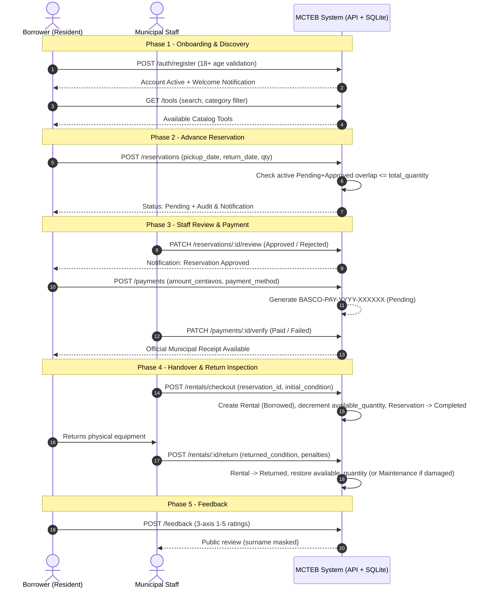
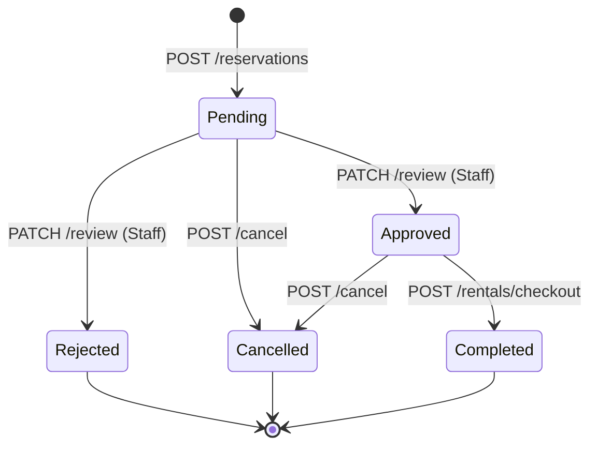
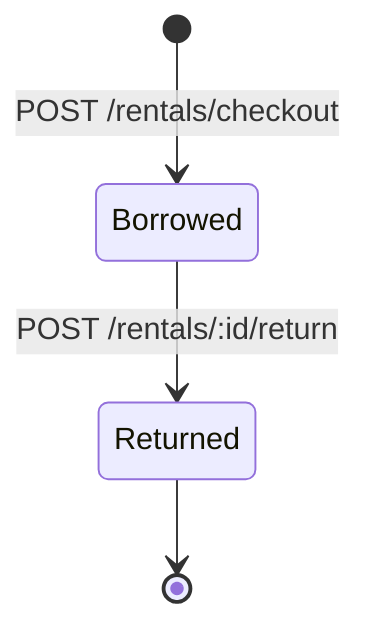
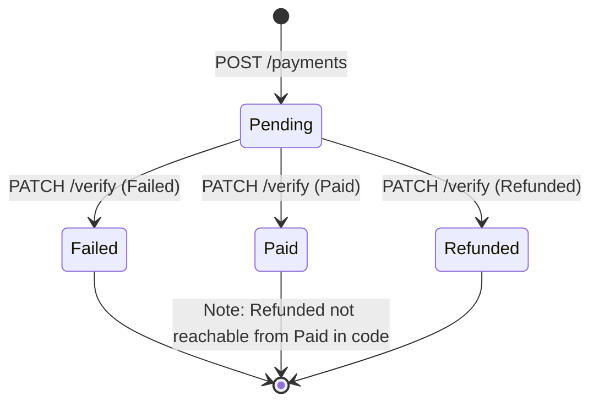
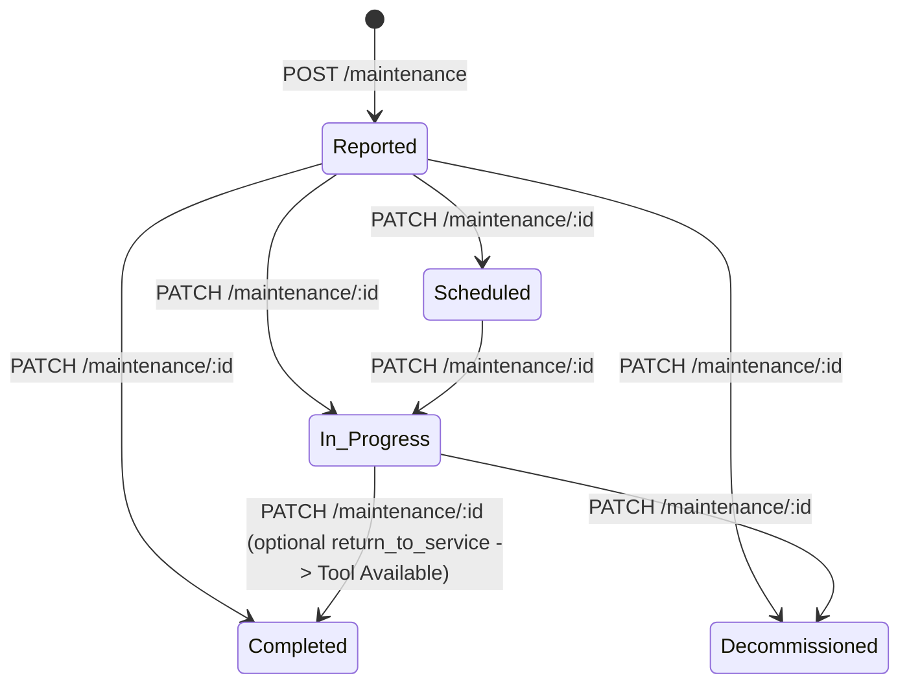

# 08 — Business Workflows

> **Epistemic Classification Legend**
> - `[Verified from source code]` — Directly observed in repository files, schemas, configurations, or tool outputs.
> - `[Inferred from architecture]` — Logically deduced from codebase structure, middleware order, or runtime behavior.
> - `[Assumption requiring validation]` — Organizational, municipal policy, or operational assumption not codified in source code.

---

## Table of Contents

- [1. Executive Summary](#1-executive-summary)
- [2. Purpose](#2-purpose)
- [3. Scope](#3-scope)
- [4. Key Components](#4-key-components)
- [5. Architecture Diagrams](#5-architecture-diagrams)
  - [5.1 End-to-End Equipment Lending Swimlane Diagram](#51-end-to-end-equipment-lending-swimlane-diagram)
  - [5.2 Entity Lifecycle State Transition Diagrams](#52-entity-lifecycle-state-transition-diagrams)
- [6. Technical Details & Detailed Analysis](#6-technical-details--detailed-analysis)
  - [6.1 Workflow 1: Resident Registration & Age Verification](#61-workflow-1-resident-registration--age-verification)
  - [6.2 Workflow 2: Equipment Discovery & Reservation Request](#62-workflow-2-equipment-discovery--reservation-request)
  - [6.3 Workflow 3: Staff Reservation Review & Borrower Cancellation](#63-workflow-3-staff-reservation-review--borrower-cancellation)
  - [6.4 Workflow 4: Rental Desk Checkout & Return Inspection](#64-workflow-4-rental-desk-checkout--return-inspection)
  - [6.5 Workflow 5: Payment Submission & Municipal Treasury Verification](#65-workflow-5-payment-submission--municipal-treasury-verification)
  - [6.6 Workflow 6: Maintenance Defect Reporting & Return to Service](#66-workflow-6-maintenance-defect-reporting--return-to-service)
  - [6.7 Workflow 7: Post-Loan Feedback & Moderation](#67-workflow-7-post-loan-feedback--moderation)
  - [6.8 Workflow 8: Administrative User Oversight](#68-workflow-8-administrative-user-oversight)
- [7. Findings](#7-findings)
- [8. Risks](#8-risks)
- [9. Recommendations](#9-recommendations)
- [10. Future Enhancements](#10-future-enhancements)
- [11. References to Source Files & Cross-References](#11-references-to-source-files--cross-references)

---

## 1. Executive Summary

MCTEB implements **eight primary business workflows** spanning resident onboarding, catalog discovery, advance reservations with date-overlap stock checking, staff queue approval, physical rental handover and return inspection, fee/deposit payment verification and receipt generation, equipment maintenance lifecycle management, community feedback moderation, and administrative governance (`[Verified from source code]`).

Every critical multi-entity transition (reservation creation/review/cancellation, rental checkout/return, payment recording/verification, maintenance reporting/completion) executes atomically inside SQLite `db.transaction()` blocks and records immutable rows in `audit_logs` alongside user alerts in `notifications` (`[Verified from source code]`).

---

## 2. Purpose

This document traces MCTEB's end-to-end operational workflows, actor interactions, business rules, validations, state transitions, and edge-case behaviors directly from backend service and frontend feature code.

---

## 3. Scope

Covers business logic across all backend services in `apps/api/src/modules/` and user journeys across `apps/web/src/features/` (`[Verified from source code]`).

---

## 4. Key Components

- `AuthService` (`auth.service.ts`), `UsersService` (`users.service.ts`), `ToolsService` (`tools.service.ts`) (`[Verified from source code]`).
- `ReservationsService` (`reservations.service.ts`), `RentalsService` (`rentals.service.ts`), `PaymentsService` (`payments.service.ts`) (`[Verified from source code]`).
- `MaintenanceService` (`maintenance.service.ts`), `FeedbackService` (`feedback.service.ts`) (`[Verified from source code]`).

---

## 5. Architecture Diagrams

### 5.1 End-to-End Equipment Lending Swimlane Diagram



### 5.2 Entity Lifecycle State Transition Diagrams


*Reservation Lifecycle (`ReservationStatusSchema`, `ReservationsService` `[Verified from source code]`)*


*Rental Lifecycle (`RentalStatusSchema` also defines `Pending`, `Reserved`, `Completed`, though code only writes `Borrowed` -> `Returned` `[Verified from source code]`)*


*Payment Lifecycle (`PaymentsService.verifyPayment` checks `payment.status !== 'Pending'` `[Verified from source code]`)*


*Maintenance Lifecycle (`MaintenanceService` `[Verified from source code]`)*

---

## 6. Technical Details & Detailed Analysis

### 6.1 Workflow 1: Resident Registration & Age Verification
- **Source**: `AuthService.register` (`apps/api/src/modules/auth/auth.service.ts` lines 10–60), `RegisterPage.tsx` (`[Verified from source code]`).
- **Business Rules**:
  1. Email uniqueness checked case-insensitively (`COLLATE NOCASE`). Duplicate returns `409 Conflict`.
  2. Minimum 18-year age policy computed from `birth_date` against server `new Date()`. Underage throws `400 Bad Request` (`Borrowers must be at least 18 years old under Municipal policies`) (`[Verified from source code]`).
  3. Role forced to `'Borrower'` and status forced to `'Active'` (`AuthRepository.createBorrower`) (`[Verified from source code]`).
  4. Creates session, records `USER_REGISTERED` audit row, and dispatches welcome notification (`link_url: '/catalog'`) (`[Verified from source code]`).

### 6.2 Workflow 2: Equipment Discovery & Reservation Request
- **Source**: `CatalogPage.tsx`, `ToolDetailPage.tsx`, `ReservationFormModal.tsx`, `ReservationsService.createReservation` (`apps/api/src/modules/reservations/reservations.service.ts` lines 26–79) (`[Verified from source code]`).
- **Date Overlap & Stock Check** (`ReservationsRepository.getActiveReservedQuantityForDates` lines 92–102) (`[Verified from source code]`):
```sql
      SELECT COALESCE(SUM(quantity), 0) as total_reserved
      FROM reservations
      WHERE tool_id = ?
        AND status IN ('Pending', 'Approved')
        AND NOT (return_date < ? OR pickup_date > ?)
```
- **Validation**: Rejects `Archived` or `Damaged` tools (`400`); rejects if `currentlyReserved + input.quantity > tool.total_quantity` (`409 Conflict`) (`[Verified from source code]`).
- **Fee Estimate Formula in UI (`ReservationFormModal.tsx` lines 36–40)**: `days = Math.max(1, Math.ceil((returnDate - pickupDate) / 86400000) + 1)` (inclusive day count), `estimatedRentalTotal = tool.rental_fee_centavos * days * quantity` (`[Verified from source code]`).

### 6.3 Workflow 3: Staff Reservation Review & Borrower Cancellation
- **Review (`ReservationsService.reviewReservation`)**: Requires `existing.status === 'Pending'`. Inside `db.transaction()`, updates decision (`Approved` or `Rejected`), `reviewed_by`, `reviewed_at`, `staff_notes`, records `RESERVATION_APPROVED`/`RESERVATION_REJECTED`, and notifies borrower (`[Verified from source code]`).
- **Cancellation (`ReservationsService.cancelReservation`)**: Enforces Borrower IDOR ownership check, requires status in `['Pending', 'Approved']`, sets status to `'Cancelled'`, writes `RESERVATION_CANCELLED` audit log, and sends warning notification (`[Verified from source code]`).

### 6.4 Workflow 4: Rental Desk Checkout & Return Inspection
- **Checkout (`RentalsService.checkout` lines 27–76)**:
  1. Checks `tool.available_quantity >= input.quantity` (throws `409` if insufficient).
  2. Inside `db.transaction()`: creates `rentals` row (`status = 'Borrowed'`), calls `ToolsRepository.adjustAvailableQuantity(input.tool_id, -input.quantity)`, sets linked `reservation_id` to `'Completed'`, records `RENTAL_CHECKOUT` audit log, and notifies borrower (`[Verified from source code]`).
- **Return Inspection (`RentalsService.processReturn` lines 78–128)**:
  1. Requires `existing.status === 'Borrowed'`.
  2. Inside `db.transaction()`: sets `status = 'Returned'`, `returned_at = DATETIME('now')`, `returned_condition`, `overdue_penalty_centavos`, `damage_penalty_centavos`, `received_by`.
  3. Restores stock via `ToolsRepository.adjustAvailableQuantity(existing.tool_id, existing.quantity)`.
  4. If `returned_condition` is `'Needs Repair'` or `'Under Maintenance'`, updates tool to `condition_status: input.returned_condition, availability_status: 'Maintenance'`.
  5. Records `RENTAL_RETURNED` audit log and notifies borrower (`[Verified from source code]`).

### 6.5 Workflow 5: Payment Submission & Municipal Treasury Verification
- **Submission (`PaymentsService.recordPayment` lines 26–58)**: Generates `BASCO-PAY-${year}-${randomSuffix}` receipt reference, inserts `'Pending'` payment row, writes `PAYMENT_SUBMITTED` audit log, notifies user (`[Verified from source code]`).
- **Verification (`PaymentsService.verifyPayment` lines 60–101)**: Requires `payment.status === 'Pending'`. Updates status to `'Paid'`, `'Failed'`, or `'Refunded'`, sets `verified_by` and `verified_at`, writes `PAYMENT_VERIFIED`/`PAYMENT_DECLINED` audit log, notifies user (`[Verified from source code]`).
- **Official Receipt (`OfficialReceiptModal.tsx`)**: Renders printable receipt via `window.print()`, though note the modal displays "Municipal Treasury Verified" stamp even when `payment.status === 'Pending'` (`OfficialReceiptModal.tsx` lines 78–91) (`[Verified from source code]`).

### 6.6 Workflow 6: Maintenance Defect Reporting & Return to Service
- **Create Report (`MaintenanceService.createReport` lines 21–56)**: Creates ticket (`status = 'Reported'`). If `severity === 'Severe' || severity === 'Critical'`, updates tool to `availability_status: 'Maintenance'` and `condition_status: 'Needs Repair'` (`[Verified from source code]`).
- **Update / Resolve (`MaintenanceService.updateRecord` lines 58–102)**: Updates ticket; if `status === 'Completed'`, sets `completed_at = DATETIME('now')`. If `return_to_service && status === 'Completed'`, restores tool to `availability_status: 'Available'` and `condition_status: 'Good'`, recording `TOOL_RETURNED_TO_SERVICE` (`[Verified from source code]`).

### 6.7 Workflow 7: Post-Loan Feedback & Moderation
- **Submit (`FeedbackService.submitFeedback` lines 26–52)**: Validates tool exists, creates `is_public = 1` feedback row, records `FEEDBACK_SUBMITTED` (`[Verified from source code]`). Note: `submitFeedback` does NOT verify whether the user ever borrowed the tool (`[Verified from source code]`).
- **Public Read (`FeedbackService.getPublicReviews` lines 8–20)**: Masks reviewer surname (`FirstName L.`).
- **Moderate (`FeedbackService.moderateFeedback` lines 54–83)**: Toggles `is_public` (`0` or `1`) and records `FEEDBACK_MODERATED` (`[Verified from source code]`).

### 6.8 Workflow 8: Administrative User Oversight
- **Status/Role Updates (`UsersService.updateUserStatus`, `updateUserRole`)**: Require mandatory `reason` (min 3 chars), enforce self-suspension and last-active-admin protections, record `USER_STATUS_UPDATED` / `USER_ROLE_UPDATED` audit rows, and send account status/role notifications (`[Verified from source code]`).

---

## 7. Findings

### Verified from Source Code
1. **`status-transitions.md` vs Code Divergence on `Paid -> Refunded`**: `docs/status-transitions.md` documents `Paid -> Refunded`, whereas `PaymentsService.verifyPayment` line 66 throws `400 Bad Request` for any payment where `payment.status !== 'Pending'`, making `Paid -> Refunded` impossible in code!
2. **`RentalStatus` `'Completed'` Never Written**: `RentalsService.processReturn` sets rental status to `'Returned'`, and no endpoint exists to transition `'Returned' -> 'Completed'` (`[Verified from source code]`).
3. **Reservation Conflict Check Misses Borrowed Tools & Review Races**: `getActiveReservedQuantityForDates` sums `reservations` in `('Pending', 'Approved')`, excluding `'Completed'` reservations that are currently `'Borrowed'` and overdue/out of stock (`[Verified from source code]`). Moreover, `reviewReservation` does not re-check stock before approving (`[Verified from source code]`).
4. **Rental Desk Checkout Hardcodes `initial_condition: 'Good'`**: `RentalDeskPage.tsx` line 55 sends `initial_condition: 'Good'` regardless of the tool's actual `condition_status` (`[Verified from source code]`).
5. **Payment Creation UI Does Not Link Reservation/Rental/Tool IDs**: `MyPaymentsPage.tsx` lines 57–60 only sends `{ amount_centavos, payment_method }`, leaving `reservation_id`, `rental_id`, and `tool_id` as `null` (`[Verified from source code]`).

### Inferred from Architecture
1. Because `ReservationsService.createReservation` allows reserving a tool whose `availability_status` is `'Maintenance'` (it only blocks `'Archived'` and `'Damaged'` on line 36), a tool currently in repair can still receive `Pending` reservations (`[Verified from source code]`).

### Assumptions Requiring Validation
1. `[Assumption requiring validation]` Whether a tool with `total_quantity = 3` and 1 unit under maintenance should allow borrowing the remaining 2 units or block the entire catalog item.

---

## 8. Risks

| ID | Risk | Severity | Details |
|---|---|---|---|
| **WF-01** | Overbooking via `Completed` reservation exclusion & unguarded approval | **High** | `getActiveReservedQuantityForDates` ignores active `Borrowed` rentals; `reviewReservation` does not re-check stock (`[Verified from source code]`). |
| **WF-02** | `Paid -> Refunded` security deposit refund workflow blocked | **Medium** | `verifyPayment` rejects non-`Pending` payments, preventing deposit refunds (`[Verified from source code]`). |
| **WF-03** | `OfficialReceiptModal` displays "Municipal Treasury Verified" for `Pending` payments | **Medium** | Confusing/misleading receipt verification badge when payment is still `Pending` or `Failed` (`[Verified from source code]`). |
| **WF-04** | Tool return sets `availability_status` unconditionally (`adjustAvailableQuantity`) | **Medium** | If `available_quantity + delta > 0` on return while tool is `'Maintenance'`, SQL `CASE` sets status to `'Available'` (`tools.repository.ts:129`) unless overridden afterward (`[Verified from source code]`). |

---

## 9. Recommendations

1. **Include Active Borrowed Rentals in Stock Availability Checks** and re-validate available inventory inside `ReservationsService.reviewReservation`'s `db.transaction()`.
2. **Support `Paid -> Refunded` Deposit Refunds**: Allow `verifyPayment` (or a dedicated `/refund` endpoint) to transition `Paid -> Refunded`.
3. **Conditionally Render Verification Stamp in `OfficialReceiptModal.tsx`**: Show "Verified" only when `payment.status === 'Paid'` (`[Verified from source code]`).
4. **Link Payments to Reservations/Rentals in `MyPaymentsPage.tsx`** and allow Staff to select `initial_condition` in `RentalDeskPage.tsx` checkout.

---

## 10. Future Enhancements

1. **Automated Overdue Penalty Calculator**: Compute daily late fees automatically in `ReturnInspectionModal.tsx` and backend `processReturn` based on `due_date` and tool `rental_fee_centavos`.
2. **Verified-Borrower Feedback Eligibility**: Require a matching `rental_id` with `status IN ('Returned', 'Completed')` before accepting `POST /api/v1/feedback` (`PROJECT_PLAN.md` Section A6.3).

---

## 11. References to Source Files & Cross-References

| File | Symbol |
|---|---|
| `apps/api/src/modules/reservations/reservations.service.ts` | `createReservation`, `reviewReservation`, `cancelReservation` |
| `apps/api/src/modules/rentals/rentals.service.ts` | `checkout`, `processReturn` |
| `apps/api/src/modules/payments/payments.service.ts` | `recordPayment`, `verifyPayment` |
| `apps/api/src/modules/maintenance/maintenance.service.ts` | `createReport`, `updateRecord` |
| `apps/api/src/modules/feedback/feedback.service.ts` | `getPublicReviews`, `submitFeedback`, `moderateFeedback` |
| `docs/status-transitions.md` | Documented status transition rules |

**Cross-References**: See [20-System-Flowcharts.md](./20-System-Flowcharts.md), [05-API-Architecture.md](./05-API-Architecture.md), and [11-Administrative-UI.md](./11-Administrative-UI.md).
