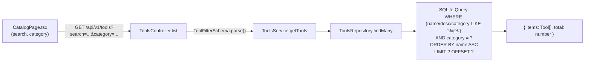
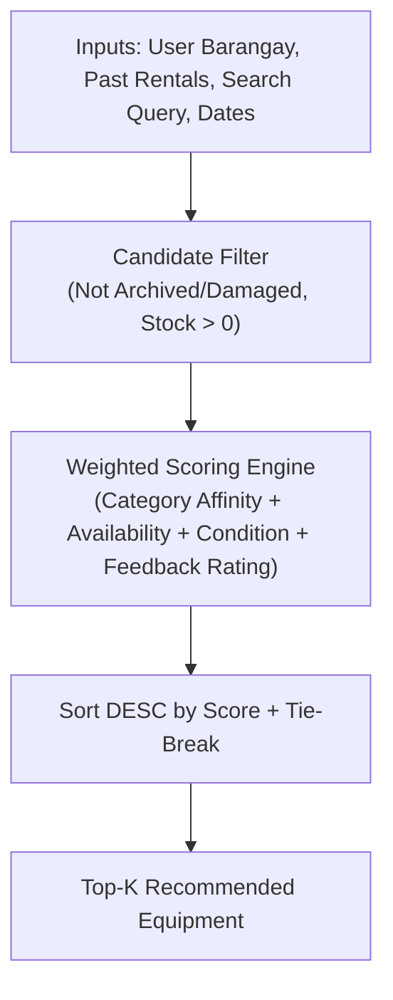

# 09 — Recommendation Engine

> **Epistemic Classification Legend**
>
> - `[Verified from source code]` — Directly observed in repository files, schemas, configurations, or tool outputs.
> - `[Inferred from architecture]` — Logically deduced from codebase structure, middleware order, or runtime behavior.
> - `[Assumption requiring validation]` — Organizational, municipal policy, or operational assumption not codified in source code.

---

## Table of Contents

- [1. Executive Summary](#1-executive-summary)
- [2. Purpose](#2-purpose)
- [3. Scope](#3-scope)
- [4. Key Components](#4-key-components)
- [5. Architecture Diagrams](#5-architecture-diagrams)
  - [5.1 Current Catalog Search & Deterministic Filtering Flow](#51-current-catalog-search--deterministic-filtering-flow)
  - [5.2 Proposed Future Recommendation Engine Architecture](#52-proposed-future-recommendation-engine-architecture)
- [6. Technical Details & Detailed Analysis](#6-technical-details--detailed-analysis)
  - [6.1 Explicit Verification: Absence of Recommendation or Matching Logic](#61-explicit-verification-absence-of-recommendation-or-matching-logic)
  - [6.2 Current Discovery & Filtering Implementation (`ToolsRepository.findMany`)](#62-current-discovery--filtering-implementation-toolsrepositoryfindmany)
  - [6.3 Current Frontend Search UX (`CatalogPage.tsx`)](#63-current-frontend-search-ux-catalogpagetsx)
  - [6.4 Proposed Future Scoring & Ranking Design (Non-Implemented Blueprint)](#64-proposed-future-scoring--ranking-design-non-implemented-blueprint)
- [7. Findings](#7-findings)
- [8. Risks](#8-risks)
- [9. Recommendations](#9-recommendations)
- [10. Future Enhancements](#10-future-enhancements)
- [11. References to Source Files & Cross-References](#11-references-to-source-files--cross-references)

---

## 1. Executive Summary

> **EXPLICIT SYSTEM FINDING (`[Verified from source code]`)**: **MCTEB does NOT contain a recommendation engine, intelligent matching algorithm, collaborative filtering pipeline, heuristic scoring model, or machine learning (ML) model.**

Catalog discovery currently relies exclusively on **deterministic SQL filtering and substring search** (`LIKE '%search%'`) sorted alphabetically (`ORDER BY name ASC`) inside `ToolsRepository.findMany` (`apps/api/src/modules/tools/tools.repository.ts` lines 12–51) (`[Verified from source code]`).

To satisfy architectural planning completeness without inventing functionality, Sections 1–6.3 document the **actual implemented search/filter behavior**, while Sections 6.4 and 10 present a clearly labeled **non-implemented future enhancement blueprint** suitable if Basco expands its tool inventory.

---

## 2. Purpose

This document explicitly verifies the absence of recommendation/ML subsystems in MCTEB, documents the existing deterministic catalog discovery and filtering logic, and outlines an actionable blueprint for future equipment matching and ranking.

---

## 3. Scope

Covers `apps/api/src/modules/tools/tools.repository.ts`, `tools.service.ts`, `tools.controller.ts`, `packages/shared/src/schemas/tool.ts`, and `apps/web/src/features/catalog/CatalogPage.tsx` (`[Verified from source code]`).

---

## 4. Key Components

- **`ToolFilterSchema` (`packages/shared/src/schemas/tool.ts` lines 46–53)**: Validates `search`, `category`, `availability`, `condition`, `page` (default `1`), `limit` (default `12`, max `100`) (`[Verified from source code]`).
- **`ToolsRepository.findMany` (`apps/api/src/modules/tools/tools.repository.ts` lines 12–51)**: Builds dynamic SQL `WHERE` clauses, counts total matching rows, and orders alphabetically by `name ASC` (`[Verified from source code]`).
- **`CatalogPage.tsx` (`apps/web/src/features/catalog/CatalogPage.tsx`)**: Provides text search bar and category dropdown (`[Verified from source code]`).

---

## 5. Architecture Diagrams

### 5.1 Current Catalog Search & Deterministic Filtering Flow



### 5.2 Proposed Future Recommendation Engine Architecture

_(Not Implemented — Future Enhancement Blueprint only)_



---

## 6. Technical Details & Detailed Analysis

### 6.1 Explicit Verification: Absence of Recommendation or Matching Logic

Inspection of every file in `packages/shared`, `apps/api`, and `apps/web` confirms (`[Verified from source code]`):

- **ML Models / Vector Embeddings / Python Pipelines**: Absent (`[Verified from source code]`).
- **Scoring / Weighting / Ranking Formulas**: Absent (`[Verified from source code]`).
- **Collaborative Filtering / Borrow-History Recommendations**: Absent (`[Verified from source code]`).
- **Heuristic Matching ("Similar Tools" or "Recommended for Your Barangay")**: Absent (`[Verified from source code]`).

### 6.2 Current Discovery & Filtering Implementation (`ToolsRepository.findMany`)

From `apps/api/src/modules/tools/tools.repository.ts` (lines 12–51) (`[Verified from source code]`):

```ts
  static findMany(filters: ToolFilterInput): { items: Tool[]; total: number } {
    const conditions: string[] = [];
    const params: (string | number)[] = [];

    if (filters.search) {
      conditions.push('(name LIKE ? OR description LIKE ? OR category LIKE ?)');
      const searchParam = `%${filters.search}%`;
      params.push(searchParam, searchParam, searchParam);
    }
    if (filters.category) {
      conditions.push('category = ?');
      params.push(filters.category);
    }
    if (filters.availability) {
      conditions.push('availability_status = ?');
      params.push(filters.availability);
    }
    if (filters.condition) {
      conditions.push('condition_status = ?');
      params.push(filters.condition);
    }
    // ... ORDER BY name ASC LIMIT ? OFFSET ?
```

Key characteristics (`[Verified from source code]`):

1. **Unweighted Boolean Filtering**: All predicates combine with `AND`.
2. **Public Visibility Leak**: `ToolsRepository.findMany` does **not** filter out `availability_status = 'Archived'` by default—archived tools still appear in `GET /api/v1/tools` unless `?availability=Available` is passed (`[Verified from source code]`).
3. **Static Ordering**: Always sorted `ORDER BY name ASC` regardless of relevance, availability, or rating (`[Verified from source code]`).
4. **Unused Filter Fields in UI**: `ToolFilterSchema` supports `availability`, `condition`, `page`, and `limit`, but `CatalogPage.tsx` only passes `search` and `category` (`[Verified from source code]`).

### 6.3 Current Frontend Search UX (`CatalogPage.tsx`)

- `CatalogPage.tsx` maintains local `search` and `category` state and calls `GET /tools?...` on category dropdown change or search form submit (`[Verified from source code]`).
- Due to category string drift between `CatalogPage.tsx` (`'Agriculture'`, `'Fishing'`, `'Electrical'`, `'Emergency Response'`) and `SEED_TOOLS` (`'Agricultural'`, `'Power Equipment'`, `'Fishery'`), selecting `'Agriculture'` or `'Fishing'` returns zero items (`[Verified from source code]`).

### 6.4 Proposed Future Scoring & Ranking Design (Non-Implemented Blueprint)

_(Note: `[Assumption requiring validation]` / `[Future Enhancement]` — None of the formulas below exist in current code.)_

Should the Municipality of Basco expand catalog size beyond ~50 tools and implement equipment recommendations, a deterministic heuristic scorer (suitable for SQLite/Node.js without external ML infrastructure) could compute:

$$S(u, t) = w_a \cdot A(t) + w_c \cdot C(t) + w_r \cdot R_{bayes}(t) + w_b \cdot B(u, t) + w_h \cdot H(u, t)$$

Where:

- $A(t) = \frac{\text{available\_quantity}}{\text{total\_quantity}} \in [0, 1]$ (Stock availability ratio).
- $C(t) \in \{1.0, 0.85, 0.65, 0.0\}$ mapped from `condition_status` (`Excellent`, `Good`, `Fair`, `Needs Repair`/`Under Maintenance`).
- $R_{bayes}(t) = \frac{v \cdot \bar{r}_t + m \cdot \bar{r}_{global}}{v + m}$ (Bayesian-smoothed `overall_rating` from `feedback` table).
- $B(u, t) \in [0, 1]$ (Normalized barangay category demand affinity based on historical `rentals` joined with `users.barangay`).
- $H(u, t) \in [0, 1]$ (User's own historical category affinity).

---

## 7. Findings

### Verified from Source Code

1. No recommendation, matching, scoring, ranking, or ML subsystem exists in the codebase.
2. Search uses SQL `LIKE '%term%'` across `name`, `description`, and `category`, sorted strictly by `name ASC`.
3. `CatalogPage.tsx` does not surface `availability`, `condition`, or pagination controls despite `ToolFilterSchema` supporting them.
4. Public catalog queries (`GET /api/v1/tools`) do not exclude `Archived` tools, contradicting `InventoryPage.tsx` line 47 ("It will no longer appear in the public catalog").

### Inferred from Architecture

1. With only 7 seeded tools (`SEED_TOOLS`), alphabetical browsing with category filtering meets MVP requirements (`PROJECT_PLAN.md` Section A12).

### Assumptions Requiring Validation

1. `[Assumption requiring validation]` Whether future catalog growth warrants seasonal agricultural/typhoon-preparedness prioritization (e.g., boosting dewatering pumps and generators during PAGASA storm signals).

---

## 8. Risks

| ID         | Risk                                                  | Severity   | Details                                                                                                                                    |
| ---------- | ----------------------------------------------------- | ---------- | ------------------------------------------------------------------------------------------------------------------------------------------ |
| **REC-01** | Archived tools remain visible in public `CatalogPage` | **Medium** | `ToolsRepository.findMany` lacks `availability_status != 'Archived'` guard when queried by public catalog (`[Verified from source code]`). |
| **REC-02** | Category filter mismatch yields empty search results  | **Medium** | `CatalogPage` uses `'Agriculture'`/`'Fishing'` while `SEED_TOOLS` uses `'Agricultural'`/`'Fishery'` (`[Verified from source code]`).       |

---

## 9. Recommendations

1. **Exclude `'Archived'` Tools from Public Catalog Queries** (unless explicitly requested by Staff/Admin in `InventoryPage.tsx`).
2. **Canonicalize `ToolCategorySchema` in `@mcteb/shared`** and expose `availability`, `condition`, and pagination controls in `CatalogPage.tsx`.
3. **Add `Available` / `Rating` Sort Options** to `ToolFilterSchema` (`sort: 'name_asc' | 'fee_asc' | 'available_desc'`).

---

## 10. Future Enhancements

1. **SQLite FTS5 Ranked Text Search**: Index tool names, descriptions, and specs using SQLite FTS5 `bm25()` relevance ranking.
2. **Heuristic "Recommended for Your Barangay / Season" Widget**: Implement the Section 6.4 deterministic scoring formula using historical `rentals` and `feedback` data (`[Inferred from architecture]`).

---

## 11. References to Source Files & Cross-References

| File                                             | Symbol                                     |
| ------------------------------------------------ | ------------------------------------------ |
| `apps/api/src/modules/tools/tools.repository.ts` | `ToolsRepository.findMany` (`lines 12–51`) |
| `packages/shared/src/schemas/tool.ts`            | `ToolFilterSchema` (`lines 46–53`)         |
| `apps/web/src/features/catalog/CatalogPage.tsx`  | `CATEGORIES`, `fetchCatalog`               |

**Cross-References**: See [19-Skills-and-Business-Type-Catalog.md](./19-Skills-and-Business-Type-Catalog.md), [20-System-Flowcharts.md](./20-System-Flowcharts.md), and [PERFORMANCE_REVIEW.md](./PERFORMANCE_REVIEW.md).
