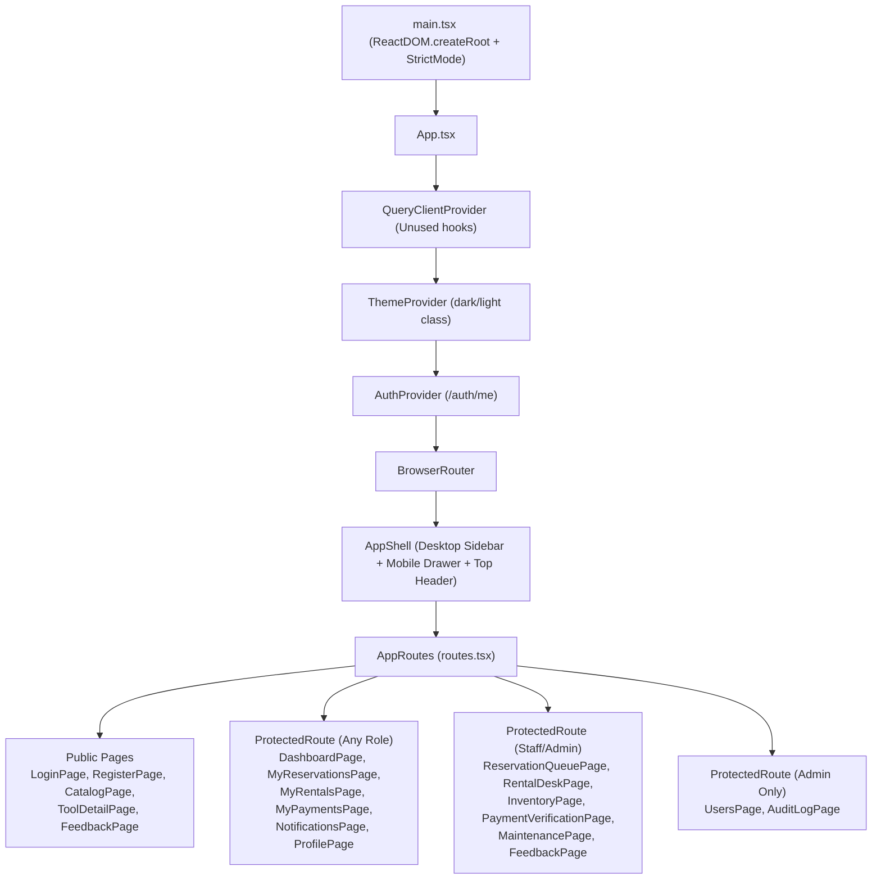
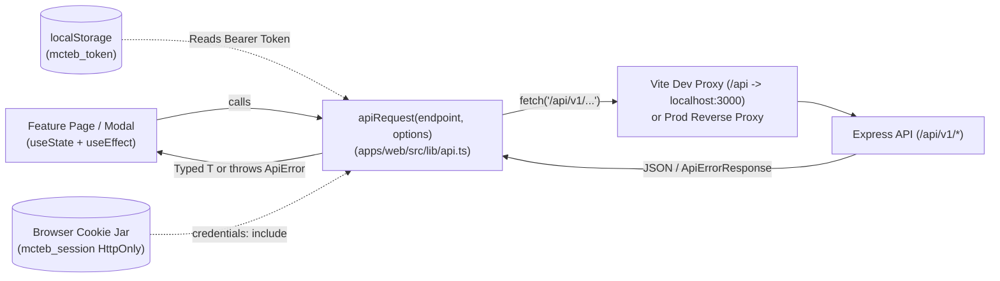

# 10 — Frontend Architecture

> **Epistemic Classification Legend**
> - `[Verified from source code]` — Directly observed in repository files, schemas, configurations, or tool outputs.
> - `[Inferred from architecture]` — Logically deduced from codebase structure, middleware order, or runtime behavior.
> - `[Assumption requiring validation]` — Organizational, municipal policy, or operational assumption not codified in source code.

---

## Table of Contents

- [1. Executive Summary](#1-executive-summary)
- [2. Purpose](#2-purpose)
- [3. Scope](#3-scope)
- [4. Key Components](#4-key-components)
- [5. Architecture Diagrams](#5-architecture-diagrams)
  - [5.1 Component Hierarchy & Provider Tree](#51-component-hierarchy--provider-tree)
  - [5.2 Client-to-API Data Flow Diagram](#52-client-to-api-data-flow-diagram)
- [6. Technical Details & Detailed Analysis](#6-technical-details--detailed-analysis)
  - [6.1 Pages & Feature Inventory](#61-pages--feature-inventory)
  - [6.2 Shared UI Primitives & Layout Components](#62-shared-ui-primitives--layout-components)
  - [6.3 Routing & Role Guards (`routes.tsx`)](#63-routing--role-guards-routestsx)
  - [6.4 State Management, Contexts & Data Fetching](#64-state-management-contexts--data-fetching)
  - [6.5 Forms, Validation & Styling System](#65-forms-validation--styling-system)
- [7. Findings](#7-findings)
- [8. Risks](#8-risks)
- [9. Recommendations](#9-recommendations)
- [10. Future Enhancements](#10-future-enhancements)
- [11. References to Source Files & Cross-References](#11-references-to-source-files--cross-references)

---

## 1. Executive Summary

The MCTEB frontend (`@mcteb/web` under `apps/web/`) is a **React 19 Single-Page Application (SPA)** bundled with **Vite 6.1.0**, routed via **React Router v7 (`react-router-dom@^7.1.5`)**, and styled using **Tailwind CSS 3.4** with custom `civic` theme tokens and `class`-based dark mode (`[Verified from source code]`, `apps/web/package.json`, `tailwind.config.ts`).

The application consists of **15 distinct routed page components**, **6 modal workflows**, **2 layout wrappers** (`AppShell`, `ProtectedRoute`), and **8 shared UI primitives** (`[Verified from source code]`). While `@tanstack/react-query` (`QueryClientProvider`) is mounted in `App.tsx` and `react-hook-form` is listed in `package.json`, feature pages currently perform data fetching with native `fetch` (`apiRequest` in `apps/web/src/lib/api.ts`) inside `useEffect` + `useState` and manage forms via controlled React state (`[Verified from source code]`).

---

## 2. Purpose

This document describes the component architecture, route topology, layout shell, state management, HTTP client, form handling, and styling tokens of `@mcteb/web`.

---

## 3. Scope

Covers all `.ts` and `.tsx` source modules under `apps/web/src/`, plus `apps/web/index.html`, `vite.config.ts`, `tailwind.config.ts`, and `apps/web/public/` (`[Verified from source code]`).

---

## 4. Key Components

- **Application Shell (`apps/web/src/app/App.tsx`, `routes.tsx`, `components/layout/AppShell.tsx`)**: Root providers, responsive sidebar/mobile drawer, and role-protected routes (`[Verified from source code]`).
- **Contexts (`apps/web/src/lib/auth-context.tsx`, `theme-context.tsx`)**: Session identity hydration (`/auth/me`) and light/dark theme persistence (`localStorage.mcteb_theme`) (`[Verified from source code]`).
- **HTTP Client (`apps/web/src/lib/api.ts`)**: `apiRequest<T>()` wrapper injecting `Authorization: Bearer` header, `credentials: 'include'`, and throwing typed `ApiError` (`[Verified from source code]`).
- **UI Primitives (`apps/web/src/components/ui/*`)**: `Alert`, `Badge`, `Button`, `Card` (`CardHeader`, `CardTitle`, `CardContent`), `EmptyState`, `Input`, `Select`, `Modal`, `Skeleton`, `CardSkeleton` (`[Verified from source code]`).

---

## 5. Architecture Diagrams

### 5.1 Component Hierarchy & Provider Tree

### 5.2 Client-to-API Data Flow Diagram

---

## 6. Technical Details & Detailed Analysis

### 6.1 Pages & Feature Inventory

| Feature Folder | Component | Route(s) | Modals / Subcomponents |
|---|---|---|---|
| `auth` | `LoginPage.tsx` | `/login` | None |
| `auth` | `RegisterPage.tsx` | `/register` | None |
| `dashboard` | `DashboardPage.tsx` | `/dashboard` | None |
| `catalog` | `CatalogPage.tsx` | `/catalog` | None |
| `catalog` | `ToolDetailPage.tsx` | `/catalog/:id` | `ReservationFormModal` |
| `reservations` | `MyReservationsPage.tsx` | `/my-reservations` | None |
| `reservations` | `ReservationQueuePage.tsx` | `/staff/reservations` | Inline Decision `Modal` |
| `rentals` | `MyRentalsPage.tsx` | `/my-rentals` | None |
| `rentals` | `RentalDeskPage.tsx` | `/staff/rentals` | `ReturnInspectionModal` |
| `payments` | `MyPaymentsPage.tsx` | `/my-payments` | Inline Record Payment `Modal`, `OfficialReceiptModal` |
| `payments` | `PaymentVerificationPage.tsx` | `/staff/payments` | Inline Verify `Modal`, `OfficialReceiptModal` |
| `inventory` | `InventoryPage.tsx` | `/staff/inventory` | `ToolFormModal` |
| `maintenance` | `MaintenancePage.tsx` | `/staff/maintenance` | `MaintenanceReportModal`, Inline Resolve `Modal` |
| `feedback` | `FeedbackPage.tsx` | `/feedback`, `/staff/feedback` | `SubmitFeedbackModal` |
| `notifications` | `NotificationsPage.tsx` | `/notifications` | None |
| `profile` | `ProfilePage.tsx` | `/profile` | None |
| `admin` | `UsersPage.tsx` | `/admin/users` | Inline Manage Account `Modal` |
| `admin` | `AuditLogPage.tsx` | `/admin/audit` | Inline Log Detail `Modal` |

### 6.2 Shared UI Primitives & Layout Components

- **`AppShell.tsx`** (`apps/web/src/components/layout/AppShell.tsx`):
  - Renders a responsive persistent left sidebar (`hidden lg:flex w-64 bg-civic-forest`) and mobile slide-over drawer (`mobileMenuOpen`) with 4 distinct navigation arrays for Guest, Borrower, Municipal Staff, and Administrator (`[Verified from source code]`).
  - Top bar includes mobile menu button, theme toggle (`Sun`/`Moon`), notifications link icon, and Sign In/Register buttons for guests (`[Verified from source code]`).
- **`Badge.tsx`** (`apps/web/src/components/ui/Badge.tsx`): Maps 26 status strings (`Available`, `Pending`, `Borrowed`, `Rejected`, `Cancelled`, `Archived`, etc.) consistently to semantic color badges (`success`, `warning`, `info`, `danger`, `neutral`) plus a colored dot indicator (`[Verified from source code]`).
- **`Modal.tsx`** (`apps/web/src/components/ui/Modal.tsx`): Accessible dialog (`role="dialog"`, `aria-modal="true"`, Escape key handler, body scroll lock, backdrop click close) (`[Verified from source code]`).

### 6.3 Routing & Role Guards (`routes.tsx`)

From `apps/web/src/app/routes.tsx` (`[Verified from source code]`):
- Root `/` redirects to `/dashboard` when authenticated or `/catalog` when unauthenticated (`<Navigate to={user ? '/dashboard' : '/catalog'} replace />`).
- Unmatched routes (`path="*"`) redirect to `/`.
- `ProtectedRoute` (`apps/web/src/components/layout/ProtectedRoute.tsx`) renders a skeleton loader while `isLoading === true`, redirects unauthenticated users to `/login` preserving `state={{ from: location }}`, and redirects unauthorized roles (`!allowedRoles.includes(user.role)`) to `/dashboard` (`[Verified from source code]`).

### 6.4 State Management, Contexts & Data Fetching

- **Authentication State (`auth-context.tsx`)**: Calls `GET /auth/me` on mount (`useEffect`); clears `localStorage.mcteb_token` on failure (`[Verified from source code]`).
- **Theme State (`theme-context.tsx`)**: Initializes from `localStorage.mcteb_theme` or `prefers-color-scheme: dark`, toggling `'dark'` class on `document.documentElement` (`[Verified from source code]`).
- **API Client (`api.ts`)**: Prepends `/api/v1` for relative paths, attaches `Authorization: Bearer ${token}` from `localStorage`, sends `credentials: 'include'`, and throws `ApiError(message, code, statusCode, details)` on `!response.ok` (`[Verified from source code]`).
- **Type Safety Gap**: All data pages (`DashboardPage`, `MyReservationsPage`, `MyRentalsPage`, `MyPaymentsPage`, `MaintenancePage`, `NotificationsPage`, `FeedbackPage`, `ReservationQueuePage`, `RentalDeskPage`, `PaymentVerificationPage`) type API results as `any[]` / `any | null` rather than importing `@mcteb/shared` response interfaces (`[Verified from source code]`).

### 6.5 Forms, Validation & Styling System

- **Controlled Forms**: Forms use standard React `useState` hooks + HTML5 `required`/`min`/`type` attributes (`[Verified from source code]`). Despite `react-hook-form` being installed in `apps/web/package.json` (`^7.54.2`), it is never imported (`[Verified from source code]`).
- **Design Tokens (`apps/web/tailwind.config.ts`)**: Defines `civic` palette (`forest: '#1b4332'`, `deep: '#2d6a4f'`, `accent: '#40916c'`, `light: '#52b788'`, `sand: '#f8f9fa'`, `stone: '#212529'`) and `primary` green scale (`50`–`950`) (`[Verified from source code]`).

---

## 7. Findings

### Verified from Source Code
1. All 15 routed pages and 6 modal components are statically imported in `routes.tsx` (no `React.lazy` code splitting).
2. `@tanstack/react-query` (`QueryClientProvider`) is mounted in `App.tsx`, and `react-hook-form` is installed, yet neither library's hooks are used anywhere in `apps/web/src/`.
3. `LoginPage.tsx` (lines 98–100) displays outdated demo credentials (`maria.c@basco.net`), whereas `SEED_USERS` uses `borrower@basco.gov.ph`.
4. `MyReservationsPage.tsx` (line 79) and `MyRentalsPage.tsx` (line 56) trigger full page reloads via `window.location.href = '/catalog'` inside `EmptyState.onAction` instead of React Router `navigate('/catalog')`.
5. `AppShell.tsx` (line 30) defines `badge?: number` on `NavItem`, and `NotificationsPage` tracks unread counts, yet neither the sidebar nor top bar notification icon displays an unread badge count.

### Inferred from Architecture
1. Because `@mcteb/shared` types (`ReservationWithDetails`, `RentalWithDetails`, etc.) live in `apps/api/src/modules/*/*.repository.ts` rather than `packages/shared`, frontend pages fell back to `any[]` typing.

### Assumptions Requiring Validation
1. `[Assumption requiring validation]` Whether `apps/web` is expected to support offline/PWA caching in Batanes when municipal network connectivity drops.

---

## 8. Risks

| ID | Risk | Severity | Details |
|---|---|---|---|
| **FE-01** | Broken `RegisterPage.tsx` typecheck against stale `@mcteb/shared/dist` | **High** | Observed `TS2345` error during `pnpm.cmd -r typecheck` (`[Verified from source code]`). |
| **FE-02** | `localStorage` auth token persistence in `auth-context.tsx` & `api.ts` | **Medium** | Increases XSS session-hijacking blast radius (`[Verified from source code]`). |
| **FE-03** | Extensive `any` typing in feature state (`useState<any[]>`) | **Low/Medium** | Runtime field-name drift between backend DTOs and JSX templates is unchecked by TypeScript (`[Verified from source code]`). |
| **FE-04** | Full-page reload via `window.location.href` & native `alert()`/`confirm()` dialogs | **Low** | Degrades SPA experience and keyboard/screen-reader accessibility (`PROJECT_PLAN.md` Section A6.4) (`[Verified from source code]`). |

---

## 9. Recommendations

1. **Export Joined `*WithDetails` DTO Types from `@mcteb/shared`** and eliminate `any[]` state across all feature pages.
2. **Adopt `@tanstack/react-query` (`useQuery` / `useMutation`)** to gain request deduplication, cache invalidation, and automatic state refresh after mutations.
3. **Replace `window.location.href`, `alert()`, and `confirm()`** with React Router `useNavigate()` and accessible confirmation `Modal` + toast components (`[Verified from source code]`).
4. **Update `LoginPage.tsx` Demo Box** to match `SEED_USERS` emails (`borrower@basco.gov.ph`, `staff@basco.gov.ph`, `admin@basco.gov.ph`) and fix `EmptyState` navigation.

---

## 10. Future Enhancements

1. **Code-Splitting with `React.lazy` & `Suspense`**: Lazy-load Staff and Admin bundles (`/staff/*`, `/admin/*`) so guest/borrower initial loads stay lightweight (`[Inferred from architecture]`).
2. **Unread Notification Counter Badge**: Poll `GET /notifications` via TanStack Query (`refetchInterval`) and display unread badge count in `AppShell.tsx` (`[Inferred from architecture]`).

---

## 11. References to Source Files & Cross-References

| File | Purpose |
|---|---|
| `apps/web/src/app/App.tsx`, `routes.tsx` | Root providers and 16-route switch |
| `apps/web/src/components/layout/AppShell.tsx`, `ProtectedRoute.tsx` | Navigation shell and RBAC route wrapper |
| `apps/web/src/lib/api.ts`, `auth-context.tsx`, `theme-context.tsx` | Fetch client, auth state, dark mode state |
| `apps/web/src/components/ui/*.tsx` | 8 reusable UI primitives |
| `apps/web/tailwind.config.ts`, `vite.config.ts` | Theme tokens and dev API proxy |

**Cross-References**: See [11-Administrative-UI.md](./11-Administrative-UI.md), [07-User-Roles-and-Permissions.md](./07-User-Roles-and-Permissions.md), and [UNUSED_CODE_ANALYSIS.md](./UNUSED_CODE_ANALYSIS.md).
