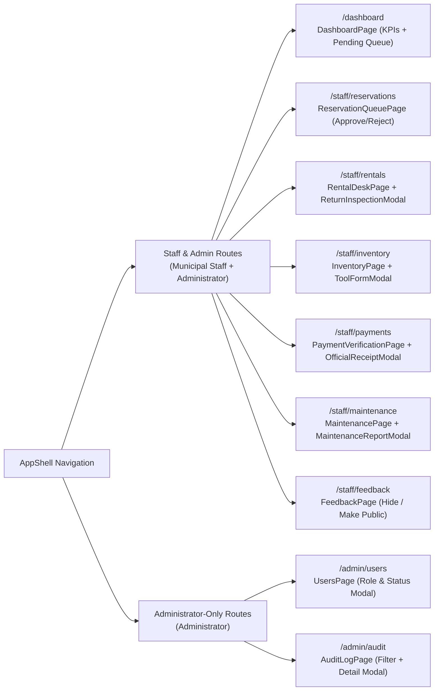

# 11 — Administrative UI

> **Epistemic Classification Legend**
>
> - `[Verified from source code]` — Directly observed in repository files, schemas, configurations, or tool outputs.
> - `[Inferred from architecture]` — Logically deduced from codebase structure, middleware order, or runtime behavior.
> - `[Assumption requiring validation]` — Organizational, municipal policy, or operational assumption not codified in source code.

---

## Table of Contents

- [1. Executive Summary](#1-executive-summary)
- [2. Purpose](#2-purpose)
- [3. Scope](#3-scope)
- [4. Key Components](#4-key-components)
- [5. Architecture Diagrams](#5-architecture-diagrams)
  - [5.1 Administrative & Staff UI Navigation Map](#51-administrative--staff-ui-navigation-map)
- [6. Technical Details & Detailed Analysis](#6-technical-details--detailed-analysis)
  - [6.1 Complete Administrative & Staff Screen Inventory](#61-complete-administrative--staff-screen-inventory)
  - [6.2 Administrator-Only Modules (`/admin/users`, `/admin/audit`)](#62-administrator-only-modules-adminusers-adminaudit)
  - [6.3 Staff & Admin Operational Modules (`/staff/*`, `/dashboard`)](#63-staff--admin-operational-modules-staff-dashboard)
  - [6.4 Configuration & Policy Controls (Verified Scope)](#64-configuration--policy-controls-verified-scope)
- [7. Findings](#7-findings)
- [8. Risks](#8-risks)
- [9. Recommendations](#9-recommendations)
- [10. Future Enhancements](#10-future-enhancements)
- [11. References to Source Files & Cross-References](#11-references-to-source-files--cross-references)

---

## 1. Executive Summary

MCTEB partitions its operational and governance interfaces across two privileged tiers inside `apps/web/src/features/` (`[Verified from source code]`):

1. **Administrator-Only Views (`/admin/*`)**: `UsersPage.tsx` (`/admin/users`) for municipal account role/status management and `AuditLogPage.tsx` (`/admin/audit`) for inspecting immutable system audit trails (`[Verified from source code]`).
2. **Municipal Staff & Administrator Views (`/staff/*` + `/dashboard`)**: `DashboardPage.tsx` (staff console mode), `ReservationQueuePage.tsx`, `RentalDeskPage.tsx` (+ `ReturnInspectionModal.tsx`), `InventoryPage.tsx` (+ `ToolFormModal.tsx`), `PaymentVerificationPage.tsx` (+ `OfficialReceiptModal.tsx`), `MaintenancePage.tsx` (+ `MaintenanceReportModal.tsx`), and `FeedbackPage.tsx` (moderation mode) (`[Verified from source code]`).

There is **no runtime system configuration or municipal fee/policy editor UI** in the application (`[Verified from source code]`)—all system settings (`PORT`, `CORS_ORIGINS`, `SESSION_SECRET`, `ALLOW_DEMO_SEED`) reside in server environment variables (`apps/api/src/config/env.ts`).

---

## 2. Purpose

This document inventories every administrative and staff screen, its access boundaries, API dependencies, modal workflows, reporting views, and configuration gaps.

---

## 3. Scope

Covers `apps/web/src/features/admin/`, `inventory/`, `maintenance/`, `payments/`, `rentals/`, `reservations/`, `feedback/`, and `dashboard/`, plus route enforcement in `apps/web/src/app/routes.tsx` and `AppShell.tsx` (`[Verified from source code]`).

---

## 4. Key Components

- **Admin Oversight (`apps/web/src/features/admin/`)**: `UsersPage.tsx`, `AuditLogPage.tsx` (`[Verified from source code]`).
- **Staff Desk & Operations (`apps/web/src/features/`)**: `ReservationQueuePage.tsx`, `RentalDeskPage.tsx`, `InventoryPage.tsx`, `PaymentVerificationPage.tsx`, `MaintenancePage.tsx`, `FeedbackPage.tsx` (`[Verified from source code]`).

---

## 5. Architecture Diagrams

### 5.1 Administrative & Staff UI Navigation Map

---

## 6. Technical Details & Detailed Analysis

### 6.1 Complete Administrative & Staff Screen Inventory

| Route                 | Component File                                   | Allowed Roles                                  | API Endpoints Called                                                                                      | Modals / Child Components                     | Audit Actions Triggered                                                   |
| --------------------- | ------------------------------------------------ | ---------------------------------------------- | --------------------------------------------------------------------------------------------------------- | --------------------------------------------- | ------------------------------------------------------------------------- |
| `/dashboard`          | `features/dashboard/DashboardPage.tsx`           | All Authenticated (Staff/Admin console branch) | `GET /reservations`, `GET /rentals`, `GET /payments`, `GET /maintenance`                                  | None                                          | None                                                                      |
| `/staff/reservations` | `features/reservations/ReservationQueuePage.tsx` | `Municipal Staff`, `Administrator`             | `GET /reservations?status=...`, `PATCH /reservations/:id/review`                                          | Decision `Modal`                              | `RESERVATION_APPROVED`, `RESERVATION_REJECTED`                            |
| `/staff/rentals`      | `features/rentals/RentalDeskPage.tsx`            | `Municipal Staff`, `Administrator`             | `GET /rentals`, `GET /reservations?status=Approved`, `POST /rentals/checkout`, `POST /rentals/:id/return` | `ReturnInspectionModal`                       | `RENTAL_CHECKOUT`, `RENTAL_RETURNED`                                      |
| `/staff/inventory`    | `features/inventory/InventoryPage.tsx`           | `Municipal Staff`, `Administrator`             | `GET /tools?limit=50`, `POST /tools`, `PATCH /tools/:id`, `POST /tools/:id/archive`                       | `ToolFormModal`                               | `TOOL_CREATED`, `TOOL_UPDATED`, `TOOL_ARCHIVED`                           |
| `/staff/payments`     | `features/payments/PaymentVerificationPage.tsx`  | `Municipal Staff`, `Administrator`             | `GET /payments?status=...`, `PATCH /payments/:id/verify`                                                  | Verify `Modal`, `OfficialReceiptModal`        | `PAYMENT_VERIFIED`, `PAYMENT_DECLINED`                                    |
| `/staff/maintenance`  | `features/maintenance/MaintenancePage.tsx`       | `Municipal Staff`, `Administrator`             | `GET /maintenance`, `POST /maintenance`, `PATCH /maintenance/:id`                                         | `MaintenanceReportModal`, Resolve `Modal`     | `MAINTENANCE_REPORTED`, `MAINTENANCE_UPDATED`, `TOOL_RETURNED_TO_SERVICE` |
| `/staff/feedback`     | `features/feedback/FeedbackPage.tsx`             | `Municipal Staff`, `Administrator`             | `GET /feedback/all`, `PATCH /feedback/:id/moderate`                                                       | None (`SubmitFeedbackModal` hidden for staff) | `FEEDBACK_MODERATED`                                                      |
| `/admin/users`        | `features/admin/UsersPage.tsx`                   | `Administrator`                                | `GET /users`, `PATCH /users/:id/role`, `PATCH /users/:id/status`                                          | Manage Account `Modal`                        | `USER_ROLE_UPDATED`, `USER_STATUS_UPDATED`                                |
| `/admin/audit`        | `features/admin/AuditLogPage.tsx`                | `Administrator`                                | `GET /audit?action=...&limit=50`                                                                          | Log Detail `Modal`                            | None (Read-only)                                                          |

### 6.2 Administrator-Only Modules (`/admin/users`, `/admin/audit`)

- **User & Account Oversight (`UsersPage.tsx`)** (`[Verified from source code]`):
  - Fetches full user table (`GET /users`) and highlights the currently signed-in admin (`(You)`).
  - Opens "Manage Account" modal allowing simultaneous updates to `role` (`Borrower`, `Municipal Staff`, `Administrator`) and `status` (`Active`, `Pending Verification`, `Suspended`) with a mandatory `reason` field (minimum 3 characters in Zod) (`[Verified from source code]`).
  - Displays explicit warning banner reminding administrators of backend safeguards (`cannot suspend own active account or demote sole remaining Administrator`) (`UsersPage.tsx` lines 205–208).
  - Note: Does not provide an admin "Create Staff Account" form—all staff accounts must first self-register as `Borrower` via `/register` and then be promoted by an Administrator in `/admin/users` (`[Verified from source code]`, `[Inferred from architecture]`).
- **System Audit Log (`AuditLogPage.tsx`)** (`[Verified from source code]`):
  - Calls `GET /audit?limit=50` with optional exact-match `action` code filter (`actionFilter`).
  - Displays Timestamp (`Asia/Manila` via `formatDateTime`), Actor Name, Action badge, Target Type/ID preview, truncated Details, and a "Details" modal showing `id`, `actor_id`, `ip_address`, `target_id`, and full narrative text (`[Verified from source code]`).
  - Note: Backend supports `target_type`, `target_id`, `actor_id`, and `page` filters (`AuditLogFilterSchema`), but `AuditLogPage.tsx` only exposes `action` and hardcodes `limit=50` with no pagination UI (`[Verified from source code]`).

### 6.3 Staff & Admin Operational Modules (`/staff/*`, `/dashboard`)

- **Dashboard Console (`DashboardPage.tsx`)**: Computes 4 KPI cards client-side from full entity fetches (`Pending Requests`, `Active Loans`, `Payments To Verify`, `Open Maintenance`) and lists up to 5 pending reservations (`[Verified from source code]`).
- **Reservation Queue (`ReservationQueuePage.tsx`)**: Defaults to `?status=Pending` filter; provides Approve (`primary`) and Reject (`danger`) actions with modal notes (`required={decision === 'Rejected'}`) (`[Verified from source code]`).
- **Rental Desk (`RentalDeskPage.tsx` + `ReturnInspectionModal.tsx`)**: Split into "Handovers Ready for Pickup" (`GET /reservations?status=Approved`) and "Active Loans & Return Inspection" (`GET /rentals`). Checkout uses browser `confirm()` and sends `initial_condition: 'Good'` (`[Verified from source code]`). Return modal captures `returned_condition`, `inspection_notes`, `overdue_penalty_centavos`, and `damage_penalty_centavos` (`[Verified from source code]`).
- **Inventory Management (`InventoryPage.tsx` + `ToolFormModal.tsx`)**: Lists up to `limit=50` tools with search bar, Edit button, and Archive action (`POST /tools/:id/archive`). Note: `ToolFormModal.tsx` does **not** expose `image_url` or `available_quantity` inputs (`[Verified from source code]`).
- **Payment Verification (`PaymentVerificationPage.tsx` + `OfficialReceiptModal.tsx`)**: Defaults to `?status=Pending`, provides Verify Paid / Decline buttons and printable Official Receipt viewer (`[Verified from source code]`).
- **Maintenance Board (`MaintenancePage.tsx` + `MaintenanceReportModal.tsx`)**: Displays all defect tickets (`GET /maintenance`) with severity/status badges, creation modal, and resolution modal (`actual_cost_centavos`, `resolution_notes`, `return_to_service` checkbox when `newStatus === 'Completed'`) (`[Verified from source code]`).
- **Feedback Moderation (`FeedbackPage.tsx`)**: Calls `/feedback/all` for Staff/Admin, displays `Public`/`Hidden` status badge, and toggles `is_public` via `PATCH /feedback/:id/moderate` (`[Verified from source code]`).

### 6.4 Configuration & Policy Controls (Verified Scope)

- `[Verified from source code]` `PROJECT_PLAN.md` Section A6.2 listed "System settings/policies (if included in approved scope)" as an optional admin screen. **No system configuration UI was implemented**; municipal operational configuration (CORS, rate limits, port, database path) is exclusively environment-driven (`apps/api/src/config/env.ts`, `rateLimit.ts`) (`[Verified from source code]`).

---

## 7. Findings

### Verified from Source Code

1. `AuditLogPage.tsx` hardcodes `limit=50` and exposes only `action` filtering, omitting pagination controls and `target_type`/`actor_id` filters supported by `AuditLogFilterSchema`.
2. `InventoryPage.tsx` hardcodes `limit=50` with no pagination UI; catalogs exceeding 50 tools will truncate silently in the admin table.
3. `UsersPage.tsx` has no search/filter bar, pagination, or direct staff creation workflow.
4. `MaintenancePage.tsx` line 141 hides "Update / Resolve Ticket" once status is `Completed` or `Decommissioned`, and `DashboardPage.tsx` line 71 counts `Decommissioned` tickets in "Open Maintenance" (`m.status !== 'Completed'`).
5. `ToolFormModal.tsx` omits `image_url` input, preventing staff from setting equipment illustrations on newly created tools.

### Inferred from Architecture

1. Administrative screens inherit backend `requireRole('Municipal Staff', 'Administrator')` or `requireRole('Administrator')` protections, paired with `<ProtectedRoute allowedRoles={...}>` on the client.

### Assumptions Requiring Validation

1. `[Assumption requiring validation]` Whether Basco municipal administrators require an admin-initiated staff provisioning endpoint (creating staff accounts without self-registration via `/register`).

---

## 8. Risks

| ID         | Risk                                                                           | Severity       | Details                                                                                                                                                            |
| ---------- | ------------------------------------------------------------------------------ | -------------- | ------------------------------------------------------------------------------------------------------------------------------------------------------------------ |
| **AUI-01** | Hardcoded `limit=50` without pagination in `InventoryPage` & `AuditLogPage`    | **Medium**     | Records beyond item 50 become invisible in the UI (`[Verified from source code]`).                                                                                 |
| **AUI-02** | `UsersPage.tsx` sequential `PATCH /role` then `PATCH /status` without rollback | **Low/Medium** | If role update succeeds and status update fails (e.g., last-admin guard), user ends up half-updated (`UsersPage.tsx` lines 73–86) (`[Verified from source code]`). |
| **AUI-03** | `RentalDeskPage.tsx` hardcodes `initial_condition: 'Good'` during handover     | **Low/Medium** | Staff cannot record actual pre-loan tool condition (`Fair` vs `Excellent`) at checkout (`[Verified from source code]`).                                            |

---

## 9. Recommendations

1. **Add Pagination & Multi-Field Filtering** to `AuditLogPage.tsx`, `InventoryPage.tsx`, and `UsersPage.tsx`.
2. **Add `image_url` & `initial_condition` Inputs** to `ToolFormModal.tsx` and `RentalDeskPage.tsx` checkout flow.
3. **Fix `DashboardPage.tsx` Open Maintenance Filter** to exclude `Decommissioned` (`m.status !== 'Completed' && m.status !== 'Decommissioned'`).

---

## 10. Future Enhancements

1. **Admin System Reports & Export Screen**: CSV/PDF export for monthly municipal treasury collections, utilization rates, and maintenance spend.
2. **Admin-Controlled Staff Account Provisioning**: Direct "Invite / Create Staff Account" modal generating temporary password or onboarding token.

---

## 11. References to Source Files & Cross-References

| File                                                                                     | Role                                       |
| ---------------------------------------------------------------------------------------- | ------------------------------------------ |
| `apps/web/src/features/admin/UsersPage.tsx`, `AuditLogPage.tsx`                          | Administrator oversight screens            |
| `apps/web/src/features/reservations/ReservationQueuePage.tsx`                            | Staff reservation approval queue           |
| `apps/web/src/features/rentals/RentalDeskPage.tsx`, `ReturnInspectionModal.tsx`          | Handover & return inspection console       |
| `apps/web/src/features/inventory/InventoryPage.tsx`, `ToolFormModal.tsx`                 | Staff catalog & stock CRUD                 |
| `apps/web/src/features/payments/PaymentVerificationPage.tsx`, `OfficialReceiptModal.tsx` | Treasury verification & receipt print view |
| `apps/web/src/features/maintenance/MaintenancePage.tsx`, `MaintenanceReportModal.tsx`    | Repair & defect tracking board             |

**Cross-References**: See [10-Frontend-Architecture.md](./10-Frontend-Architecture.md), [07-User-Roles-and-Permissions.md](./07-User-Roles-and-Permissions.md), and [16-Data-Analysis-Reference.md](./16-Data-Analysis-Reference.md).
