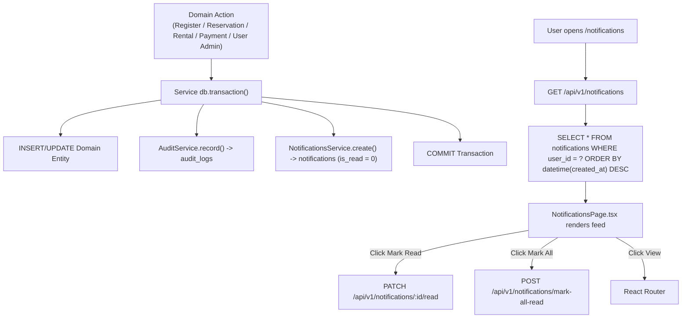

# 12 — Notifications & Applications

> **Epistemic Classification Legend**
> - `[Verified from source code]` — Directly observed in repository files, schemas, configurations, or tool outputs.
> - `[Inferred from architecture]` — Logically deduced from codebase structure, middleware order, or runtime behavior.
> - `[Assumption requiring validation]` — Organizational, municipal policy, or operational assumption not codified in source code.

---

## Table of Contents

- [1. Executive Summary](#1-executive-summary)
- [2. Purpose](#2-purpose)
- [3. Scope](#3-scope)
- [4. Key Components](#4-key-components)
- [5. Architecture Diagrams](#5-architecture-diagrams)
  - [5.1 Synchronous In-App Notification Delivery Flow](#51-synchronous-in-app-notification-delivery-flow)
- [6. Technical Details & Detailed Analysis](#6-technical-details--detailed-analysis)
  - [6.1 Channels Audit (Email, SMS, Push, Queues, Webhooks)](#61-channels-audit-email-sms-push-queues-webhooks)
  - [6.2 Notification Database Model & API Contract](#62-notification-database-model--api-contract)
  - [6.3 Complete Trigger & Template Inventory (All 10 Triggers)](#63-complete-trigger--template-inventory-all-10-triggers)
  - [6.4 Frontend Delivery, Read-State & Deep-Link Routing Bug](#64-frontend-delivery-read-state--deep-link-routing-bug)
- [7. Findings](#7-findings)
- [8. Risks](#8-risks)
- [9. Recommendations](#9-recommendations)
- [10. Future Enhancements](#10-future-enhancements)
- [11. References to Source Files & Cross-References](#11-references-to-source-files--cross-references)

---

## 1. Executive Summary

MCTEB implements an **in-app, database-persisted notification feed** backed by the `notifications` SQLite table, `NotificationsService` (`apps/api/src/modules/notifications/`), and `NotificationsPage.tsx` (`apps/web/src/features/notifications/`) (`[Verified from source code]`).

**Explicit Negative Findings (`[Verified from source code]`):**
- **Email Systems**: **Not implemented** (no Nodemailer, SMTP, SendGrid, or email templates).
- **SMS Systems**: **Not implemented** (no Semaphore, Twilio, or Infobip integration; listed as Phase 2 in `report.md` line 104).
- **Web Push / Service Workers / Real-Time WebSockets**: **Not implemented** (note `report.md` line 105 states "Push and in-app chronological notifications", which is inaccurate—only in-app pull-based notifications exist in source code `[Verified from source code]`).
- **Background Queues / Webhooks**: **Not implemented**; all notifications are inserted synchronously during the originating HTTP request transaction (`[Verified from source code]`).

A critical UI navigation bug was also verified: backend services generate `link_url` values such as `/reservations/${id}`, `/rentals/${id}`, and `/payments/${id}`, none of which exist in `apps/web/src/app/routes.tsx` (`[Verified from source code]`).

---

## 2. Purpose

This document audits all notification channels, triggers, message templates, delivery semantics, read-state workflows, and external application integrations in MCTEB.

---

## 3. Scope

Covers `apps/api/src/modules/notifications/*`, all `NotificationsService.create(...)` call sites across `apps/api/src/modules/`, `packages/shared/src/schemas/notification.ts`, `db/schema.sql` (`notifications`), and `apps/web/src/features/notifications/NotificationsPage.tsx` (`[Verified from source code]`).

---

## 4. Key Components

- **`NotificationsService` & `NotificationsRepository`** (`apps/api/src/modules/notifications/`): `create`, `getForUser`, `markRead`, `markAllRead` (`[Verified from source code]`).
- **`NotificationsController` & `notificationsRouter`**: Authenticated endpoints (`GET /`, `PATCH /:id/read`, `POST /mark-all-read`) (`[Verified from source code]`).
- **`NotificationsPage.tsx`**: Chronological feed UI with unread dot, "Mark Read", "Mark All as Read", and deep-link `<Link to={n.link_url}>` button (`[Verified from source code]`).

---

## 5. Architecture Diagrams

### 5.1 Synchronous In-App Notification Delivery Flow

---

## 6. Technical Details & Detailed Analysis

### 6.1 Channels Audit (Email, SMS, Push, Queues, Webhooks)

| Channel / Infrastructure | Implemented? | Source Evidence |
|---|---|---|
| **In-App Database Feed** | **Yes** | `notifications` table + `NotificationsService` + `NotificationsPage.tsx` `[Verified from source code]` |
| **Email (SMTP / Transactional API)** | **No** | Zero mail libraries or templates in `package.json` or `apps/api/src/` `[Verified from source code]` |
| **SMS Gateway** | **No** | Listed in `report.md` line 104–106 as Phase 2 future work `[Verified from source code]` |
| **Browser Push / WebSockets / SSE** | **No** | No Service Worker, VAPID keys, `ws`, or SSE streams `[Verified from source code]` |
| **Async Job Queues (Redis / BullMQ)** | **No** | Notifications write synchronously inline inside `db.transaction()` `[Verified from source code]` |
| **Webhooks** | **No** | Listed in `report.md` line 100 as Phase 2 future work `[Verified from source code]` |

### 6.2 Notification Database Model & API Contract

- **Schema (`db/schema.sql:134–143`)**: Columns `id`, `user_id` (`ON DELETE CASCADE`), `title`, `message`, `type` (`'info' | 'success' | 'warning' | 'danger'`), `link_url`, `is_read` (`0` or `1`), `created_at` (`[Verified from source code]`).
- **Index**: `idx_notifications_user_unread` on `(user_id, is_read)` (`[Verified from source code]`).
- **Endpoints (`notifications.routes.ts`)**: All three routes (`GET /`, `PATCH /:id/read`, `POST /mark-all-read`) strictly scope SQL queries by `req.user.id` (`WHERE user_id = ?`), preventing cross-user notification access (`[Verified from source code]`).

### 6.3 Complete Trigger & Template Inventory (All 10 Triggers)

Verified directly across every call site of `NotificationsService.create(...)` in `apps/api/src/modules/` (`[Verified from source code]`):

| # | Trigger Location | Recipient | `type` | `title` | Message Template | `link_url` |
|---|---|---|---|---|---|---|
| 1 | `AuthService.register` (`auth.service.ts:51`) | New Borrower | `success` | `Welcome to MCTEB` | `Mabuhay! Your municipal tool bank account has been created. You can now browse and reserve equipment.` | `/catalog` |
| 2 | `UsersService.updateUserStatus` (`users.service.ts:68`) | Target User | `success` (`Active`) / `danger` (else) | `Account Status Update` | `Your account status is now ${input.status}. Reason: ${input.reason}` | *Omitted (`null`)* |
| 3 | `UsersService.updateUserRole` (`users.service.ts:103`) | Target User | `info` | `Account Role Update` | `Your account role has been updated to ${input.role}. Reason: ${input.reason}` | *Omitted (`null`)* |
| 4 | `ReservationsService.createReservation` (`reservations.service.ts:66`) | Borrower | `info` | `Reservation Submitted` | `Your reservation request for "${tool.name}" (${pickup_date} to ${return_date}) has been received and is pending staff review.` | `/reservations/${created.id}` *(Broken)* |
| 5 | `ReservationsService.reviewReservation` (`reservations.service.ts:113`) | Borrower | `success` (`Approved`) / `danger` (`Rejected`) | `Reservation ${input.decision}` | Approved: `Good news! Your reservation for "${tool_name}" was approved...` / Rejected: `Your reservation for "${tool_name}" was rejected...` | `/reservations/${id}` *(Broken)* |
| 6 | `ReservationsService.cancelReservation` (`reservations.service.ts:158`) | Reservation Owner | `warning` | `Reservation Cancelled` | `Reservation for "${reservation.tool_name}" has been marked as Cancelled.` | `/reservations/${id}` *(Broken)* |
| 7 | `RentalsService.checkout` (`rentals.service.ts:63`) | Borrower (`input.user_id`) | `success` | `Tool Handover Complete` | `You have successfully received "${tool.name}". Return due date: ${input.due_date}. Please keep the tool in good condition.` | `/rentals/${rental.id}` *(Broken)* |
| 8 | `RentalsService.processReturn` (`rentals.service.ts:115`) | Borrower | `info` | `Tool Returned & Inspected` | `Your return of "${existing.tool_name}" has been accepted. Inspection condition: ${input.returned_condition}...` | `/rentals/${id}` *(Broken)* |
| 9 | `PaymentsService.recordPayment` (`payments.service.ts:45`) | Payer | `info` | `Payment Submitted` | `Your payment of ${formatPHP(amount_centavos)} (Ref: ${receiptRef}) has been submitted for municipal treasury verification.` | `/payments/${payment.id}` *(Broken)* |
| 10 | `PaymentsService.verifyPayment` (`payments.service.ts:85`) | Payer | `success` (`Paid`) / `danger` (else) | `Payment Verified` / `Payment Status Update` | Paid: `Your payment of ${formatPHP(...)} (Receipt #...) has been verified...` / Else: `Your payment reference ... was marked as ...` | `/payments/${id}` *(Broken)* |

### 6.4 Frontend Delivery, Read-State & Deep-Link Routing Bug

1. **Missing Staff Notifications**: Notice from Section 6.3 that **no notifications are generated for Municipal Staff** when a borrower submits a new reservation (`ReservationsService.createReservation`), submits a new payment (`PaymentsService.recordPayment`), or when a Severe/Critical maintenance ticket is created (`MaintenanceService.createReport`) (`[Verified from source code]`).
2. **Missing Overdue Due-Date Reminders**: Despite `NotificationsPage.tsx` line 71 describing "due dates" and `PROJECT_PLAN.md` Section A5.3 item 4, no scheduler or cron job exists to emit due-date or overdue rental alerts (`[Verified from source code]`).
3. **Broken Deep-Link Targets**: Templates 4–10 set `link_url` to `/reservations/:id`, `/rentals/:id`, and `/payments/:id`. However, `apps/web/src/app/routes.tsx` defines `/my-reservations`, `/my-rentals`, and `/my-payments` without `:id` detail routes (`[Verified from source code]`). Clicking "View" in `NotificationsPage.tsx` (lines 135–141) triggers `<Route path="*" element={<Navigate to="/" replace />} />`, bouncing users to `/dashboard` (`[Verified from source code]`).
4. **No Header Unread Count**: `AppShell.tsx` (lines 194–202) renders a static `<Bell />` link to `/notifications` without fetching or displaying the unread notification count (`[Verified from source code]`).

---

## 7. Findings

### Verified from Source Code
1. Only pull-based in-app notifications (`GET /api/v1/notifications`) exist; no email, SMS, Web Push, queue, or webhook channels exist.
2. 7 out of 8 notification `link_url` destinations (`/reservations/:id`, `/rentals/:id`, `/payments/:id`) do not match any route in `apps/web/src/app/routes.tsx`.
3. `NotificationsRepository.findByUserId` fetches all notifications for a user without pagination (`LIMIT`/`OFFSET`).
4. `MaintenanceService` and `FeedbackService` never emit notifications.

### Inferred from Architecture
1. Synchronous in-transaction `NotificationsService.create` guarantees zero lost alerts when a database commit succeeds, avoiding outbox-pattern complexity in single-node SQLite.

### Assumptions Requiring Validation
1. `[Assumption requiring validation]` Whether Basco farmers and fisherfolk need SMS alerts prioritized for Phase 2 due to intermittent cellular data coverage across Batanes (`report.md` lines 104–106).

---

## 8. Risks

| ID | Risk | Severity | Details |
|---|---|---|---|
| **NOTIF-01** | Broken notification deep links (`404` -> `/dashboard` redirect) | **Medium/High** | 7 out of 10 triggers send users to non-existent routes (`/reservations/:id`, `/rentals/:id`, `/payments/:id`) (`[Verified from source code]`). |
| **NOTIF-02** | Silent unread alerts in header (`AppShell.tsx`) | **Low/Medium** | Users have no visual unread badge indicator unless they manually open `/notifications` (`[Verified from source code]`). |
| **NOTIF-03** | No automated due-date / overdue reminder alerts | **Medium** | Residents do not receive reminders prior to `rentals.due_date` (`[Verified from source code]`). |

---

## 9. Recommendations

1. **Fix Notification `link_url` Values (or Add Frontend Routes)**: Update backend `link_url` targets to `/my-reservations`, `/my-rentals`, `/my-payments` (or implement `/reservations/:id`, `/rentals/:id`, `/payments/:id` detail pages in `routes.tsx`) (`[Verified from source code]`).
2. **Display Unread Notification Badge in `AppShell.tsx`**: Query `/notifications` via TanStack Query and render unread badge count on the header bell icon and sidebar item (`[Verified from source code]`).
3. **Add Pagination & Unread Filter** to `GET /api/v1/notifications` (`?unread=true&page=1&limit=20`).

---

## 10. Future Enhancements

1. **Scheduled Due-Date & Overdue Reminder Job**: Daily cron task scanning `rentals WHERE status = 'Borrowed' AND due_date <= date('now', '+1 day')` to dispatch warning notifications (`[Inferred from architecture]`).
2. **SMS & Email Adapter Behind Outbox Table**: Add a `notification_deliveries` outbox queue processed asynchronously by an SMS gateway (Semaphore/Infobip) (`report.md` lines 104–106).

---

## 11. References to Source Files & Cross-References

| File | Symbol |
|---|---|
| `db/schema.sql` | `notifications` table (`lines 134–143`), `idx_notifications_user_unread` (`line 173`) |
| `apps/api/src/modules/notifications/*` | `notificationsRouter`, `NotificationsController`, `NotificationsService`, `NotificationsRepository` |
| `apps/api/src/modules/{auth,users,reservations,rentals,payments}/*.service.ts` | All 10 `NotificationsService.create` trigger sites |
| `apps/web/src/features/notifications/NotificationsPage.tsx` | Notification list and read actions |
| `apps/web/src/app/routes.tsx` | Route definitions demonstrating missing `/reservations/:id`, `/rentals/:id`, `/payments/:id` |

**Cross-References**: See [08-Business-Workflows.md](./08-Business-Workflows.md), [10-Frontend-Architecture.md](./10-Frontend-Architecture.md), and [20-System-Flowcharts.md](./20-System-Flowcharts.md).
