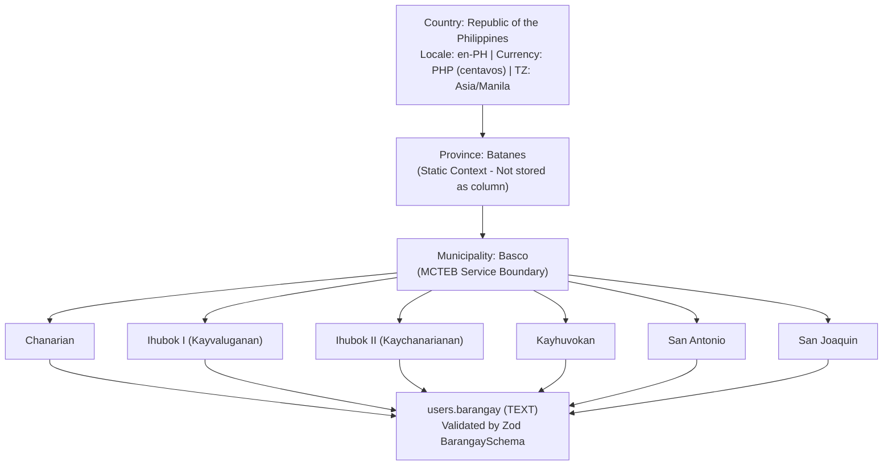
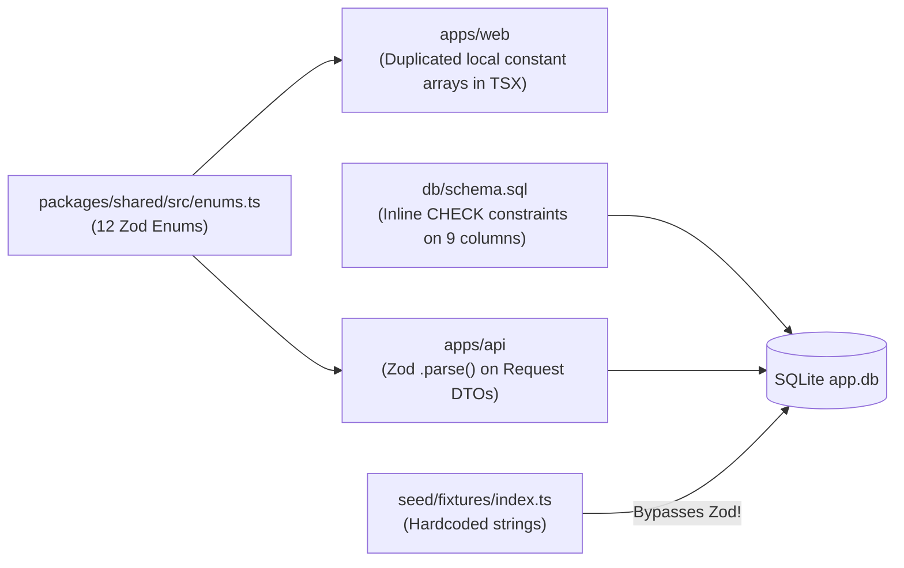

# 13 — Geography & Reference Data

> **Epistemic Classification Legend**
> - `[Verified from source code]` — Directly observed in repository files, schemas, configurations, or tool outputs.
> - `[Inferred from architecture]` — Logically deduced from codebase structure, middleware order, or runtime behavior.
> - `[Assumption requiring validation]` — Organizational, municipal policy, or operational assumption not codified in source code.

---

## Table of Contents

- [1. Executive Summary](#1-executive-summary)
- [2. Purpose](#2-purpose)
- [3. Scope](#3-scope)
- [4. Key Components](#4-key-components)
- [5. Architecture Diagrams](#5-architecture-diagrams)
  - [5.1 Geographic & Localization Data Mapping Diagram](#51-geographic--localization-data-mapping-diagram)
  - [5.2 Reference Enum Validation & Storage Mapping](#52-reference-enum-validation--storage-mapping)
- [6. Technical Details & Detailed Analysis](#6-technical-details--detailed-analysis)
  - [6.1 Geographic Coverage (Country, Province, Municipality, Barangays)](#61-geographic-coverage-country-province-municipality-barangays)
  - [6.2 Currency & Timezone Localization (`money.ts`, `dates.ts`)](#62-currency--timezone-localization-moneyts-datests)
  - [6.3 Complete Domain Reference Enum Inventory (`packages/shared/src/enums.ts`)](#63-complete-domain-reference-enum-inventory-packagessharedsrcenumsts)
  - [6.4 Geographic & Reference Data Drift Analysis](#64-geographic--reference-data-drift-analysis)
- [7. Findings](#7-findings)
- [8. Risks](#8-risks)
- [9. Recommendations](#9-recommendations)
- [10. Future Enhancements](#10-future-enhancements)
- [11. References to Source Files & Cross-References](#11-references-to-source-files--cross-references)

---

## 1. Executive Summary

MCTEB is scoped specifically to a single Philippine local government unit: the **Municipality of Basco, Province of Batanes, Republic of the Philippines** (`[Verified from source code]`, `OfficialReceiptModal.tsx` lines 26–30, `README.md`). There are **no multi-country, multi-region, or multi-city database lookup tables** (`countries`, `provinces`, `cities`, `barangays` tables do not exist in `db/schema.sql`) (`[Verified from source code]`).

Instead, geographic and domain reference data are encoded as **application-layer Zod enums** (`packages/shared/src/enums.ts`), **SQLite `CHECK` constraints** (`db/schema.sql`), and **frontend dropdown constants** (`RegisterPage.tsx`, `ProfilePage.tsx`, `CatalogPage.tsx`, `ToolFormModal.tsx`) (`[Verified from source code]`). Localization targets `en-PH`, `PHP` currency in integer centavos, and the `Asia/Manila` timezone (`[Verified from source code]`).

---

## 2. Purpose

This document catalogs MCTEB's geographic scope, Philippine localization standards, domain reference taxonomies, storage mechanisms, and verified drift between schemas, UI constants, and seed fixtures.

---

## 3. Scope

Covers `packages/shared/src/enums.ts`, `money.ts`, `dates.ts`, `db/schema.sql`, `apps/api/src/db/seed/fixtures/index.ts`, and UI dropdown arrays in `apps/web/src/features/` (`[Verified from source code]`).

---

## 4. Key Components

- **`BarangaySchema` (`packages/shared/src/enums.ts` lines 68–76)**: Canonical 6-barangay list for Basco (`[Verified from source code]`).
- **11 Domain Status/Role/Method/Severity Enums (`packages/shared/src/enums.ts`)**: Compiled into both `@mcteb/shared` Zod parsers and SQLite `CHECK` constraints (`[Verified from source code]`).
- **`MANILA_TIMEZONE`, `formatDate`, `formatDateTime` (`packages/shared/src/dates.ts`)**: Philippine timezone display formatting (`[Verified from source code]`).
- **`formatPHP`, `centavosToPesos`, `pesosToCentavos` (`packages/shared/src/money.ts`)**: Philippine Peso (`PHP`) formatting (`[Verified from source code]`).

---

## 5. Architecture Diagrams

### 5.1 Geographic & Localization Data Mapping Diagram



### 5.2 Reference Enum Validation & Storage Mapping



---

## 6. Technical Details & Detailed Analysis

### 6.1 Geographic Coverage (Country, Province, Municipality, Barangays)

- **Countries / Regions / Provinces / Cities**: **None stored in normalized database tables** (`[Verified from source code]`). Country (`Republic of the Philippines`), Province (`Province of Batanes`), and Municipality (`Municipality of Basco`) appear as static civic branding strings in `OfficialReceiptModal.tsx` (lines 27–30), `RegisterPage.tsx` (line 66), and `README.md` (`[Verified from source code]`).
  *(Note: Stale TypeScript declarations in `packages/shared/dist/schemas/user.d.ts` line 9 show an obsolete `province` field from an earlier iteration, which does not exist in `packages/shared/src/schemas/user.ts` or `db/schema.sql` `[Verified from source code]`.)*
- **Basco Barangays (`packages/shared/src/enums.ts` lines 68–76)** (`[Verified from source code]`):
  1. `Chanarian`
  2. `Ihubok II (Kaychanarianan)`
  3. `Ihubok I (Kayvaluganan)`
  4. `Kayhuvokan`
  5. `San Antonio`
  6. `San Joaquin`
- **Street Address**: Stored as free-form `users.address TEXT NOT NULL` (`min(5)`, `max(255)`) (`[Verified from source code]`).

### 6.2 Currency & Timezone Localization (`money.ts`, `dates.ts`)

- **Currency (`packages/shared/src/money.ts` lines 15–23)** (`[Verified from source code]`):
```ts
export function formatPHP(centavos: number): string {
  const pesos = centavos / 100;
  return new Intl.NumberFormat('en-PH', {
    style: 'currency',
    currency: 'PHP',
    minimumFractionDigits: 2,
    maximumFractionDigits: 2,
  }).format(pesos);
}
```
- **Timezone (`packages/shared/src/dates.ts` lines 7–30)** (`[Verified from source code]`):
  - `MANILA_TIMEZONE = 'Asia/Manila'` (`UTC+8`).
  - SQLite stores UTC timestamps (`DATETIME('now')` -> `YYYY-MM-DD HH:MM:SS` without `Z` suffix!) and JS ISO strings (`expires_at`, `lockout_until` using `.toISOString()` -> `...Z`), while date-only columns (`birth_date`, `pickup_date`, `return_date`, `due_date`, `scheduled_date`) use `YYYY-MM-DD` (`[Verified from source code]`).
  - **Subtle Parsing Hazard (`[Inferred from architecture]`)**: Because SQLite `DATETIME('now')` produces `'2026-11-16 12:00:00'` *without* a timezone indicator (`Z`), `new Date(dateString)` in `formatDateTime()` on client browsers treats `'YYYY-MM-DD HH:MM:SS'` as **local browser time** rather than UTC before converting to `Asia/Manila`!

### 6.3 Complete Domain Reference Enum Inventory (`packages/shared/src/enums.ts`)

| Enum Schema | Values | SQL `CHECK` Constraint? |
|---|---|---|
| `UserRoleSchema` | `'Administrator'`, `'Municipal Staff'`, `'Borrower'` | Yes (`users.role`) `[Verified from source code]` |
| `UserStatusSchema` | `'Active'`, `'Pending Verification'`, `'Suspended'` | Yes (`users.status`) `[Verified from source code]` |
| `ToolAvailabilityStatusSchema` | `'Available'`, `'Reserved'`, `'Borrowed'`, `'Returned'`, `'Maintenance'`, `'Damaged'`, `'Archived'` | Yes (`tools.availability_status`) `[Verified from source code]` |
| `ToolConditionStatusSchema` | `'Excellent'`, `'Good'`, `'Fair'`, `'Needs Repair'`, `'Under Maintenance'` | Yes (`tools.condition_status`, `rentals.initial_condition`, `rentals.returned_condition`) `[Verified from source code]` |
| `ReservationStatusSchema` | `'Pending'`, `'Approved'`, `'Rejected'`, `'Cancelled'`, `'Completed'` | Yes (`reservations.status`) `[Verified from source code]` |
| `RentalStatusSchema` | `'Pending'`, `'Reserved'`, `'Borrowed'`, `'Returned'`, `'Completed'` | Yes (`rentals.status`) `[Verified from source code]` |
| `PaymentStatusSchema` | `'Pending'`, `'Paid'`, `'Failed'`, `'Refunded'` | Yes (`payments.status`) `[Verified from source code]` |
| `PaymentMethodSchema` | `'Cash'`, `'GCash'`, `'Bank Transfer'`, `'Municipal Treasury'` | Yes (`payments.payment_method`) `[Verified from source code]` |
| `MaintenanceSeveritySchema` | `'Minor'`, `'Moderate'`, `'Severe'`, `'Critical'` | Yes (`maintenance.severity`) `[Verified from source code]` |
| `MaintenanceStatusSchema` | `'Reported'`, `'Scheduled'`, `'In Progress'`, `'Completed'`, `'Decommissioned'` | Yes (`maintenance.status`) `[Verified from source code]` |
| `NotificationTypeSchema` | `'info'`, `'success'`, `'warning'`, `'danger'` | Yes (`notifications.type`) `[Verified from source code]` |
| `BarangaySchema` | `'Chanarian'`, `'Ihubok II (Kaychanarianan)'`, `'Ihubok I (Kayvaluganan)'`, `'Kayhuvokan'`, `'San Antonio'`, `'San Joaquin'` | **No** (`users.barangay` has no `CHECK`) `[Verified from source code]` |

### 6.4 Geographic & Reference Data Drift Analysis

Code inspection uncovered **three exact reference data mismatches** (`[Verified from source code]`):
1. **Barangay Drift**: `SEED_USERS` (`apps/api/src/db/seed/fixtures/index.ts:21,32,43,54`) inserts `'Barangay I (Poblacion)'`, `'Barangay II'`, `'Barangay III'`, and `'Barangay IV'`. If a seeded user opens `ProfilePage.tsx` and submits edits without changing their barangay, `UpdateProfileSchema` (`BarangaySchema`) will reject the seeded value or `Select` will fall back silently to the first option (`Chanarian`)!
2. **Tool Category Drift**: `CatalogPage.tsx` & `ToolFormModal.tsx` list `'Agriculture'`, `'Fishing'`, `'Carpentry'`, `'Construction'`, `'Electrical'`, `'Emergency Response'`, whereas `SEED_TOOLS` uses `'Agricultural'`, `'Power Equipment'`, `'Construction'`, and `'Fishery'`. No `ToolCategorySchema` exists in `packages/shared/src/enums.ts` (`[Verified from source code]`).
3. **Duplicated Frontend Option Arrays**: `BARANGAYS` is duplicated verbatim in `RegisterPage.tsx` (lines 11–18) and `ProfilePage.tsx` (lines 13–20), and `CATEGORIES` is duplicated in `CatalogPage.tsx` (lines 14–22) and `ToolFormModal.tsx` (lines 9–16), instead of importing from `@mcteb/shared` (`[Verified from source code]`).

---

## 7. Findings

### Verified from Source Code
1. All 12 reference taxonomies live in `packages/shared/src/enums.ts`; no relational reference/lookup tables exist in `db/schema.sql`.
2. `users.barangay` lacks a SQL `CHECK` constraint, allowing invalid barangay names in `SEED_USERS`.
3. `ToolCategory` is an unvalidated free-form string (`z.string().min(2).max(50)`) rather than an enum, causing mismatch between `SEED_TOOLS` and `CatalogPage.tsx`.
4. `RegisterPage.tsx`, `ProfilePage.tsx`, `CatalogPage.tsx`, and `ToolFormModal.tsx` duplicate reference option arrays locally instead of deriving them from `@mcteb/shared`.

### Inferred from Architecture
1. SQLite `DATETIME('now')` timestamp strings lack explicit UTC `Z` suffixes, which can produce timezone offset bugs when formatted in non-UTC browser environments.

### Assumptions Requiring Validation
1. `[Assumption requiring validation]` Confirm with Municipality of Basco officials whether the 6 barangay names in `BarangaySchema` are the authoritative PSGC (Philippine Standard Geographic Code) barangays of Basco (and not `Barangay I–IV`).

---

## 8. Risks

| ID | Risk | Severity | Details |
|---|---|---|---|
| **REF-01** | Seeded users cannot save profile updates cleanly | **Medium** | `SEED_USERS` barangays fail `BarangaySchema` validation (`[Verified from source code]`). |
| **REF-02** | Category filter returns zero items for Agriculture/Fishing | **Medium** | `CatalogPage.tsx` category strings do not match `SEED_TOOLS.category` (`[Verified from source code]`). |
| **REF-03** | Ambiguous UTC timestamp parsing (`DATETIME('now')`) | **Low** | Missing `Z` suffix causes client `new Date()` to interpret UTC DB timestamps as local time (`[Inferred from architecture]`). |

---

## 9. Recommendations

1. **Fix `SEED_USERS` Barangays & `SEED_TOOLS` Categories** in `apps/api/src/db/seed/fixtures/index.ts` and enforce `BarangaySchema` inside `validate-fixtures.ts`.
2. **Add `ToolCategorySchema` and `BASCO_BARANGAYS` Export to `@mcteb/shared`** and delete duplicate local arrays from `apps/web`.
3. **Add `CHECK` Constraints** for `users.barangay` and `tools.category` in `db/schema.sql` (via migration), and store ISO-8601 `...Z` UTC timestamps consistently.

---

## 10. Future Enhancements

1. **PSGC Reference Alignment**: Attach official Philippine Standard Geographic Code (PSGC) identifiers if MCTEB expands to neighboring Batanes municipalities (Ivana, Mahatao, Sabtang, Uyugan, Itbayat) (`[Assumption requiring validation]`).

---

## 11. References to Source Files & Cross-References

| File | Symbol |
|---|---|
| `packages/shared/src/enums.ts` | `BarangaySchema` and 11 domain enums |
| `packages/shared/src/money.ts`, `dates.ts` | `formatPHP`, `MANILA_TIMEZONE`, `formatDate`, `formatDateTime` |
| `apps/api/src/db/seed/fixtures/index.ts` | `SEED_USERS`, `SEED_TOOLS` |
| `apps/web/src/features/{auth/RegisterPage,profile/ProfilePage,catalog/CatalogPage,inventory/ToolFormModal}.tsx` | Local reference arrays |

**Cross-References**: See [04-Database-and-ERD.md](./04-Database-and-ERD.md), [19-Skills-and-Business-Type-Catalog.md](./19-Skills-and-Business-Type-Catalog.md), and [TECHNICAL_DEBT_REPORT.md](./TECHNICAL_DEBT_REPORT.md).
