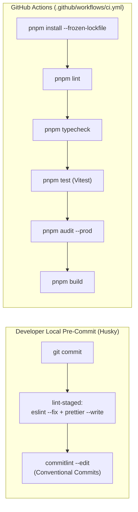

# 14 — Testing & Quality

> **Epistemic Classification Legend**
> - `[Verified from source code]` — Directly observed in repository files, schemas, configurations, or tool outputs.
> - `[Inferred from architecture]` — Logically deduced from codebase structure, middleware order, or runtime behavior.
> - `[Assumption requiring validation]` — Organizational, municipal policy, or operational assumption not codified in source code.

---

## Table of Contents

- [1. Executive Summary](#1-executive-summary)
- [2. Purpose](#2-purpose)
- [3. Scope](#3-scope)
- [4. Key Components](#4-key-components)
- [5. Architecture Diagrams](#5-architecture-diagrams)
  - [5.1 Quality Gate & CI Pipeline Flow](#51-quality-gate--ci-pipeline-flow)
- [6. Technical Details & Detailed Analysis](#6-technical-details--detailed-analysis)
  - [6.1 Automated Test Suite Inventory (Unit, Integration, E2E)](#61-automated-test-suite-inventory-unit-integration-e2e)
  - [6.2 Static Quality Gates (ESLint, TypeScript, Prettier, Husky, Commitlint)](#62-static-quality-gates-eslint-typescript-prettier-husky-commitlint)
  - [6.3 Testing Coverage Matrix Across All Modules](#63-testing-coverage-matrix-across-all-modules)
  - [6.4 Observed Verification Outcomes & Typecheck Failure](#64-observed-verification-outcomes--typecheck-failure)
- [7. Findings](#7-findings)
- [8. Risks](#8-risks)
- [9. Recommendations](#9-recommendations)
- [10. Future Enhancements](#10-future-enhancements)
- [11. References to Source Files & Cross-References](#11-references-to-source-files--cross-references)

---

## 1. Executive Summary

MCTEB pairs a strong static analysis toolchain (TypeScript strict mode, ESLint 9 type-checked rules, Prettier, Husky + lint-staged, Commitlint, GitHub Actions CI) with a **minimal automated test footprint**: only **7 backend integration tests** exist in `apps/api/src/app.test.ts` (`[Verified from source code]`).

There are **zero unit tests in `packages/shared`**, **zero unit/component tests in `apps/web`** (even though `vitest.config.ts` and `@testing-library/react` are configured), and **zero end-to-end (Playwright/Cypress) browser tests** (`[Verified from source code]`). Furthermore, running `pnpm.cmd -r typecheck` in the current workspace failed in `apps/web` (`RegisterPage.tsx(43,22)`) due to stale declarations in `packages/shared/dist/` (`[Verified from source code]`).

---

## 2. Purpose

This document audits MCTEB's unit, integration, and E2E test coverage, static quality enforcement, CI pipeline behavior, and test isolation gaps.

---

## 3. Scope

Covers `apps/api/vitest.config.ts`, `apps/api/src/app.test.ts`, `apps/web/vitest.config.ts`, `eslint.config.mjs`, `.prettierrc.json`, `.husky/husky.json`, `.lintstagedrc.json`, `commitlint.config.cjs`, `.github/workflows/ci.yml`, and `report.md` (`[Verified from source code]`).

---

## 4. Key Components

- **Backend Test Suite (`apps/api/src/app.test.ts`)**: Vitest + Supertest integration suite executing HTTP requests against the Express `app` export (`[Verified from source code]`).
- **Frontend Test Config (`apps/web/vitest.config.ts`)**: `jsdom` environment with `@testing-library/react` devDependency (0 test files present) (`[Verified from source code]`).
- **Linting & Formatting (`eslint.config.mjs`, `.prettierrc.json`, `.lintstagedrc.json`)**: Pre-commit TypeScript + Prettier enforcement (`[Verified from source code]`).
- **CI Workflow (`.github/workflows/ci.yml`)**: Automated pipeline on `main` and `develop` pushes/PRs (`[Verified from source code]`).

---

## 5. Architecture Diagrams

### 5.1 Quality Gate & CI Pipeline Flow

---

## 6. Technical Details & Detailed Analysis

### 6.1 Automated Test Suite Inventory (Unit, Integration, E2E)

| Layer | Config / Runner | Test Files Found | Cases Covered |
|---|---|---|---|
| **Backend (`@mcteb/api`)** | `apps/api/vitest.config.ts` (`node`, `v8` coverage) + `supertest` | **1 file** (`apps/api/src/app.test.ts`) | **7 integration tests**: `GET /health`, `GET /api/v1/tools`, underage `< 18` reject on `/auth/register`, demo borrower login, Borrower RBAC `403` on `/users`, Admin `200` on `/users`, `404` on `/api/v1/nonexistent` `[Verified from source code]` |
| **Frontend (`@mcteb/web`)** | `apps/web/vitest.config.ts` (`jsdom`, `@testing-library/react`) | **0 files** (`src/**/*.test.{ts,tsx}` yields none) | None `[Verified from source code]` |
| **Shared (`@mcteb/shared`)** | No test script in `packages/shared/package.json` | **0 files** | None (`money.ts`, `dates.ts`, `permissions.ts`, Zod schemas untested directly) `[Verified from source code]` |
| **E2E Browser Tests** | None | **0 files** | No Playwright or Cypress installed `[Verified from source code]` |

**Critical Test Isolation Flaw (`apps/api/src/app.test.ts` lines 7–10, 28–46)**:
- `beforeAll` runs `runMigrations()` and `await runSeed()` directly against `env.DATABASE_PATH_RESOLVED` (`./data/app.db` — the live development database!) (`[Verified from source code]`).
- Test 3 (`POST /api/v1/auth/register`) only tests an underage failure; no test inserts persistent test records or cleans up test DB state, and `apps/api/data/app.db-shm` shows local modifications (`[Verified from source code]`).

### 6.2 Static Quality Gates (ESLint, TypeScript, Prettier, Husky, Commitlint)

- **ESLint (`eslint.config.mjs`)**: Runs `recommendedTypeChecked` with `no-unused-vars` (`^_` ignored), `consistent-type-imports`, and `no-explicit-any: 'error'` (`[Verified from source code]`). Note: `package.json` root `"lint": "pnpm -r lint"` invokes `lint` scripts in workspace packages, **none of which actually define a `"lint"` script in `apps/api/package.json`, `apps/web/package.json`, or `packages/shared/package.json`!** (`[Verified from source code]`).
- **Prettier (`.prettierrc.json`)**: `semi: true`, `singleQuote: true`, `trailingComma: "all"`, `printWidth: 100`, `tabWidth: 2` (`[Verified from source code]`).
- **Husky + Commitlint (`.husky/husky.json`, `commitlint.config.cjs`)**: Uses Husky v9 config syntax `.husky/husky.json` (note Husky v9 normally uses executable shell scripts `.husky/pre-commit` and `.husky/commit-msg`, whereas `husky.json` is non-standard `[Inferred from architecture]`).

### 6.3 Testing Coverage Matrix Across All Modules

| Module / Area | Unit Tests | Integration Tests | Untested Critical Logic |
|---|---|---|---|
| `packages/shared` | **0** | N/A | `formatPHP`, `centavosToPesos`, `isValidDateRange`, `hasPermission`, `CreateReservationSchema` date refinement |
| `auth` | **0** | **2** (`register` <18, `login`) | Successful registration, 5-attempt lockout, lockout expiry, suspended login, `/logout`, `/me` |
| `users` | **0** | **2** (RBAC `403` & `200`) | IDOR checks, `updateProfile`, `updateStatus` self-suspension guard, last-admin demotion guard |
| `tools` | **0** | **1** (`GET /tools`) | `GET /:id`, `POST /`, `PATCH /:id` loaned-quantity guard, `POST /:id/archive` |
| `reservations` | **0** | **0** | Date conflict detection, concurrent booking race, review `Approve`/`Reject`, `cancel` |
| `rentals` | **0** | **0** | `checkout` stock decrement, `processReturn` stock restore, penalty calculation, Maintenance transition |
| `payments` | **0** | **0** | `recordPayment`, `BASCO-PAY` ref generation, `verifyPayment` state check |
| `maintenance` | **0** | **0** | Severe/Critical auto-maintenance, `return_to_service` restoration |
| `feedback` | **0** | **0** | Surname masking, `moderate` visibility toggle |
| `notifications` | **0** | **0** | `markRead`, `markAllRead`, IDOR ownership scope |
| `audit` | **0** | **0** | Admin RBAC, filter query params, pagination |
| `@mcteb/web` UI | **0** | **0** | All 15 pages, 6 modals, `ProtectedRoute`, `AuthContext` |

### 6.4 Observed Verification Outcomes & Typecheck Failure

Running `pnpm.cmd -r typecheck` in this session exited with **code 1** (`[Verified from source code]`):
- `packages/shared typecheck`: Done
- `apps/api typecheck`: Done
- `apps/web typecheck`: **Failed** (`TS2345` in `src/features/auth/RegisterPage.tsx(43,22)`) because `packages/shared/dist/schemas/user.d.ts` contains stale schema definitions requiring `province` and `role`, while `packages/shared/src/schemas/user.ts` was updated without rebuilding `@mcteb/shared` (`[Verified from source code]`).

---

## 7. Findings

### Verified from Source Code
1. Only 7 backend integration tests exist; all transactional workflows (reservations, rentals, payments, maintenance, feedback, notifications, audit, user safeguards) have **0% automated test coverage**.
2. `pnpm.cmd -r lint` is a no-op across packages because `apps/api`, `apps/web`, and `packages/shared` define no `"lint"` script in their `package.json` files (only root `eslint` via `lint-staged` executes).
3. `pnpm.cmd -r typecheck` currently fails on `apps/web` due to stale `packages/shared/dist/`.
4. `app.test.ts` runs against the live development SQLite database path instead of an isolated temporary/in-memory database.
5. `report.md` (line 85) states "All 7 integration tests passing", which only covers basic smoke/auth/RBAC checks rather than full domain workflow verification.

### Inferred from Architecture
1. `.github/workflows/ci.yml` will fail on clean checkout at `pnpm typecheck` and `pnpm test` because `pnpm build` (which builds `@mcteb/shared`) is placed at the end of the pipeline instead of before downstream checks.

### Assumptions Requiring Validation
1. `[Assumption requiring validation]` Whether QA verification of reservation, rental, payment, and maintenance workflows was performed manually in browser prior to writing `report.md`.

---

## 8. Risks

| ID | Risk | Severity | Details |
|---|---|---|---|
| **QA-01** | Zero regression coverage on core financial & stock transactions | **High** | Reservations, checkout stock decrements, return penalties, and payment verification have zero automated tests (`[Verified from source code]`). |
| **QA-02** | False-green `pnpm lint` in CI (`pnpm -r lint`) | **Medium** | Workspace packages lack `"lint"` scripts, so `pnpm -r lint` exits 0 without linting any code (`[Verified from source code]`). |
| **QA-03** | CI pipeline order fails on clean checkout | **High** | `packages/shared` must be built before `typecheck` and `test` run (`[Verified from source code]`). |
| **QA-04** | Tests share dev database file | **Medium** | Running `pnpm test` mutates `apps/api/data/app.db` (`[Verified from source code]`). |

---

## 9. Recommendations

1. **Fix `lint` & CI Build Order**: Add root `"lint": "eslint ."` (instead of `pnpm -r lint`) in `package.json`, add `"pretypecheck"` / CI step `pnpm --filter @mcteb/shared build`, and rebuild `@mcteb/shared` immediately.
2. **Isolate Test Database**: Set `DATABASE_PATH=:memory:` or a temporary `os.tmpdir()` path in `apps/api/vitest.config.ts` / `app.test.ts` before importing `app.ts`.
3. **Add Domain Integration Tests**: Write Vitest + Supertest tests covering concurrent reservation overbooking (`409`), checkout -> return -> penalty -> maintenance restoration, payment verification idempotency, and admin self-suspension/last-admin guards.
4. **Add `@mcteb/shared` & Frontend Component Tests**: Test `formatPHP`, `dates.ts`, `ProtectedRoute`, `LoginPage`, and `ReservationFormModal`.

---

## 10. Future Enhancements

1. **Playwright E2E Suite**: Automate critical borrower and staff user journeys against live Vite + Express servers in CI.
2. **Coverage Threshold Enforcement**: Configure `vitest.config.ts` `coverage.thresholds` (e.g., 80% lines/branches on `apps/api/src/modules/`).

---

## 11. References to Source Files & Cross-References

| File | Purpose |
|---|---|
| `apps/api/src/app.test.ts`, `apps/api/vitest.config.ts` | Backend Vitest integration test suite and coverage config |
| `apps/web/vitest.config.ts` | Frontend jsdom Vitest config (0 tests) |
| `eslint.config.mjs`, `.prettierrc.json`, `.lintstagedrc.json`, `commitlint.config.cjs`, `.husky/husky.json` | Static analysis & git hook configuration |
| `.github/workflows/ci.yml` | GitHub Actions workflow |
| `package.json` | Root workspace scripts (`lint`, `typecheck`, `test`) |

**Cross-References**: See [15-Deployment-and-Operations.md](./15-Deployment-and-Operations.md), [17-Developer-Guide.md](./17-Developer-Guide.md), and [TECHNICAL_DEBT_REPORT.md](./TECHNICAL_DEBT_REPORT.md).
