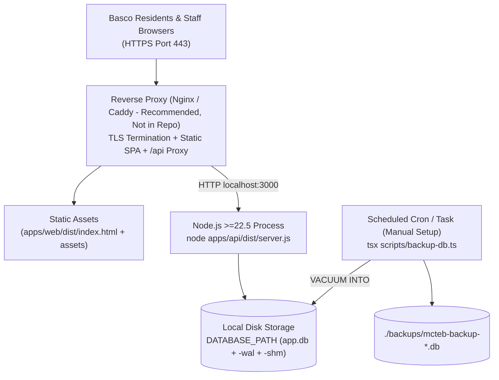

# 15 — Deployment & Operations

> **Epistemic Classification Legend**
>
> - `[Verified from source code]` — Directly observed in repository files, schemas, configurations, or tool outputs.
> - `[Inferred from architecture]` — Logically deduced from codebase structure, middleware order, or runtime behavior.
> - `[Assumption requiring validation]` — Organizational, municipal policy, or operational assumption not codified in source code.

---

## Table of Contents

- [1. Executive Summary](#1-executive-summary)
- [2. Purpose](#2-purpose)
- [3. Scope](#3-scope)
- [4. Key Components](#4-key-components)
- [5. Architecture Diagrams](#5-architecture-diagrams)
  - [5.1 Production Deployment Architecture (Inferred Topology)](#51-production-deployment-architecture-inferred-topology)
- [6. Technical Details & Detailed Analysis](#6-technical-details--detailed-analysis)
  - [6.1 Environments & Configuration (`apps/api/src/config/env.ts`)](#61-environments--configuration-appsapisrcconfigenvts)
  - [6.2 CI/CD Pipeline (`.github/workflows/ci.yml`)](#62-cicd-pipeline-githubworkflowsciyml)
  - [6.3 Containers, Infrastructure & Reverse Proxy Status](#63-containers-infrastructure--reverse-proxy-status)
  - [6.4 Monitoring, Logging & Health Check (`pino`, `/health`)](#64-monitoring-logging--health-check-pino-health)
  - [6.5 Scaling Constraints & Concurrency](#65-scaling-constraints--concurrency)
  - [6.6 Backup & Disaster Recovery (`scripts/backup-db.ts`)](#66-backup--disaster-recovery-scriptsbackup-dbts)
- [7. Findings](#7-findings)
- [8. Risks](#8-risks)
- [9. Recommendations](#9-recommendations)
- [10. Future Enhancements](#10-future-enhancements)
- [11. References to Source Files & Cross-References](#11-references-to-source-files--cross-references)

---

## 1. Executive Summary

MCTEB runs as two runtime artifacts in production: a compiled Node.js HTTP API (`apps/api/dist/server.js`) and a static Vite production bundle (`apps/web/dist/`) backed by a single SQLite file (`[Verified from source code]`).

**Explicit Infrastructure Verification (`[Verified from source code]`):**

- **Containers / IaC**: **No `Dockerfile`, `docker-compose.yml`, Kubernetes manifests, Terraform, or Nginx/Caddy configs exist in the repository.**
- **CD (Continuous Deployment)**: `.github/workflows/ci.yml` executes **CI checks only** (`install -> lint -> typecheck -> test -> audit -> build`) with **no automated deployment step** (`[Verified from source code]`).
- **Observability**: Structured JSON logging via `pino` + `pino-http` (redacting auth headers, cookies, and passwords) and an unauthenticated `GET /health` probe (`[Verified from source code]`).
- **Disaster Recovery**: Hot SQLite snapshot script (`scripts/backup-db.ts`) using `VACUUM INTO` (`[Verified from source code]`).

---

## 2. Purpose

This document covers environment configuration, CI/CD pipelines, infrastructure posture, logging/health monitoring, scaling limits, and backup/recovery operations for MCTEB.

---

## 3. Scope

Covers `.env.example`, `apps/api/src/config/env.ts`, `apps/api/src/server.ts`, `apps/api/src/utils/logger.ts`, `.github/workflows/ci.yml`, `scripts/backup-db.ts`, and `PROJECT_PLAN.md` Section B5 (`[Verified from source code]`).

---

## 4. Key Components

- **Environment Schema (`apps/api/src/config/env.ts`)**: Zod validation of 7 environment variables on boot (`[Verified from source code]`).
- **Server Lifecycle (`apps/api/src/server.ts`)**: Auto-runs `runMigrations()` before `app.listen(env.PORT)` and registers `SIGTERM`/`SIGINT` graceful shutdown (`server.close()` -> `db.close()`) (`[Verified from source code]`).
- **Logger (`apps/api/src/utils/logger.ts`)**: Pino logger with secret redaction (`[Verified from source code]`).
- **Backup Script (`scripts/backup-db.ts`)**: Executes `VACUUM INTO` hot snapshot into `./backups/` (`[Verified from source code]`).

---

## 5. Architecture Diagrams

### 5.1 Production Deployment Architecture (Inferred Topology)

_(Note: Reverse proxy, TLS, and OS service supervisor are `[Inferred from architecture]` / recommended in `PROJECT_PLAN.md` Section B5, as no proxy or container config files exist in the repo `[Verified from source code]`.)_

---

## 6. Technical Details & Detailed Analysis

### 6.1 Environments & Configuration (`apps/api/src/config/env.ts`)

| Variable          | Zod Rule & Default (`env.ts`)                                                  | `.env.example`                                   | Operational Behavior                                                                                                 |
| ----------------- | ------------------------------------------------------------------------------ | ------------------------------------------------ | -------------------------------------------------------------------------------------------------------------------- |
| `NODE_ENV`        | `enum(['development', 'test', 'production', 'demo'])`, default `'development'` | `development`                                    | Controls CORS wildcard bypass, secure cookie flag, pino transport, and demo seed guard `[Verified from source code]` |
| `PORT`            | `coerce.number()`, default `3000`                                              | `3000`                                           | Express listening port `[Verified from source code]`                                                                 |
| `DATABASE_PATH`   | `string`, default `'./data/app.db'`                                            | `./data/app.db`                                  | Resolved relative to `process.cwd()` (`apps/api` when run via pnpm filter) `[Verified from source code]`             |
| `CORS_ORIGINS`    | `string`, default `'http://localhost:5173'`                                    | `http://localhost:5173`                          | Comma-separated origin allowlist when `NODE_ENV !== 'development'` `[Verified from source code]`                     |
| `SESSION_SECRET`  | `string().min(16)`, default `'mcteb-default-session-secret-batanes-32char'`    | `change-me-min-32-chars-use-openssl-rand-hex-32` | Passed to `cookieParser()` (currently unused for signing cookies) `[Verified from source code]`                      |
| `LOG_LEVEL`       | `enum(['fatal','error','warn','info','debug','trace'])`, default `'info'`      | `info`                                           | Pino log verbosity `[Verified from source code]`                                                                     |
| `ALLOW_DEMO_SEED` | Boolean preprocess (`'true' \|\| true`), default `false`                       | `false`                                          | Blocks `runSeed()` in `production` unless explicitly `'true'` `[Verified from source code]`                          |

### 6.2 CI/CD Pipeline (`.github/workflows/ci.yml`)

Triggers on `push` and `pull_request` to `main` and `develop` (`ubuntu-latest`, `pnpm@12.15.0`, Node from `.nvmrc` = `20`) (`[Verified from source code]`):

1. `pnpm install --frozen-lockfile`
2. `pnpm lint` _(No-op across workspace packages — see `14-Testing-and-Quality.md`)_
3. `pnpm typecheck` _(Fails on clean checkout because `@mcteb/shared` is not yet built!)_
4. `pnpm test` _(Will fail to import `@mcteb/shared` before `pnpm build` on clean checkout)_
5. `pnpm audit --prod`
6. `pnpm build`

Also note `.nvmrc` pins Node `20`, which lacks the `node:sqlite` built-in module (`DatabaseSync` requires Node `>=22.5.0`) (`[Verified from source code]`).

### 6.3 Containers, Infrastructure & Reverse Proxy Status

- **Static SPA Serving Missing in `apps/api`**: `apps/api/src/app.ts` does **not** serve `apps/web/dist` via `express.static()` (`[Verified from source code]`). Therefore, production deployment requires either a reverse proxy (Nginx/Caddy) routing `/` -> `apps/web/dist` and `/api` -> `localhost:3000`, or separate static hosting with `CORS_ORIGINS` configured (`[Inferred from architecture]`).
- **No Containerization Files**: Neither `Dockerfile` nor `docker-compose.yml` exists (`[Verified from source code]`).

### 6.4 Monitoring, Logging & Health Check (`pino`, `/health`)

- **`GET /health` (`apps/api/src/app.ts` lines 81–88)**: Returns HTTP `200` `{ status: 'ok', timestamp, uptime, environment }` without querying SQLite (`[Verified from source code]`). Note: `/health` will still return `200` even if `app.db` disk permissions or volume mounts fail after startup (`[Inferred from architecture]`).
- **Logging (`apps/api/src/utils/logger.ts`)**: Uses Pino JSON stdout (`pino/file` transport in `development`, raw JSON stdout in `production`). Redacts `req.headers.authorization`, `req.headers.cookie`, `password`, and `password_hash` (`[Verified from source code]`). `pino-http` suppresses `/health` request logs (`app.ts` line 69).

### 6.5 Scaling Constraints & Concurrency

- **Vertical Scaling Only**: Because SQLite runs in-process and stores state on local disk, horizontal scaling across multiple API containers/instances is unsupported without migrating to PostgreSQL (`[Inferred from architecture]`, `docs/adr/0001-sqlite-storage-engine.md`).
- **Write Serialization**: `BEGIN IMMEDIATE` locks the SQLite database for writes during transactions (`busy_timeout = 5000`), while `WAL` mode allows concurrent read queries (`[Verified from source code]`).
- **Graceful Shutdown (`apps/api/src/server.ts` lines 20–35)**: Handles `SIGTERM` and `SIGINT` by closing the HTTP server first and then executing `db.close()` (`[Verified from source code]`), checkpointing WAL cleanly (`[Inferred from architecture]`).

### 6.6 Backup & Disaster Recovery (`scripts/backup-db.ts`)

From `scripts/backup-db.ts` (lines 5–23) (`[Verified from source code]`):

- Reads `process.env['DATABASE_PATH'] || './data/app.db'` (note: when run from repo root instead of `apps/api/`, `./data/app.db` points to `<root>/data/app.db`, NOT `apps/api/data/app.db`!).
- Creates `./backups/` and executes `VACUUM INTO './backups/mcteb-backup-<ISO-timestamp>.db'` via `node:sqlite` (`[Verified from source code]`).
- **Security Note**: `scripts/backup-db.ts` creates **unencrypted** database copies containing resident PII (`full_name`, `email`, `phone`, `birth_date`, `address`, `password_hash`), whereas `PROJECT_PLAN.md` Section B5 specifies encrypted backups stored off-machine (`[Verified from source code]`).

---

## 7. Findings

### Verified from Source Code

1. `.nvmrc` specifies Node `20`, which cannot execute `import { DatabaseSync } from 'node:sqlite'` (requires Node `>=22.5.0`).
2. `scripts/backup-db.ts` defaults to `./data/app.db`, whereas `pnpm db:migrate` / `pnpm --filter @mcteb/api dev` defaults to `apps/api/data/app.db` due to working directory differences (`process.cwd()`).
3. `apps/api` does not serve static frontend assets (`apps/web/dist`), and no Nginx/Caddy/Docker config exists.
4. `GET /health` does not verify SQLite connectivity (`SELECT 1`).
5. `.github/workflows/ci.yml` runs `lint`/`typecheck`/`test` before `build`.

### Inferred from Architecture

1. Running `apps/api` in `production` behind an HTTP reverse proxy without `app.set('trust proxy', 1)` causes `express-rate-limit` to throttle all users under the reverse proxy's single IP address (`127.0.0.1`).

### Assumptions Requiring Validation

1. `[Assumption requiring validation]` Target hosting environment in Municipality of Basco (on-premise Windows/Linux server vs cloud VPS), backup schedule, and off-site storage destination.

---

## 8. Risks

| ID         | Risk                                                                  | Severity     | Details                                                                                                                                               |
| ---------- | --------------------------------------------------------------------- | ------------ | ----------------------------------------------------------------------------------------------------------------------------------------------------- |
| **OPS-01** | CI and Production runtime fail on Node 20 (`.nvmrc`)                  | **Critical** | `node:sqlite` does not exist in Node 20 (`[Verified from source code]`).                                                                              |
| **OPS-02** | `backup-db.ts` path mismatch backs up wrong/empty DB if run from root | **High**     | Root `./data/app.db` vs `apps/api/data/app.db` (`[Verified from source code]`).                                                                       |
| **OPS-03** | Single-IP rate-limit collision behind reverse proxy                   | **Medium**   | `express-rate-limit` blocks all residents after 10 login attempts across the municipality if `trust proxy` is unset (`[Inferred from architecture]`). |
| **OPS-04** | Unencrypted PII in local backups & missing off-site sync              | **Medium**   | `VACUUM INTO` saves plaintext PII locally (`[Verified from source code]`).                                                                            |

---

## 9. Recommendations

1. **Update `.nvmrc` & `package.json` `engines.node`** to `22` / `>=22.5.0` (or `24`).
2. **Fix `backup-db.ts` Default Path** to `path.resolve(import.meta.dirname, '../apps/api/data/app.db')` (or unify root `DATABASE_PATH`), add `"db:backup"` script to root `package.json`, and encrypt output with `age` or `gpg`.
3. **Add SQLite Readiness Check to `/health`** (`db.prepare('SELECT 1').get()`).
4. **Add `Dockerfile` / `docker-compose.yml` + Nginx Config** and configure `app.set('trust proxy', 1)` in `apps/api/src/app.ts` via env config.

---

## 10. Future Enhancements

1. **Continuous WAL Replication with Litestream**: Stream SQLite WAL segments to object storage (S3/R2) for point-in-time recovery (`PROJECT_PLAN.md` Section B4).
2. **Prometheus / OpenTelemetry Metrics**: Expose request latency, active DB connections, and error counts for municipal IT alerting.

---

## 11. References to Source Files & Cross-References

| File                                                         | Purpose                                                       |
| ------------------------------------------------------------ | ------------------------------------------------------------- |
| `.nvmrc`, `package.json`, `.env.example`                     | Runtime version and environment template                      |
| `apps/api/src/config/env.ts`, `server.ts`, `utils/logger.ts` | Startup env validation, migration, logging, graceful shutdown |
| `.github/workflows/ci.yml`                                   | GitHub Actions CI pipeline                                    |
| `scripts/backup-db.ts`                                       | Hot SQLite backup utility                                     |

**Cross-References**: See [17-Developer-Guide.md](./17-Developer-Guide.md), [14-Testing-and-Quality.md](./14-Testing-and-Quality.md), and [TECH_STACK_AUDIT.md](./TECH_STACK_AUDIT.md).
