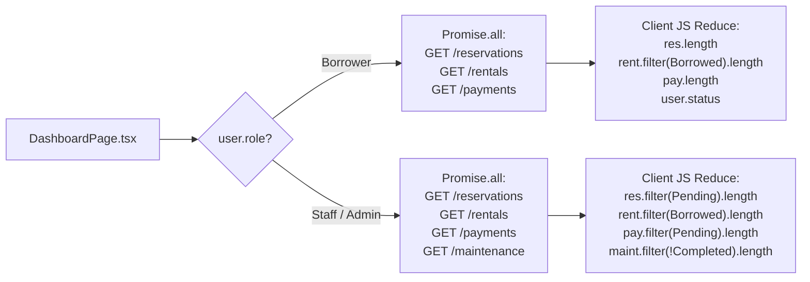

# 16 — Data Analysis Reference

> **Epistemic Classification Legend**
>
> - `[Verified from source code]` — Directly observed in repository files, schemas, configurations, or tool outputs.
> - `[Inferred from architecture]` — Logically deduced from codebase structure, middleware order, or runtime behavior.
> - `[Assumption requiring validation]` — Organizational, municipal policy, or operational assumption not codified in source code.

---

## Table of Contents

- [1. Executive Summary](#1-executive-summary)
- [2. Purpose](#2-purpose)
- [3. Scope](#3-scope)
- [4. Key Components](#4-key-components)
- [5. Architecture Diagrams](#5-architecture-diagrams)
  - [5.1 Dashboard KPI Aggregation & Data Flow](#51-dashboard-kpi-aggregation--data-flow)
- [6. Technical Details & Detailed Analysis](#6-technical-details--detailed-analysis)
  - [6.1 Implemented Reporting Logic & Dashboard KPIs (`DashboardPage.tsx`)](#61-implemented-reporting-logic--dashboard-kpis-dashboardpagetsx)
  - [6.2 Financial, Duration & Penalty Calculations](#62-financial-duration--penalty-calculations)
  - [6.3 SQLite Server-Side Aggregations](#63-sqlite-server-side-aggregations)
  - [6.4 Formal Metric Definitions Catalog (Current + Recommended)](#64-formal-metric-definitions-catalog-current--recommended)
- [7. Findings](#7-findings)
- [8. Risks](#8-risks)
- [9. Recommendations](#9-recommendations)
- [10. Future Enhancements](#10-future-enhancements)
- [11. References to Source Files & Cross-References](#11-references-to-source-files--cross-references)

---

## 1. Executive Summary

MCTEB currently provides **operational dashboard KPI cards** inside `apps/web/src/features/dashboard/DashboardPage.tsx`, **inclusive reservation cost previews** inside `ReservationFormModal.tsx`, **printable official receipts** inside `OfficialReceiptModal.tsx`, and **four backend SQL aggregation queries** (`COUNT(*)` and `COALESCE(SUM(quantity), 0)`) (`[Verified from source code]`).

There is **no dedicated analytics module, BI reporting API, time-series aggregation table, or CSV/PDF export engine** in the codebase (`[Verified from source code]`). Notably, all dashboard KPI counts are computed **client-side in the browser** by downloading full arrays from `/reservations`, `/rentals`, `/payments`, and `/maintenance` in parallel (`[Verified from source code]`, `DashboardPage.tsx` lines 44–75).

---

## 2. Purpose

This document catalogs every implemented metric, KPI formula, SQL aggregation, financial calculation, and reporting gap in MCTEB, and defines standardized formulas for municipal analytics expansion.

---

## 3. Scope

Covers `apps/web/src/features/dashboard/DashboardPage.tsx`, `reservations/ReservationFormModal.tsx`, `rentals/MyRentalsPage.tsx`, `rentals/ReturnInspectionModal.tsx`, `payments/OfficialReceiptModal.tsx`, `packages/shared/src/money.ts`, and SQL aggregations in `apps/api/src/modules/` (`[Verified from source code]`).

---

## 4. Key Components

- **`DashboardPage.tsx`**: Role-branched KPI aggregator (`Borrower` vs `Municipal Staff`/`Administrator`) (`[Verified from source code]`).
- **`ReservationFormModal.tsx`**: Pre-booking rental duration, rental fee, and deposit calculator (`[Verified from source code]`).
- **SQLite Aggregation Queries**: Located in `ToolsRepository.findMany`, `AuditRepository.findMany`, `UsersRepository.countActiveAdmins`, and `ReservationsRepository.getActiveReservedQuantityForDates` (`[Verified from source code]`).

---

## 5. Architecture Diagrams

### 5.1 Dashboard KPI Aggregation & Data Flow



---

## 6. Technical Details & Detailed Analysis

### 6.1 Implemented Reporting Logic & Dashboard KPIs (`DashboardPage.tsx`)

From `apps/web/src/features/dashboard/DashboardPage.tsx` (lines 43–75) (`[Verified from source code]`):

| Role              | Card Title           | Client Calculation Formula                             | Source Data Endpoint       |
| ----------------- | -------------------- | ------------------------------------------------------ | -------------------------- |
| **Borrower**      | `My Reservations`    | `res.length`                                           | `GET /api/v1/reservations` |
| **Borrower**      | `Active Rentals`     | `rent.filter((r) => r.status === 'Borrowed').length`   | `GET /api/v1/rentals`      |
| **Borrower**      | `My Payments`        | `pay.length`                                           | `GET /api/v1/payments`     |
| **Borrower**      | `Account Status`     | `user?.status`                                         | `AuthContext` (`/auth/me`) |
| **Staff / Admin** | `Pending Requests`   | `res.filter((r) => r.status === 'Pending').length`     | `GET /api/v1/reservations` |
| **Staff / Admin** | `Active Loans`       | `rent.filter((r) => r.status === 'Borrowed').length`   | `GET /api/v1/rentals`      |
| **Staff / Admin** | `Payments To Verify` | `pay.filter((p) => p.status === 'Pending').length`     | `GET /api/v1/payments`     |
| **Staff / Admin** | `Open Maintenance`   | `maint.filter((m) => m.status !== 'Completed').length` | `GET /api/v1/maintenance`  |

**Verified Anomaly (`DashboardPage.tsx` line 71)**: `maint.filter((m) => m.status !== 'Completed')` counts `'Decommissioned'` tickets as "Open Maintenance" (`[Verified from source code]`).

### 6.2 Financial, Duration & Penalty Calculations

1. **Estimated Rental Duration & Fee (`ReservationFormModal.tsx` lines 36–40)** (`[Verified from source code]`):

```ts
const days = Math.max(
  1,
  Math.ceil(
    (new Date(returnDate).getTime() - new Date(pickupDate).getTime()) / (1000 * 60 * 60 * 24),
  ) + 1,
);
const estimatedRentalTotal = tool.rental_fee_centavos * days * quantity;
```

- Counts inclusive calendar days (`pickup_date === return_date` -> `1` day; `Nov 10` to `Nov 14` -> `5` days, matching `SEED_RESERVATIONS` line 229: `"Approved for 5 days"`) (`[Verified from source code]`).
- Refundable Deposit: `tool.deposit_fee_centavos * quantity` (`ReservationFormModal.tsx` line 126) (`[Verified from source code]`).
- Note: These fee totals are **UI previews only** and are **not persisted** on the `reservations` or `rentals` table (`[Verified from source code]`).

2. **Overdue Indicator (`MyRentalsPage.tsx` lines 61–62)**:
   `const isOverdue = rental.status === 'Borrowed' && new Date(rental.due_date) < new Date();` (`[Verified from source code]`).
   _(Note: `RentalDeskPage.tsx` does not render an `OVERDUE` badge on staff views `[Verified from source code]`.)_
3. **Return Penalties (`ReturnInspectionModal.tsx`, `RentalsService.processReturn`)**:
   - Entered manually in Pesos in `ReturnInspectionModal.tsx` and converted via `Math.round(pesos * 100)` (`[Verified from source code]`).
   - Total penalty formatted for audit log: `(input.overdue_penalty_centavos + input.damage_penalty_centavos) / 100` (`rentals.service.ts` line 104) (`[Verified from source code]`).

### 6.3 SQLite Server-Side Aggregations

Only four aggregate SQL queries exist across all repositories (`[Verified from source code]`):

1. `UsersRepository.countActiveAdmins()`: `SELECT COUNT(*) as count FROM users WHERE role = 'Administrator' AND status = 'Active'` (`users.repository.ts:25`).
2. `ToolsRepository.findMany()`: `SELECT COUNT(*) as count FROM tools ${whereClause}` (`tools.repository.ts:36`).
3. `AuditRepository.findMany()`: `SELECT COUNT(*) as count FROM audit_logs ${whereClause}` (`audit.repository.ts:49`).
4. `ReservationsRepository.getActiveReservedQuantityForDates()`: `SELECT COALESCE(SUM(quantity), 0) as total_reserved FROM reservations WHERE tool_id = ? AND status IN ('Pending', 'Approved') AND NOT (return_date < ? OR pickup_date > ?)` (`reservations.repository.ts:94`).

### 6.4 Formal Metric Definitions Catalog (Current + Recommended)

| Metric ID | Metric Name                      | Formula / SQL Expression                                                         | Implementation Status                                                       |
| --------- | -------------------------------- | -------------------------------------------------------------------------------- | --------------------------------------------------------------------------- |
| **M-01**  | Pending Reservation Queue Count  | `COUNT(*) FROM reservations WHERE status = 'Pending'`                            | Implemented client-side (`DashboardPage.tsx`) `[Verified from source code]` |
| **M-02**  | Active Equipment Loans           | `COUNT(*) FROM rentals WHERE status = 'Borrowed'`                                | Implemented client-side (`DashboardPage.tsx`) `[Verified from source code]` |
| **M-03**  | Pending Treasury Verifications   | `COUNT(*) FROM payments WHERE status = 'Pending'`                                | Implemented client-side (`DashboardPage.tsx`) `[Verified from source code]` |
| **M-04**  | Open Maintenance Tickets         | `COUNT(*) FROM maintenance WHERE status NOT IN ('Completed', 'Decommissioned')`  | Buggy client filter (`!== 'Completed'`) `[Verified from source code]`       |
| **M-05**  | Total Verified Revenue (`PHP`)   | `SUM(amount_centavos) FROM payments WHERE status = 'Paid'`                       | **Not implemented** (Recommended)                                           |
| **M-06**  | Equipment Utilization Rate       | `SUM(total_quantity - available_quantity) / SUM(total_quantity)`                 | **Not implemented** (Recommended)                                           |
| **M-07**  | Overdue Loan Rate                | `COUNT(status='Borrowed' AND due_date < date('now')) / COUNT(status='Borrowed')` | **Not implemented** (Recommended)                                           |
| **M-08**  | Barangay Participation Breakdown | `COUNT(*) FROM rentals r JOIN users u ON r.user_id = u.id GROUP BY u.barangay`   | **Not implemented** (Recommended)                                           |

---

## 7. Findings

### Verified from Source Code

1. All dashboard metrics in `DashboardPage.tsx` download entire unpaginated entity lists and filter in browser memory.
2. No server-side reporting endpoints (`/api/v1/reports` or `/api/v1/dashboard/stats`) exist.
3. `DashboardPage.tsx` includes `Decommissioned` maintenance records in the "Open Maintenance" KPI.
4. `RentalDeskPage.tsx` lacks the `OVERDUE` visual indicator present in `MyRentalsPage.tsx`.
5. Computed rental fee totals (`days * rental_fee_centavos * quantity`) are not stored on `reservations` or `rentals`, requiring joins/recomputation against `tools` for revenue audits.

### Inferred from Architecture

1. Client-side filtering of entire tables in `DashboardPage.tsx` will become a latency and memory bottleneck as municipal transaction history grows over multiple years.

### Assumptions Requiring Validation

1. `[Assumption requiring validation]` Whether Basco Municipal Treasury requires monthly/quarterly COA-aligned revenue and deposit reconciliation reports.

---

## 8. Risks

| ID        | Risk                                                                            | Severity   | Details                                                                                                                                                                                    |
| --------- | ------------------------------------------------------------------------------- | ---------- | ------------------------------------------------------------------------------------------------------------------------------------------------------------------------------------------ |
| **DA-01** | Unbounded payload downloads on every dashboard load                             | **Medium** | `DashboardPage.tsx` fetches 3–4 full tables on mount (`[Verified from source code]`).                                                                                                      |
| **DA-02** | Overstated "Open Maintenance" metric                                            | **Low**    | Counts `Decommissioned` equipment as open maintenance (`[Verified from source code]`).                                                                                                     |
| **DA-03** | Historical rental fee changes mutate implied revenue if fees aren't snapshotted | **Medium** | Editing `tools.rental_fee_centavos` updates future and retrospective fee calculations because `rentals` stores only penalties, not the agreed rental fee (`[Inferred from architecture]`). |

---

## 9. Recommendations

1. **Create `GET /api/v1/dashboard/stats` SQL Aggregation Endpoint**: Compute counts and upcoming/overdue summaries directly in SQLite (`COUNT(*)`, `SUM(...)`).
2. **Exclude `Decommissioned` from Open Maintenance Count** and add `OVERDUE` badge highlighting to `RentalDeskPage.tsx`.
3. **Snapshot `rental_fee_centavos` and `deposit_fee_centavos` onto `rentals` (or `reservations`)** at booking/checkout time so historical financial reports remain immutable if catalog rates change (`[Inferred from architecture]`).

---

## 10. Future Enhancements

1. **Municipal Analytics & Treasurer Export Portal**: Add date-range reporting dashboards (Revenue by Barangay, Most Borrowed Categories, Maintenance Cost vs Rental Revenue, CSV/PDF export).

---

## 11. References to Source Files & Cross-References

| File                                                                           | Symbol                                         |
| ------------------------------------------------------------------------------ | ---------------------------------------------- |
| `apps/web/src/features/dashboard/DashboardPage.tsx`                            | `loadDashboardData` (`lines 38–84`)            |
| `apps/web/src/features/reservations/ReservationFormModal.tsx`                  | `days`, `estimatedRentalTotal` (`lines 36–40`) |
| `apps/web/src/features/rentals/MyRentalsPage.tsx`, `ReturnInspectionModal.tsx` | `isOverdue`, penalty centavos conversion       |
| `apps/api/src/modules/reservations/reservations.repository.ts`                 | `getActiveReservedQuantityForDates`            |

**Cross-References**: See [PERFORMANCE_REVIEW.md](./PERFORMANCE_REVIEW.md), [11-Administrative-UI.md](./11-Administrative-UI.md), and [04-Database-and-ERD.md](./04-Database-and-ERD.md).
