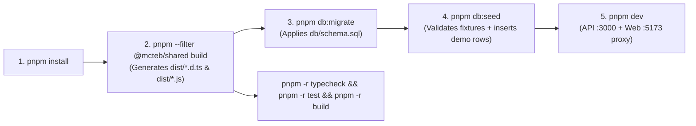

# 17 — Developer Guide

> **Epistemic Classification Legend**
>
> - `[Verified from source code]` — Directly observed in repository files, schemas, configurations, or tool outputs.
> - `[Inferred from architecture]` — Logically deduced from codebase structure, middleware order, or runtime behavior.
> - `[Assumption requiring validation]` — Organizational, municipal policy, or operational assumption not codified in source code.

---

## Table of Contents

- [1. Executive Summary](#1-executive-summary)
- [2. Purpose](#2-purpose)
- [3. Scope](#3-scope)
- [4. Key Components](#4-key-components)
- [5. Architecture Diagrams](#5-architecture-diagrams)
  - [5.1 Local Development & Build Workflow](#51-local-development--build-workflow)
- [6. Technical Details & Detailed Analysis](#6-technical-details--detailed-analysis)
  - [6.1 Prerequisites & Windows/Node Compatibility Notes](#61-prerequisites--windowsnode-compatibility-notes)
  - [6.2 Environment Variables Reference (`.env.example`)](#62-environment-variables-reference-envexample)
  - [6.3 Step-by-Step Local Setup, Migration, Seeding & Running](#63-step-by-step-local-setup-migration-seeding--running)
  - [6.4 Verified Seeded Demo Accounts (Reconciled vs README)](#64-verified-seeded-demo-accounts-reconciled-vs-readme)
  - [6.5 Building, Linting, Typechecking, Testing & Backup Commands](#65-building-linting-typechecking-testing--backup-commands)
  - [6.6 Executable Example: Adding a New Endpoint & Shared Schema](#66-executable-example-adding-a-new-endpoint--shared-schema)
- [7. Findings](#7-findings)
- [8. Risks](#8-risks)
- [9. Recommendations](#9-recommendations)
- [10. Future Enhancements](#10-future-enhancements)
- [11. References to Source Files & Cross-References](#11-references-to-source-files--cross-references)

---

## 1. Executive Summary

This guide enables engineers to set up, build, migrate, seed, test, and extend the MCTEB monorepo locally (`[Verified from source code]`).

Developers must be aware of **three critical local-setup traps verified directly from the workspace** (`[Verified from source code]`):

1. **Node.js Version**: Although `package.json` states `"node": ">=20"` and `.nvmrc` pins `20`, `apps/api/src/db/client.ts` and `scripts/backup-db.ts` import `node:sqlite`, which requires **Node.js >= 22.5.0** (e.g., Node 22 or 24 LTS).
2. **Build `@mcteb/shared` First**: Downstream typechecks (`apps/web`, `apps/api`) read `packages/shared/dist/index.d.ts`; running `pnpm --filter @mcteb/shared build` first is mandatory to avoid `TS2345` errors (`[Verified from source code]`).
3. **Seeded Demo Emails Differ from `README.md` and `LoginPage.tsx`**: Actual working demo emails are in `apps/api/src/db/seed/fixtures/index.ts` (`admin@basco.gov.ph`, `staff@basco.gov.ph`, `borrower@basco.gov.ph`, `farmer@basco.gov.ph`) (`[Verified from source code]`).

---

## 2. Purpose

Provides actionable instructions, environment documentation, exact commands, verified demo credentials, and code extension recipes for onboarding developers.

---

## 3. Scope

Covers local development, database initialization, testing, building, and operational scripts across `c:/Users/USER/Documents/GitHub/MCTED` (`[Verified from source code]`).

---

## 4. Key Components

- **Package Manager**: `pnpm@12.15.0` (`package.json`, `pnpm-workspace.yaml`, `.npmrc`) (`[Verified from source code]`).
- **Dev Runners**: `tsx watch src/server.ts` (`@mcteb/api` on port `3000`) and `vite --host` (`@mcteb/web` on port `5173`) (`[Verified from source code]`).
- **Database CLI Scripts**: `apps/api/src/db/migrate.ts`, `apps/api/src/db/seed/seed.ts`, and `scripts/backup-db.ts` (`[Verified from source code]`).

---

## 5. Architecture Diagrams

### 5.1 Local Development & Build Workflow



---

## 6. Technical Details & Detailed Analysis

### 6.1 Prerequisites & Windows/Node Compatibility Notes

- **Node.js**: **>= 22.5.0** required at runtime for `import { DatabaseSync } from 'node:sqlite'` (despite `package.json` `engines.node: ">=20"` and `.nvmrc: 20`) (`[Verified from source code]`). Note `.npmrc` sets `engine-strict=true`.
- **pnpm**: `12.15.0` (`packageManager` in root `package.json`) (`[Verified from source code]`).
- **Windows PowerShell Execution Policy**: On Windows systems where PowerShell blocks `pnpm.ps1`, invoke `pnpm.cmd` instead of `pnpm` (`[Verified from source code]`, observed during `pnpm -r typecheck` execution).

### 6.2 Environment Variables Reference (`.env.example`)

From `.env.example` and `apps/api/src/config/env.ts` (`[Verified from source code]`):

```env
NODE_ENV=development
PORT=3000
DATABASE_PATH=./data/app.db
CORS_ORIGINS=http://localhost:5173
SESSION_SECRET=change-me-min-32-chars-use-openssl-rand-hex-32
LOG_LEVEL=info
ALLOW_DEMO_SEED=false
```

- Note: `apps/api` loads `.env` from `apps/api/.env` (its `process.cwd()` when invoked via `pnpm --filter @mcteb/api ...`), or falls back to defaults in `apps/api/src/config/env.ts` if no `.env` exists in `apps/api/` (`[Inferred from architecture]`). Notice `.env` currently sits at repo root rather than `apps/api/.env`.

### 6.3 Step-by-Step Local Setup, Migration, Seeding & Running

```powershell
# 1. Install all workspace dependencies
pnpm.cmd install

# 2. Build @mcteb/shared first so apps/api and apps/web resolve fresh .d.ts files
pnpm.cmd --filter @mcteb/shared build

# 3. Copy environment template (also copy to apps/api/.env if customizing API env)
Copy-Item .env.example .env

# 4. Apply db/schema.sql to apps/api/data/app.db and seed demo records
pnpm.cmd db:migrate
pnpm.cmd db:seed

# 5. Start API (http://localhost:3000) and Web SPA (http://localhost:5173) concurrently
pnpm.cmd dev
```

### 6.4 Verified Seeded Demo Accounts (Reconciled vs README)

All demo accounts share password **`Basco@2026!`** (`apps/api/src/db/seed/seed.ts` line 43) (`[Verified from source code]`):

| Role              | Name (`fixtures/index.ts`) | Working Email (`fixtures/index.ts`) | Outdated Email in `README.md` / `LoginPage.tsx` |
| ----------------- | -------------------------- | ----------------------------------- | ----------------------------------------------- |
| `Administrator`   | Maria Santos               | `admin@basco.gov.ph`                | `admin@basco.gov.ph` (matches)                  |
| `Municipal Staff` | Juan dela Cruz             | `staff@basco.gov.ph`                | `staff@basco.gov.ph` (matches)                  |
| `Borrower`        | Ana Reyes                  | `borrower@basco.gov.ph`             | `maria.c@basco.net` _(Does not exist in seed)_  |
| `Borrower`        | Pedro Batanes              | `farmer@basco.gov.ph`               | `juan.d@basco.net` _(Does not exist in seed)_   |

### 6.5 Building, Linting, Typechecking, Testing & Backup Commands

```powershell
# Typecheck (build shared first!)
pnpm.cmd --filter @mcteb/shared build
pnpm.cmd -r typecheck

# Run backend Vitest + Supertest integration tests
pnpm.cmd --filter @mcteb/api test

# Run ESLint explicitly (root "pnpm lint" currently skips files because packages lack "lint" scripts)
pnpm.cmd exec eslint .

# Build all packages for production
pnpm.cmd -r build

# Run production API server (from apps/api)
pnpm.cmd --filter @mcteb/api start

# Run hot SQLite backup (ensure DATABASE_PATH points to apps/api/data/app.db)
$env:DATABASE_PATH="./apps/api/data/app.db"; pnpm.cmd exec tsx scripts/backup-db.ts
```

### 6.6 Executable Example: Adding a New Endpoint & Shared Schema

1. **Define Zod schema in `packages/shared/src/schemas/`** (and export from `packages/shared/src/index.ts`):

```ts
// Example: Zod query schema for dashboard stats
import { z } from 'zod';
export const DashboardStatsSchema = z.object({
  pendingReservations: z.number().int().nonnegative(),
  activeRentals: z.number().int().nonnegative(),
});
```

2. **Rebuild shared**: `pnpm.cmd --filter @mcteb/shared build`
3. **Add repository/service/controller/route in `apps/api/src/modules/`** following `routes -> controller -> service -> repository` and mount on `v1Router` in `apps/api/src/app.ts`.
4. **Consume in `apps/web/src/features/`** via `apiRequest<DashboardStats>('/dashboard/stats')`.

---

## 7. Findings

### Verified from Source Code

1. Root `.env` exists at repo root, while `apps/api` commands execute with `cwd` = `apps/api/` where `dotenv.config()` looks for `apps/api/.env` by default.
2. `packages/shared` must be compiled before `apps/web` or `apps/api` `typecheck` picks up contract edits.
3. `README.md` and `LoginPage.tsx` list `maria.c@basco.net` / `juan.d@basco.net`, which are absent from `SEED_USERS`.
4. `package.json` lacks a `"db:backup"` script and `"lint"` scripts inside individual workspace packages.

### Inferred from Architecture

1. Developers on Node 20 (matching `.nvmrc`) will immediately hit `ERR_UNKNOWN_BUILTIN_MODULE: No such built-in module: node:sqlite` when running `pnpm db:migrate` or `pnpm dev`.

### Assumptions Requiring Validation

1. `[Assumption requiring validation]` Confirm which Node.js version (e.g., Node 22 LTS or Node 24 LTS) is standardized on municipal workstations and CI runners.

---

## 8. Risks

| ID         | Risk                                                          | Severity   | Details                                                                                                                            |
| ---------- | ------------------------------------------------------------- | ---------- | ---------------------------------------------------------------------------------------------------------------------------------- |
| **DEV-01** | `.nvmrc` specifies Node `20`, incompatible with `node:sqlite` | **High**   | Causes onboarding failure on Node 20 environments (`[Verified from source code]`).                                                 |
| **DEV-02** | Misaligned `.env` location (`<root>/.env` vs `apps/api/.env`) | **Medium** | Custom env variables at repo root are ignored when `pnpm --filter @mcteb/api` runs in `apps/api` (`[Inferred from architecture]`). |
| **DEV-03** | Unbuilt `@mcteb/shared` causes cryptic `TS2345` errors        | **Medium** | Observed directly during `pnpm.cmd -r typecheck` (`[Verified from source code]`).                                                  |

---

## 9. Recommendations

1. Update `.nvmrc` and `package.json` `engines.node` to `>=22.5.0` (e.g., `22`).
2. Configure `dotenv.config({ path: path.resolve(import.meta.dirname, '../../../.env') })` in `apps/api/src/config/env.ts` so root `.env` is always loaded reliably regardless of `cwd`.
3. Add `"pretypecheck": "pnpm --filter @mcteb/shared build"` and `"db:backup": "tsx scripts/backup-db.ts"` in root `package.json`.
4. Reconcile demo credentials in `README.md` and `LoginPage.tsx` with `SEED_USERS`.

---

## 10. Future Enhancements

1. **One-Command Bootstrap (`pnpm setup`)**: Script that copies `.env.example`, builds shared, migrates, and seeds in a single step.
2. **Devcontainer / Docker Compose Dev Environment**: Provide consistent Node 22+ + pnpm environment across Windows/macOS/Linux.

---

## 11. References to Source Files & Cross-References

| File                                                    | Purpose                                           |
| ------------------------------------------------------- | ------------------------------------------------- |
| `package.json`, `.env.example`, `.nvmrc`, `.npmrc`      | Workspace scripts, Node version pin, npm settings |
| `README.md`, `apps/web/src/features/auth/LoginPage.tsx` | Quick start docs and demo credentials box         |
| `apps/api/src/db/seed/seed.ts`, `fixtures/index.ts`     | Actual seeded credentials and data                |
| `apps/api/src/config/env.ts`                            | Runtime env loading (`dotenv.config()`)           |

**Cross-References**: See [03-Repository-Structure.md](./03-Repository-Structure.md), [15-Deployment-and-Operations.md](./15-Deployment-and-Operations.md), and [21-Developer-Architecture-Guide.md](./21-Developer-Architecture-Guide.md).
