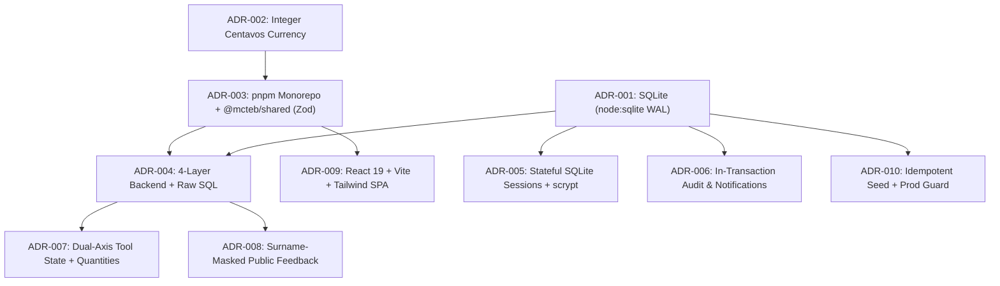

# 18 — Architecture Decision Records (ADRs)

> **Epistemic Classification Legend**
> - `[Verified from source code]` — Directly observed in repository files, schemas, configurations, or tool outputs.
> - `[Inferred from architecture]` — Logically deduced from codebase structure, middleware order, or runtime behavior.
> - `[Assumption requiring validation]` — Organizational, municipal policy, or operational assumption not codified in source code.

---

## Table of Contents

- [1. Executive Summary](#1-executive-summary)
- [2. Purpose](#2-purpose)
- [3. Scope](#3-scope)
- [4. Key Components](#4-key-components)
- [5. Architecture Diagrams](#5-architecture-diagrams)
  - [5.1 ADR Dependency & Evolution Map](#51-adr-dependency--evolution-map)
- [6. Technical Details & Detailed Analysis](#6-technical-details--detailed-analysis)
  - [ADR-001: Embedded SQLite Storage Engine (`node:sqlite` vs `better-sqlite3`)](#adr-001-embedded-sqlite-storage-engine-nodesqlite-vs-better-sqlite3)
  - [ADR-002: Integer Centavos Representation for Monetary Amounts](#adr-002-integer-centavos-representation-for-monetary-amounts)
  - [ADR-003: pnpm Workspace Monorepo with Shared Zod Contracts (`@mcteb/shared`)](#adr-003-pnpm-workspace-monorepo-with-shared-zod-contracts-mctebshared)
  - [ADR-004: 4-Layer Backend Architecture with Raw Parameterized SQL](#adr-004-4-layer-backend-architecture-with-raw-parameterized-sql)
  - [ADR-005: Stateful SQLite Sessions & `scrypt` Auth Over Stateless JWTs](#adr-005-stateful-sqlite-sessions--scrypt-auth-over-stateless-jwts)
  - [ADR-006: Synchronous In-Transaction Audit Logging & Notifications](#adr-006-synchronous-in-transaction-audit-logging--notifications)
  - [ADR-007: Dual-Axis Tool State Model (`availability_status` + `condition_status` + Quantities)](#adr-007-dual-axis-tool-state-model-availability_status--condition_status--quantities)
  - [ADR-008: Privacy-Preserving Public Feedback with Surname Masking](#adr-008-privacy-preserving-public-feedback-with-surname-masking)
  - [ADR-009: React 19 + Vite + Tailwind CSS Civic SPA](#adr-009-react-19--vite--tailwind-css-civic-spa)
  - [ADR-010: Idempotent Deterministic Demo Seeding with Production Guard](#adr-010-idempotent-deterministic-demo-seeding-with-production-guard)
- [7. Findings](#7-findings)
- [8. Risks](#8-risks)
- [9. Recommendations](#9-recommendations)
- [10. Future Enhancements](#10-future-enhancements)
- [11. References to Source Files & Cross-References](#11-references-to-source-files--cross-references)

---

## 1. Executive Summary

The repository formally documents two Architecture Decision Records under `docs/adr/`: `0001-sqlite-storage-engine.md` and `0002-integer-centavos-currency.md` (`[Verified from source code]`). Architectural analysis of the codebase identified **eight additional pivotal design decisions** embedded in code and configuration (including a significant implementation evolution in `ADR-001` from `better-sqlite3` to native `node:sqlite`, and in `ADR-004` from Drizzle ORM to raw parameterized SQL) (`[Verified from source code]`).

This document formalizes all ten decisions as **`ADR-001` through `ADR-010`**, capturing Context, Decision, Alternatives Considered, Consequences, and Verification Evidence.

---

## 2. Purpose

Preserves architectural rationale, trade-offs, and drift between planned ADRs (`PROJECT_PLAN.md`, `docs/adr/`) and actual implementation (`apps/api`, `apps/web`, `packages/shared`) for governance, audits, and modernization.

---

## 3. Scope

Covers existing ADRs (`docs/adr/0001-*`, `0002-*`) and architectural decisions inferred/verified across all source modules (`[Verified from source code]`).

---

## 4. Key Components

- Formal ADR files: `docs/adr/0001-sqlite-storage-engine.md`, `docs/adr/0002-integer-centavos-currency.md` (`[Verified from source code]`).
- Synthesized ADRs (`ADR-003` to `ADR-010`): Documenting monorepo sharing, raw SQL repositories, session auth, in-transaction side effects, inventory state model, privacy masking, SPA stack, and seed safeguards (`[Verified from source code]`, `[Inferred from architecture]`).

---

## 5. Architecture Diagrams

### 5.1 ADR Dependency & Evolution Map

---

## 6. Technical Details & Detailed Analysis

### ADR-001: Embedded SQLite Storage Engine (`node:sqlite` vs `better-sqlite3`)
- **Status**: Accepted & Evolved in Implementation (`[Verified from source code]`).
- **Context**: Municipal hardware in Basco, Batanes requires zero-config local reliability, ACID integrity, and intermittent-connectivity resilience (`docs/adr/0001-sqlite-storage-engine.md`). Additionally, Windows development/deployment avoids native C++ build toolchains (`report.md` line 50).
- **Decision**: Use SQLite in `WAL` mode (`busy_timeout = 5000`, `foreign_keys = ON`, `synchronous = NORMAL`). **Important divergence**: While `docs/adr/0001-sqlite-storage-engine.md` specifies `better-sqlite3`, the implementation (`apps/api/src/db/client.ts:1` and `scripts/backup-db.ts:3`) adopted Node.js built-in **`node:sqlite` (`DatabaseSync`)** (`[Verified from source code]`).
- **Alternatives**: PostgreSQL (requires separate DB daemon & ops), `better-sqlite3` (requires native C++ `node-gyp` build on Windows/Node 24).
- **Consequences**: Zero external database dependencies or native compilation; simple hot backups via `VACUUM INTO`; restricts horizontal scaling to a single API writer process and requires Node.js `>=22.5.0`.

### ADR-002: Integer Centavos Representation for Monetary Amounts
- **Status**: Accepted & Verified (`[Verified from source code]`, `docs/adr/0002-integer-centavos-currency.md`).
- **Context**: IEEE-754 floating-point math causes rounding discrepancies on fees, deposits, and penalties.
- **Decision**: Persist and compute all monetary values as exact integer centavos (`1 PHP = 100 centavos`, columns `*_centavos`) and format only at display boundaries using `formatPHP()` (`packages/shared/src/money.ts`).
- **Alternatives**: `REAL`/`FLOAT` SQLite columns, arbitrary-precision `decimal.js` strings.
- **Consequences**: Exact integer arithmetic across SQLite and JS; requires `* 100` / `/ 100` conversion at UI peso input forms (`ToolFormModal.tsx`, `ReturnInspectionModal.tsx`, `MyPaymentsPage.tsx`).

### ADR-003: pnpm Workspace Monorepo with Shared Zod Contracts (`@mcteb/shared`)
- **Status**: Accepted & Verified (`[Verified from source code]`, `PROJECT_PLAN.md` Section B3).
- **Context**: Prevent enum/validation drift between Express backend and React frontend.
- **Decision**: Maintain `@mcteb/shared`, `@mcteb/api`, and `@mcteb/web` in one `pnpm` workspace monorepo, defining canonical Zod schemas and domain enums once in `packages/shared/src/`.
- **Alternatives**: Separate repositories with duplicated DTOs, or OpenAPI codegen.
- **Consequences**: Single source of truth for types/enums; introduces build-order coupling requiring `packages/shared` to be compiled (`dist/`) before downstream `typecheck` or `test`.

### ADR-004: 4-Layer Backend Architecture with Raw Parameterized SQL
- **Status**: Accepted & Evolved (`[Verified from source code]`, `docs/architecture.md`).
- **Context**: Keep business logic isolated from HTTP transport and SQL engine mechanics (`PROJECT_PLAN.md` Section B4).
- **Decision**: Structure every backend module as `routes -> controller -> service -> repository`. Although `PROJECT_PLAN.md` suggested Drizzle ORM or Kysely, the implemented codebase uses **raw parameterized SQL via `db.prepare()`** (`[Verified from source code]`).
- **Alternatives**: Drizzle ORM, Prisma, TypeORM.
- **Consequences**: Zero ORM runtime overhead and full control over SQLite `RETURNING *` and `BEGIN IMMEDIATE`; loses compile-time SQL query verification (requiring integration tests to catch SQL column/type typos).

### ADR-005: Stateful SQLite Sessions & `scrypt` Auth Over Stateless JWTs
- **Status**: Accepted (`[Verified from source code]`, `session.repository.ts`, `utils/crypto.ts`).
- **Context**: Municipal systems require instant session revocation (e.g., on logout or account suspension) and zero external crypto dependencies.
- **Decision**: Use Node's built-in `crypto.scrypt` + `crypto.timingSafeEqual` for passwords and 32-byte random opaque session tokens stored in a SQLite `sessions` table (7-day TTL), delivered via `HttpOnly` cookies (and currently also Bearer tokens).
- **Alternatives**: `argon2id` + stateless JWTs (`jsonwebtoken`/`jose`), OAuth2.
- **Consequences**: Instant server-side logout/revocation; zero external auth dependencies; incurs one SQLite session + user lookup per authenticated HTTP request and requires periodic expired-session pruning.

### ADR-006: Synchronous In-Transaction Audit Logging & Notifications
- **Status**: Accepted (`[Verified from source code]`, `ReservationsService`, `RentalsService`, `PaymentsService`).
- **Context**: High-impact civic transactions must guarantee an immutable audit trail and user alert whenever state changes succeed.
- **Decision**: Invoke `AuditService.record()` and `NotificationsService.create()` synchronously inside the owning service's `db.transaction()` (`BEGIN IMMEDIATE`) block.
- **Alternatives**: Asynchronous event bus / Redis queue / transactional outbox worker.
- **Consequences**: Strict atomicity (audit and notification never diverge from domain state); impossible to fail silently post-commit; keeps write transactions slightly longer and omits background retry for external channels.

### ADR-007: Dual-Axis Tool State Model (`availability_status` + `condition_status` + Quantities)
- **Status**: Accepted (`[Verified from source code]`, `db/schema.sql:26–42`).
- **Context**: Multi-unit tools (e.g., 10 Backpack Sprayers) require tracking both physical condition and unit-level stock counts alongside catalog availability labels.
- **Decision**: Track `total_quantity`, `available_quantity`, `availability_status` (7 states), and `condition_status` (5 states) on `tools`.
- **Alternatives**: Individual serialized asset rows (`tool_units` child table).
- **Consequences**: Simple catalog schema; creates state synchronization edge cases when 1 of N units is damaged/maintained while other units remain shelf-available (`ToolsRepository.adjustAvailableQuantity`).

### ADR-008: Privacy-Preserving Public Feedback with Surname Masking
- **Status**: Accepted (`[Verified from source code]`, `FeedbackService.getPublicReviews`).
- **Context**: Build community trust in equipment quality without exposing resident full names and contact details to unauthenticated guests (`PROJECT_PLAN.md` Section B5).
- **Decision**: Store full `user_id` association internally (`GET /feedback/all` for staff/admin), while transforming `reviewer_name` dynamically in `GET /feedback/public` to `FirstName L.` and omitting email/phone.
- **Alternatives**: Anonymous reviews or opt-in display names.
- **Consequences**: Protects resident PII publicly while retaining staff moderation attribution; exposes `reviewer_barangay` publicly.

### ADR-009: React 19 + Vite + Tailwind CSS Civic SPA
- **Status**: Accepted (`[Verified from source code]`, `apps/web/package.json`).
- **Context**: Mobile-first, low-latency responsive interface for Basco residents on phones and municipal desktop staff.
- **Decision**: Build a React 19 + TypeScript SPA with Vite 6, React Router v7, Lucide icons, and custom `civic` Tailwind palette supporting dark/light themes (`ThemeProvider`).
- **Alternatives**: Next.js SSR, server-rendered Express templates (EJS/Handlebars).
- **Consequences**: Fast static asset caching and clean API separation; requires client-side routing fallback configuration on static web servers and careful sync of route guards (`ProtectedRoute`) with API RBAC.

### ADR-010: Idempotent Deterministic Demo Seeding with Production Guard
- **Status**: Accepted (`[Verified from source code]`, `apps/api/src/db/seed/seed.ts`).
- **Context**: Repeatable demo setup for stakeholders without corrupting live municipal data or exposing demo logins in production.
- **Decision**: Use fixed deterministic UUIDs with `INSERT OR IGNORE`, pre-insert relational consistency checks (`validateFixtures`), and a strict guard refusing execution when `NODE_ENV === 'production' && !ALLOW_DEMO_SEED`.
- **Alternatives**: `DROP TABLE` reset seeds or random UUIDs.
- **Consequences**: Safe re-execution without overwriting modified records; however, fixture updates do not overwrite already-seeded rows on existing databases.

---

## 7. Findings

### Verified from Source Code
1. `docs/adr/0001-sqlite-storage-engine.md` is outdated regarding the SQLite driver (`better-sqlite3` documented vs `node:sqlite` implemented).
2. `docs/adr/` only contains 2 ADR files (`0001` and `0002`), leaving 8 core architectural decisions undocumented outside `PROJECT_PLAN.md`.

### Inferred from Architecture
1. Moving from `better-sqlite3` to `node:sqlite` was likely motivated by avoiding Windows native addon compilation issues (`report.md` line 50).

### Assumptions Requiring Validation
1. `[Assumption requiring validation]` Confirm with municipal leadership whether `ADR-007` (quantity-based tools) suffices long-term or whether individual serialized unit tracking (`tool_units`) is required for high-value machinery like generators and hand tillers.

---

## 8. Risks

| ID | Risk | Severity | Details |
|---|---|---|---|
| **ADR-01** | Stale formal ADR (`0001`) misleads engineers | **Low** | Engineers expect `better-sqlite3` and Node 20 instead of `node:sqlite` and Node 22+ (`[Verified from source code]`). |
| **ADR-02** | Unit-level maintenance ambiguity (`ADR-007`) | **Medium** | Multi-unit tools lack per-unit serial/condition tracking (`[Inferred from architecture]`). |

---

## 9. Recommendations

1. Update `docs/adr/0001-sqlite-storage-engine.md` to reflect `node:sqlite` (`DatabaseSync`) and Node `>=22.5.0`.
2. Commit `ADR-003` through `ADR-010` into `docs/adr/` so architectural governance stays version-controlled alongside code.

---

## 10. Future Enhancements

1. **`ADR-011` (Proposed): Split `tools` Catalog Definitions from `tool_units` Serialized Assets** for per-unit maintenance and checkout tracking.
2. **`ADR-012` (Proposed): Transactional Outbox for External SMS & Payment Gateways**.

---

## 11. References to Source Files & Cross-References

| File | Scope |
|---|---|
| `docs/adr/0001-sqlite-storage-engine.md`, `0002-integer-centavos-currency.md` | Existing formal ADRs |
| `apps/api/src/db/client.ts`, `utils/crypto.ts`, `modules/auth/session.repository.ts` | Implementation evidence for `ADR-001`, `ADR-005` |
| `packages/shared/src/money.ts`, `schemas/`, `enums.ts` | Implementation evidence for `ADR-002`, `ADR-003` |
| `apps/api/src/db/seed/seed.ts` | Implementation evidence for `ADR-010` |

**Cross-References**: See [02-Architecture.md](./02-Architecture.md), [04-Database-and-ERD.md](./04-Database-and-ERD.md), and [TECH_STACK_AUDIT.md](./TECH_STACK_AUDIT.md).
