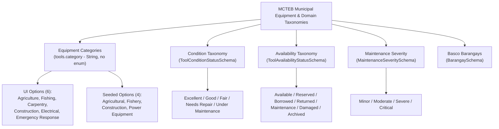

# 19 — Skills & Business Type Catalog

> **Epistemic Classification Legend**
> - `[Verified from source code]` — Directly observed in repository files, schemas, configurations, or tool outputs.
> - `[Inferred from architecture]` — Logically deduced from codebase structure, middleware order, or runtime behavior.
> - `[Assumption requiring validation]` — Organizational, municipal policy, or operational assumption not codified in source code.

---

## Table of Contents

- [1. Executive Summary](#1-executive-summary)
- [2. Purpose](#2-purpose)
- [3. Scope](#3-scope)
- [4. Key Components](#4-key-components)
- [5. Architecture Diagrams](#5-architecture-diagrams)
  - [5.1 Equipment Category & Domain Taxonomy Hierarchy](#51-equipment-category--domain-taxonomy-hierarchy)
- [6. Technical Details & Detailed Analysis](#6-technical-details--detailed-analysis)
  - [6.1 Explicit Verification: Absence of User Skills & Commercial Business Type Tables](#61-explicit-verification-absence-of-user-skills--commercial-business-type-tables)
  - [6.2 Equipment Category Catalog & Drift Analysis](#62-equipment-category-catalog--drift-analysis)
  - [6.3 Equipment Technical Specifications JSON Structure](#63-equipment-technical-specifications-json-structure)
  - [6.4 Equipment Condition, Availability & Maintenance Severity Taxonomies](#64-equipment-condition-availability--maintenance-severity-taxonomies)
  - [6.5 Civic Project Purpose & Borrowing Contexts](#65-civic-project-purpose--borrowing-contexts)
- [7. Findings](#7-findings)
- [8. Risks](#8-risks)
- [9. Recommendations](#9-recommendations)
- [10. Future Enhancements](#10-future-enhancements)
- [11. References to Source Files & Cross-References](#11-references-to-source-files--cross-references)

---

## 1. Executive Summary

> **EXPLICIT DOMAIN VERIFICATION (`[Verified from source code]`)**: MCTEB is a **civic municipal equipment lending bank**, not a labor marketplace, job portal, or commercial business directory. Consequently, **no user "Skills" catalog and no commercial "Business Type" tables exist in `db/schema.sql` or `packages/shared` (`[Verified from source code]`).**

Instead, MCTEB organizes its municipal domain through **Equipment Categories** (`tools.category`), **Technical Specifications** (`tools.specifications`), **Condition & Availability Taxonomies** (`ToolConditionStatusSchema`, `ToolAvailabilityStatusSchema`), **Maintenance Severity Levels** (`MaintenanceSeveritySchema`), and **Civic Project Purposes** (`reservations.purpose`) (`[Verified from source code]`).

Analysis reveals an active category string mismatch between the frontend UI (`'Agriculture'`, `'Fishing'`, `'Electrical'`, `'Emergency Response'`) and seeded catalog records (`'Agricultural'`, `'Fishery'`, `'Power Equipment'`) (`[Verified from source code]`).

---

## 2. Purpose

This document verifies the absence of user skill / commercial business-type entities and provides a complete structural, validation, and usage specification of all implemented equipment categories, specifications, and domain taxonomies.

---

## 3. Scope

Covers `db/schema.sql`, `packages/shared/src/enums.ts`, `packages/shared/src/schemas/tool.ts`, `apps/api/src/db/seed/fixtures/index.ts`, `apps/web/src/features/catalog/CatalogPage.tsx`, and `apps/web/src/features/inventory/ToolFormModal.tsx` (`[Verified from source code]`).

---

## 4. Key Components

- **UI Category Dropdowns (`CatalogPage.tsx`, `ToolFormModal.tsx`)**: 6 municipal equipment categories (`[Verified from source code]`).
- **Seeded Equipment Fixtures (`SEED_TOOLS` in `fixtures/index.ts`)**: 7 equipment items with JSON technical specifications across 4 fixture category labels (`[Verified from source code]`).
- **Validation Schemas (`packages/shared/src/schemas/tool.ts`, `enums.ts`)**: `CreateToolSchema`, `UpdateToolSchema`, `ToolConditionStatusSchema`, `ToolAvailabilityStatusSchema` (`[Verified from source code]`).

---

## 5. Architecture Diagrams

### 5.1 Equipment Category & Domain Taxonomy Hierarchy

---

## 6. Technical Details & Detailed Analysis

### 6.1 Explicit Verification: Absence of User Skills & Commercial Business Type Tables

- **User Skills / Operator Certifications**: **Absent** (`[Verified from source code]`). While Basco lends power equipment such as a 196cc Hand Tiller, 3.5kVA Generator, and 1200W Circular Saw, the database does not track borrower operator certifications, licenses, or trade skills (though `ReservationQueuePage.tsx` line 193 mentions `"Verified ID and safety equipment"` in placeholder text).
- **Business Types / Enterprise Classifications**: **Absent** (`[Verified from source code]`). Borrowers are individual residents (`users`) classified solely by `role` (`Borrower`, `Municipal Staff`, `Administrator`) and `barangay` (`[Verified from source code]`).
- **Tags**: **Absent** (`[Verified from source code]`). There is no `tags` table or `tools.tags` column (`[Verified from source code]`).

### 6.2 Equipment Category Catalog & Drift Analysis

Three separate category vocabularies appear across repository files (`[Verified from source code]`):

| Category Source | Exact Values | Validation Rules |
|---|---|---|
| **UI Dropdowns** (`CatalogPage.tsx:14–22`, `ToolFormModal.tsx:9–16`) | `'Agriculture'`, `'Fishing'`, `'Carpentry'`, `'Construction'`, `'Electrical'`, `'Emergency Response'` | Enforced only by HTML `<select>` options `[Verified from source code]` |
| **Seed Fixtures** (`SEED_TOOLS` in `fixtures/index.ts`) | `'Agricultural'`, `'Power Equipment'`, `'Construction'`, `'Fishery'` | No Zod enum check; bypasses UI `<select>` `[Verified from source code]` |
| **Backend Zod Schema** (`packages/shared/src/schemas/tool.ts:7`) | `category: z.string().min(2).max(50)` | Free-form text (2–50 chars); accepts any string `[Verified from source code]` |
| **`PROJECT_PLAN.md` Section A7.1** | Mentions `agricultural`, `fishing`, `carpentry`, `construction`, `electrical`, `mechanical`, `emergency-response` | Documentation prose only `[Verified from source code]` |

**Impact**: Filtering by `'Agriculture'` or `'Fishing'` in `CatalogPage.tsx` queries `WHERE category = 'Agriculture'`, returning **0 results** against the seeded `'Agricultural'` and `'Fishery'` tools (`[Verified from source code]`).

### 6.3 Equipment Technical Specifications JSON Structure

In `SEED_TOOLS` (`apps/api/src/db/seed/fixtures/index.ts`), `tools.specifications` stores `JSON.stringify({...})` strings, whereas `ToolFormModal.tsx` treats `specifications` as a plain text input and `ToolDetailPage.tsx` renders it raw inside `
{tool.specifications}
` (`[Verified from source code]`):

| Seeded Tool | Category (`SEED_TOOLS`) | Specifications Keys Stored | Daily Fee / Deposit (`PHP`) | Illustration Asset |
|---|---|---|---|---|
| Agricultural Hand Tiller | `Agricultural` | `engine`, `tillage_width`, `weight`, `fuel_capacity` | ₱500 / ₱2,000 | `/equipment/tiller.svg` |
| Honda Generator 3.5kVA | `Power Equipment` | `output`, `fuel`, `run_time`, `outlets`, `weight` | ₱800 / ₱5,000 | `/equipment/generator.svg` |
| Concrete Mixer (1-Bag) | `Construction` | `drum_capacity`, `motor`, `drum_speed`, `weight` | ₱600 / ₱3,000 | `/equipment/concrete-mixer.svg` |
| Water Pump 2-inch | `Agricultural` | `discharge_diameter`, `max_flow`, `max_head`, `engine`, `weight` | ₱400 / ₱1,500 | `/equipment/water-pump.svg` |
| Circular Saw 7-1/4" | `Construction` | `blade_diameter`, `no_load_speed`, `bevel_capacity`, `power`, `weight` | ₱250 / ₱1,000 | `/equipment/circular-saw.svg` |
| Backpack Sprayer 20L | `Agricultural` | `tank_capacity`, `pressure_range`, `lance_length`, `weight_empty` | ₱100 / ₱500 | `/equipment/backpack-sprayer.svg` |
| Marine GPS Handheld | `Fishery` | `screen`, `battery`, `waterproof`, `channels`, `weight` | ₱200 / ₱800 | `/equipment/marine-gps.svg` |

### 6.4 Equipment Condition, Availability & Maintenance Severity Taxonomies

- **Availability (`ToolAvailabilityStatusSchema`)**: `'Available'`, `'Reserved'`, `'Borrowed'`, `'Returned'`, `'Maintenance'`, `'Damaged'`, `'Archived'` (`[Verified from source code]`).
- **Condition (`ToolConditionStatusSchema`)**: `'Excellent'`, `'Good'`, `'Fair'`, `'Needs Repair'`, `'Under Maintenance'` (`[Verified from source code]`).
- **Maintenance Severity (`MaintenanceSeveritySchema`)**: `'Minor'`, `'Moderate'`, `'Severe'`, `'Critical'` — note `Severe` and `Critical` automatically set `tools.availability_status = 'Maintenance'` (`MaintenanceService.createReport:35`) (`[Verified from source code]`).

### 6.5 Civic Project Purpose & Borrowing Contexts

- `reservations.purpose` (`CreateReservationSchema` line 27: `z.string().max(255).optional()`) captures resident civic use-cases (e.g., root crop planting, vegetable garden pest control, home repair, boat navigation) (`[Verified from source code]`). Note: `ReservationFormModal.tsx` line 108 marks `purpose` as `required` in the UI despite the backend allowing it to be optional (`[Verified from source code]`).

---

## 7. Findings

### Verified from Source Code
1. No user skills, operator certifications, tags, or business-type tables/fields exist.
2. `tools.category` is unvalidated free-form text (`min(2).max(50)`), resulting in conflicting values between `SEED_TOOLS` and UI dropdowns.
3. `SEED_TOOLS` stores JSON strings in `tools.specifications`, which `ToolDetailPage.tsx` renders verbatim as raw JSON text (`{"engine":"196cc..."}`) instead of formatted key-value pairs!

### Inferred from Architecture
1. Unparsed JSON in `ToolDetailPage.tsx` indicates `specifications` schema was left unstructured during rapid seeding vs UI form authoring.

### Assumptions Requiring Validation
1. `[Assumption requiring validation]` Whether high-risk machinery (e.g., Circular Saw, Hand Tiller, Generator) requires tracking resident safety briefings or operator skill certifications before reservation approval.

---

## 8. Risks

| ID | Risk | Severity | Details |
|---|---|---|---|
| **CAT-01** | Category filtering fails for seeded Agricultural/Fishery/Generator items | **Medium** | `CatalogPage.tsx` dropdown labels do not match `SEED_TOOLS.category` values (`[Verified from source code]`). |
| **CAT-02** | Raw JSON rendered to residents on `ToolDetailPage` | **Low** | `SEED_TOOLS.specifications` displays unformatted JSON braces to users (`[Verified from source code]`). |

---

## 9. Recommendations

1. **Create `ToolCategorySchema` in `packages/shared/src/enums.ts`**: Standardize canonical categories (`Agriculture`, `Fishing`, `Carpentry`, `Construction`, `Electrical`, `Emergency Response`) and align `SEED_TOOLS` and `ToolFormModal.tsx`.
2. **Parse `specifications` Safely in `ToolDetailPage.tsx`**: Attempt `JSON.parse(tool.specifications)` to render clean key-value spec badges, falling back to plain text for manual staff entries.

---

## 10. Future Enhancements

1. **Equipment Safety Prerequisites / Operator Skills**: Add optional `required_certification` tag on high-risk tools and `user_certifications` verification records if mandated by Basco municipal policy (`[Assumption requiring validation]`).

---

## 11. References to Source Files & Cross-References

| File | Symbol |
|---|---|
| `packages/shared/src/enums.ts`, `schemas/tool.ts` | Status/condition enums, `CreateToolSchema` |
| `apps/api/src/db/seed/fixtures/index.ts` | `SEED_TOOLS` (`lines 63–215`) |
| `apps/web/src/features/catalog/CatalogPage.tsx`, `ToolDetailPage.tsx` | `CATEGORIES`, `specifications` rendering |
| `apps/web/src/features/inventory/ToolFormModal.tsx` | `CATEGORIES` |

**Cross-References**: See [13-Geography-and-Reference-Data.md](./13-Geography-and-Reference-Data.md), [09-Recommendation-Engine.md](./09-Recommendation-Engine.md), and [TECHNICAL_DEBT_REPORT.md](./TECHNICAL_DEBT_REPORT.md).
