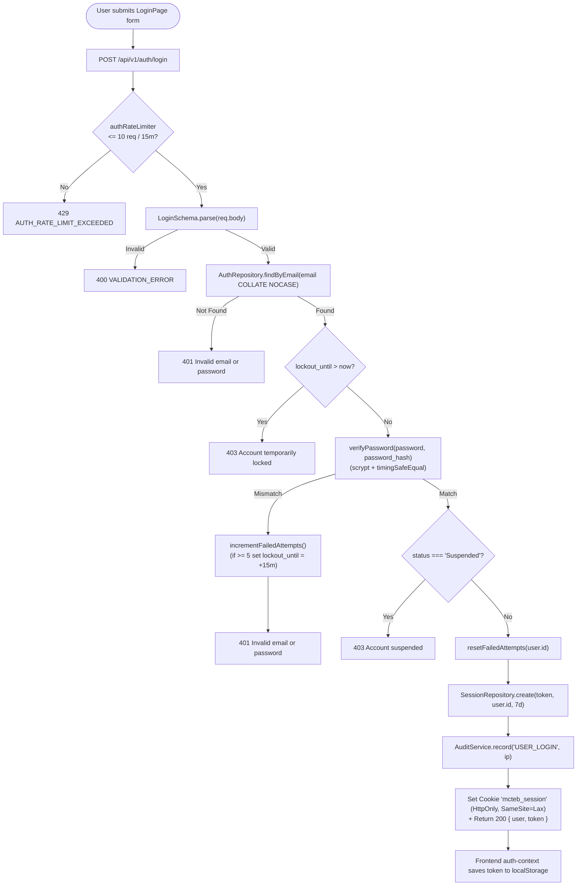
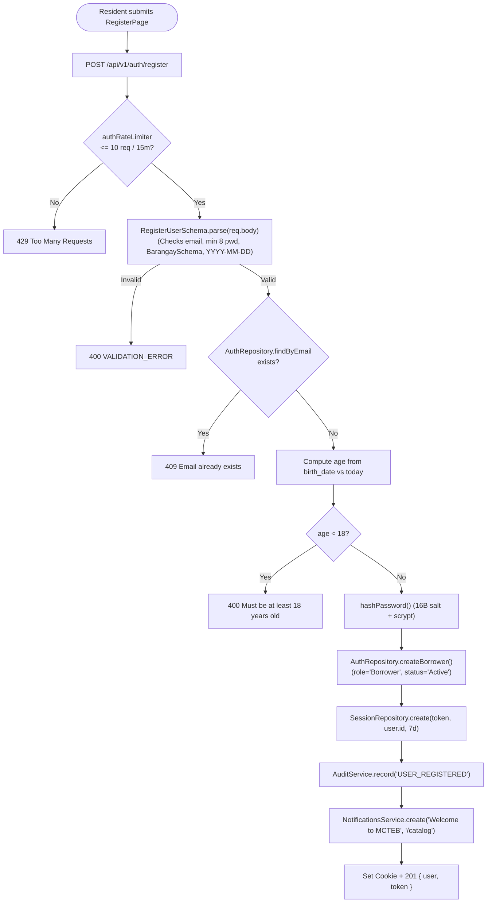
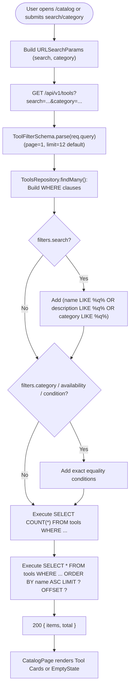
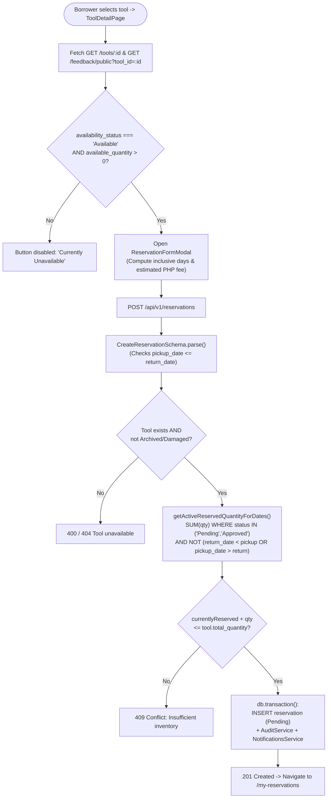
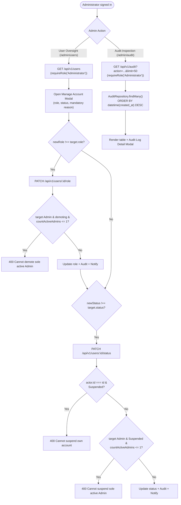
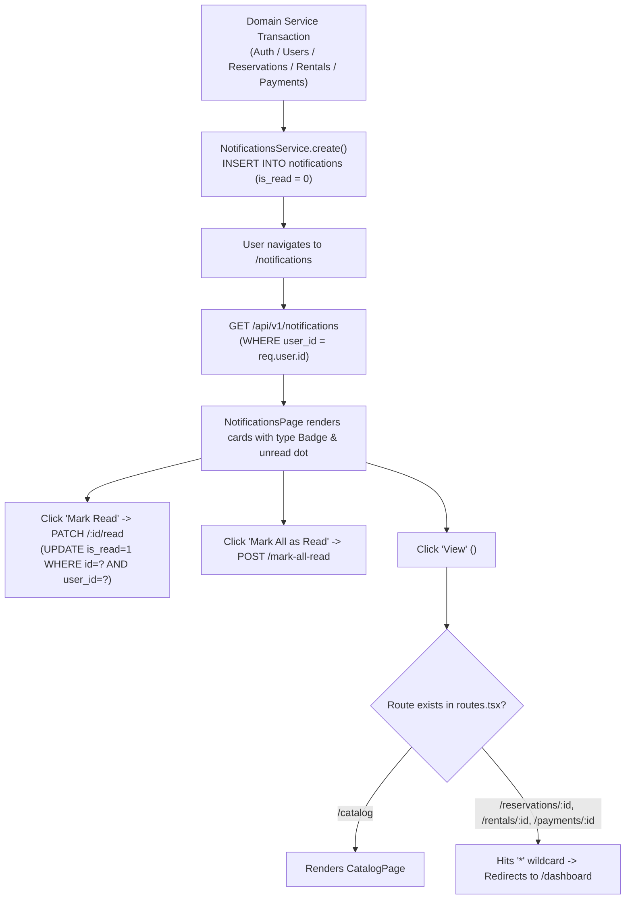
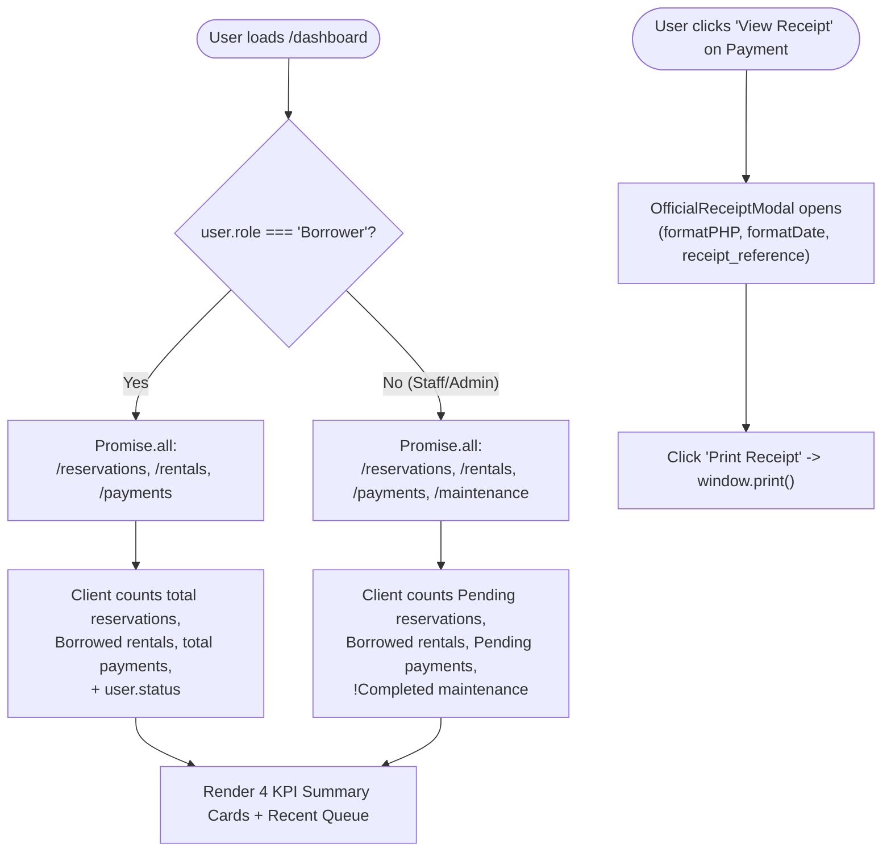

# 20 — System Flowcharts

> **Epistemic Classification Legend**
>
> - `[Verified from source code]` — Directly observed in repository files, schemas, configurations, or tool outputs.
> - `[Inferred from architecture]` — Logically deduced from codebase structure, middleware order, or runtime behavior.
> - `[Assumption requiring validation]` — Organizational, municipal policy, or operational assumption not codified in source code.

---

## Table of Contents

- [1. Executive Summary](#1-executive-summary)
- [2. Purpose](#2-purpose)
- [3. Scope](#3-scope)
- [4. Key Components](#4-key-components)
- [5. Architecture Diagrams](#5-architecture-diagrams)
  - [5.1 Login Flow](#51-login-flow)
  - [5.2 Registration Flow](#52-registration-flow)
  - [5.3 Search & Catalog Filter Flow](#53-search--catalog-filter-flow)
  - [5.4 Recommendation / Equipment Selection & Availability Conflict Flow](#54-recommendation--equipment-selection--availability-conflict-flow)
  - [5.5 Admin Flow (User Governance & Audit Inspection)](#55-admin-flow-user-governance--audit-inspection)
  - [5.6 Notification Flow](#56-notification-flow)
  - [5.7 Reporting & Dashboard Aggregation Flow](#57-reporting--dashboard-aggregation-flow)
- [6. Technical Details & Detailed Analysis](#6-technical-details--detailed-analysis)
- [7. Findings](#7-findings)
- [8. Risks](#8-risks)
- [9. Recommendations](#9-recommendations)
- [10. Future Enhancements](#10-future-enhancements)
- [11. References to Source Files & Cross-References](#11-references-to-source-files--cross-references)

---

## 1. Executive Summary

This document visualizes all seven core operational and technical execution flows of MCTEB using Mermaid flowcharts verified directly against the implemented TypeScript source code (`[Verified from source code]`):

1. **Login Flow** (`AuthController.login` -> `AuthService.login`)
2. **Registration Flow** (`AuthController.register` -> `AuthService.register`)
3. **Search Flow** (`CatalogPage` -> `ToolsController.list` -> `ToolsRepository.findMany`)
4. **Recommendation / Equipment Selection & Conflict Check Flow** (`ToolDetailPage` -> `ReservationsService.createReservation`) — explicitly noting no ML/recommendation engine exists
5. **Admin Flow** (`UsersPage` / `AuditLogPage` -> `UsersService` / `AuditService`)
6. **Notification Flow** (`NotificationsService.create` -> `NotificationsPage`)
7. **Reporting & Dashboard Aggregation Flow** (`DashboardPage` & `OfficialReceiptModal`)

---

## 2. Purpose

Provides unambiguous visual execution traces for onboarding engineers, security reviewers, and QA teams.

---

## 3. Scope

Covers runtime behavior across `apps/web/src/features/` and `apps/api/src/modules/` (`[Verified from source code]`).

---

## 4. Key Components

- **Auth & Lockout Flow**: `authRateLimiter`, `AuthService`, `AuthRepository`, `SessionRepository`, `crypto.ts` (`[Verified from source code]`).
- **Catalog & Booking Conflict Flow**: `ToolsRepository.findMany`, `ReservationsRepository.getActiveReservedQuantityForDates` (`[Verified from source code]`).
- **Admin Governance Flow**: `UsersService.updateUserStatus`, `updateUserRole`, `AuditService.getLogs` (`[Verified from source code]`).
- **Notifications & Reporting Flow**: `NotificationsService`, `DashboardPage`, `OfficialReceiptModal` (`[Verified from source code]`).

---

## 5. Architecture Diagrams

### 5.1 Login Flow

_(Verified against `auth.routes.ts`, `auth.controller.ts`, `auth.service.ts`, `auth.repository.ts`, `session.repository.ts` `[Verified from source code]`)_

### 5.2 Registration Flow

_(Verified against `RegisterPage.tsx`, `auth.controller.ts`, `auth.service.ts`, `auth.repository.ts` `[Verified from source code]`)_

### 5.3 Search & Catalog Filter Flow

_(Verified against `CatalogPage.tsx`, `tools.controller.ts`, `tools.repository.ts` `[Verified from source code]`)_

### 5.4 Recommendation / Equipment Selection & Availability Conflict Flow

_(Explicit Note: `[Verified from source code]` — No ML/heuristic recommendation engine exists; selection uses deterministic catalog filtering + date-range conflict checking.)_

### 5.5 Admin Flow (User Governance & Audit Inspection)

_(Verified against `UsersPage.tsx`, `AuditLogPage.tsx`, `users.service.ts`, `audit.service.ts` `[Verified from source code]`)_

### 5.6 Notification Flow

_(Verified against `NotificationsPage.tsx`, `notifications.controller.ts`, `notifications.service.ts` `[Verified from source code]`)_

### 5.7 Reporting & Dashboard Aggregation Flow

_(Verified against `DashboardPage.tsx`, `OfficialReceiptModal.tsx` `[Verified from source code]`)_

---

## 6. Technical Details & Detailed Analysis

All flowcharts above mirror actual execution paths verified line-by-line in source files (`[Verified from source code]`):

- Every backend flow uses synchronous SQLite operations (`node:sqlite`), meaning only `scrypt` password hashing/verification in Flows 5.1 and 5.2 is asynchronous (`await`) (`[Verified from source code]`).
- Flow 5.4 confirms the absence of any recommendation scoring pipeline (`[Verified from source code]`).
- Flow 5.6 documents the broken `link_url` redirect behavior verified by comparing service `link_url` strings with `apps/web/src/app/routes.tsx` (`[Verified from source code]`).

---

## 7. Findings

_(See detailed findings in [08-Business-Workflows.md](./08-Business-Workflows.md), [09-Recommendation-Engine.md](./09-Recommendation-Engine.md), [12-Notifications-and-Applications.md](./12-Notifications-and-Applications.md), and [16-Data-Analysis-Reference.md](./16-Data-Analysis-Reference.md).)_

---

## 8. Risks

1. **Broken Deep Links in Flow 5.6**: Notification `View` links for reservations, rentals, and payments redirect to `/dashboard` (`[Verified from source code]`).
2. **Client-Side Dashboard Aggregation in Flow 5.7**: Downloads entire entity lists on every `/dashboard` visit (`[Verified from source code]`).
3. **Unchecked Concurrent Approval in Flow 5.4**: `reviewReservation` does not re-check stock before marking `Approved` (`[Verified from source code]`).

---

## 9. Recommendations

1. Repair notification `link_url` destinations (`/my-reservations`, `/my-rentals`, `/my-payments`) (`[Verified from source code]`).
2. Move dashboard KPI counts into a dedicated `GET /api/v1/dashboard/stats` endpoint (`[Inferred from architecture]`).
3. Re-validate date/stock availability inside `ReservationsService.reviewReservation` (`[Verified from source code]`).

---

## 10. Future Enhancements

1. Add real-time SSE/WebSocket updates for Flow 5.6 (Notification delivery without page reload).
2. Add an actual Recommendation Flow branch into Flow 5.4 when catalog expands.

---

## 11. References to Source Files & Cross-References

| Flow                       | Source Files                                                                                                      |
| -------------------------- | ----------------------------------------------------------------------------------------------------------------- |
| 5.1 & 5.2 (Auth)           | `apps/api/src/modules/auth/*`, `apps/web/src/features/auth/*`, `apps/web/src/lib/auth-context.tsx`                |
| 5.3 & 5.4 (Search/Booking) | `apps/api/src/modules/{tools,reservations}/*`, `apps/web/src/features/{catalog,reservations}/*`                   |
| 5.5 (Admin)                | `apps/api/src/modules/{users,audit}/*`, `apps/web/src/features/admin/*`                                           |
| 5.6 (Notifications)        | `apps/api/src/modules/notifications/*`, `apps/web/src/features/notifications/NotificationsPage.tsx`, `routes.tsx` |
| 5.7 (Reporting)            | `apps/web/src/features/dashboard/DashboardPage.tsx`, `payments/OfficialReceiptModal.tsx`                          |

**Cross-References**: See [08-Business-Workflows.md](./08-Business-Workflows.md), [21-Developer-Architecture-Guide.md](./21-Developer-Architecture-Guide.md), and [22-Backend-Architecture.md](./22-Backend-Architecture.md).
