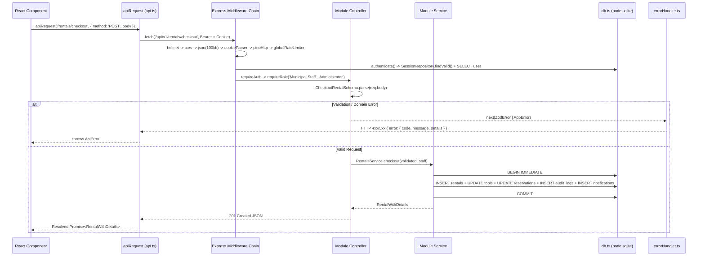

# 21 — Developer Architecture Guide (Senior Engineers)

> **Epistemic Classification Legend**
>
> - `[Verified from source code]` — Directly observed in repository files, schemas, configurations, or tool outputs.
> - `[Inferred from architecture]` — Logically deduced from codebase structure, middleware order, or runtime behavior.
> - `[Assumption requiring validation]` — Organizational, municipal policy, or operational assumption not codified in source code.

---

## Table of Contents

- [1. Executive Summary](#1-executive-summary)
- [2. Purpose](#2-purpose)
- [3. Scope](#3-scope)
- [4. Key Components](#4-key-components)
- [5. Architecture Diagrams](#5-architecture-diagrams)
  - [5.1 End-to-End Request Execution Trace](#51-end-to-end-request-execution-trace)
- [6. Technical Details & Detailed Analysis](#6-technical-details--detailed-analysis)
  - [6.1 End-to-End Request Lifecycle (Browser -> Proxy -> Express -> SQLite -> Browser)](#61-end-to-end-request-lifecycle-browser---proxy---express---sqlite---browser)
  - [6.2 Dependency Injection & Static Module Wiring Strategy](#62-dependency-injection--static-module-wiring-strategy)
  - [6.3 Service Layer & Transaction Semantics (`BEGIN IMMEDIATE`)](#63-service-layer--transaction-semantics-begin-immediate)
  - [6.4 Repository Layer & SQLite Typing Patterns](#64-repository-layer--sqlite-typing-patterns)
  - [6.5 Event Flow, Async Processing & Background Jobs (Verified Absence)](#65-event-flow-async-processing--background-jobs-verified-absence)
  - [6.6 Caching Architecture (Client & Server)](#66-caching-architecture-client--server)
  - [6.7 End-to-End Error Handling Pipeline](#67-end-to-end-error-handling-pipeline)
- [7. Findings](#7-findings)
- [8. Risks](#8-risks)
- [9. Recommendations](#9-recommendations)
- [10. Future Enhancements](#10-future-enhancements)
- [11. References to Source Files & Cross-References](#11-references-to-source-files--cross-references)

---

## 1. Executive Summary

This guide provides a senior-engineer-level teardown of MCTEB's internal execution model, wiring patterns, transaction isolation, concurrency behavior, caching, and error propagation (`[Verified from source code]`).

Unlike IoC-container frameworks (NestJS, InversifyJS) or asynchronous SQL ORMs (Prisma, TypeORM), MCTEB deliberately adopts **static class methods imported directly as ES modules** paired with **synchronous SQLite access (`node:sqlite` `DatabaseSync`)** and **explicit `BEGIN IMMEDIATE` transactions** (`[Verified from source code]`). Understanding the implications of synchronous SQL execution on the Node.js event loop, non-reentrant transactions, static coupling, and missing background maintenance workers is critical before extending or scaling the codebase.

---

## 2. Purpose

Equips senior engineers, technical reviewers, and architects with the deep implementation semantics required to safely refactor, test, debug, optimize, or migrate MCTEB.

---

## 3. Scope

Covers runtime execution mechanics across `apps/web/src/lib/`, `apps/api/src/app.ts`, `server.ts`, `db/client.ts`, `middleware/`, `utils/`, and `modules/*` (`[Verified from source code]`).

---

## 4. Key Components

- **Client Fetch Wrapper (`apps/web/src/lib/api.ts`)**: Token attachment, `credentials: 'include'`, error hydration into `ApiError` (`[Verified from source code]`).
- **Express Pipeline (`apps/api/src/app.ts`)**: Ordered security, body, logging, rate-limit, auth, routing, and error middleware (`[Verified from source code]`).
- **Database Abstraction (`apps/api/src/db/client.ts`)**: `AppDatabase` adapter over `node:sqlite` (`DatabaseSync`) (`[Verified from source code]`).
- **Error Hierarchy (`apps/api/src/utils/errors.ts`, `middleware/errorHandler.ts`)**: `AppError` + `ZodError` mapping (`[Verified from source code]`).

---

## 5. Architecture Diagrams

### 5.1 End-to-End Request Execution Trace

---

## 6. Technical Details & Detailed Analysis

### 6.1 End-to-End Request Lifecycle (Browser -> Proxy -> Express -> SQLite -> Browser)

1. **Client Initiation (`apps/web/src/lib/api.ts:23–60`)**:
   - Reads `localStorage.getItem('mcteb_token')` and injects `Authorization: Bearer ${token}` if present.
   - Sets `Content-Type: application/json` (unless `FormData`) and `credentials: 'include'` so browser sends the `mcteb_session` cookie.
   - Routes relative URLs to `/api/v1${endpoint}` (`vite.config.ts` proxies `/api` -> `http://localhost:3000`).
2. **Express Global Middleware (`apps/api/src/app.ts:32–78`)**:
   - `helmet()` (CSP headers, `x-powered-by` disabled).
   - `cors()` (allowlist or any origin when `NODE_ENV === 'development'`).
   - `express.json({ limit: '100kb' })` + `cookieParser(env.SESSION_SECRET)`.
   - `pinoHttp()` (auto-logs all requests except `/health`).
   - `globalRateLimiter` (300 req / 15 min per IP).
   - `authenticate` (runs on **every** route including `/health` and `/api/v1/tools`, performing 2 SQLite queries whenever a cookie or Bearer token is present!).
3. **Route Guard & Controller (`modules/*/*.routes.ts` & `*.controller.ts`)**:
   - `requireAuth` / `requireRole(...)` verify `req.user`.
   - Controller parses `req.body` or `req.query` synchronously with `Schema.parse(...)`.
4. **Service & SQLite Commit**:
   - Synchronous execution against `DatabaseSync` (`node:sqlite`).
   - `res.json(...)` or `res.status(201).json(...)` returns payload.

### 6.2 Dependency Injection & Static Module Wiring Strategy

- **Pattern**: Every controller, service, and repository is implemented as an ES class composed exclusively of `static` methods (`AuthService.login`, `ToolsRepository.findById`, etc.) imported directly via ES module imports (`[Verified from source code]`).
- **Architectural Trade-Offs**:
  - _Pros_: Zero boilerplate, zero DI container overhead, obvious call graphs (`[Inferred from architecture]`).
  - _Cons_: Tight compile-time coupling prevents constructor injection of mock repositories/services for isolated unit tests without `vi.mock(...)` module patching, and prevents per-request transaction context propagation (`AsyncLocalStorage`) without changing method signatures (`[Inferred from architecture]`).

### 6.3 Service Layer & Transaction Semantics (`BEGIN IMMEDIATE`)

From `apps/api/src/db/client.ts` (lines 58–70) (`[Verified from source code]`):

- `db.transaction(fn)` wraps `fn` in `BEGIN IMMEDIATE` ... `COMMIT` (or `ROLLBACK` on thrown exception).
- **Why `BEGIN IMMEDIATE` matters in SQLite**: Standard `BEGIN DEFERRED` upgrades a read lock to a write lock mid-transaction, which immediately throws `SQLITE_BUSY` _without honoring `busy_timeout`_ if another connection holds a write lock (`[Inferred from architecture]`). `BEGIN IMMEDIATE` acquires the reserved write lock upfront and properly waits up to `busy_timeout = 5000` ms (`[Inferred from architecture]`).
- **Non-Reentrant Caveat**: Because `node:sqlite` does not support nested `BEGIN IMMEDIATE`, calling a `db.transaction()` service method from inside another `db.transaction()` throws an error (`[Inferred from architecture]`). Additionally, `db.transaction()` **cannot wrap `async` functions** (`Promise`-returning functions would execute `COMMIT` synchronously before `await` resolves!)—currently only `AuthService.register` and `login` are `async` (due to `crypto.scrypt`) and neither uses `db.transaction()` (`[Verified from source code]`).

### 6.4 Repository Layer & SQLite Typing Patterns

- **Unchecked Row Casts**: `apps/api/src/db/client.ts` casts `stmt.get(...) as T | undefined` and `stmt.all(...) as T[]` (`[Verified from source code]`). SQLite returns `INTEGER` (`0`/`1`) for booleans (`is_public`, `is_read`) and `TEXT` for dates, so TypeScript types (`Feedback.is_public: number`) match SQLite storage directly (`[Verified from source code]`).
- **Joined Projection DTOs**: Repositories define `*WithDetails` interfaces (`ReservationWithDetails`, `RentalWithDetails`, `PaymentWithDetails`, `MaintenanceWithDetails`, `FeedbackWithDetails`) inside backend repository files—these are **not** shared via `@mcteb/shared` (`[Verified from source code]`).
- **`RETURNING *` Clause**: All `INSERT` and `UPDATE` statements use SQLite `RETURNING *` (supported in SQLite >= 3.35.0, bundled in Node 22+ `node:sqlite`) to return inserted/updated rows in a single round-trip (`[Verified from source code]`).

### 6.5 Event Flow, Async Processing & Background Jobs (Verified Absence)

- **Asynchronous Processing**: The only `async` operations on the backend are `crypto.scrypt` calls in `apps/api/src/utils/crypto.ts` (`hashPassword`, `verifyPassword`) (`[Verified from source code]`). All HTTP controllers except `AuthController.register` and `login` are synchronous `void` methods (`[Verified from source code]`).
- **Event Flow**: Strictly synchronous in-process calls (`AuditService.record`, `NotificationsService.create`) inside `db.transaction()` (`[Verified from source code]`).
- **Background Jobs / Cron**: **None implemented** (`[Verified from source code]`). Consequently:
  - Expired `sessions` rows (`expires_at <= now`) are never purged from SQLite (`[Verified from source code]`).
  - Overdue `rentals` never trigger automated status warnings or notifications (`[Verified from source code]`).
  - Database backups (`scripts/backup-db.ts`) must be invoked externally via OS scheduler (`[Inferred from architecture]`).

### 6.6 Caching Architecture (Client & Server)

- **Server-Side Caching**: **None** (`[Verified from source code]`). Every authenticated HTTP call executes `SELECT` against `sessions` and `users` in SQLite (`apps/api/src/middleware/auth.ts` lines 45–54). Since SQLite runs in-process over memory-mapped WAL pages, single-row PK reads are sub-millisecond (`[Inferred from architecture]`), though no HTTP `Cache-Control` / `ETag` headers are configured for `/tools` or `/feedback/public` (`[Verified from source code]`).
- **Client-Side Caching (`apps/web/src/app/App.tsx` lines 9–16)**: `QueryClient` is instantiated with `{ queries: { refetchOnWindowFocus: false, retry: 1 } }` (`[Verified from source code]`), **but zero pages use `useQuery()`**, so client caching is effectively inactive (`[Verified from source code]`).

### 6.7 End-to-End Error Handling Pipeline

From `apps/api/src/utils/errors.ts` and `apps/api/src/middleware/errorHandler.ts` (`[Verified from source code]`):

- Services throw static `AppError` factories (`AppError.badRequest` 400, `.unauthorized` 401, `.forbidden` 403, `.notFound` 404, `.conflict` 409, `.internal` 500).
- Controllers catch all errors and pass `next(error)` to Express's 4-argument `errorHandler(err, req, res, _next)`.
- `ZodError` from `Schema.parse()` is caught in `errorHandler` and converted to HTTP `400` `{ error: { code: 'VALIDATION_ERROR', message: 'Invalid request payload', details: err.flatten().fieldErrors } }`.
- On the client, `apiRequest()` parses `{ error: { code, message, details } }` into `new ApiError(...)`, which components catch and display in `<Alert variant="error">` or `alert()` (`[Verified from source code]`).

---

## 7. Findings

### Verified from Source Code

1. `authenticate` middleware runs globally in `app.ts` _before_ `/health` and public `/tools` routes, running 2 DB queries even on public endpoints if a stale cookie/token is attached.
2. `db.transaction()` does not support nested transactions (`SAVEPOINT`) or `async` callbacks.
3. No background jobs exist for purging expired `sessions` or detecting overdue `rentals`.
4. `apps/api/src/db/client.ts` lines 45, 48, 51 contain `as any[]`, violating `eslint.config.mjs`'s `no-explicit-any: 'error'` rule.
5. `AuthService.register` writes `AuthRepository.createBorrower`, `SessionRepository.create`, `AuditService.record`, and `NotificationsService.create` _without_ wrapping them in `db.transaction()`, because `hashPassword` is `async` (`[Verified from source code]`).

### Inferred from Architecture

1. Static class methods make pure unit testing harder without `vi.mock()` and prevent automatic transaction propagation across services.
2. Synchronous `node:sqlite` queries block the Node.js event loop for the duration of each query; while negligible at municipal scale for indexed PK lookups, unpaginated `SELECT *` queries or `LIKE '%...%'` scans block concurrent requests.

### Assumptions Requiring Validation

1. `[Assumption requiring validation]` Whether Basco's concurrency profile (< 50 concurrent users) keeps synchronous `node:sqlite` response times under SLA targets without worker threads.

---

## 8. Risks

| ID              | Risk                                                  | Severity       | Details                                                                                                                                                    |
| --------------- | ----------------------------------------------------- | -------------- | ---------------------------------------------------------------------------------------------------------------------------------------------------------- |
| **DEV-ARCH-01** | Non-atomic `AuthService.register` post-hash DB writes | **Low/Medium** | If `SessionRepository.create` fails after `createBorrower`, an orphaned user without session/welcome notification remains (`[Verified from source code]`). |
| **DEV-ARCH-02** | Non-reentrant `db.transaction()`                      | **Medium**     | Nested transaction call would crash at runtime (`[Inferred from architecture]`).                                                                           |
| **DEV-ARCH-03** | Unbounded `sessions` table accumulation               | **Low**        | Expired sessions are never cleaned up (`[Verified from source code]`).                                                                                     |

---

## 9. Recommendations

1. **Wrap Sync Writes in `AuthService.register` Inside `db.transaction()`** _after_ `await hashPassword(...)` completes (`[Verified from source code]`).
2. **Add `SAVEPOINT` Re-entrancy Guard** to `db.transaction()` in `apps/api/src/db/client.ts` (`[Inferred from architecture]`).
3. **Add `SessionRepository.pruneExpired()`** triggered periodically via `setInterval(...).unref()` or on login (`[Inferred from architecture]`).
4. **Move `*WithDetails` DTO Interfaces to `@mcteb/shared`** and eliminate `as any[]` casts in `client.ts` (`[Verified from source code]`).

---

## 10. Future Enhancements

1. **Adopt `useQuery` / `useMutation` Across `apps/web`** so `QueryClient` caching, optimistic updates, and window focus policies take effect.
2. **Add Node `node:sqlite` Worker / Async Queue Wrapper** if heavy reporting queries are introduced that could block the main event loop.

---

## 11. References to Source Files & Cross-References

| File                                                         | Symbol                                                         |
| ------------------------------------------------------------ | -------------------------------------------------------------- |
| `apps/api/src/app.ts`, `server.ts`                           | Global middleware chain, startup migrations, graceful shutdown |
| `apps/api/src/db/client.ts`                                  | `AppDatabase`, `db.transaction` (`BEGIN IMMEDIATE`)            |
| `apps/api/src/utils/errors.ts`, `middleware/errorHandler.ts` | `AppError`, `errorHandler`                                     |
| `apps/api/src/modules/auth/auth.service.ts`                  | `async register`, `async login`                                |
| `apps/web/src/lib/api.ts`, `app/App.tsx`                     | `apiRequest`, `ApiError`, `QueryClient`                        |

**Cross-References**: See [02-Architecture.md](./02-Architecture.md), [22-Backend-Architecture.md](./22-Backend-Architecture.md), and [PERFORMANCE_REVIEW.md](./PERFORMANCE_REVIEW.md).
