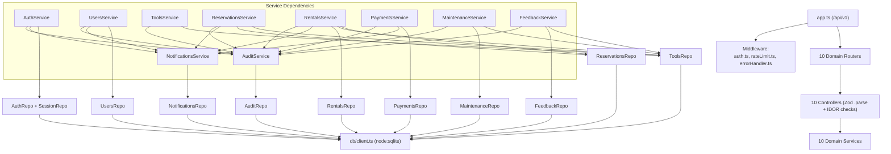
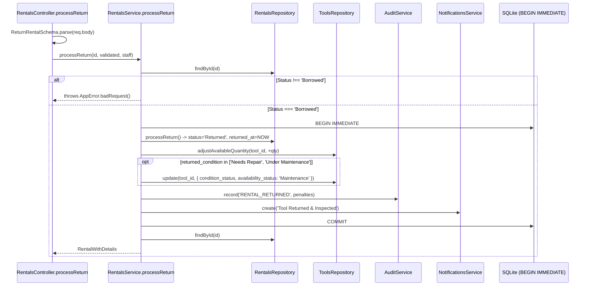

# 22 — Backend Architecture Deep Dive

> **Epistemic Classification Legend**
> - `[Verified from source code]` — Directly observed in repository files, schemas, configurations, or tool outputs.
> - `[Inferred from architecture]` — Logically deduced from codebase structure, middleware order, or runtime behavior.
> - `[Assumption requiring validation]` — Organizational, municipal policy, or operational assumption not codified in source code.

---

## Table of Contents

- [1. Executive Summary](#1-executive-summary)
- [2. Purpose](#2-purpose)
- [3. Scope](#3-scope)
- [4. Key Components](#4-key-components)
- [5. Architecture Diagrams](#5-architecture-diagrams)
  - [5.1 Complete Backend Module & Dependency Map](#51-complete-backend-module--dependency-map)
  - [5.2 Multi-Module Return Inspection Sequence Diagram](#52-multi-module-return-inspection-sequence-diagram)
- [6. Technical Details & Detailed Analysis](#6-technical-details--detailed-analysis)
  - [6.1 Module Inventory & Layer Responsibilities](#61-module-inventory--layer-responsibilities)
  - [6.2 Controllers Deep Dive](#62-controllers-deep-dive)
  - [6.3 Services Deep Dive & Transaction Boundaries](#63-services-deep-dive--transaction-boundaries)
  - [6.4 Repositories Deep Dive & SQL Patterns](#64-repositories-deep-dive--sql-patterns)
  - [6.5 Models & Joined DTO Interfaces](#65-models--joined-dto-interfaces)
  - [6.6 Middleware, Validation & Error Management](#66-middleware-validation--error-management)
  - [6.7 Jobs, Events & Queues Status](#67-jobs-events--queues-status)
- [7. Findings](#7-findings)
- [8. Risks](#8-risks)
- [9. Recommendations](#9-recommendations)
- [10. Future Enhancements](#10-future-enhancements)
- [11. References to Source Files & Cross-References](#11-references-to-source-files--cross-references)

---

## 1. Executive Summary

The MCTEB backend (`@mcteb/api` under `apps/api/`) consists of **44 TypeScript files** implementing **10 domain modules** (`audit`, `auth`, `feedback`, `maintenance`, `notifications`, `payments`, `rentals`, `reservations`, `tools`, `users`), **4 middleware modules**, **3 utility modules**, and **4 database/migration/seed modules** (`[Verified from source code]`).

Every domain module cleanly separates HTTP handling (`*.routes.ts`, `*.controller.ts`), business rules and `db.transaction()` coordination (`*.service.ts`), and parameterized `node:sqlite` queries (`*.repository.ts`) (`[Verified from source code]`). There are **no background job runners, message queues, or asynchronous event buses**—all audit logs and notifications are persisted synchronously within the active HTTP request (`[Verified from source code]`).

---

## 2. Purpose

Serves as the authoritative module-by-module backend engineering specification covering controllers, services, repositories, DTOs, middleware, validation, error handling, and async/job capabilities.

---

## 3. Scope

Covers every file inside `apps/api/src/` (`[Verified from source code]`).

---

## 4. Key Components

- **10 Controllers** in `apps/api/src/modules/*/*.controller.ts` (`[Verified from source code]`).
- **10 Services** in `apps/api/src/modules/*/*.service.ts` (`[Verified from source code]`).
- **11 Repositories** in `apps/api/src/modules/*/*.repository.ts` (including `SessionRepository` in `modules/auth/session.repository.ts`) (`[Verified from source code]`).
- **4 Middleware Modules** (`auth.ts`, `errorHandler.ts`, `rateLimit.ts`, `validate.ts`) (`[Verified from source code]`).

---

## 5. Architecture Diagrams

### 5.1 Complete Backend Module & Dependency Map



### 5.2 Multi-Module Return Inspection Sequence Diagram



---

## 6. Technical Details & Detailed Analysis

### 6.1 Module Inventory & Layer Responsibilities

| Module | Routes File | Controller Class | Service Class | Repository Class(es) |
|---|---|---|---|---|
| `auth` | `auth.routes.ts` | `AuthController` | `AuthService` | `AuthRepository`, `SessionRepository` |
| `users` | `users.routes.ts` | `UsersController` | `UsersService` | `UsersRepository` |
| `tools` | `tools.routes.ts` | `ToolsController` | `ToolsService` | `ToolsRepository` |
| `reservations` | `reservations.routes.ts` | `ReservationsController` | `ReservationsService` | `ReservationsRepository` |
| `rentals` | `rentals.routes.ts` | `RentalsController` | `RentalsService` | `RentalsRepository` |
| `payments` | `payments.routes.ts` | `PaymentsController` | `PaymentsService` | `PaymentsRepository` |
| `maintenance` | `maintenance.routes.ts` | `MaintenanceController` | `MaintenanceService` | `MaintenanceRepository` |
| `feedback` | `feedback.routes.ts` | `FeedbackController` | `FeedbackService` | `FeedbackRepository` |
| `notifications` | `notifications.routes.ts` | `NotificationsController` | `NotificationsService` | `NotificationsRepository` |
| `audit` | `audit.routes.ts` | `AuditController` | `AuditService` | `AuditRepository` |

### 6.2 Controllers Deep Dive

- **Uniform Pattern**: Every controller method wraps its body in `try { ... } catch (error) { next(error); }` so both `ZodError` and `AppError` flow cleanly into `errorHandler` (`[Verified from source code]`).
- **Role-Based List Switching**: `ReservationsController.list`, `RentalsController.list`, and `PaymentsController.list` inspect `req.user.role === 'Borrower'` to invoke `getBorrower*(req.user.id)` vs `getAll*(status)` for Staff/Admin (`[Verified from source code]`).
- **IDOR Checks**: `UsersController.getById` & `updateProfile`, `ReservationsController.getById`, `RentalsController.getById`, and `PaymentsController.getById` validate ownership against `req.user.id` (`[Verified from source code]`).
- **Param Extraction Cast**: Due to `@types/express@^5.0.0` being installed alongside `express@^4.21.2`, controllers cast `const id = req.params['id'] as string;` (`[Verified from source code]`).

### 6.3 Services Deep Dive & Transaction Boundaries

| Service | Transactional Methods (`db.transaction`) | Non-Transactional Mutating Methods |
|---|---|---|
| `AuthService` | None (`register` & `login` are `async` due to `scrypt`) | `register`, `login`, `logout` |
| `UsersService` | None (`updateProfile`, `updateUserStatus`, `updateUserRole` run separate SQL statements for user update, audit, and notification) | `updateProfile`, `updateUserStatus`, `updateUserRole` |
| `ToolsService` | None (`createTool`, `updateTool`, `archiveTool` run tool update followed by separate `AuditService.record()`) | `createTool`, `updateTool`, `archiveTool` |
| `ReservationsService` | `createReservation`, `reviewReservation`, `cancelReservation` | None |
| `RentalsService` | `checkout`, `processReturn` | None |
| `PaymentsService` | `recordPayment`, `verifyPayment` | None |
| `MaintenanceService` | `createReport`, `updateRecord` | None |
| `FeedbackService` | None (`submitFeedback`, `moderateFeedback` run feedback SQL followed by separate `AuditService.record()`) | `submitFeedback`, `moderateFeedback` |
| `NotificationsService` | None (called inside parent service transactions or standalone for `markRead`/`markAllRead`) | `create`, `markRead`, `markAllRead` |
| `AuditService` | None (called inside parent service transactions or directly) | `record` |

### 6.4 Repositories Deep Dive & SQL Patterns

- **Stock Adjustment Query (`ToolsRepository.adjustAvailableQuantity`, lines 124–139)** (`[Verified from source code]`):
```sql
      UPDATE tools
      SET
        available_quantity = MAX(0, available_quantity + ?),
        availability_status = CASE
          WHEN (available_quantity + ?) <= 0 THEN 'Borrowed'
          ELSE 'Available'
        END,
        updated_at = DATETIME('now')
      WHERE id = ?
      RETURNING *
```
  - Note: Clamps `available_quantity` at `0` (`MAX(0, ...)`), does **not** clamp upper bound at `total_quantity`, and sets `availability_status` to `'Available'` or `'Borrowed'` unconditionally—which `RentalsService.processReturn` must override afterward if `returned_condition` requires `'Maintenance'` (`[Verified from source code]`).
- **Receipt Reference Generator (`PaymentsRepository.generateReceiptReference`, lines 118–122)** (`[Verified from source code]`): Generates `BASCO-PAY-${year}-${randomSuffix}` using `Math.floor(100000 + Math.random() * 900000)` (`900,000` possible 6-digit codes per year without checking for collision prior to `UNIQUE` insert!).
- **Dynamic Update Builders**: `UsersRepository.updateProfile`, `ToolsRepository.update`, and `MaintenanceRepository.update` build parameterized `SET col = ?` arrays dynamically, safely falling back to `findById(id)` if 0 fields are modified (`[Verified from source code]`).

### 6.5 Models & Joined DTO Interfaces

Backend repositories extend `@mcteb/shared` Zod entities with joined read models (`[Verified from source code]`):
- `UserWithPassword` (`auth.repository.ts`): `User & { password_hash: string }`
- `SessionRecord` (`session.repository.ts`): `{ token, user_id, created_at, expires_at }`
- `ReservationWithDetails` (`reservations.repository.ts`): `Reservation` + `tool_name`, `tool_category`, `tool_image_url`, `rental_fee_centavos`, `deposit_fee_centavos`, `borrower_name`, `borrower_email`, `borrower_phone`, `borrower_barangay`
- `RentalWithDetails` (`rentals.repository.ts`): `Rental` + same tool and borrower detail fields
- `PaymentWithDetails` (`payments.repository.ts`): `Payment` + `payer_name`, `payer_email`, `payer_barangay`, `tool_name`, `verifier_name`
- `MaintenanceWithDetails` (`maintenance.repository.ts`): `Maintenance` + `tool_name`, `tool_category`, `reporter_name`
- `FeedbackWithDetails` (`feedback.repository.ts`): `Feedback` + `tool_name`, `reviewer_name`, `reviewer_barangay`

### 6.6 Middleware, Validation & Error Management

- **`apps/api/src/middleware/validate.ts`**: Exports `validate(schema, source)` middleware, **never imported anywhere** (`[Verified from source code]`). Controllers validate manually via `Schema.parse(...)`.
- **`apps/api/src/middleware/rateLimit.ts`**: In-memory store (`express-rate-limit` default `MemoryStore`) (`[Verified from source code]`).
- **`apps/api/src/middleware/errorHandler.ts`**: Differentiates `AppError`, `ZodError`, and unknown errors; logs `AppError`/`ZodError` as `warn` and unknown exceptions as `error` via Pino (`[Verified from source code]`).

### 6.7 Jobs, Events & Queues Status

- **Background Jobs**: **None** (`[Verified from source code]`).
- **Event Emitters / PubSub**: **None** (`[Verified from source code]`).
- **Message Queues**: **None** (`[Verified from source code]`).

---

## 7. Findings

### Verified from Source Code
1. `UsersService`, `ToolsService`, `FeedbackService`, and `AuthService` do not wrap multi-table mutations + `AuditService.record()` in `db.transaction()`, unlike `ReservationsService`, `RentalsService`, `PaymentsService`, and `MaintenanceService`.
2. `PaymentsRepository.generateReceiptReference()` uses `Math.random()` for a 6-digit number without retry-on-`UNIQUE`-conflict handling.
3. `ToolsRepository.adjustAvailableQuantity` does not enforce `<= total_quantity` and overwrites `availability_status` even if a tool has units in `'Maintenance'`.
4. `ToolsRepository.update` allows setting `total_quantity` or `available_quantity` independently without checking `available_quantity <= total_quantity` (`ToolsService.updateTool` checks `input.total_quantity < currentlyLoaned`, but does not adjust `available_quantity` when `total_quantity` increases!).
5. `ReservationsService.createReservation` checks `ReservationsRepository.getActiveReservedQuantityForDates`, which ignores active `'Borrowed'` rentals whose reservations already transitioned to `'Completed'`.

### Inferred from Architecture
1. Using `MemoryStore` in `express-rate-limit` resets rate-limit counters on process restart and works only for single-instance deployment (consistent with SQLite).

### Assumptions Requiring Validation
1. `[Assumption requiring validation]` Whether increasing `tools.total_quantity` (procuring new municipal units) is intended to automatically increase `available_quantity` by the same delta.

---

## 8. Risks

| ID | Risk | Severity | Details |
|---|---|---|---|
| **BE-01** | `ToolsService.updateTool` total vs available stock desync | **Medium** | Increasing `total_quantity` via `ToolFormModal` does not increment `available_quantity` unless `available_quantity` is also passed (and `ToolFormModal` doesn't send `available_quantity`!) (`[Verified from source code]`). |
| **BE-02** | `PaymentsRepository.generateReceiptReference()` collision probability | **Low** | Under birthday paradox, 6 random digits (~1000 payments/yr) carries ~40% collision risk over time unless retried or derived from a monotonic sequence (`[Inferred from architecture]`). |
| **BE-03** | Non-transactional audit writes in `UsersService`/`ToolsService`/`FeedbackService` | **Low** | If `AuditService.record` threw, primary row would persist without audit trail (`[Verified from source code]`). |

---

## 9. Recommendations

1. **Automatically Adjust `available_quantity` Delta** when `ToolsService.updateTool` modifies `total_quantity` (`available_quantity = current.available_quantity + (input.total_quantity - current.total_quantity)`).
2. **Wrap `UsersService`, `ToolsService`, and `FeedbackService` Mutations in `db.transaction()`** for uniform audit atomicity.
3. **Replace Random Receipt Suffix with Sequence or Retry Loop** (e.g., atomic counter or `UNIQUE` retry + `crypto.randomInt`).
4. **Fix `ToolsRepository.adjustAvailableQuantity`** to preserve `'Maintenance'` / `'Damaged'` / `'Archived'` statuses and clamp `MIN(total_quantity, MAX(0, ...))`.

---

## 10. Future Enhancements

1. **Cron / Worker Scheduler**: Add lightweight node-cron / `setInterval` workers for session cleanup, overdue rental flagging, and due-date notifications.
2. **Idempotency Keys**: Support `Idempotency-Key` header on `/payments` and `/rentals/checkout` to prevent accidental double-submission on unstable island networks.

---

## 11. References to Source Files & Cross-References

| File | Scope |
|---|---|
| `apps/api/src/modules/*/*.routes.ts`, `*.controller.ts`, `*.service.ts`, `*.repository.ts` | All 10 backend modules |
| `apps/api/src/middleware/*.ts` | `auth.ts`, `errorHandler.ts`, `rateLimit.ts`, `validate.ts` |
| `apps/api/src/utils/*.ts` | `crypto.ts`, `errors.ts`, `logger.ts` |
| `apps/api/src/db/client.ts` | SQLite connection and transaction primitives |

**Cross-References**: See [02-Architecture.md](./02-Architecture.md), [05-API-Architecture.md](./05-API-Architecture.md), and [21-Developer-Architecture-Guide.md](./21-Developer-Architecture-Guide.md).
