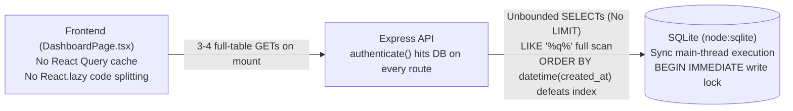

# Performance Review (`PERFORMANCE_REVIEW.md`)

> **Epistemic Classification Legend**
>
> - `[Verified from source code]` — Directly observed in repository files, schemas, configurations, or tool outputs.
> - `[Inferred from architecture]` — Logically deduced from codebase structure, middleware order, or runtime behavior.
> - `[Assumption requiring validation]` — Organizational, municipal policy, or operational assumption not codified in source code.

---

## Table of Contents

- [1. Executive Summary](#1-executive-summary)
- [2. Purpose](#2-purpose)
- [3. Scope](#3-scope)
- [4. Key Components](#4-key-components)
- [5. Architecture Diagrams](#5-architecture-diagrams)
  - [5.1 Identified Performance Bottlenecks Across Stack](#51-identified-performance-bottlenecks-across-stack)
- [6. Technical Details & Detailed Analysis](#6-technical-details--detailed-analysis)
  - [6.1 Database & SQL Query Performance](#61-database--sql-query-performance)
  - [6.2 Backend Concurrency & Event Loop Behavior](#62-backend-concurrency--event-loop-behavior)
  - [6.3 API Pagination & Payload Size Audit](#63-api-pagination--payload-size-audit)
  - [6.4 Frontend Rendering, Bundling & Caching Review](#64-frontend-rendering-bundling--caching-review)
- [7. Findings](#7-findings)
- [8. Risks](#8-risks)
- [9. Recommendations](#9-recommendations)
- [10. Future Enhancements](#10-future-enhancements)
- [11. References to Source Files & Cross-References](#11-references-to-source-files--cross-references)

---

## 1. Executive Summary

MCTEB runs on a fast, low-overhead embedded stack (`node:sqlite` in `WAL` mode, Vite-compiled React 19 SPA), providing sub-millisecond in-process database reads at small scale (`[Inferred from architecture]`).

However, systematic review identified **six performance bottlenecks** that will degrade latency and throughput as municipal records grow:

1. **Unbounded List Endpoints**: 8 out of 10 repository `findAll`/`findByUserId` queries lack `LIMIT`/`OFFSET` pagination (`[Verified from source code]`).
2. **Dashboard Over-Fetching**: `DashboardPage.tsx` fetches 3–4 entire unpaginated entity arrays in parallel to calculate 4 count KPIs in JavaScript (`[Verified from source code]`).
3. **Unindexed Search & Wrapped Date Indexes**: `ToolsRepository.findMany` executes leading-wildcard `LIKE '%...%'` full-table scans, and repositories sort using `ORDER BY datetime(created_at) DESC`, defeating B-tree index ordering (`[Verified from source code]`).
4. **Per-Request Global Auth DB Lookups**: `authenticate` executes 2 SQLite queries even on public `/health` and `/tools` requests when a token/cookie exists (`[Verified from source code]`).
5. **Unutilized Client Query Cache**: `@tanstack/react-query` hooks are unused, causing redundant full-page API re-fetches on every navigation (`[Verified from source code]`).
6. **Zero Frontend Code-Splitting**: All 15 routed feature pages are bundled eagerly (`[Verified from source code]`).

---

## 2. Purpose

Evaluates database query efficiency, concurrency behavior, payload sizes, frontend bundle structure, and caching opportunities.

---

## 3. Scope

Covers all SQL queries in `apps/api/src/modules/*/*.repository.ts`, `db/schema.sql`, `middleware/auth.ts`, `apps/api/src/db/client.ts`, and `apps/web/src/` (`[Verified from source code]`).

---

## 4. Key Components

- **SQLite Engine & Pragmas (`apps/api/src/db/client.ts`)**: `WAL`, `busy_timeout = 5000`, `synchronous = NORMAL` (`[Verified from source code]`).
- **Repository Queries (`apps/api/src/modules/*/*.repository.ts`)**: SQL joins, filters, counts, and sorting (`[Verified from source code]`).
- **Frontend Fetching (`DashboardPage.tsx`, `CatalogPage.tsx`, `routes.tsx`)**: Parallel `Promise.all` calls and static imports (`[Verified from source code]`).

---

## 5. Architecture Diagrams

### 5.1 Identified Performance Bottlenecks Across Stack

---

## 6. Technical Details & Detailed Analysis

### 6.1 Database & SQL Query Performance

1. **Function-Wrapped `ORDER BY` Defeats Indexes (`[Verified from source code]`)**:
   - `AuditRepository.findMany` (`audit.repository.ts:57`) runs `ORDER BY datetime(created_at) DESC`, even though `db/schema.sql:174` indexes `created_at` (`idx_audit_logs_created`) without `datetime(...)`. SQLite cannot use `idx_audit_logs_created` for sort elimination (`[Inferred from architecture]`).
   - Same pattern appears in `UsersRepository.findAll`, `ReservationsRepository`, `RentalsRepository`, `PaymentsRepository`, `MaintenanceRepository`, `FeedbackRepository`, and `NotificationsRepository` (`[Verified from source code]`).
2. **Leading-Wildcard `LIKE '%q%'` Scan (`tools.repository.ts:17`)**:
   - `(name LIKE ? OR description LIKE ? OR category LIKE ?)` triggers a full table scan (`[Inferred from architecture]`).
3. **Date Range Overlap Query (`reservations.repository.ts:94–99`)**:
   - Filters `tool_id = ?` (uses `idx_reservations_tool`) and `status IN ('Pending', 'Approved')`, then scans date columns without a composite index on `(tool_id, status, pickup_date, return_date)` (`[Verified from source code]`).
4. **Unindexed `sessions.expires_at` & Uncleaned Expired Rows**:
   - `SessionRepository.findValid` queries `WHERE token = ? AND datetime(expires_at) > datetime('now')` (PK lookup on `token` is O(1)), but `sessions` grows indefinitely without pruning (`[Verified from source code]`).

### 6.2 Backend Concurrency & Event Loop Behavior

- **Synchronous `node:sqlite`**: Every `stmt.get()`, `stmt.all()`, and `db.transaction()` blocks the single Node.js event loop thread (`[Verified from source code]`, `[Inferred from architecture]`).
- **`scrypt` Async Execution**: `hashPassword` and `verifyPassword` offload CPU-heavy KDF work to Node's `libuv` thread pool via callback-based `crypto.scrypt` (`utils/crypto.ts:10,30`), preventing event-loop stalls during logins (`[Verified from source code]`).
- **`WAL` + `BEGIN IMMEDIATE` Concurrency**: Multiple readers run concurrently with at most 1 writer (`5000ms` busy wait) (`[Verified from source code]`).

### 6.3 API Pagination & Payload Size Audit

| Endpoint                               | Pagination Implemented?          | Query Return Scope                                                                |
| -------------------------------------- | -------------------------------- | --------------------------------------------------------------------------------- |
| `GET /api/v1/tools`                    | **Yes** (`page`, `limit <= 100`) | Bounded `[Verified from source code]`                                             |
| `GET /api/v1/audit`                    | **Yes** (`page`, `limit <= 100`) | Bounded `[Verified from source code]`                                             |
| `GET /api/v1/users`                    | **No**                           | Returns all users `[Verified from source code]`                                   |
| `GET /api/v1/reservations`             | **No**                           | Returns all reservations (or all user reservations) `[Verified from source code]` |
| `GET /api/v1/rentals`                  | **No**                           | Returns all rentals (or all user rentals) `[Verified from source code]`           |
| `GET /api/v1/payments`                 | **No**                           | Returns all payments (or all user payments) `[Verified from source code]`         |
| `GET /api/v1/maintenance`              | **No**                           | Returns all maintenance tickets `[Verified from source code]`                     |
| `GET /api/v1/feedback/public` & `/all` | **No**                           | Returns all public / all feedback entries `[Verified from source code]`           |
| `GET /api/v1/notifications`            | **No**                           | Returns all notifications for user `[Verified from source code]`                  |

### 6.4 Frontend Rendering, Bundling & Caching Review

- **Dashboard Over-Fetching (`DashboardPage.tsx:44–75`)**: Staff dashboard invokes 4 unpaginated API endpoints (`reservations`, `rentals`, `payments`, `maintenance`), joins user+tool columns in SQL for every historical record, transfers all JSON over the wire, and counts statuses in JS (`[Verified from source code]`).
- **Missing Code Splitting (`routes.tsx:7–24`)**: Imports all 15 feature pages synchronously at top level (`[Verified from source code]`).
- **Unused React Query Cache**: Every route visit mounts a fresh `useEffect` fetch (`[Verified from source code]`).

---

## 7. Findings

_(Summarized in Sections 6.1–6.4 `[Verified from source code]`.)_

---

## 8. Risks

| ID          | Risk                                                                  | Severity       | Details                                                                                                                  |
| ----------- | --------------------------------------------------------------------- | -------------- | ------------------------------------------------------------------------------------------------------------------------ |
| **PERF-01** | Unbounded list APIs & `DashboardPage` over-fetching                   | **Medium**     | Multi-year municipal transaction logs will slow down `/dashboard` and `/staff/*` pages (`[Inferred from architecture]`). |
| **PERF-02** | `datetime(created_at)` defeats SQLite B-tree indexes                  | **Low/Medium** | Forces temp B-tree sorts on `audit_logs` and list queries (`[Inferred from architecture]`).                              |
| **PERF-03** | Synchronous event-loop blocking during large unpaginated `stmt.all()` | **Low**        | Single-threaded Node.js stalls during large SQLite result serialization (`[Inferred from architecture]`).                |

---

## 9. Recommendations

1. **Add `GET /api/v1/dashboard/stats` SQL Aggregation Endpoint** to replace 4 full-table downloads on `/dashboard`.
2. **Enforce Pagination (`page`, `limit`, default `20`, max `100`)** on `/users`, `/reservations`, `/rentals`, `/payments`, `/maintenance`, `/feedback/*`, and `/notifications`.
3. **Add Composite Indexes & Remove `datetime(...)` in `ORDER BY`**: Store canonical ISO-8601 UTC strings and sort directly with `ORDER BY created_at DESC`.
4. **Activate `@tanstack/react-query` (`useQuery`)** and split Admin/Staff routes with `React.lazy()`.

---

## 10. Future Enhancements

1. **SQLite FTS5 Search Table** for `tools` catalog full-text search.
2. **HTTP `ETag` / `Cache-Control` Headers** on public `GET /api/v1/tools` and `GET /api/v1/feedback/public`.

---

## 11. References to Source Files & Cross-References

| File                                                                  | Symbol                                          |
| --------------------------------------------------------------------- | ----------------------------------------------- |
| `apps/api/src/modules/*/*.repository.ts`                              | `findAll`, `findMany`, `findByUserId`           |
| `apps/api/src/db/client.ts`, `db/schema.sql`                          | Pragmas, indexes                                |
| `apps/web/src/features/dashboard/DashboardPage.tsx`, `app/routes.tsx` | Dashboard parallel fetches, static page imports |

**Cross-References**: See [04-Database-and-ERD.md](./04-Database-and-ERD.md), [16-Data-Analysis-Reference.md](./16-Data-Analysis-Reference.md), and [TECHNICAL_DEBT_REPORT.md](./TECHNICAL_DEBT_REPORT.md).
