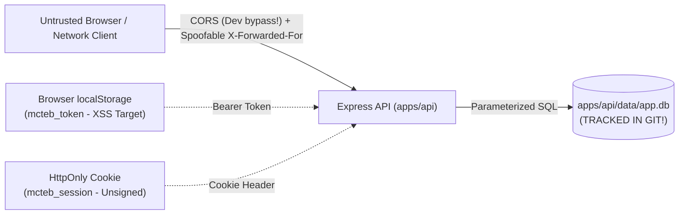

# Security Audit (`SECURITY_AUDIT.md`)

> **Epistemic Classification Legend**
>
> - `[Verified from source code]` — Directly observed in repository files, schemas, configurations, or tool outputs.
> - `[Inferred from architecture]` — Logically deduced from codebase structure, middleware order, or runtime behavior.
> - `[Assumption requiring validation]` — Organizational, municipal policy, or operational assumption not codified in source code.

---

## Table of Contents

- [1. Executive Summary](#1-executive-summary)
- [2. Purpose](#2-purpose)
- [3. Scope](#3-scope)
- [4. Key Components](#4-key-components)
- [5. Architecture Diagrams](#5-architecture-diagrams)
  - [5.1 Attack Surface & Trust Boundary Diagram](#51-attack-surface--trust-boundary-diagram)
- [6. Technical Details & Detailed Analysis](#6-technical-details--detailed-analysis)
  - [6.1 Security Audit Finding Register (SEC-01 to SEC-10)](#61-security-audit-finding-register-sec-01-to-sec-10)
  - [6.2 Detailed Code Evidence & Remediation Snippets](#62-detailed-code-evidence--remediation-snippets)
  - [6.3 Positive Security Controls Verified](#63-positive-security-controls-verified)
- [7. Findings](#7-findings)
- [8. Risks](#8-risks)
- [9. Recommendations](#9-recommendations)
- [10. Future Enhancements](#10-future-enhancements)
- [11. References to Source Files & Cross-References](#11-references-to-source-files--cross-references)

---

## 1. Executive Summary

This security audit assesses MCTEB's backend (`@mcteb/api`), frontend (`@mcteb/web`), shared contracts (`@mcteb/shared`), database storage, and repository configuration against secure engineering standards (`[Verified from source code]`).

MCTEB incorporates strong core defenses including salted `scrypt` password hashing, `crypto.timingSafeEqual` verification, 5-attempt account lockout, `express-rate-limit`, `helmet` CSP headers, parameterized SQL statements, borrower IDOR ownership scoping, surname privacy masking, and admin self-lockout prevention (`[Verified from source code]`).

However, the audit identified **10 security findings (`1 High`, `5 Medium`, `4 Low`)**, led by missing role checks on borrower write endpoints, `localStorage` session token storage, live SQLite database files tracked in Git, non-revocation of sessions upon account suspension, and a hardcoded default `SESSION_SECRET` (`[Verified from source code]`).

---

## 2. Purpose

Provides an evidence-backed vulnerability register and concrete remediation guidance for security reviews, municipal IT sign-off, and production hardening.

---

## 3. Scope

Covers all authentication, authorization, cryptography, input validation, HTTP transport, data storage, and frontend token handling code in `c:/Users/USER/Documents/GitHub/MCTED` (`[Verified from source code]`).

---

## 4. Key Components

- `apps/api/src/middleware/{auth,rateLimit,errorHandler}.ts`, `apps/api/src/app.ts`, `config/env.ts`, `utils/crypto.ts` (`[Verified from source code]`).
- `apps/api/src/modules/{auth,users,reservations,payments,feedback}/*` (`[Verified from source code]`).
- `apps/web/src/lib/{api,auth-context}.*` (`[Verified from source code]`).

---

## 5. Architecture Diagrams

### 5.1 Attack Surface & Trust Boundary Diagram



---

## 6. Technical Details & Detailed Analysis

### 6.1 Security Audit Finding Register (`SEC-01` to `SEC-10`)

| ID         | Severity   | Finding                                                                                                                                                           | Location                                                                                                    |
| ---------- | ---------- | ----------------------------------------------------------------------------------------------------------------------------------------------------------------- | ----------------------------------------------------------------------------------------------------------- |
| **SEC-01** | **High**   | Missing `Borrower` role restriction on `POST /reservations`, `POST /payments`, and `POST /feedback` (`requireAuth` only)                                          | `reservations.routes.ts:10`, `payments.routes.ts:10`, `feedback.routes.ts:11` `[Verified from source code]` |
| **SEC-02** | **Medium** | Session token persisted in `localStorage` (`mcteb_token`) despite `httpOnly` cookie being set                                                                     | `auth.controller.ts:21,40`, `auth-context.tsx:41,50`, `api.ts:27` `[Verified from source code]`             |
| **SEC-03** | **Medium** | Live SQLite DB files (`app.db`, `app.db-shm`, `app.db-wal`) tracked in Git                                                                                        | `apps/api/data/app.db*`, `.gitignore:16–18` `[Verified from source code]`                                   |
| **SEC-04** | **Medium** | Active sessions are not deleted when an Admin suspends a user (`SessionRepository.deleteForUser` unused)                                                          | `users.service.ts:54`, `session.repository.ts:45` `[Verified from source code]`                             |
| **SEC-05** | **Medium** | Hardcoded default `SESSION_SECRET` allowed in `production` & `cookieParser` secret unused (unsigned cookies)                                                      | `config/env.ts:13`, `app.ts:62`, `auth.controller.ts:14` `[Verified from source code]`                      |
| **SEC-06** | **Medium** | Spoofable `x-forwarded-for` header read without `trust proxy`, plus `express-rate-limit` IP bypass risk                                                           | `auth.controller.ts:11,30`, `app.ts` `[Verified from source code]`                                          |
| **SEC-07** | **Low**    | Account lockout counter (`failed_login_attempts`) is not reset after 15-min lockout window expires (6th failure re-locks immediately)                             | `auth.repository.ts:44–58`, `auth.service.ts:71–85` `[Verified from source code]`                           |
| **SEC-08** | **Low**    | `Pending Verification` users can log in and submit reservations identical to `Active` users                                                                       | `auth.service.ts:89`, `middleware/auth.ts:67` `[Verified from source code]`                                 |
| **SEC-09** | **Low**    | `proof_url` (`CreatePaymentSchema`) and `image_url` (`CreateToolSchema`) accept arbitrary strings (potential `javascript:` URI if rendered in `href`/`src` later) | `schemas/payment.ts:29`, `schemas/tool.ts:35` `[Verified from source code]`                                 |
| **SEC-10** | **Low**    | No server-side Zod `.strict()` enforcement; `validate.ts` unused; `req.query.tool_id` in `FeedbackController` unvalidated                                         | `feedback.controller.ts:9`, `middleware/validate.ts` `[Verified from source code]`                          |

### 6.2 Detailed Code Evidence & Remediation Snippets

1. **`SEC-01` — Unenforced `Borrower` Role (`reservations.routes.ts:9–10`, `payments.routes.ts:9–10`, `feedback.routes.ts:11`)**:

```ts
reservationsRouter.post('/', ReservationsController.create); // Only requireAuth!
```

- _Fix_: Apply `requirePermission('RESERVATION_CREATE')` or `requireRole('Borrower')` (`[Verified from source code]`).

2. **`SEC-02` — `localStorage` Session Exposure (`apps/web/src/lib/auth-context.tsx:41`, `api.ts:27`)**:

```ts
localStorage.setItem('mcteb_token', data.token);
```

- _Fix_: Rely exclusively on `httpOnly; sameSite: 'lax'; secure` cookie (`mcteb_session`) and remove `token` from response JSON and `localStorage` (`[Verified from source code]`).

3. **`SEC-05` — Fallback `SESSION_SECRET` (`apps/api/src/config/env.ts:13`)**:

```ts
SESSION_SECRET: z.string().min(16).default('mcteb-default-session-secret-batanes-32char'),
```

- _Fix_: Require explicit `SESSION_SECRET` via `.superRefine()` when `NODE_ENV === 'production'`, and pass `signed: true` on `res.cookie(...)` (`[Verified from source code]`).

4. **`SEC-06` — Unverified `x-forwarded-for` (`apps/api/src/modules/auth/auth.controller.ts:11`)**:

```ts
const ip = (req.headers['x-forwarded-for'] as string) || req.socket.remoteAddress;
```

- _Fix_: Configure `app.set('trust proxy', 1)` when behind a trusted proxy and use `req.ip` (`[Inferred from architecture]`).

### 6.3 Positive Security Controls Verified

- Salted `scrypt` (`16` random bytes salt, `64`-byte key) + `crypto.timingSafeEqual` (`apps/api/src/utils/crypto.ts`) `[Verified from source code]`.
- Zero raw SQL string interpolation of user input (`db.prepare(...)` `?` placeholders everywhere) `[Verified from source code]`.
- Zero `dangerouslySetInnerHTML` calls in React (`apps/web/src/`) `[Verified from source code]`.
- Pino redaction of `authorization`, `cookie`, `password`, `password_hash` (`apps/api/src/utils/logger.ts:6`) `[Verified from source code]`.
- Strong self-suspension and last-active-admin protections (`apps/api/src/modules/users/users.service.ts`) `[Verified from source code]`.

---

## 7. Findings

_(Captured in Section 6.1 `SEC-01` through `SEC-10` and Section 6.3 `[Verified from source code]`.)_

---

## 8. Risks

- **Privilege / Role Integrity Risk (`SEC-01`)**: Non-borrowers can post borrower reviews or submit borrower reservations via API (`[Verified from source code]`).
- **Credential / Data Exposure Risk (`SEC-02`, `SEC-03`, `SEC-05`)**: Committing `app.db*` and caching session tokens in `localStorage` weaken defense-in-depth (`[Verified from source code]`).

---

## 9. Recommendations

1. Enforce `requirePermission(...)` on all 40 routes immediately (`SEC-01`).
2. Remove `apps/api/data/app.db*` from Git and rotate any non-demo hashes/sessions (`SEC-03`).
3. Remove `localStorage` session token storage (`SEC-02`) and enforce production `SESSION_SECRET` validation (`SEC-05`).
4. Call `SessionRepository.deleteForUser(id)` in `UsersService.updateUserStatus` when `status === 'Suspended'` (`SEC-04`).
5. Validate `proof_url` / `image_url` prefixes (`https://` or relative `/equipment/`) (`SEC-09`).

---

## 10. Future Enhancements

1. Add **CSRF Token Middleware** once exclusively using `HttpOnly` cookies.
2. Add **Automated Secret Scanning** (`gitleaks`) in `.github/workflows/ci.yml` (`PROJECT_PLAN.md` Section B5).

---

## 11. References to Source Files & Cross-References

| File                                                                 | Scope                             |
| -------------------------------------------------------------------- | --------------------------------- |
| `apps/api/src/middleware/auth.ts`, `rateLimit.ts`                    | Auth, RBAC, rate limiting         |
| `apps/api/src/utils/crypto.ts`, `logger.ts`                          | Hashing, tokens, log redaction    |
| `apps/api/src/modules/{auth,users,reservations,payments,feedback}/*` | Auth, lockout, safeguards, routes |
| `apps/web/src/lib/{api.ts,auth-context.tsx}`                         | Client token storage              |

**Cross-References**: See [06-Authentication-and-Security.md](./06-Authentication-and-Security.md), [07-User-Roles-and-Permissions.md](./07-User-Roles-and-Permissions.md), and [TECHNICAL_DEBT_REPORT.md](./TECHNICAL_DEBT_REPORT.md).
