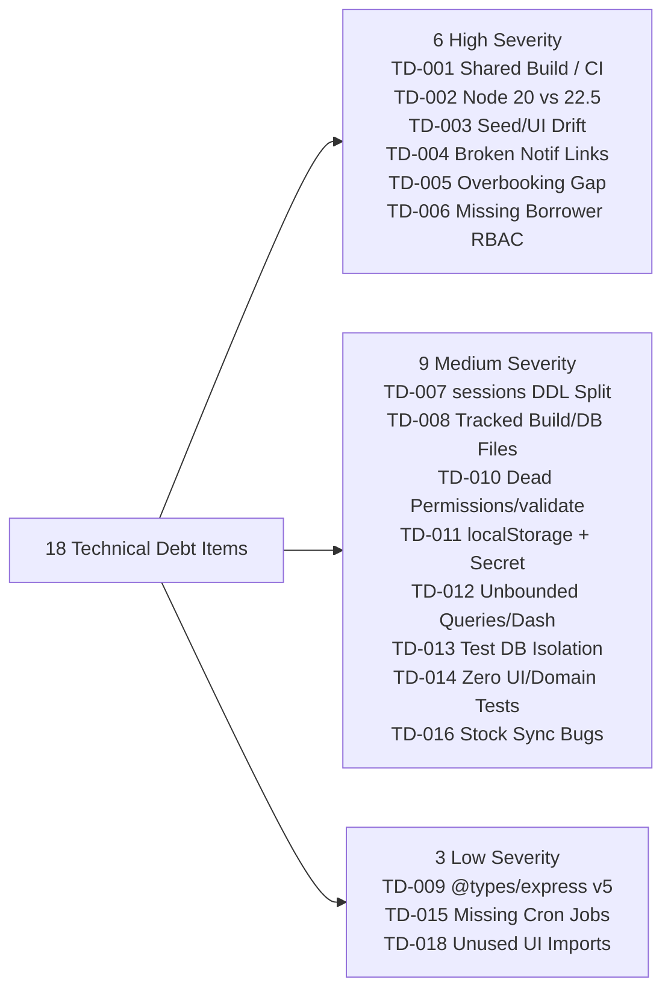

# Technical Debt Report (`TECHNICAL_DEBT_REPORT.md`)

> **Epistemic Classification Legend**
> - `[Verified from source code]` — Directly observed in repository files, schemas, configurations, or tool outputs.
> - `[Inferred from architecture]` — Logically deduced from codebase structure, middleware order, or runtime behavior.
> - `[Assumption requiring validation]` — Organizational, municipal policy, or operational assumption not codified in source code.

---

## Table of Contents

- [1. Executive Summary](#1-executive-summary)
- [2. Purpose](#2-purpose)
- [3. Scope](#3-scope)
- [4. Key Components](#4-key-components)
- [5. Architecture Diagrams](#5-architecture-diagrams)
  - [5.1 Technical Debt Distribution by Category & Severity](#51-technical-debt-distribution-by-category--severity)
- [6. Technical Details & Detailed Analysis](#6-technical-details--detailed-analysis)
  - [6.1 Consolidated Technical Debt Register (`TD-001` through `TD-018`)](#61-consolidated-technical-debt-register-td-001-through-td-018)
  - [6.2 Prioritized Remediation Roadmap](#62-prioritized-remediation-roadmap)
- [7. Findings](#7-findings)
- [8. Risks](#8-risks)
- [9. Recommendations](#9-recommendations)
- [10. Future Enhancements](#10-future-enhancements)
- [11. References to Source Files & Cross-References](#11-references-to-source-files--cross-references)

---

## 1. Executive Summary

While MCTEB successfully implements a clean modular architecture and core civic workflows, the codebase carries **18 measurable technical debt items (`6 High`, `9 Medium`, `3 Low`)** accumulated across build configuration, data hygiene, workflow edge cases, security boundaries, and testing (`[Verified from source code]`).

The highest-priority blockers requiring immediate remediation prior to any production launch are:
1. **`TD-001`**: Stale `packages/shared/dist` breaking `pnpm typecheck` (`TS2345`) and CI build order (`[Verified from source code]`).
2. **`TD-002`**: Node.js runtime mismatch (`.nvmrc` `20` vs `node:sqlite` requiring `>=22.5.0`) (`[Verified from source code]`).
3. **`TD-003`**: Seed fixture drift across barangays, categories, demo emails, and receipt formats (`[Verified from source code]`).
4. **`TD-004`**: Broken notification deep links (`/reservations/:id`, `/rentals/:id`, `/payments/:id`) (`[Verified from source code]`).
5. **`TD-005`**: Reservation stock conflict gaps (`Completed` reservation exclusion + unguarded `reviewReservation`) (`[Verified from source code]`).
6. **`TD-006`**: Missing `requireRole('Borrower')` enforcement on borrower write endpoints (`[Verified from source code]`).

---

## 2. Purpose

Consolidates all architectural, security, performance, quality, and data-integrity debt identified across the 28-document review into an actionable, effort-estimated engineering backlog.

---

## 3. Scope

Aggregates findings verified across all files in `c:/Users/USER/Documents/GitHub/MCTED` (`[Verified from source code]`).

---

## 4. Key Components

- Build/CI & Hygiene (`TD-001`, `TD-002`, `TD-008`, `TD-009`, `TD-013`).
- Domain & Workflow Correctness (`TD-003`, `TD-004`, `TD-005`, `TD-014`, `TD-017`).
- Security & Authorization (`TD-006`, `TD-010`, `TD-011`).
- Testing, Performance & Maintainability (`TD-007`, `TD-012`, `TD-015`, `TD-016`, `TD-018`).

---

## 5. Architecture Diagrams

### 5.1 Technical Debt Distribution by Category & Severity

---

## 6. Technical Details & Detailed Analysis

### 6.1 Consolidated Technical Debt Register (`TD-001` through `TD-018`)

| ID | Category | Severity | Effort | Location | Root Cause & Impact |
|---|---|---|---|---|---|
| **TD-001** | Build / CI | **High** | **S** | `packages/shared/dist`, `.github/workflows/ci.yml`, `package.json` | Stale `@mcteb/shared/dist` causes `RegisterPage.tsx` `TS2345` failure; CI runs `lint`/`typecheck`/`test` before building `@mcteb/shared`, and `pnpm -r lint` is a no-op `[Verified from source code]`. |
| **TD-002** | Runtime | **High** | **S** | `.nvmrc`, `package.json`, `apps/api/src/db/client.ts` | `.nvmrc` (`20`) and `engines.node` (`>=20`) fail to run `node:sqlite` (`>=22.5.0`); docs mention `better-sqlite3` `[Verified from source code]`. |
| **TD-003** | Data / UX | **High** | **S** | `fixtures/index.ts`, `README.md`, `LoginPage.tsx`, `CatalogPage.tsx` | Seeded barangays (`Barangay I-IV`) fail `BarangaySchema`; seeded tool categories (`Agricultural`, `Fishery`, `Power Equipment`) fail UI filters; `README`/`LoginPage` show wrong emails (`maria.c@basco.net`) `[Verified from source code]`. |
| **TD-004** | UX / Routing | **High** | **S** | `reservations/rentals/payments.service.ts`, `routes.tsx` | Notification `link_url` uses `/reservations/:id`, `/rentals/:id`, `/payments/:id` which do not exist in `routes.tsx`, redirecting users to `/dashboard` `[Verified from source code]`. |
| **TD-005** | Concurrency | **High** | **M** | `reservations.service.ts`, `reservations.repository.ts` | `getActiveReservedQuantityForDates` ignores active `Borrowed` rentals (`Completed` reservations) and `reviewReservation` skips stock re-check, enabling overbooking `[Verified from source code]`. |
| **TD-006** | Security | **High** | **S** | `reservations/payments/feedback.routes.ts`, `permissions.ts` | Borrower write endpoints use `requireAuth` only, ignoring `Permissions` matrix and allowing Staff/Admin submissions `[Verified from source code]`. |
| **TD-007** | Database | **Medium** | **S** | `db/schema.sql`, `session.repository.ts`, `migrate.ts` | `sessions` table created dynamically outside `db/schema.sql`; no incremental versioned migration table (`_migrations`) `[Verified from source code]`. |
| **TD-008** | Git Hygiene | **Medium** | **S** | `apps/web/src/*.{js,d.ts,map}`, `apps/api/data/app.db*` | 160 generated frontend artifacts and 3 live SQLite DB files tracked in Git `[Verified from source code]`. |
| **TD-009** | Typing | **Low** | **S** | `apps/api/package.json` | `@types/express@^5.0.0` paired with `express@^4.21.2` `[Verified from source code]`. |
| **TD-010** | Dead Code | **Medium** | **S** | `middleware/{auth,validate}.ts`, `permissions.ts` | `requirePermission`, `validate`, `Permissions`, `hasPermission`, `deleteForUser` are unreferenced `[Verified from source code]`. |
| **TD-011** | Security | **Medium** | **M** | `auth.controller.ts`, `auth-context.tsx`, `api.ts`, `env.ts` | Token stored in `localStorage`; `SESSION_SECRET` has hardcoded fallback; `cookieParser` secret unused; `trust proxy` missing; suspended user sessions not revoked `[Verified from source code]`. |
| **TD-012** | Performance | **Medium** | **M** | `DashboardPage.tsx`, `*Repository`, `tools.repository.ts` | Unbounded list queries, client-side dashboard aggregation, `datetime(created_at)` preventing index sort, `LIKE '%q%'` scans `[Verified from source code]`. |
| **TD-013** | Testing | **Medium** | **S** | `apps/api/src/app.test.ts` | Integration tests run against live dev `apps/api/data/app.db` instead of isolated test DB `[Verified from source code]`. |
| **TD-014** | Testing | **Medium** | **L** | `apps/api`, `apps/web`, `packages/shared` | Zero tests on domain transactions (reservations, rentals, payments, maintenance), zero UI tests, zero shared tests `[Verified from source code]`. |
| **TD-015** | Operations | **Low** | **M** | `apps/api/src/`, `scripts/backup-db.ts` | No background cleanup for expired `sessions`, no overdue rental alerts, `backup-db.ts` path defaults to root `./data/app.db` `[Verified from source code]`. |
| **TD-016** | Domain Logic | **Medium** | **M** | `tools.service.ts`, `tools.repository.ts`, `payments.service.ts` | `updateTool` ignores `available_quantity` delta; `adjustAvailableQuantity` overwrites `Maintenance`; `verifyPayment` blocks `Paid -> Refunded` `[Verified from source code]`. |
| **TD-017** | UI/UX | **Medium** | **M** | `OfficialReceiptModal.tsx`, `ToolDetailPage.tsx`, `DashboardPage.tsx`, `InventoryPage.tsx`, `AuditLogPage.tsx` | Receipt shows "Verified" when Pending; raw JSON specs shown to users; Dashboard counts `Decommissioned` as Open Maintenance; `limit=50` without pagination; `any[]` typing everywhere `[Verified from source code]`. |
| **TD-018** | Code Quality | **Low** | **S** | `apps/web/src/features/*.tsx`, `apps/api/src/db/client.ts` | 18+ unused UI imports, unused `react-hook-form`, `as any[]` casts in `client.ts` `[Verified from source code]`. |

### 6.2 Prioritized Remediation Roadmap

- **Sprint 1 — Immediate Stabilization (1–2 Days)**: Resolve `TD-001`, `TD-002`, `TD-003`, `TD-004`, `TD-006`, `TD-008`, `TD-013`, `TD-018` (fix build, Node pin, seed drift, notification links, borrower RBAC, git cleanup, test DB isolation, ESLint).
- **Sprint 2 — Correctness & Security Hardening (3–5 Days)**: Resolve `TD-005`, `TD-007`, `TD-010`, `TD-011`, `TD-016` (overbooking guard, `sessions` in `schema.sql`, cookie-only auth, `deleteForUser`, stock/refund logic).
- **Sprint 3 — Performance, UI & Test Coverage (1–2 Weeks)**: Resolve `TD-012`, `TD-014`, `TD-015`, `TD-017` (dashboard stats endpoint, pagination, React Query hooks, shared DTOs, domain + UI Vitest suites, backup/cron).

---

## 7. Findings

*(Every item `TD-001` through `TD-018` is `[Verified from source code]` with exact file locations documented across this suite.)*

---

## 8. Risks

Leaving `TD-001` through `TD-006` unresolved risks CI breakage, broken catalog search, user navigation dead ends, concurrent overbooking, and privilege drift in production (`[Verified from source code]`, `[Inferred from architecture]`).

---

## 9. Recommendations

Execute the 3-sprint Remediation Roadmap in Section 6.2 before removing demo gates for Basco municipal production deployment.

---

## 10. Future Enhancements

1. Introduce automated debt tracking (ESLint strictness in CI, Knip dead-code checks, Vitest coverage thresholds) to prevent regressions.

---

## 11. References to Source Files & Cross-References

| Reference Document | Focus Area |
|---|---|
| [SECURITY_AUDIT.md](./SECURITY_AUDIT.md) | `TD-006`, `TD-010`, `TD-011` |
| [PERFORMANCE_REVIEW.md](./PERFORMANCE_REVIEW.md) | `TD-012` |
| [UNUSED_CODE_ANALYSIS.md](./UNUSED_CODE_ANALYSIS.md) | `TD-008`, `TD-010`, `TD-018` |
| [TECH_STACK_AUDIT.md](./TECH_STACK_AUDIT.md) | `TD-001`, `TD-002`, `TD-009` |
| [14-Testing-and-Quality.md](./14-Testing-and-Quality.md) | `TD-013`, `TD-014` |
| [08-Business-Workflows.md](./08-Business-Workflows.md) | `TD-004`, `TD-005`, `TD-016` |
