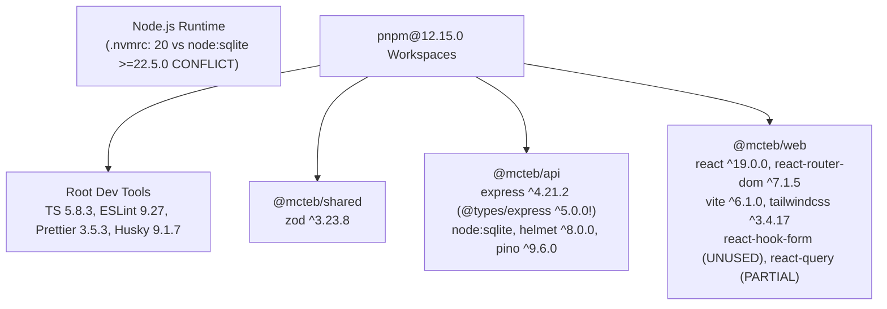

# Tech Stack Audit (`TECH_STACK_AUDIT.md`)

> **Epistemic Classification Legend**
> - `[Verified from source code]` — Directly observed in repository files, schemas, configurations, or tool outputs.
> - `[Inferred from architecture]` — Logically deduced from codebase structure, middleware order, or runtime behavior.
> - `[Assumption requiring validation]` — Organizational, municipal policy, or operational assumption not codified in source code.

---

## Table of Contents

- [1. Executive Summary](#1-executive-summary)
- [2. Purpose](#2-purpose)
- [3. Scope](#3-scope)
- [4. Key Components](#4-key-components)
- [5. Architecture Diagrams](#5-architecture-diagrams)
  - [5.1 Runtime & Package Dependency Stack](#51-runtime--package-dependency-stack)
- [6. Technical Details & Detailed Analysis](#6-technical-details--detailed-analysis)
  - [6.1 Runtime, Language & Toolchain Matrix](#61-runtime-language--toolchain-matrix)
  - [6.2 Complete Dependency Audit by Workspace Package](#62-complete-dependency-audit-by-workspace-package)
  - [6.3 Critical Version & Documentation Mismatches](#63-critical-version--documentation-mismatches)
- [7. Findings](#7-findings)
- [8. Risks](#8-risks)
- [9. Recommendations](#9-recommendations)
- [10. Future Enhancements](#10-future-enhancements)
- [11. References to Source Files & Cross-References](#11-references-to-source-files--cross-references)

---

## 1. Executive Summary

This audit evaluates every runtime, framework, library, compiler, and developer tool across MCTEB's root workspace, `@mcteb/shared`, `@mcteb/api`, and `@mcteb/web` (`[Verified from source code]`).

Overall, the technology stack is modern, minimal, and well-suited for a civic web platform (`TypeScript 5.8.3`, `React 19`, `Vite 6`, `Tailwind CSS 3.4`, `Express 4.21`, `Zod 3.23`, `Pino 9.6`, `Vitest 3.0`, `ESLint 9.27`) (`[Verified from source code]`). However, the audit identified **four critical stack mismatches**:
1. **Node.js Engine Mismatch**: `.nvmrc` (`20`) and `package.json` (`>=20`) conflict with `node:sqlite`, which requires **Node.js >= 22.5.0** (`[Verified from source code]`).
2. **Express Type Definition Mismatch**: `@types/express@^5.0.0` is paired with `express@^4.21.2` (`[Verified from source code]`).
3. **Documented vs Actual SQLite Driver**: `README.md` and `ADR-0001` reference `better-sqlite3`, whereas code uses `node:sqlite` (`[Verified from source code]`).
4. **Unused Frontend Libraries**: `react-hook-form`, `@testing-library/react`, and `@tanstack/react-query` hooks are unused in application code (`[Verified from source code]`).

---

## 2. Purpose

Evaluates technology choices, package versions, unused dependencies, and compatibility risks for system governance, audits, and dependency upgrades.

---

## 3. Scope

Covers `package.json`, `.nvmrc`, `.npmrc`, `packages/shared/package.json`, `apps/api/package.json`, `apps/web/package.json`, and active import statements across all source files (`[Verified from source code]`).

---

## 4. Key Components

- Core Runtime (`Node.js`, `pnpm`, `TypeScript`).
- Backend Stack (`Express`, `node:sqlite`, `Helmet`, `CORS`, `Pino`, `Zod`, `express-rate-limit`).
- Frontend Stack (`React 19`, `React Router 7`, `Vite 6`, `Tailwind CSS 3`, `Lucide React`, `TanStack Query 5`, `React Hook Form 7`).

---

## 5. Architecture Diagrams

### 5.1 Runtime & Package Dependency Stack

---

## 6. Technical Details & Detailed Analysis

### 6.1 Runtime, Language & Toolchain Matrix

| Tool | Configured Version | Source File | Audit Status |
|---|---|---|---|
| **Node.js** | `>=20` (`package.json`), `20` (`.nvmrc`) | `package.json:8`, `.nvmrc:1` | **Mismatch** — `node:sqlite` requires `>=22.5.0` `[Verified from source code]` |
| **pnpm** | `12.15.0` | `package.json:6`, `.github/workflows/ci.yml:20` | Active `[Verified from source code]` |
| **TypeScript** | `5.8.3` | `package.json:27`, `apps/*/package.json` | Active `[Verified from source code]` |
| **ESLint** | `9.27.0` (`typescript-eslint`) | `package.json:23`, `eslint.config.mjs` | Active at root; missing workspace `lint` scripts `[Verified from source code]` |
| **Prettier** | `3.5.3` | `package.json:26`, `.prettierrc.json` | Active via `lint-staged` `[Verified from source code]` |
| **Husky / Commitlint** | `9.1.7` / `19.8.1` | `package.json:21,24`, `.husky/husky.json` | Configured `[Verified from source code]` |

### 6.2 Complete Dependency Audit by Workspace Package

#### A. `@mcteb/shared` (`packages/shared/package.json`)
| Package | Version | Type | Usage Status |
|---|---|---|---|
| `zod` | `^3.23.8` | Dependency | **Active** — All 12 enums and 30 schemas `[Verified from source code]` |

#### B. `@mcteb/api` (`apps/api/package.json`)
| Package | Version | Type | Usage Status |
|---|---|---|---|
| `@mcteb/shared` | `workspace:*` | Dependency | **Active** `[Verified from source code]` |
| `express` | `^4.21.2` | Dependency | **Active** — REST server `[Verified from source code]` |
| `helmet` | `^8.0.0` | Dependency | **Active** — CSP & security headers `[Verified from source code]` |
| `cors` | `^2.8.5` | Dependency | **Active** — Origin allowlisting `[Verified from source code]` |
| `cookie-parser` | `^1.4.7` | Dependency | **Active** (cookie signing secret unused) `[Verified from source code]` |
| `dotenv` | `^16.4.7` | Dependency | **Active** — `env.ts` `[Verified from source code]` |
| `express-rate-limit` | `^7.5.0` | Dependency | **Active** — `globalRateLimiter`, `authRateLimiter` `[Verified from source code]` |
| `pino` / `pino-http` | `^9.6.0` / `^10.4.0` | Dependency | **Active** — `logger.ts`, `app.ts` `[Verified from source code]` |
| `zod` | `^3.23.8` | Dependency | **Active** — `env.ts`, `errorHandler.ts`, `validate.ts` `[Verified from source code]` |
| `@types/express` | `^5.0.0` | DevDep | **Version Mismatch** (v5 types on Express v4.21.2) `[Verified from source code]` |
| `vitest` / `supertest` | `^3.0.5` / `^7.0.0` | DevDep | **Active** — `app.test.ts` `[Verified from source code]` |
| `tsx` | `^4.19.3` | DevDep | **Active** — `dev`, `db:migrate`, `db:seed` `[Verified from source code]` |

#### C. `@mcteb/web` (`apps/web/package.json`)
| Package | Version | Type | Usage Status |
|---|---|---|---|
| `@mcteb/shared` | `workspace:*` | Dependency | **Active** `[Verified from source code]` |
| `react` / `react-dom` | `^19.0.0` | Dependency | **Active** `[Verified from source code]` |
| `react-router-dom` | `^7.1.5` | Dependency | **Active** `[Verified from source code]` |
| `lucide-react` | `^0.475.0` | Dependency | **Active** `[Verified from source code]` |
| `clsx` / `tailwind-merge` | `^2.1.1` / `^3.0.1` | Dependency | **Active** — UI components `[Verified from source code]` |
| `zod` | `^3.23.8` | Dependency | **Unused directly** in `apps/web/src/` (`@mcteb/shared` exports types only to web) `[Verified from source code]` |
| `@tanstack/react-query` | `^5.66.0` | Dependency | **Partially Used** (`QueryClientProvider` in `App.tsx`, 0 hooks used) `[Verified from source code]` |
| `react-hook-form` | `^7.54.2` | Dependency | **Unused** (0 imports in `apps/web/src/`) `[Verified from source code]` |
| `vite` / `@vitejs/plugin-react` | `^6.1.0` / `^4.3.4` | DevDep | **Active** `[Verified from source code]` |
| `tailwindcss` / `postcss` / `autoprefixer` | `^3.4.17` / `^8.5.1` / `^10.4.20` | DevDep | **Active** `[Verified from source code]` |
| `vitest` / `@testing-library/react` | `^3.0.5` / `^16.2.0` | DevDep | **Unused** (0 frontend test files) `[Verified from source code]` |

### 6.3 Critical Version & Documentation Mismatches

1. **Node.js `20` vs `node:sqlite`**: `.npmrc` sets `engine-strict=true` and `package.json` specifies `"node": ">=20"`, `.nvmrc` specifies `20`. Yet `node:sqlite` (`DatabaseSync`) was introduced experimentally in Node 22.5.0 (`[Verified from source code]`).
2. **`@types/express@^5.0.0` on Express `4.21.2`**: Express 5 types change `req.params[key]` to `string | string[]` (or require explicit bracket access) and alter middleware/error signatures relative to Express 4 (`[Verified from source code]`, `[Inferred from architecture]`).
3. **`better-sqlite3` vs `node:sqlite`**: `README.md`, `PROJECT_PLAN.md`, and `docs/adr/0001-sqlite-storage-engine.md` document `better-sqlite3`, which is absent from `package.json` and `pnpm-lock.yaml` (`[Verified from source code]`).

---

## 7. Findings

### Verified from Source Code
1. `node:sqlite` requires Node `>=22.5.0`, making `.nvmrc: 20` and `engines.node: >=20` invalid.
2. `@types/express@^5.0.0` does not match `express@^4.21.2`.
3. `react-hook-form`, `@testing-library/react`, and `zod` (in `apps/web`) have 0 direct imports in `apps/web/src/`.
4. `better-sqlite3`, `drizzle-orm`, and `argon2` mentioned in `PROJECT_PLAN.md`/`README.md` are not installed.

### Inferred from Architecture
1. `node:sqlite` remains marked **experimental** (`Stability: 1`) in Node 22.x and emits `ExperimentalWarning: SQLite is an experimental feature` on Node 22 (`[Inferred from architecture]`).

### Assumptions Requiring Validation
1. `[Assumption requiring validation]` Which exact Node.js version (22.x vs 24.x) is running on the developer and target Basco municipal host.

---

## 8. Risks

| ID | Risk | Severity | Details |
|---|---|---|---|
| **TS-01** | Runtime crash on Node 20 CI / host | **Critical** | CI `.github/workflows/ci.yml` installs Node 20 from `.nvmrc`, which lacks `node:sqlite` (`[Verified from source code]`). |
| **TS-02** | Type mismatch between `@types/express@5` and `express@4` | **Low/Medium** | Can mask Express 4 vs 5 behavior differences (`[Verified from source code]`). |
| **TS-03** | Unused dependencies bloat `node_modules` and `pnpm-lock.yaml` | **Low** | `react-hook-form` and `zod` in `apps/web` ship unused dependencies (`[Verified from source code]`). |

---

## 9. Recommendations

1. **Pin Node.js `>=22.5.0` (e.g., `22` or `24` LTS)** in `.nvmrc` and root `package.json` `engines.node`.
2. **Align `@types/express` to `^4.17.21`** (matching `express@^4.21.2`) or upgrade `express` to `^5.x` cleanly.
3. **Either Adopt or Remove `react-hook-form` & `@tanstack/react-query`**: Use them as intended in `PROJECT_PLAN.md` Section B6, or remove unused packages from `apps/web/package.json`.
4. **Update `README.md` & `ADR-0001`** to document `node:sqlite` accurately.

---

## 10. Future Enhancements

1. Add **Dependabot / Renovate** (`PROJECT_PLAN.md` Section B5) to keep dependencies patched automatically.
2. Evaluate migrating from experimental `node:sqlite` to stable Node 24+ `node:sqlite` or PostgreSQL when scaling.

---

## 11. References to Source Files & Cross-References

| File | Scope |
|---|---|
| `package.json`, `.nvmrc`, `.npmrc` | Root engines, pnpm version, scripts |
| `packages/shared/package.json`, `apps/api/package.json`, `apps/web/package.json` | Package manifests |
| `.github/workflows/ci.yml` | CI Node setup and audit step |

**Cross-References**: See [03-Repository-Structure.md](./03-Repository-Structure.md), [15-Deployment-and-Operations.md](./15-Deployment-and-Operations.md), and [UNUSED_CODE_ANALYSIS.md](./UNUSED_CODE_ANALYSIS.md).
