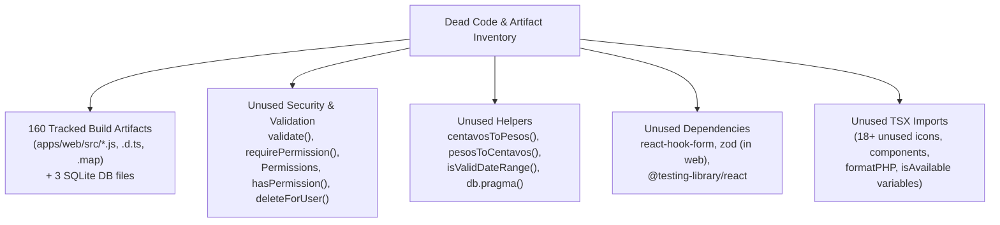

# Unused Code Analysis (`UNUSED_CODE_ANALYSIS.md`)

> **Epistemic Classification Legend**
>
> - `[Verified from source code]` — Directly observed in repository files, schemas, configurations, or tool outputs.
> - `[Inferred from architecture]` — Logically deduced from codebase structure, middleware order, or runtime behavior.
> - `[Assumption requiring validation]` — Organizational, municipal policy, or operational assumption not codified in source code.

---

## Table of Contents

- [1. Executive Summary](#1-executive-summary)
- [2. Purpose](#2-purpose)
- [3. Scope](#3-scope)
- [4. Key Components](#4-key-components)
- [5. Architecture Diagrams](#5-architecture-diagrams)
  - [5.1 Categories of Dead Code & Unused Artifacts](#51-categories-of-dead-code--unused-artifacts)
- [6. Technical Details & Detailed Analysis](#6-technical-details--detailed-analysis)
  - [6.1 Tracked Build & Runtime Artifacts (`160` Frontend Files + `3` SQLite DB Files)](#61-tracked-build--runtime-artifacts-160-frontend-files--3-sqlite-db-files)
  - [6.2 Unused Backend Middleware, Repository & Shared Functions](#62-unused-backend-middleware-repository--shared-functions)
  - [6.3 Unused NPM Dependencies](#63-unused-npm-dependencies)
  - [6.4 Unused Imports & Dead Variables in Frontend Components](#64-unused-imports--dead-variables-in-frontend-components)
  - [6.5 Unused Schema Fields & Status Values](#65-unused-schema-fields--status-values)
- [7. Findings](#7-findings)
- [8. Risks](#8-risks)
- [9. Recommendations](#9-recommendations)
- [10. Future Enhancements](#10-future-enhancements)
- [11. References to Source Files & Cross-References](#11-references-to-source-files--cross-references)

---

## 1. Executive Summary

Static inspection across `packages/shared`, `apps/api`, and `apps/web` revealed significant dead code, unused abstractions, unreferenced imports, and committed build artifacts (`[Verified from source code]`):

- **160 compiled `.js`, `.js.map`, `.d.ts`, and `.d.ts.map` files** tracked inside `apps/web/src/` alongside their 40 `.ts`/`.tsx` source files (`[Verified from source code]`).
- **3 runtime SQLite files** (`apps/api/data/app.db`, `app.db-shm`, `app.db-wal`) tracked in Git (`[Verified from source code]`).
- **8 unused backend/shared modules or exported functions** (`validate` middleware, `requirePermission`, `Permissions`, `hasPermission`, `centavosToPesos`, `pesosToCentavos`, `isValidDateRange`, `SessionRepository.deleteForUser`, `db.pragma`) (`[Verified from source code]`).
- **4 unused or underutilized NPM packages** (`react-hook-form`, `@testing-library/react`, `zod` in `apps/web`, `@tanstack/react-query` query/mutation hooks) (`[Verified from source code]`).
- **18+ unused icon/component/utility imports** across 9 frontend `.tsx` files (`[Verified from source code]`).

---

## 2. Purpose

Identifies dead code, orphaned modules, unused packages, and tracked build artifacts to streamline the codebase, enforce strict ESLint cleanliness, and reduce maintenance surface area.

---

## 3. Scope

Covers all `.ts`, `.tsx`, `package.json`, and tracked files across `c:/Users/USER/Documents/GitHub/MCTED` (`[Verified from source code]`).

---

## 4. Key Components

- Tracked artifact clutter (`apps/web/src/**/*`, `apps/api/data/*`).
- Dead security & validation helpers (`middleware/validate.ts`, `middleware/auth.ts`, `packages/shared/src/permissions.ts`).
- Unused UI imports and unconsumed NPM packages.

---

## 5. Architecture Diagrams

### 5.1 Categories of Dead Code & Unused Artifacts

---

## 6. Technical Details & Detailed Analysis

### 6.1 Tracked Build & Runtime Artifacts (`160` Frontend Files + `3` SQLite DB Files)

1. **`apps/web/src/` (`160` generated files)**: Every one of the `40` `.ts`/`.tsx` files under `apps/web/src/` has 4 compiled sibling files committed to Git (`.js`, `.js.map`, `.d.ts`, `.d.ts.map`), verified in `git ls-files` lines 94–293 (`[Verified from source code]`).
2. **`apps/api/data/` (`3` files)**: `app.db`, `app.db-shm`, `app.db-wal` (`git ls-files` lines 19–21) (`[Verified from source code]`).

### 6.2 Unused Backend Middleware, Repository & Shared Functions

| Symbol                                               | File & Lines                                            | Status                                                                                         |
| ---------------------------------------------------- | ------------------------------------------------------- | ---------------------------------------------------------------------------------------------- |
| `validate()`                                         | `apps/api/src/middleware/validate.ts:4–14`              | **0 callers**; controllers call `Schema.parse()` directly `[Verified from source code]`        |
| `requirePermission()`                                | `apps/api/src/middleware/auth.ts:103–115`               | **0 callers**; routes use `requireAuth` / `requireRole` `[Verified from source code]`          |
| `Permissions`, `PermissionAction`, `hasPermission()` | `packages/shared/src/permissions.ts:3–43`               | **0 callers** outside `auth.ts`'s unused `requirePermission` `[Verified from source code]`     |
| `SessionRepository.deleteForUser()`                  | `apps/api/src/modules/auth/session.repository.ts:45–47` | **0 callers**; never invoked on user suspension `[Verified from source code]`                  |
| `db.pragma()`                                        | `apps/api/src/db/client.ts:71–73`                       | **0 callers**; pragmas run on `rawDb.exec()` directly `[Verified from source code]`            |
| `centavosToPesos()`, `pesosToCentavos()`             | `packages/shared/src/money.ts:7–13`                     | **0 callers**; UI does inline `/ 100` & `Math.round(x * 100)` `[Verified from source code]`    |
| `isValidDateRange()`                                 | `packages/shared/src/dates.ts:32–36`                    | **0 callers**; `CreateReservationSchema` uses inline `.refine()` `[Verified from source code]` |
| `CreateNotificationSchema`, `CreateAuditLogSchema`   | `schemas/notification.ts:17`, `schemas/audit.ts:17`     | Types imported, Zod `.parse()` never invoked `[Verified from source code]`                     |

### 6.3 Unused NPM Dependencies

| Package                              | Workspace                  | Reason Marked Unused                                                                                                          |
| ------------------------------------ | -------------------------- | ----------------------------------------------------------------------------------------------------------------------------- |
| `react-hook-form` (`^7.54.2`)        | `apps/web/package.json:20` | Zero imports across all 40 `.ts`/`.tsx` files (`[Verified from source code]`).                                                |
| `zod` (`^3.23.8`)                    | `apps/web/package.json:23` | Zero direct imports in `apps/web/src/` (`[Verified from source code]`).                                                       |
| `@testing-library/react` (`^16.2.0`) | `apps/web/package.json:26` | Zero frontend test files exist (`[Verified from source code]`).                                                               |
| `@tanstack/react-query` (`^5.66.0`)  | `apps/web/package.json:15` | `QueryClient` / `QueryClientProvider` mounted in `App.tsx`, 0 `useQuery`/`useMutation` calls (`[Verified from source code]`). |

### 6.4 Unused Imports & Dead Variables in Frontend Components

Verified by reading every `.tsx` file (`[Verified from source code]`):

| File                                      | Unused Imports / Dead Variables                                                                                                       |
| ----------------------------------------- | ------------------------------------------------------------------------------------------------------------------------------------- |
| `CatalogPage.tsx` (`lines 7, 10, 115`)    | Unused imports: `Input`, `Wrench`, `Filter`; dead local variable `const isAvailable = ...` (computed inside `.map()` and never read!) |
| `ToolDetailPage.tsx` (`line 10`)          | Unused icons: `Check`, `Shield`                                                                                                       |
| `MyReservationsPage.tsx` (`lines 10, 11`) | Unused import: `AlertCircle`, `formatPHP`                                                                                             |
| `MyRentalsPage.tsx` (`lines 5, 8`)        | Unused imports: `Button`, `CheckCircle`                                                                                               |
| `RentalDeskPage.tsx` (`lines 6, 10, 11`)  | Unused imports: `Select`, `ShoppingBag`, `formatPHP`                                                                                  |
| `ReturnInspectionModal.tsx` (`line 8`)    | Unused import: `formatPHP`                                                                                                            |
| `InventoryPage.tsx` (`lines 3, 6`)        | Unused imports: `Card`, `CardContent`, `Select`                                                                                       |
| `MaintenancePage.tsx` (`lines 12`)        | Unused icons: `Wrench`, `CheckCircle`                                                                                                 |
| `ProfilePage.tsx` (`line 9`)              | Unused icons: `User`, `Shield`, `MapPin`, `Phone`                                                                                     |
| `UsersPage.tsx` (`lines 3, 11`)           | Unused imports: `Card`, `CardContent`, `Users`, `Shield`, `UserX`, `UserCheck`                                                        |
| `AuditLogPage.tsx` (`lines 3, 4, 7, 10`)  | Unused imports: `Card`, `CardContent`, `Badge`, `Input`, `Filter`                                                                     |
| `AppShell.tsx` (`line 30`)                | Unused interface field `badge?: number` on `NavItem`                                                                                  |

_(Why ESLint didn't flag these during CI: root `"lint": "pnpm -r lint"` skips packages lacking a `"lint"` script! `[Verified from source code]`)_

### 6.5 Unused Schema Fields & Status Values

- `RentalStatus` values `'Pending'`, `'Reserved'`, and `'Completed'` (`enums.ts:38–44`) are never written by `RentalsRepository` (only `'Borrowed'` and `'Returned'`) (`[Verified from source code]`).
- `ToolAvailabilityStatus` value `'Returned'` (`enums.ts:13`) is never written by `ToolsRepository` or `RentalsService` (`[Verified from source code]`).
- `tools.update` / `UpdateToolSchema.available_quantity` (`schemas/tool.ts:41`) is never sent by `ToolFormModal.tsx` (`[Verified from source code]`).
- `payments.proof_url`, `reservation_id`, `rental_id`, `tool_id` are never sent by `MyPaymentsPage.tsx` (`[Verified from source code]`).

---

## 7. Findings

_(See detailed findings in Sections 6.1–6.5 `[Verified from source code]`.)_

---

## 8. Risks

| ID          | Risk                                                                | Severity   | Details                                                                                                                  |
| ----------- | ------------------------------------------------------------------- | ---------- | ------------------------------------------------------------------------------------------------------------------------ |
| **DEAD-01** | Tracked JS artifacts in `apps/web/src/`                             | **Medium** | Can mask TypeScript edits if build/bundler resolves `.js` over `.tsx` (`[Inferred from architecture]`).                  |
| **DEAD-02** | Unused security primitives (`requirePermission`, `deleteForUser`)   | **Medium** | Creates false assurance during code reviews (`[Verified from source code]`).                                             |
| **DEAD-03** | Unused imports prove ESLint is not executing in CI (`pnpm -r lint`) | **Medium** | `no-unused-vars: 'error'` would fail immediately on all 12 files if ESLint actually ran (`[Verified from source code]`). |

---

## 9. Recommendations

1. **Delete `160` Compiled Artifacts** in `apps/web/src/` and `3` DB files in `apps/api/data/` from Git.
2. **Wire Up Useful Dead Code**: Connect `requirePermission()` to routes, `SessionRepository.deleteForUser()` to user suspension, `pesosToCentavos`/`centavosToPesos` to UI modals, and `isValidDateRange()` to reservation validation.
3. **Run `eslint . --fix`** after changing root `"lint": "eslint ."` to purge all unused imports across `apps/web/src/`.
4. **Prune or Adopt Unused NPM Packages**: Remove `react-hook-form` and `zod` from `apps/web/package.json` unless migrating forms to `react-hook-form`.

---

## 10. Future Enhancements

1. Add `ts-prune` or `knip` dead-code detection to CI to prevent future accumulation of unused exports and dependencies.

---

## 11. References to Source Files & Cross-References

| File                                                                                               | Scope                                                      |
| -------------------------------------------------------------------------------------------------- | ---------------------------------------------------------- |
| `apps/web/src/**/*`                                                                                | Tracked `.js`/`.d.ts` artifacts & unused component imports |
| `apps/api/src/middleware/{auth,validate}.ts`, `modules/auth/session.repository.ts`, `db/client.ts` | Unused backend exports                                     |
| `packages/shared/src/{permissions,money,dates}.ts`                                                 | Unused shared helpers                                      |
| `apps/web/package.json`                                                                            | Unused dependencies                                        |

**Cross-References**: See [SYSTEM_INVENTORY.md](./SYSTEM_INVENTORY.md), [TECH_STACK_AUDIT.md](./TECH_STACK_AUDIT.md), and [TECHNICAL_DEBT_REPORT.md](./TECHNICAL_DEBT_REPORT.md).
